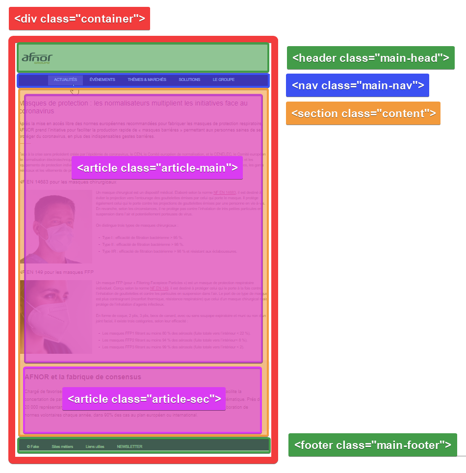
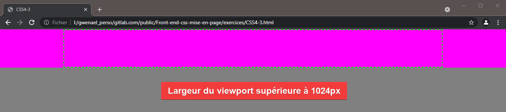
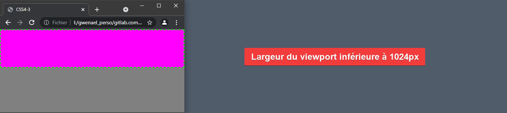

(_Cours CSS : [retour sommaire](readme.md#32-cours-avec-exercices)_)
# Cours CSS 2 : Balises Structurantes

> * Auteur : Gwénaël LAURENT
> * Date : 15/09/2021
> * OS : Windows 10 (version 20H2)
> * VScode : version 1.60.0 (system setup)
> * Chrome : version 93.0

- [Cours CSS 2 : Balises Structurantes](#cours-css-2--balises-structurantes)
- [1. Balises blocs structurantes](#1-balises-blocs-structurantes)
  - [L'élément HTML ``<header>``](#lélément-html-header)
  - [L'élément HTML ```<footer>```](#lélément-html-footer)
  - [L'élément HTML ```<nav>```](#lélément-html-nav)
  - [L'élément HTML ```<article>```](#lélément-html-article)
  - [L'élément HTML ```<section>```](#lélément-html-section)
  - [L'élément HTML ```<aside>```](#lélément-html-aside)
- [2. Balises génériques](#2-balises-génériques)
  - [L'élément HTML ```<div>```](#lélément-html-div)
  - [L'élément HTML ```<span>```](#lélément-html-span)
- [Exo CSS2-1](#exo-css2-1)
- [Exo CSS2-2](#exo-css2-2)

# 1. Balises blocs structurantes
Depuis la version 5 de HTML, de nouvelles balises permettent de structurer la page web, d'**```organiser le contenenu d'une page```** en donnant du sens aux différentes parties de la page. 

Certaines de ces balises sont des boîtes de bloc et **```peuvent servir naturellement à la mise en page CSS```**, comme l'illustre cet exemple de structuration du contenu :



## L'élément HTML ``<header>`` 
représente un groupe de contenu introductif ou de contenu aidant à la navigation. Il peut contenir des éléments de titre, mais aussi d'autres éléments tels qu'un logo, un formulaire de recherche, etc.

```html
<header>
    <h1>Cute Puppies Express!</h1>
</header>
```

## L'élément HTML ```<footer>``` 
représente le pied de page. Il contient habituellement des informations sur l'auteur, les données relatives au droit d'auteur (copyright) ou les liens vers d'autres documents en relation.

```html
<footer>
    <p>© 2018 Gandalf</p>
</footer>
```

## L'élément HTML ```<nav>``` 
représente une section d'une page ayant des liens vers d'autres pages ou des fragments de cette page. Autrement dit, c'est une section destinée à la navigation dans un document (avec des menus, des tables des matières, des index, etc.).

```html
<nav class="crumbs">
    <ul>
        <li class="crumb"><a href="#">Bikes</a></li>
        <li class="crumb"><a href="#">BMX</a></li>
        <li class="crumb">Jump Bike 3000</li>
    </ul>
</nav>
```

## L'élément HTML ```<article>``` 
représente du contenu autonome dans un document. Ceci peut être un message sur un forum, un article de journal ou de magazine, une parution sur un blog, un commentaire d'utilisateur, un widget ou gadget interactif, ou tout autre élément de contenu indépendant. Ce contenu est prévu pour être distribué ou réutilisé indépendamment (par exemple dans un flux de syndication)

```html
<article>
    <h1>Titre de l'article</h1>
    <p>Contenu de l'article</p>
</article>
```

## L'élément HTML ```<section>``` 
représente une section générique d'un document, par exemple un groupe de contenu thématique. Une section commence généralement avec un titre.

> L'élément ```<section>``` ne doit pas être utilisé lorsque le sectionnement du contenu sert uniquement la mise en forme, c'est le rôle de la balise générique ```<div>```. Pour savoir quelle balise utiliser, on peut se demander si la section doit apparaître sur le plan du document : si oui, on utilisera ```<section>```, sinon, ```<div>```

```html
<section>
    <h1>Articles</h1>
    <article>
        <h2>Article 1</h2>
        <p>Texte de l'article</p>
    </article>
</section>
```

## L'élément HTML ```<aside>``` 
(en anglais, "aparté") représente une partie d'un document dont le contenu n'a qu'un rapport indirect avec le contenu principal du document. Les apartés sont fréquemment présents sous la forme d'encadrés ou de boîtes de légende. Par exemple, on pourra s'en servir pour proposer la définition d'un terme, une biographie de l'auteur de l'article, un glossaire, préciser des sources, une liste d'articles en relation...

```html
<aside>
    <h4>Sources de l'article</h4>
    <ul>
        <li><a href="#">Lien 1</a></li>
        <li><a href="#">Lien 2</a></li>
        <li><a href="#">Lien 3</a></li>
    </ul>
</aside> 
```

> Documentation : [Structures et sections d'un document HTML5](https://developer.mozilla.org/fr/docs/Web/Guide/HTML/Using_HTML_sections_and_outlines)

# 2. Balises génériques
Les balises ```<div>``` et ```<span>``` sont des conteneurs "génériques", c'est à dire qu'elles ne donnent pas de sens particulier au contenu de la page web.

## L'élément HTML ```<div>```
est un **```conteneur générique de bloc```** (*block*) qui permet d'organiser le contenu sans représenter rien de particulier.  Il peut être utilisé afin de grouper d'autres éléments pour leur appliquer un style (en utilisant les attributs class ou id).

> L'élément ```<div>``` doit uniquement être utilisé lorsqu'il n'existe aucun autre élément dont la sémantique permet de représenter le contenu (par exemple ```<article>``` ou ```<nav>```).

Exemple :
```html
<div class="warning">
    <p>Beware of the leopard</p>
</div>
```

## L'élément HTML ```<span>```
est un **```conteneur générique en ligne```** (*inline*) pour les contenus phrasés. Il ne représente rien de particulier. Il peut être utilisé pour grouper des éléments afin de les mettre en forme (grâce aux attributs class ou id et aux règles CSS).

> L'élément ```<span>```  doit uniquement être utilisé lorsqu'aucun autre élément sémantique n'est approprié (par exemple ```<em>``` ou ```<strong>```)

Exemple :
```html
<p>Add the <span class="ingredient">basil</span>, <span class="ingredient">pine nuts</span> 
and <span class="ingredient">garlic</span> to a blender and blend into a paste.</p>
```

# Exo CSS2-1
Vous trouverez le code HTML de départ dans [exercices/CSS2-1.html](exercices/CSS2-1.html)

Votre objectif est d'organiser le code HTML de cette page pour donner du sens aux différentes zones affichées.
Pour cela, vous devrez ajouter les balises structurantes suivantes :
* une balise ```header```
* une balise ```footer```
* une balise ```nav```
* une balise ```section```
* deux balises ```article```

# Exo CSS2-2
L'objectif est de réaliser la mise en page flexible de l'en-tête d'un site :
* La couleur de fond de l'en-tête (ici de couleur rose) s'étire sur toute la largeur du viewport.
* L'élément ```<header>``` (ici avec une bordure pointillée verte) à une largeur maximale de 1024px et est centrée dans le viewport.





Pour réaliser ce type de mise en page très courant, il faut "envelopper" l'élément ```<header>``` avec une balise ```<div class="header-wrapper">```. Cette balise permet de fixer la couleur de fond de l'en-tête.

Vous trouverez le code HTML/CSS de départ dans [exercices/CSS2-2.html](exercices/CSS2-2.html)

Modifiez le code CSS pour obtenir la mise en page désirée.
