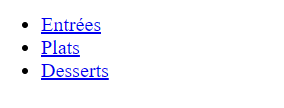
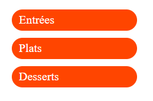
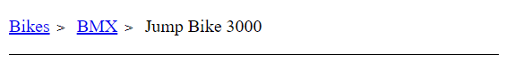
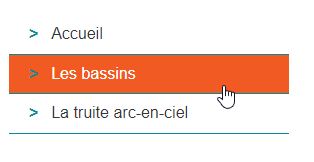
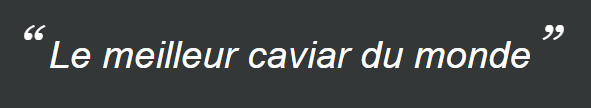

(_Cours CSS : [retour sommaire](readme.md#32-cours-avec-exercices)_)
# Cours CSS 4 : Modification du flux normal avec ```display```

> * Auteur : Gwénaël LAURENT
> * Date : 15/09/2021
> * OS : Windows 10 (version 20H2)
> * VScode : version 1.60.0 (system setup)
> * Chrome : version 93.0

- [Cours CSS 4 : Modification du flux normal avec ```display```](#cours-css-4--modification-du-flux-normal-avec-display)
- [1. Modification du type de placement dans le flux d'affichage](#1-modification-du-type-de-placement-dans-le-flux-daffichage)
  - [1.1 Propriété display](#11-propriété-display)
  - [1.2 Exemple - Convertir un lien en élément de bloc](#12-exemple---convertir-un-lien-en-élément-de-bloc)
  - [1.3 Exemple - Convertir un list item en élément inline-bloc](#13-exemple---convertir-un-list-item-en-élément-inline-bloc)
- [Exo CSS4-1](#exo-css4-1)
- [Exo CSS4-2](#exo-css4-2)

# 1. Modification du type de placement dans le flux d'affichage
## 1.1 Propriété display
Chaque balise HTML possède son propre type de placement dans le flux d'affichage : **```élément en ligne```** ou **```éléments de bloc```**.

La propriété CSS **```display```** permet de modifier l'affichage par défaut des éléments. Chaque chose dans le cours normal a une valeur de propriété display. Les éléments se règlent sur cette valeur pour définir leur comportement par défaut. .

> Ici, nous n'utiliserons que les valeurs de display qui modifient le **```positionnement extérieur```** des balises dans le flux (*outer display*) .

Les valeurs standards de la propriété ```display``` sont :
* **```display: inline;```** : éléments en ligne, affichés dans le sens dans lequel les mots sont écrits. Ex : ```<a>```, ```<em>```, ```<span>```, ...
* **```display: block;```** : éléments de bloc, affichés les uns après les autres. Ex : ```<p>```, ```<div>```, ```<section>```, ...
* **```display: inline-block;```** : éléments positionnés les uns à côté des autres (comme les inlines) mais qui peuvent être redimensionnés (comme les blocs). Ex : ```<select>```, ```<input>```
* **```display: none;```** : Eléments non affichés. Ex : ```<head>```

## 1.2 Exemple - Convertir un lien en élément de bloc
Les liens HTML ```<a>``` sont par défaut des éléments en ligne. On ne peut donc pas modifier leurs paramètres ```width``` et ```height```, les marges verticales ne déplacent pas les éléments alentours.

Grâce à la propriété display, on peut modifier leur boîte CSS pour que les liens ```<a>``` se comporte comme des boîtes en bloc ```display: block;```. On peut alors fixer leur apparence.

Exemple pour les liens d'un menu de navigation :
```html
<nav class="menu2">
    <ul>
        <li><a href="#">Entrées</a></li>
        <li><a href="#">Plats</a></li>
        <li><a href="#">Desserts</a></li>
    </ul>
</nav>
```
Affichage dans le flux standard :



Modification des liens en boîtes de bloc :
```css
.menu2 ul {
    list-style-type: none;
}

.menu2 ul li a {
    display: block;
    width: 150px;
    text-decoration: none;
    background-color: orangered;
    border-radius: 20px;
    margin: 10px;
    padding: 5px 10px 5px 10px;
    color: white;
}
```
Affichage grâce au comportement bloc :



> Le fait que vous puissiez changer la valeur d'affichage de n'importe quel élément signifie que vous pouvez choisir des éléments HTML pour leur signification sémantique, sans vous soucier de leur apparence. Leur apparence est quelque chose que vous pouvez modifier

## 1.3 Exemple - Convertir un list item en élément inline-bloc
Autre exemple de menu mais avec les éléments de liste ```<li>``` verticaux. pour créer une navigation de type "fil d'Ariane".

> La navigation avec un fil d'Ariane (breadcrumb) permet à un utilisateur de comprendre l'emplacement auquel il se trouve au sein du site web en fournissant un fil d'Ariane qui permette de revenir à la page de départ.

Par défaut, le placement des balises ```<li>``` est en ```display: list-item;```, ce qui ressemble beaucoup à une boîte en bloc. Pour disposer les éléments de liste sur la même ligne il faut utiliser ```display: inline-block;```



```html
<nav class="ariane">
    <ul>
        <li><a href="#">Bikes</a></li>
        <li><a href="#">BMX</a></li>
        <li>Jump Bike 3000</li>
    </ul>
</nav>
```
```css
nav {
    border-bottom: 1px solid black;
}

.ariane ul {
    list-style-type: none;
    padding-left: 0
}

.ariane li {
    display: inline-block;
}

.ariane li a::after {
    display: inline-block;
    color: black;
    content: '>';
    font-size: 80%;
    font-weight: bold;
    padding: 0 0.5em;
}
```

# Exo CSS4-1
Vous devez réalisez la mise en forme du menu de navigation suivant :



Vous trouverez le code HTML/CSS de départ dans [exercices/CSS4-1.html](exercices/CSS4-1.html)

Caractéristiques du menu :
* Couleur du texte : rgb(51, 55, 56)
* Couleur du texte au survol d'un item : white
* hauteur d'un item du menu : 40px
* bordure de 1px sous les items du menu - couleur rgb(0, 140, 157)
* Couleur de fond au survol d'un item : rgb(241, 90, 34)
* Couleur du caractère ">" devant les items du menu : rgb(0, 140, 157)

**Remarque** : on doit pouvoir cliquez sur le lien dans toute la zone orange, même si le curseur ne se trouve pas sur le texte du lien !

# Exo CSS4-2
Un site web affiche une citation dans son en-tête avec le code suivant :
```html
<header class="main-head">
    <blockquote>Le meilleur caviar du monde</blockquote>
</header>
```
On veut ajouter en CSS des guillements "stylisés" autour de la citation pour obtenir ceci :



* Texte de la citation : white, 24px, italique
* Caractéristiques générales des guillemets : 
  * police de caractère : georgia, serif
  * taille : 36px
  * couleur : white
  * Décalage par rapport au texte de la citation : 7.2px
* Guillemets de début : caractère unicode "\201C"
* Guillemet de fin : caractère unicode "\201D"

Vous trouverez le code HTML/CSS de départ dans [exercices/CSS4-2.html](exercices/CSS4-2.html)

Modifiez le code CSS pour obtenir cet effet.


