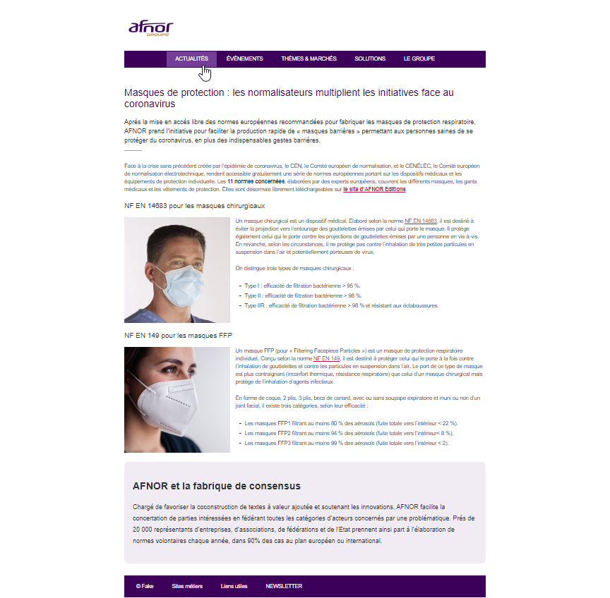
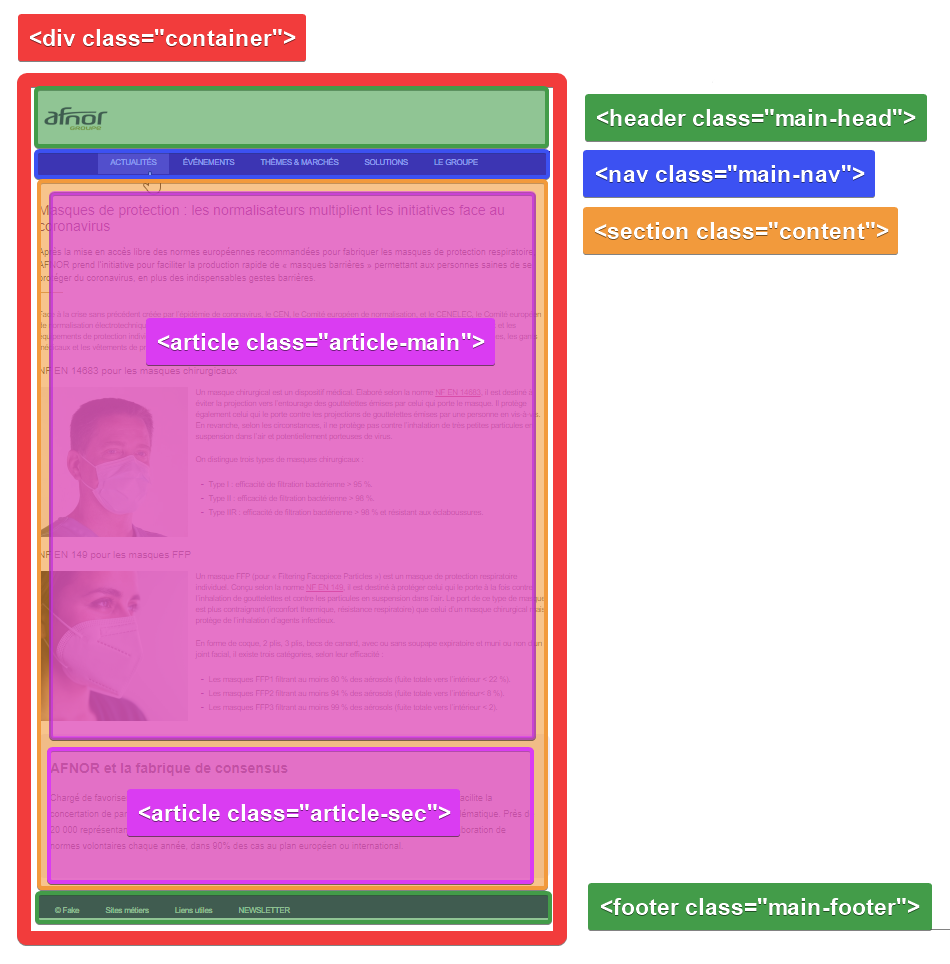
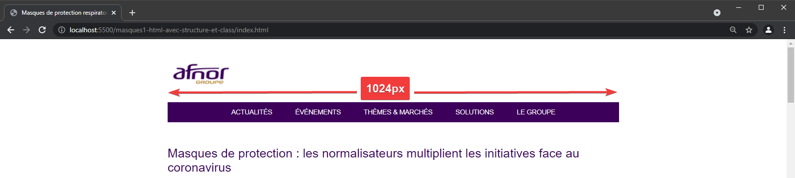
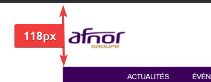
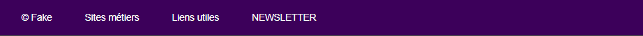
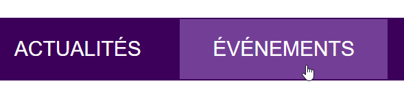
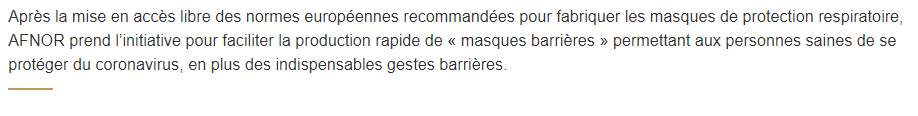
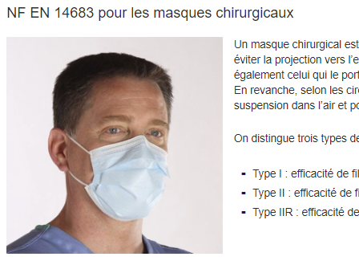
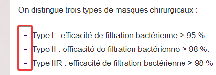
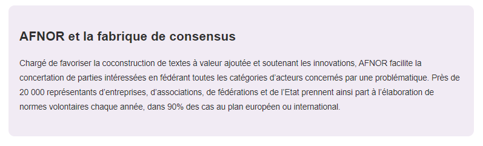

(_Cours CSS : [retour sommaire](../../readme.md#32-cours-avec-exercices)_)
# TP1 "Masques 1" : Mise en page avec les techniques standards de CSS

> * Auteur : Gwénaël LAURENT
> * Date : 02/10/2025


- [TP1 "Masques 1" : Mise en page avec les techniques standards de CSS](#tp1-masques-1--mise-en-page-avec-les-techniques-standards-de-css)
- [1. Résultat final "Masques de protection respiratoire" version 1](#1-résultat-final-masques-de-protection-respiratoire-version-1)
- [2. Contraintes à respecter](#2-contraintes-à-respecter)
- [3. Charte graphique "Masques de protection respiratoire"](#3-charte-graphique-masques-de-protection-respiratoire)
  - [3.1 Paramétrage global (sélecteur html, body)](#31-paramétrage-global-sélecteur-html-body)
  - [3.2 Définitions des couleurs](#32-définitions-des-couleurs)
  - [3.3 Largeur de la zone d'affichage](#33-largeur-de-la-zone-daffichage)
  - [3.4 L'en-tête avec le logo](#34-len-tête-avec-le-logo)
  - [3.5 Le pied de page](#35-le-pied-de-page)
  - [3.6 Menu de navigation](#36-menu-de-navigation)
  - [3.7 Titre principal](#37-titre-principal)
  - [3.8 Titres secondaires](#38-titres-secondaires)
  - [3.9 Paragraphe d'introduction](#39-paragraphe-dintroduction)
  - [3.10 Paragraphes de l'article principal](#310-paragraphes-de-larticle-principal)
  - [3.11 Images flottantes dans l'article principal](#311-images-flottantes-dans-larticle-principal)
  - [3.12 Listes à puces dans l'article principal](#312-listes-à-puces-dans-larticle-principal)
  - [3.13 Article secondaire](#313-article-secondaire)
  - [3.14 Titre de l'article secondaire](#314-titre-de-larticle-secondaire)
  - [3.15 Paragraphe de l'article secondaire](#315-paragraphe-de-larticle-secondaire)


# 1. Résultat final "Masques de protection respiratoire" version 1
Vous allez réalisez la mise en page du site "Masques de protection respiratoire"
* Le HTML et les images sont donnés (**Interdiction de modifier le HTML!**)
* à vous de faire le CSS

La page d'accueil souhaitée :



Les balises blocs structurantes utilisées pour la mise en page :

```html
<body>
    <div class="container">
        <header class="main-head">...</header>
        <nav class="main-nav">...</nav>
        <section class="content">
            <article class="article-main">...</article>
            <article class="article-sec">...</article>
        </section>
        <footer class="main-footer">...</footer>
    </div>
</body>
```

Ce qui correspond graphiquement aux zones ci-dessous :



# 2. Contraintes à respecter
La mise en page ne ciblera que les grands écrans (> 1024px).
> Le site ne doit pas être complètement responsive, mais doit avoir un minimum de flexibilité. 

Compatibilité des navigateurs :
* Chrome, Firefox, Edge

Organisation du CSS :
* Respecter les zones définies par les commentaires
* On essaye d'ordonner les règles CSS en suivant le flux d'affichage normal


Techniques à utiliser :
* Les techniques standards de CSS
* **```Interdiction d'utiliser Grid Layout ou Flexbox```** pour cet exercice ! L'objectif est de travailler les techniques standards de CSS.
* **```Utilisation des unités rem (root em)```** : La taille du texte est définie de façon globale à ```0.625rem``` pour la balise ```html``` (ce qui fait correspondre 1rem à 10px dans un navigateur standard). Toutes les autres dimensions doivent utiliser l'unité ```rem``` (par exemple, la taille du texte des paragraphes est de 1.5rem, ce qui correspond à une taille standard de 15px)

Documentation sur l'intérêt de l'unité rem : [grafikart.fr/tutoriels/font-size-rem-em-px-477](https://grafikart.fr/tutoriels/font-size-rem-em-px-477)


# 3. Charte graphique "Masques de protection respiratoire"

> Toutes les dimensions exprimées ici en pixels (px) doivent être converties en unité **```rem```** dans votre code CSS

## 3.1 Paramétrage global (sélecteur html, body)
* marge et remplissage : 0
* police de caractère : Helvetica, Arial, sans-serif
* taille du texte : 0.625rem;  /* 1rem = 10px */
* couleur standard du texte : rgb(47, 47, 47)
* couleur de fond : blanc

## 3.2 Définitions des couleurs
* **Blanc** : rgb(255, 255, 255) - fond
* **Noir** : rgb(47, 47, 47) - paragraphe
* **Violet foncé** : rgb(60, 0, 90) - menu, footer
* **Violet moyen** : rgb(115, 63, 150) - survol du menu
* **Violet clair** : rgb(241, 235, 244) - fond de l'article secondaire
* **Orange** : rgb(195, 150, 90) - liseret après l'intro
* **Rouge** : rgb(178, 24, 74) - liens dans les articles

## 3.3 Largeur de la zone d'affichage 
```<div class="container">```



* La largeur du contenu sera fixé à 1024px maximum, mais peut diminuer si le viewport (=zone d'affichage du navigateur) est plus petit.
* La zone d'affichage du contenu doit être centrée dans le viewport (bandes blanches de même largeur à gauche et à droite)

## 3.4 L'en-tête avec le logo
```<header class="main-head">```



* couleur de fond : blanc
* hauteur 118px, 
* padding gauche et droite de 5px
* padding haut et bas de 10px
* Le logo est placé à 47px du haut du header
* Les dimensions d'affichage du logo sont de 132px / 54px

**Aide** : En CSS, pour garder les proportions d'affichage d'une image de 100px de large par 46px de haut (utile pour l'accessibilité et pour uniformiser les dimensions des images)
```css
height: 46px;
aspect-ratio: auto 100 / 46;
```

## 3.5 Le pied de page
```<footer class="main-footer">```



* couleur de fond : violet foncé
* les liens ne changent pas de couleur au survol
* Les éléments de menu sont affichés en ligne
* padding gauche et droite de 5px
* padding haut et bas de 10px

Le texte des éléments de la liste :
* couleur du texte : blanc
* taille du texte : 15px
* épaisseur des caractères 500 : ```font-weight: 500;```
* espace entre les éléments de la liste : 24px


## 3.6 Menu de navigation
```<nav class="main-nav">```
* hauteur de 44px
* couleur de fond : violet foncé
* Les éléments de menu sont affichés en ligne
* Couleur d'un élément du menu au survol de la souris : violet moyen avec un liseret violet foncé de 1px en haut et en bas



Le texte des éléments du menu :
* couleur du texte : blanc
* taille du texte : 15px
* épaisseur des caractères : 400
* hauteur de la ligne de texte 44px : ```line-height: 4.4rem;```
* Le texte des éléments du menu est affiché en majuscule : ```text-transform: uppercase;```
* espace entre les éléments du menu : 24px

**Aide** : Quand vous aurez fini l'affichage du menu en ligne, vous pourrez centrer les éléments du menu dans la largeur totale du menu 
```css
ul {
  text-align: center;
}
```
## 3.7 Titre principal
```<article class="article-main">...<h1>```
* couleur du texte : violet foncé
* taille du texte : 28px
* épaisseur des caractères : 300
* marge haute : 40px
* marge basse : 23px


## 3.8 Titres secondaires
```<article class="article-main">...<h2>```
* couleur du texte : noir
* taille du texte : 20px
* épaisseur des caractères : 400
* marge basse : 22px

## 3.9 Paragraphe d'introduction
```<p id="intro">```



* couleur du texte : noir
* taille du texte : 18px
* épaisseur des caractères : 400
* hauteur de la ligne de texte : 27px
* marge basse : 24px

**Aide** : Le liseret orange qui suit le paragraphe d'introduction est entièrement créé en CSS à l'aide du pseudo-élément ```:after```
```css
#intro::after {
  background: rgb(195, 150, 90);
  content: "";
  display: block;
  height: 0.2rem;
  margin-bottom: 3.2rem;
  margin-top: 1.4rem;
  width: 5rem;
}
```

## 3.10 Paragraphes de l'article principal
```<article class="article-main">...<p>```
* couleur du texte : noir
* taille du texte : 15px
* épaisseur des caractères : 400
* hauteur de la ligne de texte : 22px
* marge basse : 24px


## 3.11 Images flottantes dans l'article principal
``````



* position du flottement : gauche
* marge haute et gauche : 0
* marge droite : 15px
* marge basse : 25px

**Remarque** : pensez à gérer le dégagement des boîtes flottantes sur les éléments qui le nécessite !


## 3.12 Listes à puces dans l'article principal
```<article class="article-main">...<ul>```



* couleur du texte : noir
* taille du texte : 15px
* épaisseur des caractères : 400
* hauteur de la ligne de texte : **26px**

**Remarque** : Les puces des listes ne sont pas des puces standards. Elles sont créées en CSS à l'aide du pseudo-élément ```:before```. Elles sont créés avec le caractère "-" et sont de couleur violet foncé.


## 3.13 Article secondaire
```<article class="article-sec">```



* couleur du texte : noir
* couleur de fond : violet clair
* bordure arrondie de rayon 13px
* padding : 24px
* marge basse : 34px

## 3.14 Titre de l'article secondaire
```<article class="article-sec">...<h3>```
* couleur du texte : noir
* taille du texte : 28px

## 3.15 Paragraphe de l'article secondaire
```<article class="article-sec">...<p>```
* couleur du texte : noir
* taille du texte : 18px
* épaisseur des caractères : 400
* hauteur de la ligne de texte : 32px
* marge basse : 24px
