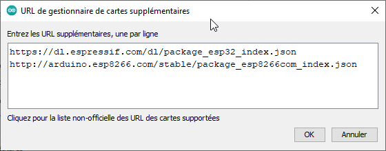
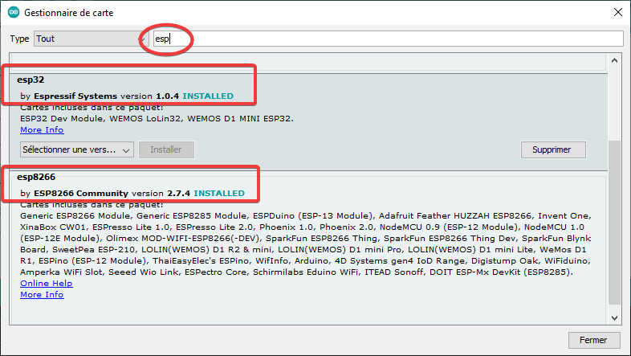
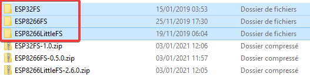
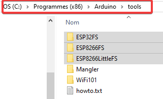
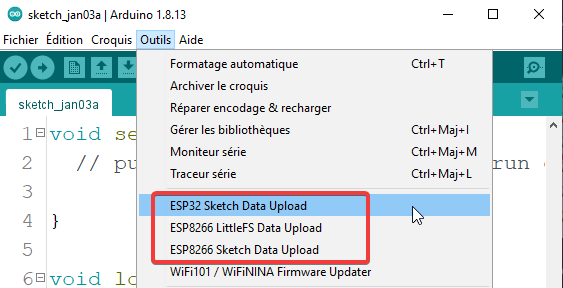
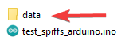

# Install et config de l'IDE arduino

> * Auteur : Gwénaël LAURENT - Daniel MUFFATO
> * Date : 03/01/2021
> * OS : Windows 10 (version 1903)
> * Arduino IDE 1.8.13

 [Licence Creative Commons](https://creativecommons.org/licenses/by-nc-sa/3.0/fr/)

- [Install et config de l'IDE arduino](#install-et-config-de-lide-arduino)
- [1. Objectif](#1-objectif)
- [2. Installer arduino IDE](#2-installer-arduino-ide)
- [3. Configurer arduino IDE pour les ESP](#3-configurer-arduino-ide-pour-les-esp)
- [4. Installer les SDK des cartes ESP](#4-installer-les-sdk-des-cartes-esp)
- [5. Sélection des cartes pour le développement](#5-sélection-des-cartes-pour-le-développement)
- [6. Installer une bibliothèque](#6-installer-une-bibliothèque)
- [7. Utiliser la SPIFFS des ESP](#7-utiliser-la-spiffs-des-esp)
  - [7.1 Documentation sur la SPIFFS et les utilitaires](#71-documentation-sur-la-spiffs-et-les-utilitaires)
  - [7.2 Téléchargement et installation des utilitaires](#72-téléchargement-et-installation-des-utilitaires)
  - [7.3 Utilisation des utilitaires SPIFFS](#73-utilisation-des-utilitaires-spiffs)

# 1. Objectif
Installer l'IDE arduino pour développer sur :
* arduino nano
* ESP8266
* ESP32

# 2. Installer arduino IDE
Téléchargement sur le site officiel [www.arduino.cc/en/software](https://www.arduino.cc/en/software)
* Sélectionnez DOWNLOAD OPTIONS > Windows Win7 and newer

Double cliquez sur le fichier téléchargé ```arduino-1.8.13-windows.exe```
* installation par défaut
* emplacement ```C:\Program Files (x86)\Arduino\```

# 3. Configurer arduino IDE pour les ESP
Lancer Arduino IDE > Fichier > Préférences :
* Langue du système (Français )
* Cocher Afficher les numéros de ligne
* Cocher Activer le repli du code
* Cocher Sauvegarder pendant la vérification ou le transfert
* Décocher Vérifier le code après téléversement

Fichier > Préférences > URL de gestionnaire de cartes supplémentaires :
* Pour ESP8266, ajoutez l'URL : ```http://arduino.esp8266.com/stable/package_esp8266com_index.json```
* Pour ESP32, ajoutez l'URL : ```https://dl.espressif.com/dl/package_esp32_index.json```



# 4. Installer les SDK des cartes ESP
Outils > Type de Carte > Gestionnaire de carte :
* Dans la zone de recherche, filtrez avec "esp"
* Pour ESP8266, installez ```esp8266 by ESP8266 Community v2.7.4```
* Pour ESP32, installez ```esp32 by Espressif Systems v1.0.4```



# 5. Sélection des cartes pour le développement
Pour ESP8266 :
* Outils > Type de Carte > ESP8266 Boars (2.7.4) > ```NodeMCU 1.0 (ESP-12E Module)``` 

Pour ESP32 :
* Outils > Type de Carte > ESP32 Arduino > ```WEMOS LOLIN32```

# 6. Installer une bibliothèque
> Exemple pour une librairie qui permet d'utiliser le format JSON.

Pour installer la bibliothèque : Croquis > Inclure une bibliothèque > Gérer les bibliothèques :
* Dans la zone de recherche, filtrez avec "json"
* Sélectionner la librairie ```ArduinoJson by Benoit Blanchon v6.17.2```
* Cliquez sur Installer

# 7. Utiliser la SPIFFS des ESP
Pour travailler avec la SPIFFS, il faut :
* Installer un utilitaire permettant le formatage de la SPIFFS et le transfert de fichiers de l’EDI vers la SPIFFS
* Créer un dossier nommé ```data``` sous la racine du dossier de travail. Ce dossier contiendra tous les fichiers à transférer dans la SPIFFS à partir de l’EDI. Cette fonction de copie nécessite l’installation préalable d’un outil permettant ce transfert (pour le système de fichiers choisi)

## 7.1 Documentation sur la SPIFFS et les utilitaires
* [Doc sur la SPIFFS](https://arduino-esp8266.readthedocs.io/en/latest/filesystem.html)
* [ESP8266 FS](https://github.com/esp8266/arduino-esp8266fs-plugin)
* [ESP 8266 Little FS](https://github.com/earlephilhower/arduino-esp8266littlefs-plugin)
* [ESP 32 FS](https://github.com/me-no-dev/arduino-esp32fs-plugin)

## 7.2 Téléchargement et installation des utilitaires
Téléchargez dans le même dossier les 3 utilitaires pour les systèmes de fichiers :
* [ESP8266 FS : ESP8266FS-0.5.0.zip](https://github.com/esp8266/arduino-esp8266fs-plugin/releases/download/0.5.0/ESP8266FS-0.5.0.zip)
* [ESP 8266 Little FS : ESP8266LittleFS-2.6.0.zip](https://github.com/earlephilhower/arduino-esp8266littlefs-plugin/releases/download/2.6.0/ESP8266LittleFS-2.6.0.zip)
* [ESP 32 FS : ESP32FS-1.0.zip](https://github.com/me-no-dev/arduino-esp32fs-plugin/releases/download/1.0/ESP32FS-1.0.zip)

Dézippez dans le même dossier les 3 utilitaires téléchargés (clic droit > 7-Zip > Extraire ici):



Copiez les 3 dossiers dézippés dans ```C:\Program Files (x86)\Arduino\tools```



Redémarrez Arduino IDE. Ces outils sont maintenant disponibles dans le menu « Outils ».



## 7.3 Utilisation des utilitaires SPIFFS
Préparez les fichiers à enregistrer dans la SPIFFS :
* Créez un nouveau projet arduino IDE
* Enregistrez le projet (Fichier > Enregistrer sous)
* Ouvrez le dossier du projet dans l'explorateur de fichier
* Créez un sous dossier ```data```
*  
* Copiez dans le dossier data tous les fichiers que vous voulez incorporer dans la SPIFFS

Transférez les fichiers dans la SPIFFS :
> ATTENTION : Fermez le moniteur série (s'il est ouvert)
* Choisissez le type de carte. Par exemple : Outils > Type de Carte > ESP8266 Boars (2.7.4) > ```NodeMCU 1.0 (ESP-12E Module)```
* Connectez la carte sur un port USB de l'ordi
* Choisissez le bon port série virtuel : Outils > Port
* Sélectionnez l'outil correspondant à votre carte ESP. Par exemple : Outils > ESP8266 Sketch Data Upload