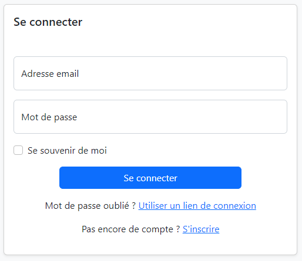
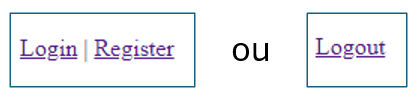

# Gestion de l'authentification avec Shield pour CodeIgniter 4

> * Auteur : Gwénaël LAURENT
> * Date : 28/02/2024
> * CodeIgniter : 4.4.6
> * PHP : 8.0.26
> * MySQL : 8.0.21

- [Gestion de l'authentification avec Shield pour CodeIgniter 4](#gestion-de-lauthentification-avec-shield-pour-codeigniter-4)
- [1. Présentation](#1-présentation)
- [2. Création d'une appli CI4 de test](#2-création-dune-appli-ci4-de-test)
  - [2.1 Installation du framework et de shield](#21-installation-du-framework-et-de-shield)
  - [2.2 création du virtualhost et de la BDD](#22-création-du-virtualhost-et-de-la-bdd)
  - [2.3 Config de CI4](#23-config-de-ci4)
  - [2.4 Config de shield](#24-config-de-shield)
- [3. Authentification avec les sessions](#3-authentification-avec-les-sessions)
  - [3.1 Configuration du système d'authentification](#31-configuration-du-système-dauthentification)
  - [3.2 Protéger toutes les pages du site](#32-protéger-toutes-les-pages-du-site)
  - [3.3 Pour rendre certaines pages accessibles uniquement aux utilisateurs connectés](#33-pour-rendre-certaines-pages-accessibles-uniquement-aux-utilisateurs-connectés)
  - [3.4 Protéger le système d'authentification des spams](#34-protéger-le-système-dauthentification-des-spams)
  - [3.5 Créer des liens vers les pages d'authentification](#35-créer-des-liens-vers-les-pages-dauthentification)
  - [3.6 Styliser les pages d'authentification](#36-styliser-les-pages-dauthentification)
  - [3.7 Gérer les utilisateurs en PHP](#37-gérer-les-utilisateurs-en-php)
  - [3.8 Niveaux d'accès](#38-niveaux-daccès)
  - [3.9 Savoir si un utilisateur est loggué](#39-savoir-si-un-utilisateur-est-loggué)
  - [3.10 Retrouver les informations de l'utilisateur loggué](#310-retrouver-les-informations-de-lutilisateur-loggué)
- [4. Authentification avec les AccessTokens](#4-authentification-avec-les-accesstokens)


# 1. Présentation
Shield est le framework officiel d'authentification et d'autorisation pour CodeIgniter 4. Bien qu'il fournisse un ensemble d'outils de base couramment utilisés dans les sites Web, il est conçu pour être flexible et facilement personnalisable.



> Shield Documentation : https://shield.codeigniter.com/\
> Dépôt : https://github.com/codeigniter4/shield

Usage of Shield requires the following:
- A CodeIgniter 4.3.5+ based project
- Composer for package management
- PHP 7.4.3+
- une BDD MysQL avec InnoDB

Shield fournit les systèmes d'authentification suivants :
* L'**authentificateur de session** fournit une authentification traditionnelle par identifiant/mot de passe. Il utilise le nom d'utilisateur/e-mail/mot de passe pour s'authentifier et stocke les informations utilisateur dans la session.
* L'**authentificateur AccessTokens** fournit une authentification sans état à l'aide de jetons d'accès personnels transmis dans les en-têtes HTTP.
* L'**authentificateur HmacSha256** fournit une authentification sans état à l'aide de clés HMAC
* L'**authentificateur JWT** fournit une authentification sans état à l'aide du jeton Web JSON. Pour l'utiliser, vous avez besoin d'une configuration supplémentaire


# 2. Création d'une appli CI4 de test
## 2.1 Installation du framework et de shield
```cmd
composer create-project codeigniter4/appstarter ci4-auth
cd ci4-auth
composer require codeigniter4/translations
composer require codeigniter4/shield
```
doc d'install shield : https://shield.codeigniter.com/getting_started/install/

## 2.2 création du virtualhost et de la BDD
http://ci4-auth.local/

Base de données :
ci4-auth-bdd (encodage utf8mb4_0900_ai_ci)

## 2.3 Config de CI4
/app/Config/App.php
```php
public string $baseURL = 'http://ci4-auth.local/';
public string $defaultLocale = 'fr-FR';
```

/app/Config/Routing.php
```
public bool $autoRoute = true;
```

/app/Config/ Feature.php
```php
public bool $autoRoutesImproved = false;
```

/.env
```php
CI_ENVIRONMENT = development
```

/app/Config/Database.php
```php
        'hostname'     => 'localhost',
        'username'     => 'xxxxxx',
        'password'     => 'xxxxxx',
        'database'     => 'ci4-auth-bdd',
```


## 2.4 Config de shield
Invite de commande sur la racine du framework :
```cmd
php spark shield:setup
```
réponse aux questions :
```
  The required Config\Email::$fromEmail is not set. Do you set now? [y, n]: y
  What is your email? : xxxx@gmail.com
  The required Config\Email::$fromName is not set. Do you set now? [y, n]: y
  What is your name? : Appli CI4
  Updated: APPPATH\Config\Email.php
  Run `spark migrate --all` now? [y, n]: y
```
L'installation de shield a :
* créé des fichiers dans /app/Config
    ```
    APPPATH\Config\Auth.php
    APPPATH\Config\AuthGroups.php
    APPPATH\Config\AuthToken.php
    ```
* créé des tables dans la BDD
    ```
    auth_groups_users
    auth_identities
    auth_logins
    auth_permissions_users
    auth_remember_tokens
    auth_token_logins
    migrations
    settings
    users
    ```
* défini des routes pour l'authentification dans /app/Config/Routes.php
  ```
  service('auth')->routes($routes);
  ```

> **Il faut finir la configuration des mails** dans APPPATH\Config\Email.php.\
> L'envoi de mail doit être fonctionnel pour activer les fonctionnalités d'inscription !\
> cf [Envoyer des mails avec CI4 et gmail](https://gitlab.com/gwenael.laurent/public/-/blob/master/ci4/email-ci4.md)

Modèle relationnel des tables créées dans la BDD :


# 3. Authentification avec les sessions
https://shield.codeigniter.com/quick_start_guide/using_session_auth/

https://shield.codeigniter.com/references/authentication/session/

## 3.1 Configuration du système d'authentification
https://shield.codeigniter.com/customization/validation_rules/

Dans /app/Config/Auth.php :
```php
public bool $allowRegistration = true;
public array $usernameValidationRules
public int $minimumPasswordLength = 8;
...
```


## 3.2 Protéger toutes les pages du site
https://shield.codeigniter.com/references/controller_filters/

Par défaut, Shield ne protège pas les pages. Il faut activer la protection dans /app/Config/Filters.php

Si tout le site nécessite une authentification, il faut modifier  /app/Config/Filters.php comme suit :
```php
public array $globals = [
    'before' => [
        // ...
        'session' => ['except' => ['login*', 'register', 'auth/a/*', 'logout']],
    ],
    // ...
];
```


## 3.3 Pour rendre certaines pages accessibles uniquement aux utilisateurs connectés
Certaines pages nécessitent une authentification. 
Il faut ajouter les URI des pages non protégées (en accès public)

Dans /app/Config/Filters.php :
```php
public array $globals = [
    'before' => [
        // ...
        'session' => ['except' => ['login*', 'register', 'auth/a/*', 'logout', '/', '/Caccueil*']],
    ],
    // ...
];
```

## 3.4 Protéger le système d'authentification des spams
Pour protéger vos formulaires d'authentification contre le spam par des robots.

```php
public array $filters = [
    'auth-rates' => [
        'before' => [
            'login*', 'register', 'auth/*'
        ]
    ]
];
```

## 3.5 Créer des liens vers les pages d'authentification
https://shield.codeigniter.com/customization/route_config/

Adresses des pages d'authentification :
* Login : adresse_du_site/login
* Logout : adresse_du_site/logout
* Création d'un compte : adresse_du_site/register

```php
<p>
    <a href="<?= base_url() . 'login' ?>">Login</a> | 
    <a href="<?= base_url() . 'logout' ?>">Logout</a> | 
    <a href="<?= base_url() . 'register' ?>">Register</a>
</p>
```


## 3.6 Styliser les pages d'authentification
https://shield.codeigniter.com/customization/views/

Modifiez les valeurs de $views dans le fichier ```app/Config/Auth.php``` .
```php
public array $views = [
    'login'                       => '\CodeIgniter\Shield\Views\login',
    'register'                    => '\CodeIgniter\Shield\Views\register',
    'layout'                      => '\CodeIgniter\Shield\Views\layout',
    'action_email_2fa'            => '\CodeIgniter\Shield\Views\email_2fa_show',
    'action_email_2fa_verify'     => '\CodeIgniter\Shield\Views\email_2fa_verify',
    'action_email_2fa_email'      => '\CodeIgniter\Shield\Views\Email\email_2fa_email',
    'action_email_activate_show'  => '\CodeIgniter\Shield\Views\email_activate_show',
    'action_email_activate_email' => '\CodeIgniter\Shield\Views\Email\email_activate_email',
    'magic-link-login'            => '\CodeIgniter\Shield\Views\magic_link_form',
    'magic-link-message'          => '\CodeIgniter\Shield\Views\magic_link_message',
    'magic-link-email'            => '\CodeIgniter\Shield\Views\Email\magic_link_email',
];
```

**Copiez** le fichier que vous souhaitez personnaliser de ```vendor/codeigniter4/shield/src/Views/```  dans le dossier ```app/Views/Shield/``` .

Personnalisez le contenu du fichier de vue dans ```app/Views/Shield/``` comme vous le souhaitez. **MAIS** gardez les informations de formulaire (attributs name et id), etc ...


## 3.7 Gérer les utilisateurs en PHP
https://shield.codeigniter.com/user_management/managing_users/

https://shield.codeigniter.com/references/authentication/session/


Logguer un utilisateur :
```php
$credentials = [
    'email'    => $this->request->getPost('email'),
    'password' => $this->request->getPost('password')
];

$loginAttempt = auth()->attempt($credentials);

if (! $loginAttempt->isOK()) {
    return redirect()->back()->with('error', $loginAttempt->reason());
}
```

Délogguer l'utilisateur :
```php
auth()->logout();
```

Créer un utilisateur et l'affecter à un groupe :
```php
use CodeIgniter\Shield\Entities\User;

// Get the User Provider (UserModel by default)
$users = auth()->getProvider();

$user = new User([
    'username' => 'foo-bar',
    'email'    => 'foo.bar@example.com',
    'password' => 'secret plain text password',
]);
$users->save($user);

// To get the complete user object with ID, we need to get from the database
$user = $users->findById($users->getInsertID());

// Add to default group
$users->addToDefaultGroup($user);
```

## 3.8 Niveaux d'accès
https://shield.codeigniter.com/quick_start_guide/using_authorization/

https://shield.codeigniter.com/references/authorization/

## 3.9 Savoir si un utilisateur est loggué
https://shield.codeigniter.com/references/authentication/session/

Il faut utiliser :
```php
auth()->loggedIn()
```

On peut, par exemple, s'en servir pour adapter l'affichage des liens vers les pages d'authentification :



```php
<p>
    <?php if (auth()->loggedIn()) { ?><a href="<?= base_url() . 'logout' ?>">Logout</a><?php } else { ?>
        <a href="<?= base_url() . 'login' ?>">Login</a> |
        <a href="<?= base_url() . 'register' ?>">Register</a>
    <?php } ?>
</p>
```

## 3.10 Retrouver les informations de l'utilisateur loggué
Pour avoir accès à l'utilisateur :
```php
$user = auth()->user();
```
> Si ```$user``` est différent de ```null```, l'utilisateur est loggué.


Appartenance à un groupe (le groupe par défaut est 'user'):
```php
$user = auth()->user();
if ($user->inGroup('user')) {
    // do something
}
```

Afficher les informations de l'utilisateur loggué :
```php
$user = auth()->user();
if ($user->inGroup('user', 'admin')) {
    $user_id = $user->id;
    $user_mail = $user->email;
    $user_username = $user->username;

    echo "id=".$user_id." | username=" . $user_username . " | mail=". $user_mail ;
}
```

Ces informations viennent de la BDD, tables ```users``` et ```auth_identities```.\
On peut se servir de l'```users.id``` de l'utilisateur pour créer des associations avec les autres tables du projet.


# 4. Authentification avec les AccessTokens
[Protéger une API avec des jetons d'accès](https://shield.codeigniter.com/guides/api_tokens/)

[Authentificateur de jeton d'accès](https://shield.codeigniter.com/references/authentication/tokens/)
