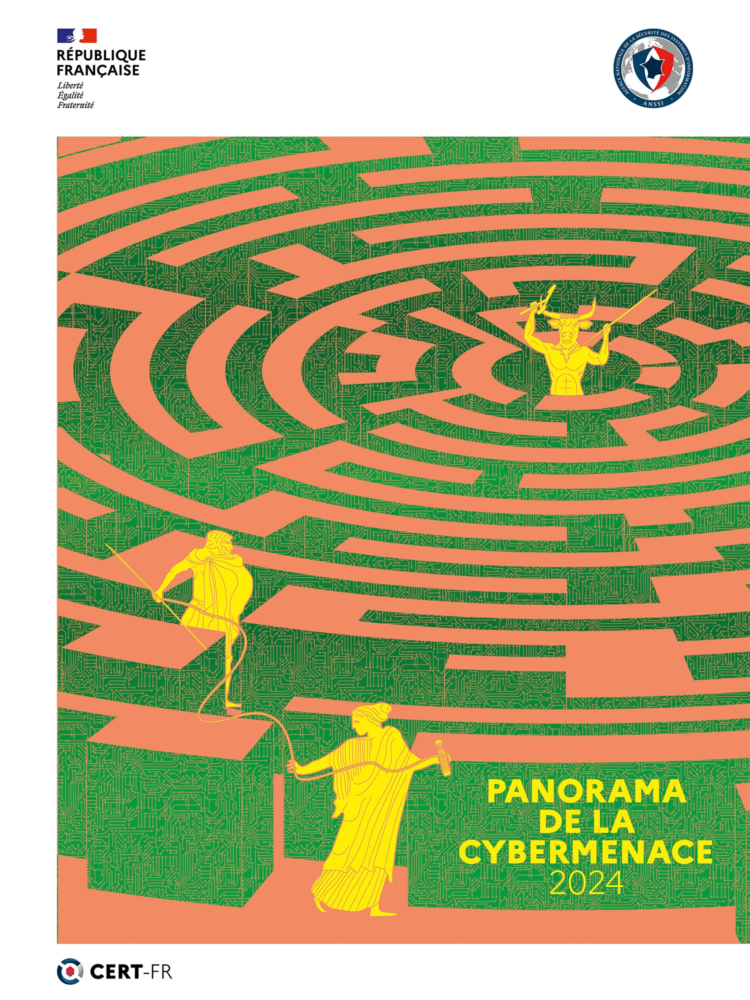

# Etat de la cybermenace

> * Auteur : Gwénaël LAURENT
> * Date : 11-03-2025

 [Licence Creative Commons](https://creativecommons.org/licenses/by-nc-sa/3.0/fr/)

# 1. Tendances 2024

Source complète : https://cyber.gouv.fr/tendances-les-cybermenaces

Quelles sont les principales motivations des attaquants ?
* L'appât du gain
* Le pré-positionnement stratégique
* L'espionnage
* La déstabilisation

Quelles sont les capacités et techniques des attaquants ?
* Les attaques sur la chaine d’approvisionnement (*supply chain attack*) 
* Attaque par rançongiciel (*ransomware*)
* Attaques par point d’eau (*watering hole*)
* Défiguration de sites internet (*defacement*)

Quels sont les profils des attaquants ?
* Etats et agences de renseignement
* Organisations criminelles
* Hacktivistes
* Entreprises spécialisées dans la vente de prestations et de services cyber-offensifs
* Amateurs
* Menace interne

# 2. Panorama de la cybermenace 2024

Document de l'ANSSI (*Agence nationale de la sécurité des systèmes d'information*) à télécharger sur https://cyber.gouv.fr/le-panorama-de-la-cybermenace

Ce document se concentre sur les intentions des attaquants, leurs capacités et les opportunités exploitées pour compromettre des systèmes d’information (SI), en fournissant des exemples concrets d’incidents traités par l’ANSSI durant l’année.

