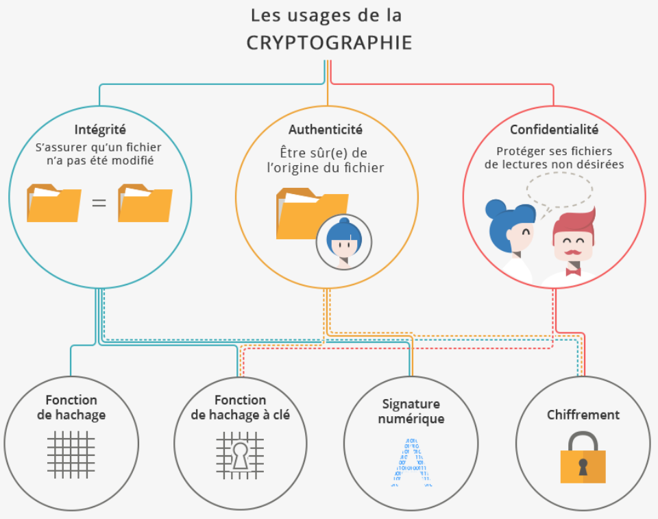

# Généralités sur la cryptographie

> * Auteur : Gwénaël LAURENT
> * Date : 04-01-2025

 [Licence Creative Commons](https://creativecommons.org/licenses/by-nc-sa/3.0/fr/)

- [Généralités sur la cryptographie](#généralités-sur-la-cryptographie)
- [1. Les usages de la cryptographie](#1-les-usages-de-la-cryptographie)
- [2. Chiffrement](#2-chiffrement)
  - [2.1. 1.1 Définition](#21-11-définition)
  - [2.2. 1.2 *Secret*, *clair* et *chiffré*](#22-12-secret-clair-et-chiffré)
  - [2.3. 1.3 Méthode de chiffrement](#23-13-méthode-de-chiffrement)
- [3. Algorithmes recommandés par ANSSI - CNIL (avril 2024)](#3-algorithmes-recommandés-par-anssi---cnil-avril-2024)
  - [3.1. pour les fonctions de hachage](#31-pour-les-fonctions-de-hachage)
  - [3.2. pour le chiffrement symétrique](#32-pour-le-chiffrement-symétrique)
  - [3.3. pour le chiffrement asymétrique](#33-pour-le-chiffrement-asymétrique)
  - [3.4. pour les signatures](#34-pour-les-signatures)

# 1. Les usages de la cryptographie

> [CNIL : Sécurité : Chiffrement, hachage, signature](https://www.cnil.fr/fr/securite-chiffrement-hachage-signature)\
> [CNIL : Comprendre les grands principes de la cryptologie et du chiffrement](https://www.cnil.fr/fr/comprendre-les-grands-principes-de-la-cryptologie-et-du-chiffrement)\
> [CNIL : [INFOGRAPHIE] LES USAGES DE LA CRYPTOGRAPHIE](https://www.cnil.fr/fr/infographie-les-usages-de-la-cryptographie)

Étymologiquement, la **cryptologie** est la science (λόγος) du secret (κρυπτός) . Elle réunit la **cryptographie** (« écriture secrète ») et la **cryptanalyse** (étude des attaques contre les mécanismes de cryptographie).

Aujourd'hui, la cryptologie s’est élargie au fait de prouver qui est l'auteur d'un message et s'il a été modifié ou non, grâce aux **signatures** numériques et aux **fonctions** de hachage.

> **Différences entre cryptage et chiffrement :**
> * **Chiffrer** un message consiste à l’encoder avec une clé
> * **Déchiffrer** un message consiste à le décoder avec une clé
> * **Décrypter** un message consiste à le décoder sans connaitre la clé (force brute ...)
> * "*Crypter*" un message reviendrait à l’encoder, mais sans avoir de clé et donc sans pouvoir le décoder ensuite (ça n'a pas de sens)

> Les fonctions de **hachage** permettent d’assurer l’***intégrité*** des données.

> Les **signatures** numériques, en plus d’assurer l’intégrité, permettent de vérifier l’***authenticité*** du signataire et d'assurer la non-répudiation.

> Le **chiffrement**, parfois improprement appelé cryptage, permet de garantir la ***confidentialité*** d’un message.

# 2. Chiffrement

## 2.1. 1.1 Définition
Le **chiffrement**, parfois improprement appelé cryptage, permet de garantir la **confidentialité** d’un message. Il est utilisé pour permettre à deux individus d'échanger des messages de manière confidentielle à travers un canal non sécurisé (ex : internet).

## 2.2. 1.2 *Secret*, *clair* et *chiffré*

* Pour chiffrer les échanges, les deux individus conviennent d'un
**secret**, permettant de transformer le message appelé **clair**, en
un message inintelligible appelé **chiffré** afin que l'attaquant
éventuel ne puisse pas en prendre connaissance.
* Cette transformation doit être **réversible** : si on connait le *secret* et le *chiffré*, alors on peut reconstituer le *clair*.

> **Secret** = mot(s), ou  nombre(s) appelés **clés**.

## 2.3. 1.3 Méthode de chiffrement

La méthode de chiffrement explique :
* comment à partir des clés et du clair, on produit le chiffré
* comment, à partir du chiffré et des clés, on produit le clair

> Un bon système de chiffrement ne doit et ne peut pas reposer
uniquement sur le caractère secret de la méthode employée 
([Principe de Kerckhoffs](https://fr.wikipedia.org/wiki/Principe_de_Kerckhoffs)).\
> Si tel était le cas, il faudrait changer de
méthode dès qu'elle serait compromise, ce qui peut être coûteux,
voir impossible. Au contraire, il faut considérer que l'attaquant
connait la méthode

La sécurité d'un système de chiffrement doit donc reposer sur :
1.  La difficulté à calculer le clair à partir du chiffré sans
    la connaissance du secret ,
2.  La difficulté à retrouver le secret

> CNIL : **Utiliser un algorithme reconnu et sûr** (cf. les types de chiffrements). Appliquer les recommandations d’utilisation appropriées.

> CNIL : **Protéger les clés secrètes**, a minima par la mise en œuvre de droits d’accès restrictifs et d’un mot de passe sûr.

> ANSSI : **Une clé ne doit pas être utilisée dans un autre mécanisme cryptographique**. Réutiliser une même clé dans plusieurs mécanismes différents peut s’avérer désastreux.

# 3. Algorithmes recommandés par ANSSI - CNIL (avril 2024)

Sources :
* [CNIL : Sécurité : Chiffrement, hachage, signature (14 mars 2024)](https://www.cnil.fr/fr/securite-chiffrement-hachage-signature)
* [ANSSI : Mécanismes cryptographiques > Règles et recommandations concernant le choix et le dimensionnement de mécanismes cryptographiques - v2.04 du 01/01/2020](https://cyber.gouv.fr/publications/mecanismes-cryptographiques)
* [ANSSI : Mécanismes cryptographiques > Guide de sélection d'algorithmes cryptographiques - v1.0 du 08/03/2021](https://cyber.gouv.fr/publications/mecanismes-cryptographiques)

## 3.1. pour les fonctions de hachage
* **SHA-2** [FIPS180] et **SHA-3** [FIPS202] dont la taille minimale des empreintes produites est de 256 bits
* **bcrypt**, scrypt, Argon2 ou PBKDF2 pour stocker les mots de passe

## 3.2. pour le chiffrement symétrique
* **AES** avec un mode de construction approprié (CCM, GCM, ou EAX) (algorithme de chiffrement par bloc)
* **ChaCha20** avec Poly1305 (algorithme de chiffrement par flot)

> La taille minimale recommandée des clés symétriques AES est de **128 bits**

## 3.3. pour le chiffrement asymétrique
* **RSA-OAEP**, ECIES-KEM ou DLIES-KEM

> pour les algorithmes basés sur RSA, il est recommandé d’utiliser des *modules* et *exposants* secrets d’au moins 2 048 bits (**3 072 bits** à partir de l'année 2031). Pour les applications de chiffrement, les *exposants publics* doivent être strictement supérieurs à 65536.

Remarque :  l'algorithme RSA était l'algorithme le plus utilisé, mais, l'**algorithme ECC (Elliptic Curve Cryptography)**, ou algorithme de cryptographie sur courbes elliptiques en français, gagne du terrain. Cet algorithme peut créer une clé beaucoup plus petite qui est toujours aussi sûre que les clés RSA, elles, beaucoup plus longues.\
L'ANSSI recommande les algorithmes basés sur les courbes elliptiques, notamment dans le cadre de signatures numériques. **Ed25519**, qui repose sur la courbe elliptique Curve25519, est implicitement couvert par ces recommandations.

## 3.4. pour les signatures
* **RSA-SSA-PSS** ou ECDSA

> pour les algorithmes basés sur RSA, il est recommandé d’utiliser des *modules* et *exposants* secrets d’au moins 2 048 bits (**3 072 bits** à partir de l'année 2031). Pour les applications de chiffrement, les *exposants publics* doivent être strictement supérieurs à 65536.