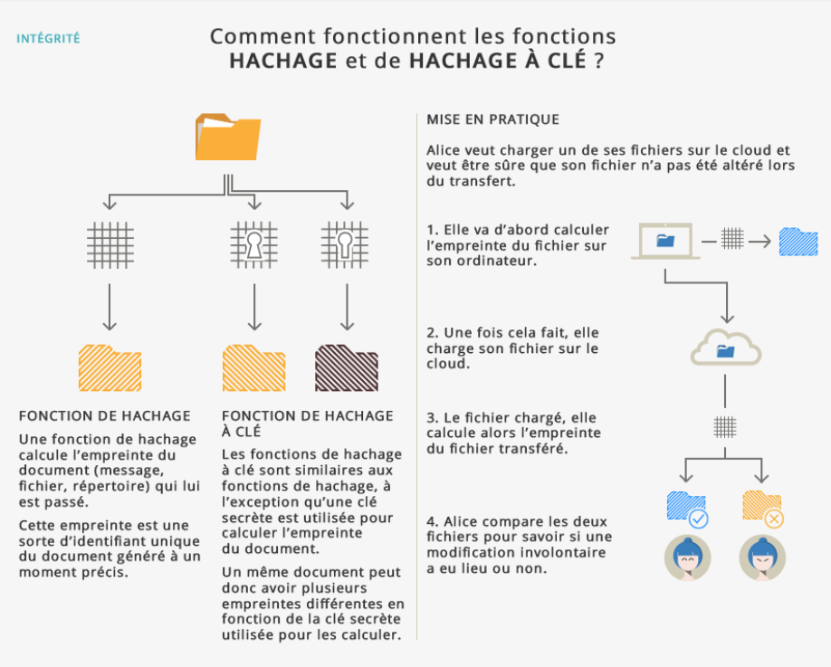

# Le hashage pour l'intégrité des données

> * Auteur : Gwénaël LAURENT
> * Date : 05/12/2024

 [Licence Creative Commons](https://creativecommons.org/licenses/by-nc-sa/3.0/fr/)

- [Le hashage pour l'intégrité des données](#le-hashage-pour-lintégrité-des-données)
- [1. Le hashage dans la cryptographie](#1-le-hashage-dans-la-cryptographie)
- [2. Fonction de hashage](#2-fonction-de-hashage)
- [3. Hashage à clé](#3-hashage-à-clé)
- [4. Algorithmes recommandés pour le hashage](#4-algorithmes-recommandés-pour-le-hashage)

# 1. Le hashage dans la cryptographie

> [CNIL : Sécurité : Chiffrement, hachage, signature](https://www.cnil.fr/fr/securite-chiffrement-hachage-signature)\
> [CNIL : Comprendre les grands principes de la cryptologie et du chiffrement](https://www.cnil.fr/fr/comprendre-les-grands-principes-de-la-cryptologie-et-du-chiffrement)\
> [CNIL : [INFOGRAPHIE] LES USAGES DE LA CRYPTOGRAPHIE](https://www.cnil.fr/fr/infographie-les-usages-de-la-cryptographie)

> Les fonctions de **hachage** permettent d’assurer l’***intégrité*** des données = s'assurer qu'un fichier n'a pas été modifié

# 2. Fonction de hashage
Une « fonction de hachage » permettra d’associer à un message, à un fichier ou à un répertoire, **une empreinte unique** calculable et vérifiable par tous. Cette empreinte est souvent matérialisée par une longue suite de chiffres et de lettres précédées du nom de l’algorithme utilisé, par exemple « SHA2» ou « SHA256 ».

# 3. Hashage à clé
Les fonctions de hachage à clé permettent de rendre le calcul de l’empreinte différent en fonction de la clé utilisée.

C’est parmi ces fonctions de hachage à clé que l’on trouve celles utilisées pour stocker les mots de passe de façon sécurisée.

# 4. Algorithmes recommandés pour le hashage
* **SHA-2** (standard NIST FIPS 180-4) et **SHA-3** (standard NIST FIPS 202) dont la taille minimale des empreintes produites est de 256 bits
* **bcrypt**, scrypt, Argon2 ou PBKDF2 pour stocker les mots de passe

Sources :
* [CNIL : Sécurité : Chiffrement, hachage, signature (14 mars 2024)](https://www.cnil.fr/fr/securite-chiffrement-hachage-signature)
* [ANSSI : Mécanismes cryptographiques > Règles et recommandations concernant le choix et le dimensionnement de mécanismes cryptographiques - v2.04 du 01/01/2020](https://cyber.gouv.fr/publications/mecanismes-cryptographiques)
* [ANSSI : Mécanismes cryptographiques > Guide de sélection d'algorithmes cryptographiques - v1.0 du 08/03/2021](https://cyber.gouv.fr/publications/mecanismes-cryptographiques)