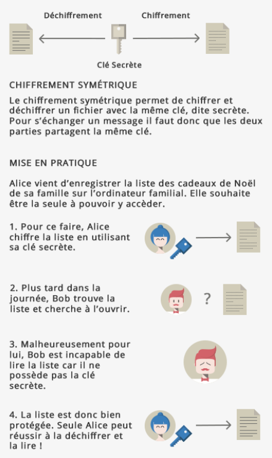
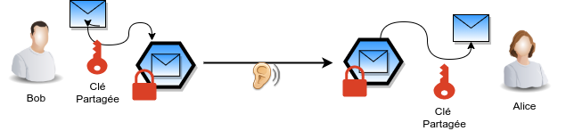
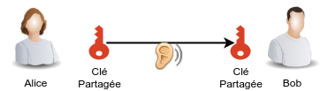

#  Chiffrement symétrique pour la confidentialité

> * Auteur : Gwénaël LAURENT
> * Date : 05/12/2024

 [Licence Creative Commons](https://creativecommons.org/licenses/by-nc-sa/3.0/fr/)

- [Chiffrement symétrique pour la confidentialité](#chiffrement-symétrique-pour-la-confidentialité)
- [1. Le chiffrement symétrique dans la cryptographie](#1-le-chiffrement-symétrique-dans-la-cryptographie)
- [2. Chiffrement symétrique](#2-chiffrement-symétrique)
  - [2.1. Principe](#21-principe)
  - [2.2. Inconvénients](#22-inconvénients)
- [3. Algorithmes recommandés pour le chiffrement symétrique](#3-algorithmes-recommandés-pour-le-chiffrement-symétrique)

# 1. Le chiffrement symétrique dans la cryptographie

> [CNIL : Sécurité : Chiffrement, hachage, signature](https://www.cnil.fr/fr/securite-chiffrement-hachage-signature)\
> [CNIL : Comprendre les grands principes de la cryptologie et du chiffrement](https://www.cnil.fr/fr/comprendre-les-grands-principes-de-la-cryptologie-et-du-chiffrement)\
> [CNIL : [INFOGRAPHIE] LES USAGES DE LA CRYPTOGRAPHIE](https://www.cnil.fr/fr/infographie-les-usages-de-la-cryptographie)

> Le **chiffrement**, parfois improprement appelé cryptage, permet de garantir la ***confidentialité*** d’un message.

# 2. Chiffrement symétrique

[cf Wikipédia](https://fr.wikipedia.org/wiki/Cryptographie_sym%C3%A9trique)

## 2.1. Principe

Dans les méthodes de chiffrement symétrique, **la clé est unique** : elle sert à la fois au **chiffrement et au déchiffrement**.

Si Alice (A) veut envoyer un message chiffré à Bob (B), elle
chiffre le message en utilisant une clé partagée entre eux deux.

Pour déchiffrer le message, Bob utilise la même clé.

## 2.2. Inconvénients

1.  La clé doit d'abord être échangée entre les protagonistes, au moyen d'un **canal sûr**.\
    
2.  Si Alice veut échanger de manière sécurisée avec $n-1$
    participants, alors $n-1$ clés sont nécessaires.
3.  Par conséquent, si $n$ personnes veulent communiquer de manière
    sécurisée, alors $\frac{n(n-1)}{2}$ clés sont nécessaires.

# 3. Algorithmes recommandés pour le chiffrement symétrique

* **AES** (standard NIST FIPS 197) avec un mode de construction approprié :
  *  CCM (Counter with CBC-MAC)
  *  GCM (Galois/Counter Mode)
  *  EAX (Encrypt-then-Authenticate-then-Translate)
* **ChaCha20** (RFC 8439) avec Poly1305 (algorithme de chiffrement par flot)

> La taille minimale recommandée des clés symétriques AES est de **128 bits**

Sources :
* [CNIL : Sécurité : Chiffrement, hachage, signature (14 mars 2024)](https://www.cnil.fr/fr/securite-chiffrement-hachage-signature)
* [ANSSI : Mécanismes cryptographiques > Règles et recommandations concernant le choix et le dimensionnement de mécanismes cryptographiques - v2.04 du 01/01/2020](https://cyber.gouv.fr/publications/mecanismes-cryptographiques)
* [ANSSI : Mécanismes cryptographiques > Guide de sélection d'algorithmes cryptographiques - v1.0 du 08/03/2021](https://cyber.gouv.fr/publications/mecanismes-cryptographiques)

