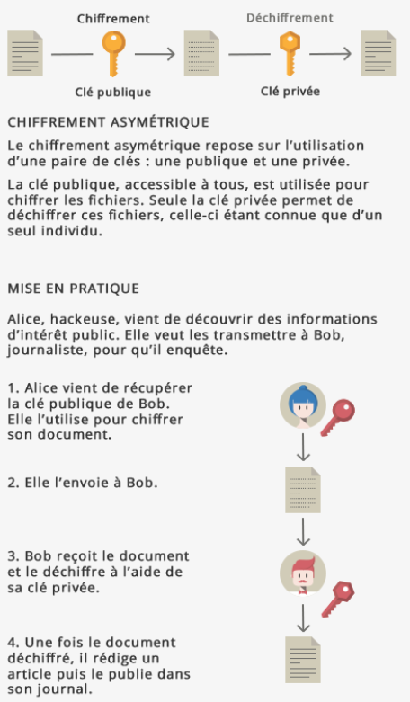
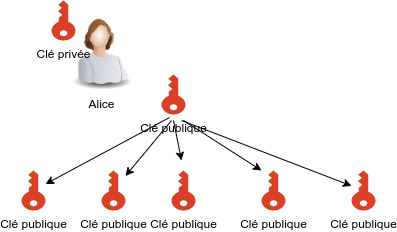
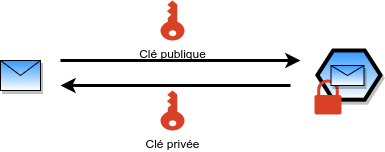
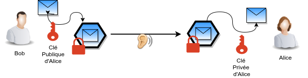
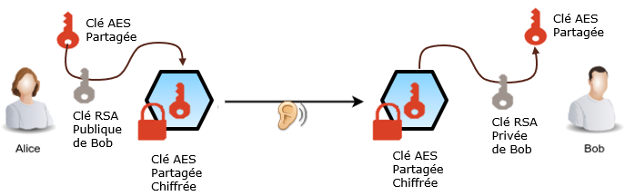
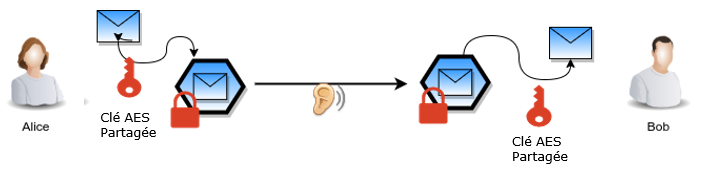

# Chiffrement asymétrique pour la confidentialité

> * Auteur : Gwénaël LAURENT
> * Date : 05/12/2024

 [Licence Creative Commons](https://creativecommons.org/licenses/by-nc-sa/3.0/fr/)

- [Chiffrement asymétrique pour la confidentialité](#chiffrement-asymétrique-pour-la-confidentialité)
- [1. Le chiffrement asymétrique dans la cryptographie](#1-le-chiffrement-asymétrique-dans-la-cryptographie)
- [2. Chiffrement asymétrique](#2-chiffrement-asymétrique)
  - [2.1. Principe](#21-principe)
  - [2.2. Inconvénients](#22-inconvénients)
  - [2.3. Utilisation pour protéger une clé symétrique](#23-utilisation-pour-protéger-une-clé-symétrique)
- [3. Algorithmes recommandés pour le chiffrement asymétrique](#3-algorithmes-recommandés-pour-le-chiffrement-asymétrique)

# 1. Le chiffrement asymétrique dans la cryptographie

> [CNIL : Sécurité : Chiffrement, hachage, signature](https://www.cnil.fr/fr/securite-chiffrement-hachage-signature)\
> [CNIL : Comprendre les grands principes de la cryptologie et du chiffrement](https://www.cnil.fr/fr/comprendre-les-grands-principes-de-la-cryptologie-et-du-chiffrement)\
> [CNIL : [INFOGRAPHIE] LES USAGES DE LA CRYPTOGRAPHIE](https://www.cnil.fr/fr/infographie-les-usages-de-la-cryptographie)

> Le **chiffrement**, parfois improprement appelé cryptage, permet de garantir la ***confidentialité*** d’un message.

# 2. Chiffrement asymétrique

[cf Wikipédia](https://fr.wikipedia.org/wiki/Cryptographie_asym%C3%A9trique)

## 2.1. Principe

Dans les méthodes de chiffrement asymétrique, chaque participant possède une **paire de clés** :

* une **clé publique**, que (comme son nom l'indique) tout le
    monde peut obtenir;
* une **clé privée**,  propriété exclusive de son propriétaire.

    

Ces deux clés sont **liées** l'une à l'autre.

Le système repose sur la propriété suivante : **un message chiffré avec la clé publique ne pourra être déchiffré qu'avec la clé privée correspondante**

Lorsque Bob veut envoyer un message de manière confidentielle à
Alice, il utilise la **clé publique d'Alice** : Seule Alice pourra
déchiffrer le message.

## 2.2. Inconvénients
Complexité algorithmique : les chiffrements asymétriques sont globalement moins performants que leurs équivalents symétriques car les **temps de traitement sont plus longs** et, pour un niveau de sécurité équivalent, les clés doivent être beaucoup plus longues.

## 2.3. Utilisation pour protéger une clé symétrique
> **Les système asymétriques sont utilisés pour communiquer une clé d'un chiffrement symétrique**. Cette clé est générée aléatoirement et est appelée clé de session.

Le problème des algorithmes symétriques est qu'il faut être sûr que la clé de chiffrement ne soit divulguée qu'aux personnes qui veulent partager un secret. Le chiffrement asymétrique RSA permet de communiquer cette clé symétrique de manière sûre.

Pour ce faire, Alice va tout d'abord choisir une clé symétrique (AES). Voulant échanger un secret avec Bob elle va lui transmettre cette clé symétrique en utilisant RSA. Elle va, pour cela, chiffrer la clé symétrique avec la clé publique (RSA) de Bob, ainsi elle sera sûre que seul Bob pourra déchiffrer cette clé symétrique.

Une fois que Bob reçoit le message, il le déchiffre et peut alors utiliser la clé symétrique (AES) définie par Alice pour lui envoyer des messages chiffrés que seuls lui et Alice pourront alors déchiffrer.

# 3. Algorithmes recommandés pour le chiffrement asymétrique
* **RSA-OAEP** (standard RSA PKCS#1 v2.2)
* **ECIES-KEM** (norme ISO/IEC 18033-2)
* **DLIES-KEM** (norme ISO/IEC 18033-2)

> pour les algorithmes basés sur RSA, il est recommandé d’utiliser des *modules* et *exposants* secrets d’au moins 2 048 bits (**3 072 bits** à partir de l'année 2031). Pour les applications de chiffrement, les *exposants publics* doivent être strictement supérieurs à 65536.

Sources :
* [CNIL : Sécurité : Chiffrement, hachage, signature (14 mars 2024)](https://www.cnil.fr/fr/securite-chiffrement-hachage-signature)
* [ANSSI : Mécanismes cryptographiques > Règles et recommandations concernant le choix et le dimensionnement de mécanismes cryptographiques - v2.04 du 01/01/2020](https://cyber.gouv.fr/publications/mecanismes-cryptographiques)
* [ANSSI : Mécanismes cryptographiques > Guide de sélection d'algorithmes cryptographiques - v1.0 du 08/03/2021](https://cyber.gouv.fr/publications/mecanismes-cryptographiques)