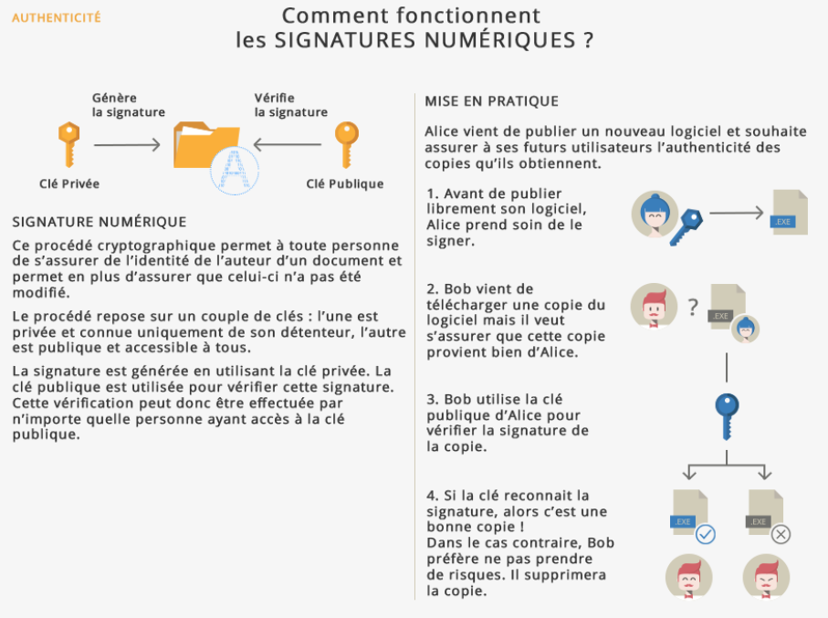
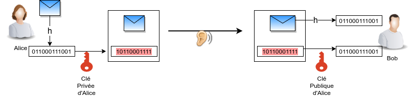

# Signature numérique pour l'authenticité

> * Auteur : Gwénaël LAURENT
> * Date : 05/12/2024

 [Licence Creative Commons](https://creativecommons.org/licenses/by-nc-sa/3.0/fr/)

- [Signature numérique pour l'authenticité](#signature-numérique-pour-lauthenticité)
- [1. La signature dans la cryptographie](#1-la-signature-dans-la-cryptographie)
- [2. Signature numérique](#2-signature-numérique)
  - [2.1. Fonctionnement général](#21-fonctionnement-général)
  - [2.2. Signer](#22-signer)
  - [2.3. Vérifier](#23-vérifier)
- [3. Algorithmes recommandés pour les signatures](#3-algorithmes-recommandés-pour-les-signatures)

# 1. La signature dans la cryptographie

> [CNIL : Sécurité : Chiffrement, hachage, signature](https://www.cnil.fr/fr/securite-chiffrement-hachage-signature)\
> [CNIL : Comprendre les grands principes de la cryptologie et du chiffrement](https://www.cnil.fr/fr/comprendre-les-grands-principes-de-la-cryptologie-et-du-chiffrement)\
> [CNIL : [INFOGRAPHIE] LES USAGES DE LA CRYPTOGRAPHIE](https://www.cnil.fr/fr/infographie-les-usages-de-la-cryptographie)

> Les **signatures** numériques, en plus d’assurer l’intégrité, permettent de vérifier l’***authenticité*** du signataire et d'assurer la non-répudiation.

# 2. Signature numérique

[cf Wikipédia](https://fr.wikipedia.org/wiki/Signature_num%C3%A9rique)

## 2.1. Fonctionnement général
La signature numérique (ou signature électronique) est un mécanisme permettant :
* de garantir l'**intégrité** du document (=il n'a pas été altéré) 
* d'**identifier** l'auteur d'un document électronique.

Les procédures de signature numérique existantes s’appuient sur le hashage et la cryptographie asymétrique (le plus souvent en utilisant l'algorithme RSA) :
* Le hashage du document permet de créer une empreinte qui garantie l'intégrité du document
* L'authentification de l'empreinte est effectuée en chiffrant l'empreinte à l'aide de la clé RSA privée de l'émetteur. C'est la signature.
* La clé publique de l'émetteur permet de vérifier la signature.

**Remarque** : A l'inverse du chiffrement asymétrique, on utilise la clé privée pour chiffrer. Le déchiffrement est réalisé à l'aide de la clé publique.

> **ANSSI : En cryptographie asymétrique, une même clé ne doit pas être employée pour plusieurs usages, par exemple du chiffrement et de la signature.**

## 2.2. Signer

Lorsque Alice veut signer son message,

* elle calcule l'empreinte du message
* elle chiffre l'empreinte avec sa clé privée
* elle envoie le message, accompagné de la signature.

## 2.3. Vérifier

Lorsque Bob veut vérifier que le message reçu provient bien d'Alice.

* il calcule l'empreinte du message H1
* il déchiffre la signature à l'aide de la clé publique de d'Alice et obtient l'empreinte créée par Alice H2
* Si H1 = H2 alors le message provient bien d'Alice.

# 3. Algorithmes recommandés pour les signatures

* **RSA-SSA-PSS** (standard RSA PKCS#1 v2.2.)
* **ECDSA** (standard NIST FIPS 186-5)

> pour les algorithmes basés sur RSA, il est recommandé d’utiliser des *modules* et *exposants* secrets d’au moins 2 048 bits (**3 072 bits** à partir de l'année 2031). Pour les applications de chiffrement, les *exposants publics* doivent être strictement supérieurs à 65536.

Sources :
* [CNIL : Sécurité : Chiffrement, hachage, signature (14 mars 2024)](https://www.cnil.fr/fr/securite-chiffrement-hachage-signature)
* [ANSSI : Mécanismes cryptographiques > Règles et recommandations concernant le choix et le dimensionnement de mécanismes cryptographiques - v2.04 du 01/01/2020](https://cyber.gouv.fr/publications/mecanismes-cryptographiques)
* [ANSSI : Mécanismes cryptographiques > Guide de sélection d'algorithmes cryptographiques - v1.0 du 08/03/2021](https://cyber.gouv.fr/publications/mecanismes-cryptographiques)

