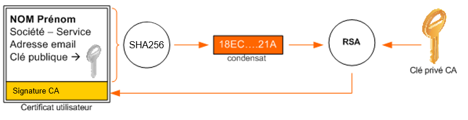
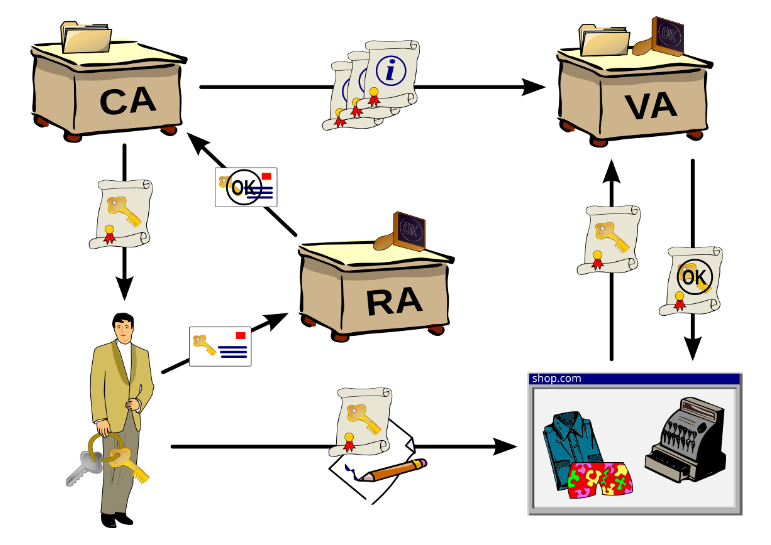
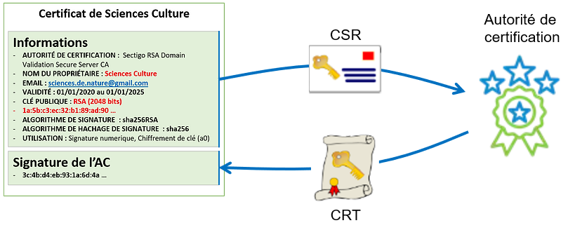
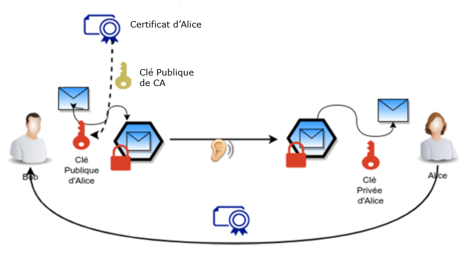
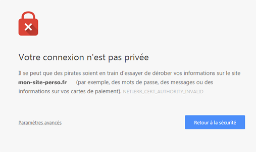

# Certificats électroniques pour l'authenticité

> * Auteur : Gwénaël LAURENT
> * Date : 11/01/2025

 [Licence Creative Commons](https://creativecommons.org/licenses/by-nc-sa/3.0/fr/)

- [Certificats électroniques pour l'authenticité](#certificats-électroniques-pour-lauthenticité)
- [1. Les certificats dans la cryptographie](#1-les-certificats-dans-la-cryptographie)
- [2. Certificat électronique](#2-certificat-électronique)
- [3. Autorités de certification (CA)](#3-autorités-de-certification-ca)
  - [3.1. Définition](#31-définition)
  - [3.2. Types de certificats](#32-types-de-certificats)
  - [3.3. Quelques adresses de CA](#33-quelques-adresses-de-ca)
- [4. Fonctionnement type pour un certificat X.509](#4-fonctionnement-type-pour-un-certificat-x509)
  - [4.1. Création du certificat](#41-création-du-certificat)
  - [4.2. Utilisation du certificat](#42-utilisation-du-certificat)
- [5. Certificats auto-signés pour les tests](#5-certificats-auto-signés-pour-les-tests)

# 1. Les certificats dans la cryptographie

> Les **certificats électroniques** permettent de sécuriser la diffusion de clé publique.\
> Ils garantissent :
> * l’***authentification*** du signataire d'une clé publique
> * l'***intégrité*** des données avec la signature
> * la ***confidentialité*** des données grâce au chiffrement

# 2. Certificat électronique

[cf Wikipédia](https://fr.wikipedia.org/wiki/Certificat_%C3%A9lectronique)

Un certificat électronique est un document électronique délivré par une autorité de certification (CA). **Il associe une clé publique à l'identité d'une personne, d'une organisation ou d'un appareil**.

**Le certificat permet de vérifier que la clé publique appartient bien à l'entité mentionnée**, garantissant ainsi la confiance dans les communications numériques.

Un certificat électronique est un ensemble de données contenant :

-   des informations d'indentification (nom, domaine, email, ...)
-   une clé publique
-   une signature des données précédentes obtenue avec la clé privée d'une autorité de certification (CA).

Les certificats électroniques sont utilisés dans plusieurs contextes, notamment :
* **Signature électronique** : Le certificat peut être utilisé pour créer une signature électronique, en confirmant l'identité du signataire.
* **Chiffrement** : Les certificats sont utilisés pour chiffrer des données ou des communications, comme dans le cas des protocoles SSL/TLS sur les sites web.
* **Authentification** : Ils peuvent servir à authentifier des utilisateurs ou des appareils sur un réseau.

Les deux **formats** de certificat les plus utilisés aujourd'hui sont :
* [**X.509**](https://fr.wikipedia.org/wiki/X.509), défini dans la RFC 5280
* [**OpenPGP**](https://fr.wikipedia.org/wiki/OpenPGP), défini dans la RFC 4880

# 3. Autorités de certification (CA)
[cf Wikipédia : Autorité de certification](https://fr.wikipedia.org/wiki/Autorit%C3%A9_de_certification)

## 3.1. Définition
Les autorités de certification sont des organismes **enregistrés et certifiés auprès d'autorités publiques et/ou de gouvernance de l'Internet**. Ces organismes diffusent leurs propres clés publiques. 

Les systèmes d'exploitation et navigateurs web incluent nativement les listes des clés publiques de ces autorités de certification. Ces clés sont appelées **clés publiques racines ou certificats racines** et sont utilisées pour identifier les clés publiques d'autres organismes.

> **Dans Chrome :**\
> Paramètres > Confidentialité et sécurité > Sécurité > Paramètres avancés > Gérer les certificats > Chrome Root Store\
> **Dans Windows :**\
> certificats pour l’appareil local : certlm.msc
> certificats de l’utilisateur actuel : certmgr.msc

L'autorité de certification est un modèle parmi d'autres d'infrastructure à clés publiques (ICP) ou  **Public Key Infrastructure (PKI)** [cf Wikipédia](https://fr.wikipedia.org/wiki/Infrastructure_%C3%A0_cl%C3%A9s_publiques)

Diagramme de principe d'une autorité de certification, exemple d'infrastructure à clés publiques
* CA : autorité de certification ;
* VA : autorité de validation ;
* RA : autorité d'enregistrement.

## 3.2. Types de certificats
Il existe 3 types de certificats en fonction des informations validées par l'autorité de certicication :
* **DV** (Validation de domaine) : 
  * Vérifie l'existence du domaine
* **OV** (Validation d’organisation) : 
  * Vérifie l'existence légale de l'organisation.
  * Vérifie que l'organisation possède le contrôle du domaine.
* **EV** (Validation étendue) :
  * Effectue une validation plus stricte et détaillée.
  * Vérifie des documents juridiques et des informations spécifiques (ex. : identité du demandeur, adresse, numéro d'enregistrement).
  * La validation garantit un contrôle rigoureux pour lutter contre l'usurpation et le phishing

## 3.3. Quelques adresses de CA
CA Gratuites ou Peu Coûteuses : [Let's Encrypt](https://letsencrypt.org/), [ZeroSSL](https://zerossl.com/)

CA Commerciales (pour les OV et EV) : [DigiCert](https://www.digicert.com/), [Sectigo](https://www.sectigo.com/), [GlobalSign](https://www.globalsign.com/fr), [Entrust](https://www.entrust.com/), [GoDaddy](https://www.godaddy.com/fr), [Thawte](https://www.thawte.com/), [GeoTrust](https://www.geotrust.com/)

Spécialistes français (RGPD, ...) : [Certigna](https://www.certigna.fr), [Chambersign France](https://www.chambersign.fr)

# 4. Fonctionnement type pour un certificat X.509
https://www.sciencesculture.com/post/kezako-certificats-num%C3%A9riques

## 4.1. Création du certificat 

Lorsque Alice veut diffuser sa clé publique il faut qu'elle crée un certificat pulic :

* Alice envoie une demande de signature de certificat (**CSR : Certificate Signing Request**) auprès d'une autorité de certification (CA). Le CSR contient :
  * des informations sur l'identité d'Alice
  * la clé publique d'Alice.

* L'autorité de certification vérifie l'identité d'Alice et lui délivre le certificat (fichier **.CRT**). Le certificat contient :
  * les informations d'Alice, 
  * les informations sur l'émetteur du certificat (autorité de certification), 
  * la durée de validité
  * une signature numérique émise par l'autorité de certification (chiffrée avec la clé privée de l'autorité de certification).

    
## 4.2. Utilisation du certificat

Bob souhaite communiquer avec Alice. Celle-ci lui envoie son certificat.

Bob peut alors vérifier l'intégrité du certificat en utilisant la clé publique de l'autorité de certification.

S'il authentifie le certificat, alors il peut utiliser la clé publique qu'il contient pour échanger avec Alice.

# 5. Certificats auto-signés pour les tests

L’expression "certificats auto-signés" fait référence aux certificats qui ont été générés de manière autonome, sans aucun lien avec une  autorité de certification (CA) publiquement reconnue.

La nature des certificats auto-signés implique que les informations figurant sur le certificat n’ont pas été vérifiées par une partie de confiance (une CA publique), et ces certificats déclencheront une alerte de sécurité : Les navigateurs Web et les systèmes d’exploitation détecteront et signaleront les certificats qui n’ont pas été signés par une CA publique de confiance, car ils représentent un risque pour la sécurité de leurs utilisateurs.

> Attention : les certificats auto-signés ne sont pas idéaux pour une utilisation en production car il n’y a pas de tierce partie fiable pour vérifier l’identité de l’utilisateur. **Ils ne doivent servir qu'à des fins de développements ou pour tester des produits**.
