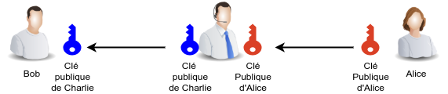
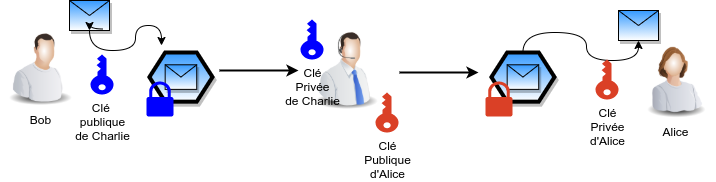

# Attaque MITM sur des clés publiques

> * Auteur : Gwénaël LAURENT
> * Date : 11/01/2025

 [Licence Creative Commons](https://creativecommons.org/licenses/by-nc-sa/3.0/fr/)

> **Le problème vient de la transmission de la clé publique**. Si celle-ci n'est pas sécurisée, un attaquant peut se positionner entre l'entité et son public en diffusant de fausses clés publiques (par le biais d'un faux site web par exemple) puis intercepter toutes les communications, lui permettant d'usurper l'identité du diffuseur de clés publique et de créer une "attaque de l'homme du milieu".

# 1. Problème

-   Lorsqu'une entité veut communiquer avec un large public, il lui
    suffit de diffuser sa clé publique.
-   La diffusion de la clé publique pose néanmoins problème,
    puisqu'elle se fait au travers d'un canal non sécurisé.
-   Que ce passe-t-il lorsque un attaquant se positionne **entre l'entité
    et son public** ?

# 2. Attaque de l'homme du milieu

-   Alice souhaite communiquer à Bob sa clé publique.
-   L'attaquant Charlie parvient, par un moyen ou un autre, à
    intercepter la diffusion de la clé publique ;
-   Il envoie à Bob sa propre clé publique.

-   L'usurpation fonctionne alors dans les deux sens :
-   Si Alice signe un message, Charlie le signe avec sa clé privée;
-   Si Bob envoie un message chiffré à Alice, il utilise la
    clé de Charlie.

# 3. Résolution du problème
Les **certificats électroniques** permettent de sécuriser la diffusion de clé publique.

**Le certificat permet de vérifier que la clé publique appartient bien à l'entité mentionnée**, garantissant ainsi la confiance dans les communications numériques.