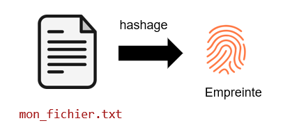
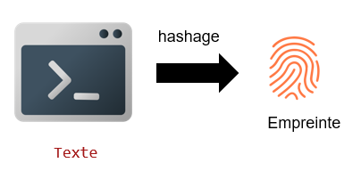

# OpenSSL : Hashage SHA256

> * Auteur : Gwénaël LAURENT
> * Date : 04/03/2026

 [Licence Creative Commons](https://creativecommons.org/licenses/by-nc-sa/3.0/fr/)

- [OpenSSL : Hashage SHA256](#openssl--hashage-sha256)
- [1. Calculer l'empreinte (hash, digest, fingerprint) d'un document](#1-calculer-lempreinte-hash-digest-fingerprint-dun-document)
  - [1.1. Empreinte d'un fichier](#11-empreinte-dun-fichier)
  - [1.2. Empreinte d'un texte dans la console](#12-empreinte-dun-texte-dans-la-console)


# 1. Calculer l'empreinte (hash, digest, fingerprint) d'un document
## 1.1. Empreinte d'un fichier


Calculer l'**empreinte d'un fichier** en utilisant l'algorithme SHA-256 :
```sh
openssl dgst -sha256 mon_fichier_telecharge.txt
```
Note : Le résultat de la commande ```openssl dgst -sha256``` renvoie l'empreinte en représentataion ASCII. Pour avoir l'empreinte en binaire : ```openssl dgst -sha256 -binary```

Note : Sous windows, on peut aussi utiliser la commande
```cmd
certutil -hashfile mon_fichier_telecharge.txt SHA256
```

## 1.2. Empreinte d'un texte dans la console


Calculer l'**empreinte d'un texte** saisi dans la console :
* Sous Linux :
  ```sh
  echo -n "tartempion" | openssl dgst -sha256
  ```
  Explication : La commande ```echo``` permet d'afficher un texte dans la console mais ajoute un retour à la ligne. Sous Linux l'option ```-n``` permet de ne pas l'ajouter.\
`|` (pipe) : Redirige la sortie de la commande echo comme entrée pour la commande suivante.

* Sous Windows :
  ```cmd
  echo | set /p="tartempion" | openssl dgst -sha256
  ```
  Explication : Sous Windows, echo ajoute généralement un saut de ligne par défaut. L'astuce echo|set /p= permet d'éviter ce comportement. Normalement, set /p permet d'affecter une valeur à une variable en demandant à l'utilisateur de la saisir dans la console. 

