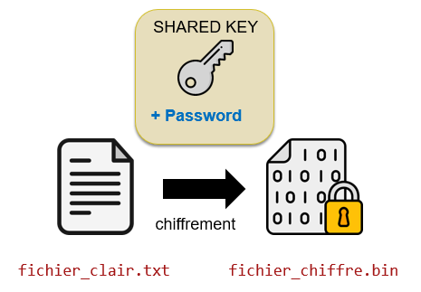
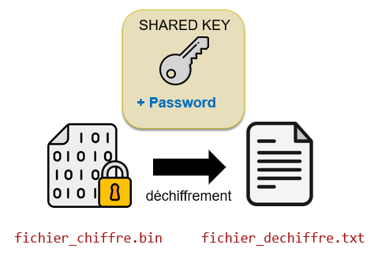
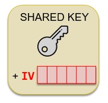
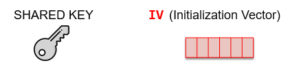
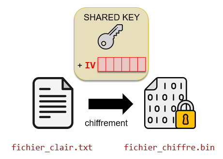
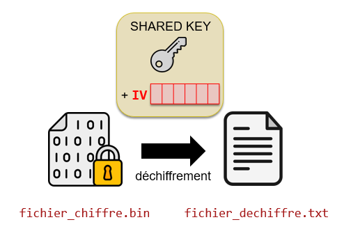
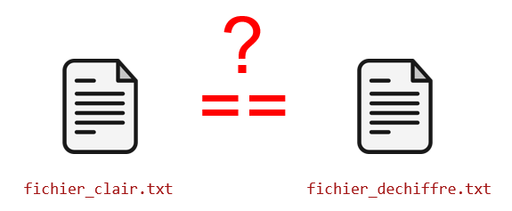

# OpenSSL : Chiffrement symétrique AES

> * Auteur : Gwénaël LAURENT
> * Date : 08/03/2026

 [Licence Creative Commons](https://creativecommons.org/licenses/by-nc-sa/3.0/fr/)

- [OpenSSL : Chiffrement symétrique AES](#openssl--chiffrement-symétrique-aes)
- [1. Chiffrement symétrique AES](#1-chiffrement-symétrique-aes)
- [2. Chiffrement symétrique avec mot de passe](#2-chiffrement-symétrique-avec-mot-de-passe)
  - [2.1. Chiffrement des données AES-256 en mode CBC](#21-chiffrement-des-données-aes-256-en-mode-cbc)
  - [2.2. Déchiffrement des données AES-256 en mode CBC](#22-déchiffrement-des-données-aes-256-en-mode-cbc)
- [3. Chiffrement symétrique avec clé et IV](#3-chiffrement-symétrique-avec-clé-et-iv)
  - [3.1. Génération de la clé symétrique et d'un vecteur d'initialisation (IV)](#31-génération-de-la-clé-symétrique-et-dun-vecteur-dinitialisation-iv)
  - [3.2. Chiffrement des données AES-256 en mode CBC](#32-chiffrement-des-données-aes-256-en-mode-cbc)
  - [3.3. Déchiffrement des données](#33-déchiffrement-des-données)
- [4. Vérifications](#4-vérifications)


# 1. Chiffrement symétrique AES
Pour un chiffrement symétrique optimal, il faut générer **une clé de chiffrement** ET **un vecteur d'initialisation (IV)**

> L'IV (Vecteur d'Initialisation, ou Initialization Vector en anglais) est une valeur utilisée dans la cryptographie pour assurer que le chiffrement est non déterministe, même si le même message est chiffré plusieurs fois avec la même clé. Cela permet d'améliorer la sécurité en empêchant certaines attaques sur les systèmes de chiffrement symétriques.\
> L'IV n'est pas secret mais doit être transmis avec précaution pour garantir son intégrité.


La génération de la clé et de l'IV peuvent se faire de 2 façons :
1. Ils peuvent être générés automatiquement **grâce à un mot de passe** fourni lors du chiffrement ou du déchiffrement (c'est le mot de passe qui doit être échangé entre les protagonistes)
2. Ils peuvent être **générés avant le chiffrement** (il faut alors échanger la clé et l'IV entre les protagonistes)


# 2. Chiffrement symétrique avec mot de passe


> ⚠️ **ATTENTION** : L'utilisation de la commande OpenSSL avec un mot de passe pour générer automatiquement la clé de chiffrement et le vecteur d'initialisation (IV) peut être pratique, mais elle présente des considérations importantes concernant la sécurité.\
> **Pour une utilisation ponctuelle avec un mot de passe fort**, cette méthode est raisonnablement sécurisée, bien que non optimale.\
> Pour des besoins sensibles ou dans des contextes professionnels, il est préférable de spécifier explicitement une clé forte et un IV

## 2.1. Chiffrement des données AES-256 en mode CBC


```bash
openssl enc -aes-256-cbc -in fichier_clair.txt -out fichier_chiffre.bin
enter AES-256-CBC encryption password:
Verifying - enter AES-256-CBC encryption password:
```

Si le mot de passe est enregistré dans un fichier texte `secret.txt`, on peut utiliser la commande suivante :
```bash
openssl enc -aes-256-cbc -in fichier_clair.txt -out fichier_chiffre.bin -pass file:secret.txt
```

## 2.2. Déchiffrement des données AES-256 en mode CBC


```bash
openssl enc -d -aes-256-cbc -in fichier_chiffre.bin -out fichier_dechiffre.txt
enter AES-256-CBC decryption password:
```

Si le mot de passe est enregistré dans un fichier texte `secret.txt`, on peut utiliser la commande suivante :
```bash
openssl enc -d -aes-256-cbc -in fichier_chiffre.bin -out fichier_dechiffre.txt -pass file:secret.txt
```

# 3. Chiffrement symétrique avec clé et IV


Pour un chiffrement symétrique optimal, il faut générer **une clé de chiffrement** ET **un vecteur d'initialisation (IV)**

> ⚠️ Gestion des fichiers sensibles : Les fichiers contenant les clés et l'IV doivent être protégés (permissions, stockage sécurisé).


## 3.1. Génération de la clé symétrique et d'un vecteur d'initialisation (IV)


Remarque : la taille de la clé et de l'IV doivent correspondre à l'algorithme utilisé.

```sh
# Génération d'une clé de 256 bits (32 octets) aléatoire
openssl rand -hex 32 > key.txt

# Génération d'un vecteur d'initialisation IV de 128 bits (16 octets) aléatoire
openssl rand -hex 16 > iv.txt
```

## 3.2. Chiffrement des données AES-256 en mode CBC


Linux :
```sh
openssl enc -aes-256-cbc -in fichier_clair.txt -out fichier_chiffre.bin -K $(cat key.txt) -iv $(cat iv.txt)
```

Windows PowerShell :
```ps
$KEY = Get-Content key.txt
$IV = Get-Content iv.txt
openssl enc -aes-256-cbc -in fichier_clair.txt -out fichier_chiffre.bin -K $KEY -iv $IV
```

Windows CMD :
```cmd
for /f %k in (key.txt) do set KEY=%k
for /f %i in (iv.txt) do set IV=%i
openssl enc -aes-256-cbc -in fichier_clair.txt -out fichier_chiffre.bin -K %KEY% -iv %IV%
```

> Le fichier chiffré (fichier_chiffre.bin) est au format binaire. Il peut être visualisé avec un logiciel "éditeur hexadécimal".

## 3.3. Déchiffrement des données


Linux :
```sh
openssl enc -d -aes-256-cbc -in fichier_chiffre.bin -out fichier_dechiffre.txt -K $(cat key.txt) -iv $(cat iv.txt)
```

Windows PowerShell :
```ps
$KEY = Get-Content key.txt
$IV = Get-Content iv.txt
openssl enc -d -aes-256-cbc -in fichier_chiffre.bin -out fichier_dechiffre.txt -K $KEY -iv $IV
```

Windows CMD :
```cmd
for /f %k in (key.txt) do set KEY=%k
for /f %i in (iv.txt) do set IV=%i
openssl enc -d -aes-256-cbc -in fichier_chiffre.bin -out fichier_dechiffre.txt -K %KEY% -iv %IV%
```

Remarque : Si vous prévoyez d'utiliser les commandes Windows CMD fréquemment, vous pouvez créer un **script batch** (chiffrement.bat) :
```bat
@echo off
REM Lire la clé et l'IV depuis les fichiers
for /f %%k in (key.txt) do set KEY=%%k
for /f %%i in (iv.txt) do set IV=%%i

REM Chiffrement
openssl enc -aes-256-cbc -in fichier_clair.txt -out fichier_chiffre.bin -K %KEY% -iv %IV%

REM Déchiffrement
openssl enc -d -aes-256-cbc -in fichier_chiffre.bin -out fichier_dechiffre.txt -K %KEY% -iv %IV%

REM Vérification
fc fichier_clair.txt fichier_dechiffre.txt

```

# 4. Vérifications


Linux :
```sh
diff fichier_clair.txt fichier_dechiffre.txt
```

Windows PowerShell :
```ps
Compare-Object (Get-Content fichier_clair.txt) (Get-Content fichier_dechiffre.txt)
```

Windows CMD :
```cmd
fc /B fichier_clair.txt fichier_dechiffre.txt
```
ou
```cmd
comp fichier_clair.txt fichier_dechiffre.txt
```
