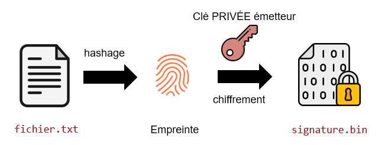
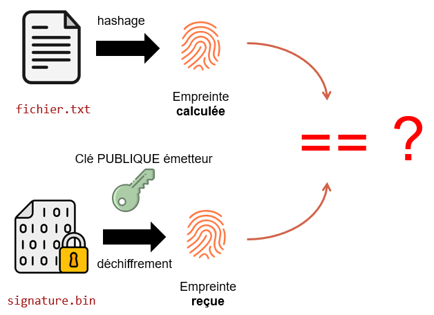

# OpenSSL : Signature numérique RSA

> * Auteur : Gwénaël LAURENT
> * Date : 08/03/2026

 [Licence Creative Commons](https://creativecommons.org/licenses/by-nc-sa/3.0/fr/)

- [OpenSSL : Signature numérique RSA](#openssl--signature-numérique-rsa)
- [1. Principe de la signature avec RSA](#1-principe-de-la-signature-avec-rsa)
  - [1.1. La signature d'un document](#11-la-signature-dun-document)
  - [1.2. La vérification de la signature](#12-la-vérification-de-la-signature)
- [2. Signature avec l'algorithme RSA-SSA-PSS](#2-signature-avec-lalgorithme-rsa-ssa-pss)
- [3. Signature avec l'algorithme ECDSA - standard FIPS 186-5](#3-signature-avec-lalgorithme-ecdsa---standard-fips-186-5)
- [4. Séparer le calcul de l'empreinte du chiffrement de signature](#4-séparer-le-calcul-de-lempreinte-du-chiffrement-de-signature)


# 1. Principe de la signature avec RSA
Les **signatures** numériques, en plus d’assurer l’***intégrité***, permettent de vérifier l’***authenticité*** du signataire

## 1.1. La signature d'un document
1. **générer une empreinte** du document (pour garantir l'intégrité)
2. **chiffrer cette empreinte avec la clé privée** de l'émetteur.



## 1.2. La vérification de la signature
1. **déchiffrer l'empreinte reçue avec la clé publique de l'émetteur**
2. calculer l'empreinte du document reçu
3. comparer les 2 empreintes (reçue et calculée) pour prouver que le document n'a pas été altéré et appartient bien à l'émetteur.



# 2. Signature avec l'algorithme RSA-SSA-PSS
**Générer une paire de clés RSA 2048** bits pour signer.
```sh
openssl genpkey -algorithm RSA -out cle_privee.pem -pkeyopt rsa_keygen_bits:2048
openssl rsa -pubout -in cle_privee.pem -out cle_publique.pem
```

**Générer une signature** avec une clé privée et l'algorithme RSA-SSA-PSS :
```sh
openssl dgst -sha256 -sign cle_privee.pem -sigopt rsa_padding_mode:pss -sigopt rsa_pss_saltlen:-1 -out empreinte.sig mon_fichier.txt
```
Note :
* rsa_padding_mode:pss : Active le mode PSS.
* rsa_pss_saltlen:-1 : Utilise la longueur maximale autorisée pour le sel (par défaut, la longueur du hachage).

**Vérifier une signature** RSA-SSA-PSS avec la clé publique associée :
```sh
openssl dgst -sha256 -verify cle_publique.pem -sigopt rsa_padding_mode:pss -sigopt rsa_pss_saltlen:-1 -signature empreinte.sig mon_fichier.txt
```

# 3. Signature avec l'algorithme ECDSA - standard FIPS 186-5
**Générer une paire de clés ECDSA** bits pour signer.
```sh
openssl ecparam -name prime256v1 -genkey -noout -out cle_privee.pem
openssl ec -in cle_privee.pem -pubout -out cle_publique.pem
```

Note : prime256v1 est un algorithme conforme au standard FIPS 186-5. Il offre une sécurité équivalente à une clé RSA de 3072 bits.

**Générer une signature** avec une clé privée et l'algorithme ECDSA :
```sh
openssl dgst -sha256 -sign cle_privee.pem -out empreinte.sig mon_fichier.txt
```

**Vérifier une signature** ECDSA avec la clé publique associée :
```sh
openssl dgst -sha256 -verify cle_publique.pem -signature empreinte.sig mon_fichier.txt
```


# 4. Séparer le calcul de l'empreinte du chiffrement de signature
Il est possible de séparer le calcul de l'empreinte SHA-256 (hachage) du chiffrement de cette empreinte pour générer ou vérifier une signature numérique. Cette séparation est souvent utilisée pour des raisons de flexibilité.

Il y a cependant deux contraintes :
* Avec OpenSSL, on ne peut utiliser que l'algorithme RSA-SSA-PSS
* L'empreinte doit être créée en format binaire

**Générer une paire de clés RSA 2048** bits pour signer.
```sh
openssl genpkey -algorithm RSA -out cle_privee.pem -pkeyopt rsa_keygen_bits:2048
openssl rsa -pubout -in cle_privee.pem -out cle_publique.pem
```

**Générer la signature** :

1. Calculer l'empreinte SHA-256 séparément en format binaire
```sh
openssl dgst -sha256 -binary -out empreinte.bin mon_fichier.txt
```

2. Générer la signature en chiffrant l'empreinte avec la clé privée
```sh
openssl pkeyutl -sign -in empreinte.bin -inkey cle_privee.pem -out empreinte.sig -pkeyopt rsa_padding_mode:pss -pkeyopt digest:sha256 -pkeyopt rsa_pss_saltlen:-1
```
Note :
* pkeyopt digest:sha256 : Spécifie l'algorithme de hachage utilisé (SHA-256).
* pkeyopt rsa_padding_mode:pss : Définit le padding RSA-SSA-PSS.
* pkeyopt rsa_pss_saltlen:-1 : Définit la longueur du sel comme étant égale à celle du hachage (par défaut).

**Vérifier la signature** :

1. Calculer l'empreinte SHA-256 en format binaire (même méthode que précédemment) 
```sh
openssl dgst -sha256 -binary -out empreinte_a_verifier.bin mon_fichier.txt
```

2. Vérifier la signature avec la clé publique
```sh
openssl pkeyutl -verify -in empreinte_a_verifier.bin -sigfile empreinte.sig -pubin -inkey cle_publique.pem -pkeyopt rsa_padding_mode:pss -pkeyopt digest:sha256 -pkeyopt rsa_pss_saltlen:-1
```
Note : 
* empreinte_a_verifier.bin : L'empreinte calculée du fichier
* empreinte.sig : La signature à vérifier

