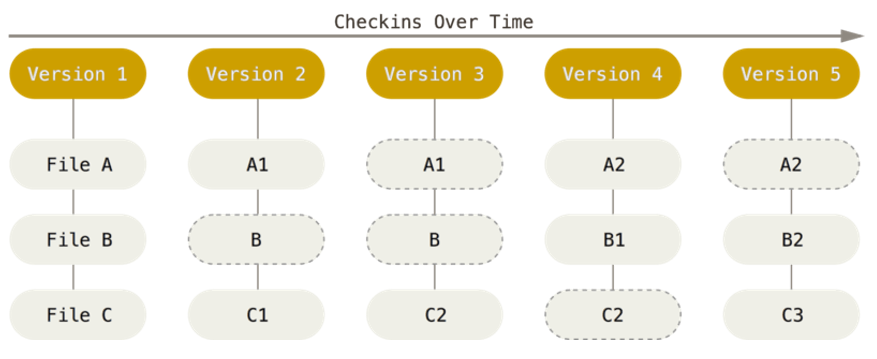
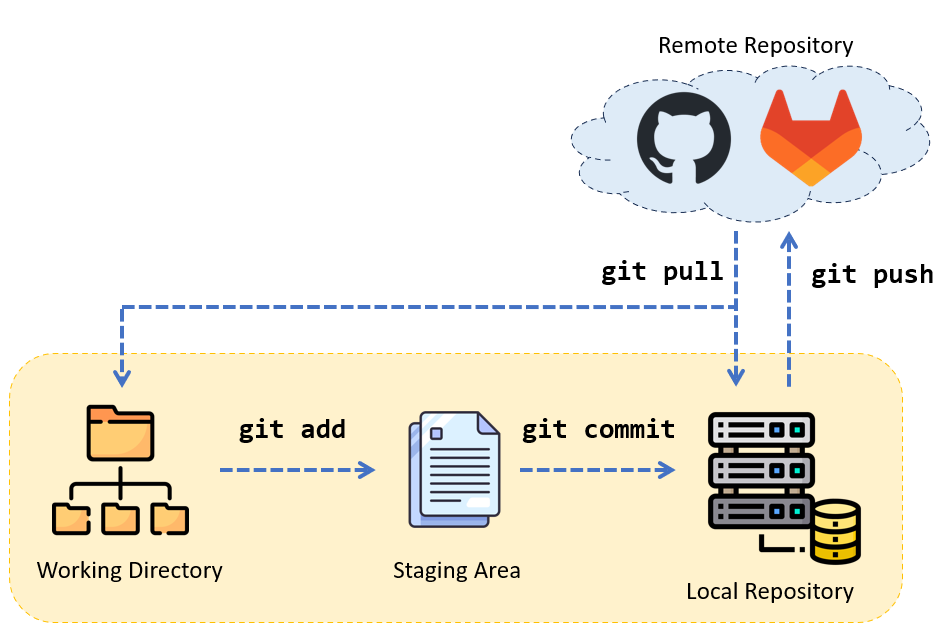

# GIT : Les bases

> * Auteur : Gwénaël LAURENT
> * Date : 27/09/2024

 [Licence Creative Commons](https://creativecommons.org/licenses/by-nc-sa/3.0/fr/)

- [GIT : Les bases](#git--les-bases)
- [1. Pourquoi utiliser Git ?](#1-pourquoi-utiliser-git-)
- [2. Installation de Git](#2-installation-de-git)
- [3. Gestion du versioning et terminologie](#3-gestion-du-versioning-et-terminologie)
- [4. Commandes de base pour l'utilisation en local](#4-commandes-de-base-pour-lutilisation-en-local)
  - [4.1. Initialiser un dépôt Git](#41-initialiser-un-dépôt-git)
  - [4.2. S'identifier](#42-sidentifier)
  - [4.3. Suivre l'état du dépôt](#43-suivre-létat-du-dépôt)
  - [4.4. Ajouter des fichiers à la zone de staging](#44-ajouter-des-fichiers-à-la-zone-de-staging)
  - [4.5. Créer un commit](#45-créer-un-commit)
  - [4.6. Vérifier l'état du dépôt](#46-vérifier-létat-du-dépôt)
  - [4.7. Voir l'historique des commits](#47-voir-lhistorique-des-commits)
- [5. Travailler avec un dépôt distant](#5-travailler-avec-un-dépôt-distant)
- [6. Ressources supplémentaires](#6-ressources-supplémentaires)


# 1. Pourquoi utiliser Git ?


**Git**  est un **système de gestion de versions** (_en anglais : **VCS** pour **Version Control System**_). Il permet de suivre l'évolution d'un projet (souvent du code), d'enregistrer des modifications et de collaborer avec d'autres personnes sur le même projet sans écraser le travail des autres.

- **Sauvegarder l'historique**  : Chaque modification de votre projet est enregistrée avec un commentaire. Cela permet de revenir à une version précédente si une erreur est commise.
 
- **Travailler à plusieurs**  : Git permet à plusieurs personnes de travailler sur un même projet, même en parallèle, sans risque de conflit majeur.
 
- **Synchronisation avec un dépôt distant**  : Vous pouvez sauvegarder votre projet sur un serveur distant (par exemple GitHub, GitLab) pour collaborer ou simplement pour stocker une copie de secours.


> Git gère les données comme un **instantané d’un mini système de fichiers (=snapshots)**. À chaque fois que vous validez ou enregistrez l’état du projet dans Git, il prend un instantané du contenu de votre espace de travail à ce moment et enregistre une référence à cet instantané. Pour être efficace, si les fichiers n’ont pas changé, Git ne stocke pas le fichier à nouveau, juste une référence vers le fichier original qu’il a déjà enregistré. Git pense ses données plus à la manière d’un flux d’instantanés.
>
> [](https://git-scm.com/book/fr/v2/D%C3%A9marrage-rapide-Rudiments-de-Git)

# 2. Installation de Git
Avant d'utiliser Git, il faut l'installer. Vous pouvez suivre l'article [Installation de Git sur Windows](installer-git-windows.md) ou utiliser un gestionnaire de paquets comme `apt` (Linux) ou `brew` (Mac).

# 3. Gestion du versioning et terminologie



---

**Repository** : *Dépôt*

C'est un dossier avec suivi de version par Git.

---

**Local Repository** : *Dépôt local*

Le dossier supervisé par Git qui se situe sur votre ordinateur. Git enregistre les versions dans un sous-répertoire de votre répertoire de projet (dossier **.git**). C'est une sorte de base de données pour conserver les modifications des fichiers.

---

**Remote Repository** : *Dépôt distant*

C'est un dossier supervisé par Git qui se situe souvent sur un serveur GIT en mode Cloud. Les deux plus connus sont [Github](https://github.com/) et [Gitlab](https://about.gitlab.com/). Vous pouvez synchroniser votre dépôt local avec votre dépôt distant.

---

**Working directory** : *Dossier de travail*

Il s'agit du dossier de votre projet avec ses fichiers tels qu'ils apparaissent sur votre disque dur, c'est-à-dire l'état actuel du projet sur lequel vous travaillez. Ce sont les fichiers que vous modifiez directement dans l'éditeur de texte avant de les ajouter à la zone de préparation. 

---

**Staging Area**: *Zone de préparation* ou *zone d'index*

Cela correspond à l'endroit où les fichiers modifiés sont placés avant d'être enregistrés dans un commit. C'est une étape intermédiaire où vous sélectionnez les fichiers qui seront inclus dans le prochain commit. 

---

**Commit** : *Validation*

Un commit représente un instantané de l'état des fichiers à un moment donné dans le projet. C'est une version sauvegardée de votre projet. Une fois que vous avez validé des changements (créé un commit), vous pouvez revenir à cet état à tout moment. 

# 4. Commandes de base pour l'utilisation en local
## 4.1. Initialiser un dépôt Git
Avant de commencer à utiliser Git, vous devez initialiser un **dépôt**  dans le dossier de votre projet. Utilisez un terminal et placez vous dans le répertoire de votre projet :

```bash
git init
```
Cela crée un sous-dossier caché `.git` qui contient toutes les informations nécessaires pour gérer les versions de votre projet.

 ## 4.2. S'identifier
Vérifiez si vous êtes identifiés par git dans votre dépôt local (vous l'avez peut-être déjà fait lors de l'installation de Git).

Les commandes suivantes doivent renvoyer votre nom et votre e-mail :

```bash
git config user.name
git config user.email
```

> Fournissez la même adresse mail que celle que vous utiliserez pour votre dépôt Cloud (GitHub ou GitLab)

Si vous devez modifier votre identification pour ce dépôt :

```sh
git config user.email "votre.adresse@email"
git config user.name "votre nom"
```


## 4.3. Suivre l'état du dépôt
Créez des fichiers dans votre dossier de projet (python, html, javascript ...).\
Pour savoir quels fichiers sont indexés ou pas par git, vous pouvez vérifier l'état du dépôt avec :


```bash
git status
```

## 4.4. Ajouter des fichiers à la zone de staging
Pour dire à Git quels fichiers il doit prendre en compte lors de la sauvegarde (commit), vous devez les "*stager*"  (ajouter à la zone de staging).

```bash
git add nom_du_fichier
```

Ou pour ajouter tous les fichiers modifiés :


```bash
git add .
```

Vérifiez l'état du dépot avec `git status`

## 4.5. Créer un commit
Un **commit**  est une version du projet. Vous enregistrez ici les fichiers qui ont été ajoutés à la zone de staging.

```bash
git commit -m "Message qui décrit les modifications"
```

## 4.6. Vérifier l'état du dépôt
Pour savoir quels fichiers ont été modifiés, ajoutés ou supprimés, vous pouvez vérifier l'état du dépôt avec :


```bash
git status
```

## 4.7. Voir l'historique des commits
Pour visualiser tous les commits effectués sur le projet :


```bash
git log
```


# 5. Travailler avec un dépôt distant
Git est souvent utilisé avec un dépôt distant, par exemple sur **GitHub**  ou **GitLab** , pour partager le code avec d'autres.

> Note : Pour créer un dépôt distant sur Github ou GitLab en utilisant l'authentification SSH, suivez les articles :
> * [Créer un dépôt distant sur Github](2-creer-depot-distant-github.md)
> * [Créer un dépôt distant sur GitLab](3-creer-depot-distant-gitlab.md)


<!-- ## 5.1. Lier le dépôt local à un dépôt distant en HTTPS
Pour lier votre dépôt local à un dépôt distant, vous utilisez la commande suivante :


```bash
git remote add origin https://url_du_dépôt.git
```
Ici, `origin` est le nom que Git utilise pour référencer le dépôt distant. Vous pouvez le nommer autrement, mais `origin` est la convention la plus courante.

## 5.2. Envoyer les modifications vers le dépôt distant
Après avoir effectué des commits en local, vous pouvez envoyer ces modifications sur le dépôt distant avec la commande :


```bash
git push origin master
```
 
> `master` est la branche principale par défaut (dans les nouvelles versions, c'est souvent `main`).

## 5.3. Récupérer les modifications du dépôt distant
Si d'autres personnes ont modifié le projet, vous pouvez **récupérer**  leurs modifications avec :

```bash
git pull origin master
```

Cela récupère les modifications depuis le dépôt distant et les fusionne avec votre dépôt local.

## 5.4. Cloner un dépôt distant
Si vous voulez télécharger un projet existant depuis un dépôt distant vers votre machine locale, vous pouvez utiliser la commande :


```bash
git clone https://url_du_dépôt.git
```

# 6. Résumé des commandes principales

| Commande | Description | 
| --- | --- | 
| git init | Initialiser un dépôt local | 
| git add . | Ajouter tous les fichiers modifiés à la zone de staging | 
| git commit -m "Message" | Créer un commit avec un message descriptif | 
| git status | Vérifier l'état du dépôt | 
| git log | Voir l'historique des commits | 
| git remote add origin URL | Lier le dépôt local à un dépôt distant | 
| git push origin master | Envoyer les commits vers le dépôt distant | 
| git pull origin master | Récupérer les modifications depuis le dépôt distant | 
| git clone URL | Cloner un dépôt distant sur votre machine |  -->


# 6. Ressources supplémentaires 
 
- [Documentation Git officielle](https://git-scm.com/book/fr/v2)
 
- [Tutoriel GitHub](https://docs.github.com/fr)

- [Reference Git](https://git-scm.com/docs)
