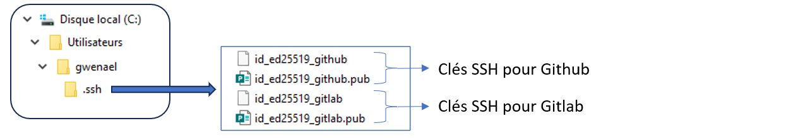
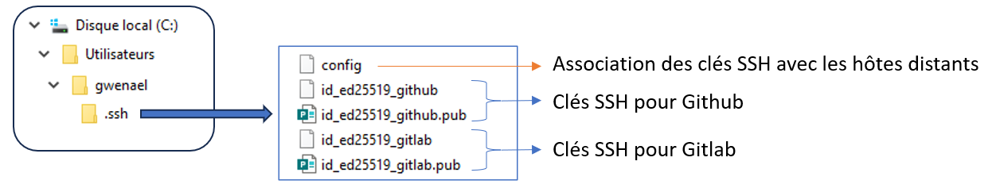

# GIT : Créer un dépôt distant sur Github

> * Auteur : Gwénaël LAURENT
> * Date : 23/09/2025

 [Licence Creative Commons](https://creativecommons.org/licenses/by-nc-sa/3.0/fr/)

- [GIT : Créer un dépôt distant sur Github](#git--créer-un-dépôt-distant-sur-github)
- [1. Créer un dépôt distant sur Github](#1-créer-un-dépôt-distant-sur-github)
- [2. Authentification par clé SSH pour GitHub](#2-authentification-par-clé-ssh-pour-github)
  - [2.1. Générer une clé SSH (si vous n'en avez pas déjà une)](#21-générer-une-clé-ssh-si-vous-nen-avez-pas-déjà-une)
  - [2.2. Sélectionner la clé qui sera associée à github.com](#22-sélectionner-la-clé-qui-sera-associée-à-githubcom)
  - [2.3. Ajouter la clé SSH à GitHub](#23-ajouter-la-clé-ssh-à-github)
  - [2.4. Tester la connexion SSH](#24-tester-la-connexion-ssh)
- [3. Lier votre dépôt local au dépôt distant](#3-lier-votre-dépôt-local-au-dépôt-distant)
  - [3.1. Si vous avez déjà un projet local](#31-si-vous-avez-déjà-un-projet-local)
  - [3.2. Si vous n'avez pas encore créé de projet local](#32-si-vous-navez-pas-encore-créé-de-projet-local)
- [4. Envoyer vos fichiers locaux sur GitHub](#4-envoyer-vos-fichiers-locaux-sur-github)
- [5. Récupérer les modifications du dépôt distant](#5-récupérer-les-modifications-du-dépôt-distant)
- [6. Le fichier `.gitignore`](#6-le-fichier-gitignore)
- [7. Documenter son dépôt avec `readme.md`](#7-documenter-son-dépôt-avec-readmemd)


# 1. Créer un dépôt distant sur Github 

[ ](https://github.com/) 

1. Connectez-vous à votre compte GitHub : [github.com](https://github.com/) .
 
2. Sous votre avatar > Your repositories, cliquez sur le bouton **"New"**  (Nouveau dépôt).
 
3. Remplissez les informations du dépôt : 
  * **Repository name**  : Choisissez un nom pour votre dépôt. Il apparaitra dans l'URL du projet. Par exemple "tp-python"
  * **Description**  (facultatif) : Décrivez brièvement votre projet.
  * **Visibilité**  :Choisissez **Public**  pour commencer.
 
1. Cliquez sur **"Create repository"** .

À ce stade, votre dépôt GitHub est créé, mais il est vide.


# 2. Authentification par clé SSH pour GitHub
L'authentification par clé SSH permet de vous connecter à GitHub sans avoir à entrer votre mot de passe à chaque fois.

Pour Info : [ANSSI - Recommandations pour un usage sécurisé d’(Open)SSH](https://cyber.gouv.fr/sites/default/files/2014/01/NT_OpenSSH.pdf)

## 2.1. Générer une clé SSH (si vous n'en avez pas déjà une)

Si vous n'avez pas encore une paire de clés SSH, vous pouvez en générer une sur votre machine locale. Ouvrez un terminal et tapez la commande suivante pour générer une clé SSH (utilisez l'adresse email fournie à GitHub)

```bash
ssh-keygen -t ed25519 -C "votre_email@example.com"
```
Si votre système ne supporte pas `ed25519`, vous pouvez utiliser `rsa` :

```bash
ssh-keygen -t rsa -b 4096 -C "votre_email@example.com"
```
* Gardez l'**emplacement par défaut** de la clé (`~/.ssh/` sous linux, `C:\Users\login\.ssh\` sous windows)
* Mais **modifiez le nom de la clé** pour qu'il comporte le nom du service cloud associé. Par exemple : `C:\Users\login/.ssh/id_ed25519_github` ou `C:\Users\login/.ssh/id_rsa_github`

Si vous le souhaitez (et c'est très souhaitable), vous pouvez ajouter une **phrase secrète** (passphrase) pour protéger l'accès à votre clé.



## 2.2. Sélectionner la clé qui sera associée à github.com
Pour indiquer à SSH quelle clé utiliser en fonction de l’hôte (GitHub ou GitLab), il faut configurer le fichier `~/.ssh/config`. 

1. Ouvrez ou créez le fichier `~/.ssh/config` avec un éditeur de texte (VScode par exemple)

2. Ajoutez la configuration suivante :

    ```bash
    # Configuration pour GitHub
    Host github.com
        HostName github.com
        User git
        IdentityFile C:\Users\login\.ssh\id_ed25519_github
    ```



<!-- ## 2.2. Ajouter votre clé SSH à l'agent SSH
Ensuite, vous devez ajouter la clé générée à l'agent SSH pour qu'elle soit utilisée par Git :


```bash
eval "$(ssh-agent -s)"
```

Ajoutez la clé SSH à l'agent :


```bash
ssh-add ~/.ssh/id_ed25519
``` -->

## 2.3. Ajouter la clé SSH à GitHub
1. Copiez le contenu de votre **clé publique**, avec l'extension **.pub** (fichier `C:\Users\login\.ssh\id_ed25519_github.pub`) : 
   1. Ouvrez le ficgier .pub dans VScode
   2. Sélectionner Tout (Ctrl+A)
   3. Copier la totalité (Ctrl+C)


2. Connectez-vous à votre compte GitHub.
 
3. Allez dans vos **paramètres utilisateur**  (cliquez sur votre avatar, puis sur **Settings** ).
 
4. Dans le menu de gauche, cliquez sur **SSH and GPG keys** .
 
5. Cliquez sur **New SSH key**  et collez la clé publique dans le champ prévu.
 
6. Donnez-lui un nom, puis cliquez sur **Add SSH key** .


## 2.4. Tester la connexion SSH
Vous pouvez tester la connexion SSH à GitHub pour vérifier que tout fonctionne correctement :

```bash
ssh -T git@github.com
```
* Saisissez votre passphrase de protection de votre clé

Si tout est bien configuré, vous verrez un message similaire à celui-ci confirmant la connexion :

```
Hi @votre_utilisateur! You've successfully authenticated...
```
> L'empreinte du serveur GitHub (fingerprint) sera enregist rée dans le fichier `C:\Users\login\.ssh\known_hosts`


# 3. Lier votre dépôt local au dépôt distant
Après avoir configuré l'authentification SSH, vous pouvez lier votre dépôt local au dépôt GitHub.

**Deux possibilités en fonction de votre projet local** :
* soit le dossier de projet local existe déjà : il faut utiliser `git remote add origin ...`
* soit vous n'avez pas encore de dossier de projet local : il faut utiliser `git clone ...`

## 3.1. Si vous avez déjà un projet local

1. **Initialiser votre dépôt Git local (si ce n'est pas déjà fait)** 

    Si votre dépôt local n'est pas encore initialisé avec Git, faites-le dans le répertoire de votre projet :

    ```bash
    git init
    git branch -M main
    git config user.email "votre.adresse@email"
    git config user.name "votre nom"
    ```

    *`git branch -M main` permet de choisir le nom de la branche par défaut*
<!-- 
# init d'un dépôt en choisissant le nom de la branche par défaut "main"
git init --initial-branch=main
ou
git init
git branch -M main
# connaître le nom de la branche dans laquelle tu te trouves 
git branch --show-current
# renommer la branche master en main
git branch -m master main
 -->`

2. **Ajouter l'adresse du dépôt distant avec SSH** 
    
    Récupérez l'URL SSH de votre dépôt sur GitHub. Vous pouvez la trouver dans l'interface de votre projet sur GitHub. Elle ressemble à ceci :


    `git@github.com:nom-utilisateur/nom-du-dépôt.git`


    Dans votre terminal, ajoutez ce dépôt distant avec la commande `git remote add origin` :

    ```bash
    git remote add origin git@github.com:nom-utilisateur/nom-du-dépôt.git
    ```

    *Ici, `origin` est le nom que Git utilise pour référencer le dépôt distant. Vous pouvez le nommer autrement, mais `origin` est la convention la plus courante.*

3. **Vérifier la configuration du dépôt distant** 
    
    Vérifiez que le dépôt distant a bien été ajouté avec :

    ```bash
    git remote -v
    ```

    Cela devrait afficher quelque chose comme :


    ```bash
    origin  git@github.com:nom-utilisateur/nom-du-dépôt.git (fetch)
    origin  git@github.com:nom-utilisateur/nom-du-dépôt.git (push)
    ```

## 3.2. Si vous n'avez pas encore créé de projet local

Vous pouvez "**cloner**" un dépôt distant sur votre machine locale. Cela créera votre dossier de projet local en le liant automatiquement avec le dépôt distant.

1. **Créer un dossier qui contiendra les fichiers de votre projet**.
   
2. **Cloner le dépôt distant sur votre machine locale**. 
   
    Récupérez l'URL SSH de votre dépôt sur GitHub. Vous pouvez la trouver dans l'interface de votre projet sur GitHub. Elle ressemble à ceci :

    `git@github.com:nom-utilisateur/nom-du-dépôt.git`


    Dans votre terminal, déplacez vous dans le nouveau dossier de projet, et clonez le dépôt distant avec la commande :

    > N'oubliez pas le point à la fin de commande !

    ```bash
    git clone git@github.com:nom-utilisateur/nom-du-dépôt.git .
    ```

    Assurez vous d'être identifié sur le dépôt local :

    ```sh
    git config user.email "votre.adresse@email"
    git config user.name "votre nom"
    ```


3. **Vérifier la configuration du dépôt distant** 
    
    Vérifiez que le dépôt distant a bien été ajouté avec :

    ```bash
    git remote -v
    ```

    Cela devrait afficher quelque chose comme :

    ```bash
    origin  git@github.com:nom-utilisateur/nom-du-dépôt.git (fetch)
    origin  git@github.com:nom-utilisateur/nom-du-dépôt.git (push)
    ```


# 4. Envoyer vos fichiers locaux sur GitHub
Une fois que vous avez lié votre dépôt local au dépôt distant, vous pouvez envoyer vos fichiers vers GitHub.
 
1. **Ajouter les fichiers à la zone de préparation**  :

    ```bash
    git add .
    ```

2. **Créer un commit**  :

    ```bash
    git commit -m "Premier commit"
    ```

3. **Envoyer les modifications vers Github**  :

    ```bash
    git push -u origin main
    ```

    Le premier `git push` doit avoir l'option `-u`. Cela sert à lier la branche locale à une branche distante, et à définir cette dernière comme la branche de suivi par défaut.

    On peut ensuite simplement utiliser des commandes abrégées comme `git push` ou `git pull` sans spécifier le dépôt (origin) et la branche

<!-- 
Le -u (abréviation de --set-upstream) permet d'automatiser le suivi entre une branche locale et une branche distante.
git push --set-upstream origin main
 -->

> Note : La branche par défaut peut être `main` au lieu de `master`, selon la configuration de GitHub. Si c'est le cas, remplacez `master` par `main`. *Vous pouvez trouver le nom de la branche principale dans l'interface de votre projet sur GitHub*.


# 5. Récupérer les modifications du dépôt distant
Si d'autres personnes ont modifié le projet sur le dépôt distant, vous pouvez **récupérer**  leurs modifications avec :

```bash
git pull origin main
```

Cela récupère les modifications depuis le dépôt distant et les fusionne avec votre dépôt local.

# 6. Le fichier `.gitignore`

Le fichier **Le fichier `.gitignore`**  est un élément clé dans un projet Git. Il permet de définir quels fichiers ou dossiers doivent être **exclus** du contrôle de version, c'est-à-dire qu'ils ne seront ni suivis ni ajoutés au dépôt Git.

Consultez l'article sur [Le fichier `.gitignore`](4-fichier-.gitignore.md)

#  7. Documenter son dépôt avec `readme.md`
Tous les dépôts GitHub ou GitLab ont des fichiers de documentation sur le projet.

Le fichier principal de documentation doit se situer à la racine du projet et s'appelle **`readme.md`**. Il contient au minimum une description succinte du contenu du dépôt.

Les fichiers de documentation sont écrit au format **`Markdown`**. C'est un **format texte simple** avec quelques informations sur le sens du contenu (titre, liens, images ...).

Consultez l'article sur la [syntaxe du langage Markdown](markdown_syntaxe.md).


