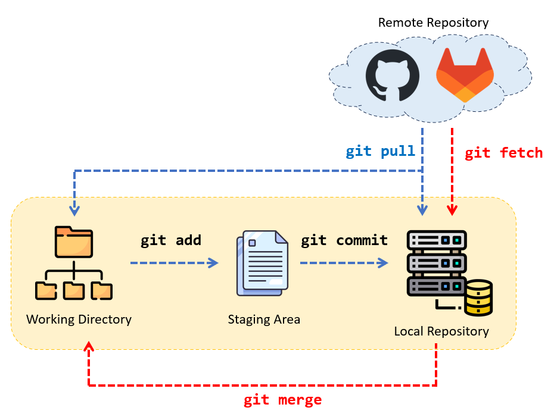

# GIT : Les commandes fetch et merge

> * Auteur : Gwénaël LAURENT
> * Date : 20/09/2024

 [Licence Creative Commons](https://creativecommons.org/licenses/by-nc-sa/3.0/fr/)

- [GIT : Les commandes fetch et merge](#git--les-commandes-fetch-et-merge)
- [1. La commande fetch](#1-la-commande-fetch)
- [2. Différence entre `git fetch` et `git pull`](#2-différence-entre-git-fetch-et-git-pull)
- [3. Utilisation de `git fetch`](#3-utilisation-de-git-fetch)
  - [3.1. Récupérer toutes les branches distantes](#31-récupérer-toutes-les-branches-distantes)
  - [3.2. Vérifier les différences après un fetch](#32-vérifier-les-différences-après-un-fetch)
  - [3.3. Fusionner manuellement après un fetch : `git merge`](#33-fusionner-manuellement-après-un-fetch--git-merge)
- [4. Résumé des commandes](#4-résumé-des-commandes)


# 1. La commande fetch

La commande `git fetch` est une commande essentielle pour synchroniser votre dépôt local avec le dépôt distant sans modifier votre environnement de travail local immédiatement. Elle permet de récupérer les **métadonnées et les nouvelles modifications**  (commits) du dépôt distant **sans fusionner**  ces changements avec vos fichiers locaux.

Si vous collaborez avec d'autres personnes sur le même dépôt, vous pouvez utiliser `git fetch` pour voir ce qui a été modifié sur le dépôt distant sans modifier votre propre travail local. Ensuite, si tout semble en ordre, vous pouvez fusionner ces changements avec un `git merge`.



---

**fetch** : *récupérer*

Cela fait référence à l'action de récupérer les mises à jour depuis un dépôt distant sans les fusionner avec la branche locale.

---

**merge** : *fusion*

Cela désigne l'action de combiner les modifications de différentes branches dans une seule branche.


# 2. Différence entre `git fetch` et `git pull`
- `git fetch` : Télécharge les modifications du dépôt distant, mais ne les applique pas (pas de fusion avec votre branche locale). Cela vous permet de voir les modifications et de décider quand vous souhaitez les intégrer.
 
- `git pull` : Fait en deux étapes : d'abord un `fetch`, puis un **merge**  (fusionne immédiatement les modifications du dépôt distant avec votre branche actuelle).

En résumé :
 
- `git fetch` : récupère les changements distants.
- `git pull` : récupère et applique immédiatement les changements.


# 3. Utilisation de `git fetch`
## 3.1. Récupérer toutes les branches distantes

```bash
git fetch origin
```
Cette commande télécharge toutes les modifications des branches distantes du dépôt `origin` (le dépôt distant configuré par défaut).

## 3.2. Vérifier les différences après un fetch
Après avoir effectué un `git fetch`, vous pouvez voir les changements avant de les fusionner.

Pour afficher les nouveaux commits sur la branche `master` du dépôt distant sans les fusionner avec votre branche locale.

```bash
git log origin/master
```

Vous pouvez aussi comparer la branche locale `master` avec la branche distante correspondante `origin/master` en utilisant la commande :

```bash
git diff master origin/master
```

Vous pouvez également vérifier les différences pour un fichier spécifique :

```bash
git diff master origin/master -- chemin/vers/le/fichier
```

## 3.3. Fusionner manuellement après un fetch : `git merge`
Après avoir récupéré les modifications avec `git fetch`, si vous souhaitez fusionner les changements dans votre branche locale, vous pouvez le faire manuellement :

```bash
git merge origin/master
```
Cela permet d'intégrer les changements de la branche `master` du dépôt distant dans votre branche locale actuelle.

# 4. Résumé des commandes
| Commande | Description | 
| --- | --- | 
| git fetch origin | Récupère les modifications distantes sans les fusionner | 
| git log origin/master | Affiche les nouveaux commits sur la branche master distante | 
| git merge origin/master | Fusionne les modifications récupérées dans votre branche locale | 
