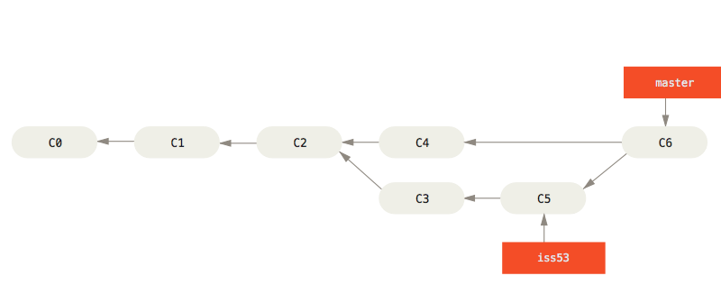

# GIT : Intérêt d'utiliser des branches

<!-- https://git-scm.com/book/fr/v2/Les-branches-avec-Git-Branches-et-fusions%C2%A0:-les-bases -->
<!-- https://git-scm.com/book/fr/v2/Les-branches-avec-Git-Travailler-avec-les-branches -->

> * Auteur : Gwénaël LAURENT
> * Date : 27/09/2024

 [Licence Creative Commons](https://creativecommons.org/licenses/by-nc-sa/3.0/fr/)

- [GIT : Intérêt d'utiliser des branches](#git--intérêt-dutiliser-des-branches)
- [1. Qu'est-ce qu'une branche dans Git ?](#1-quest-ce-quune-branche-dans-git-)
- [2. Intérêt d'utiliser des branches](#2-intérêt-dutiliser-des-branches)
- [3. Exemples de types de branches couramment utilisées](#3-exemples-de-types-de-branches-couramment-utilisées)
- [4. Documentation](#4-documentation)

# 1. Qu'est-ce qu'une branche dans Git ? 
Une **branche**  dans Git est une version parallèle du projet, qui vous permet de travailler sur des changements ou des fonctionnalités sans affecter la version principale du code. Chaque branche est un pointeur vers une série de commits. La branche par défaut dans Git est généralement appelée `main`**  (ou `master` dans les anciennes versions).

Lorsque vous créez une nouvelle branche, Git crée une copie du dernier état du projet à partir de la branche actuelle. Cela vous permet de travailler sur de nouvelles fonctionnalités, de corriger des bugs ou de tester des idées sans modifier la branche principale.

# 2. Intérêt d'utiliser des branches 

Les branches sont essentielles pour une gestion de code efficace et flexible. Voici leurs principaux avantages :
 
* Isolation du travail
* Collaboration facile
* Gestion des fonctionnalités et correctifs 
* Expérimentation sans risque 
* Historique plus propre et contrôle des versions 
* Livraison continue 

# 3. Exemples de types de branches couramment utilisées
 
- **`main`**  ou ****`main`**  ou `master`**  : Branche principale stable où le code est prêt pour la production.
 
- **`develop`**  : Branche de développement où les fonctionnalités sont intégrées avant d'être fusionnées dans `main`.
 
- **`feature/*`**  : Branches dédiées aux nouvelles fonctionnalités.
 
- **`bugfix/*`**  : Branches dédiées à la correction de bugs.
 
- **`hotfix/*`**  : Utilisées pour les correctifs urgents en production.

# 4. Documentation

[Les branches avec Git - Branches et fusions : les bases](https://git-scm.com/book/fr/v2/Les-branches-avec-Git-Branches-et-fusions%C2%A0:-les-bases)
