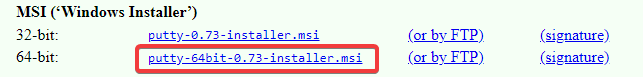
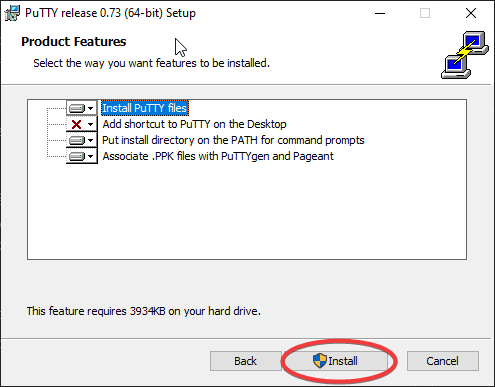
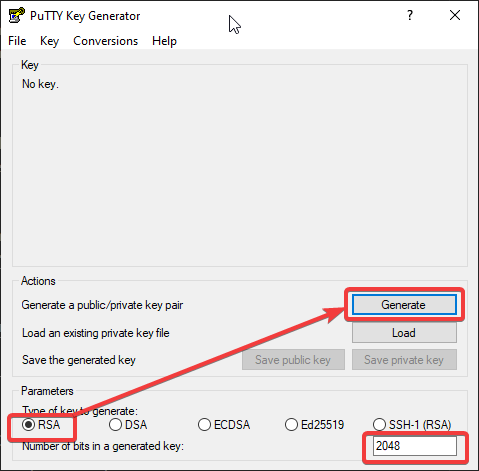
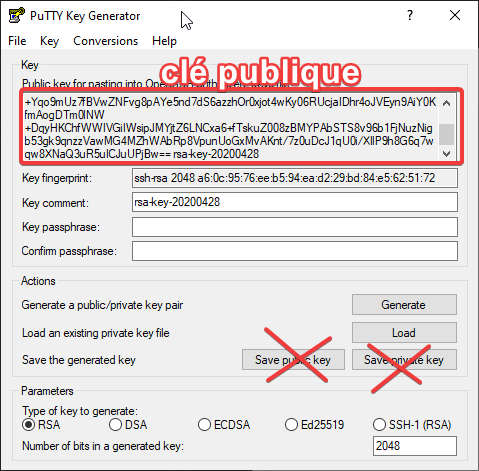
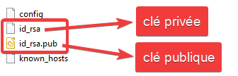
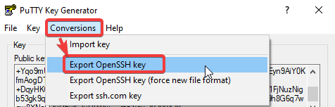

# Générer des clés SSH avec Putty

> * Auteur : Gwénaël LAURENT
> * Date : 28/04/2020
> * OS : Windows 10 (version 1903)
> * VScode : version 1.44.2 (system setup)

 [Licence Creative Commons](https://creativecommons.org/licenses/by-nc-sa/3.0/fr/)

- [Générer des clés SSH avec Putty](#g%c3%a9n%c3%a9rer-des-cl%c3%a9s-ssh-avec-putty)
- [1. Objectifs de ce document](#1-objectifs-de-ce-document)
- [2. Installation de Putty](#2-installation-de-putty)
- [3. Génération des clés SSH avec PuttyGen](#3-g%c3%a9n%c3%a9ration-des-cl%c3%a9s-ssh-avec-puttygen)
  - [3.1 Création de la clé publique](#31-cr%c3%a9ation-de-la-cl%c3%a9-publique)
  - [3.2 Création de la clé privée](#32-cr%c3%a9ation-de-la-cl%c3%a9-priv%c3%a9e)

# 1. Objectifs de ce document
Générer une paire de clés SSH publique / privée pour utiliser avec GIT.
Pour ceux qui ne peuvent pas installer OpenSSH de Windows 10. Sans doute parce que vous avez une ancienne version de Windows ...

> Attention : Les clés SSH générées par Putty fonctionneront pour GIT mais pas pour le développement à distance (VScode pour coder sur Raspberry par exemple)

# 2. Installation de Putty
Téléchargez le fichier d'installation MSI sur le [site officiel de Putty](https://www.chiark.greenend.org.uk/~sgtatham/putty/latest.html)



Double cliquez sur le fichier téléchargé ```putty-64bit-0.73-installer.msi```

* emplacement d'install : C:\Program Files\PuTTY\
* laissez la sélection des composants par défaut
* Cliquez sur Install



# 3. Génération des clés SSH avec PuttyGen
Lancez le programme PuttyGen


Sélectionnez une clé RSA 2048 bits et cliquezsur ```Generate```



Bougez la souris dans la zone ```Key``` (Putty s'en sert pour générer des nombres aléatoires).



> Attention : il ne sert à rien d'utiliser les boutons "Save public key" et "Save private key", ça génère des clés inutilisables par GIT.

Il faut maintenant créer les 2 fichiers de clés SSH utilisable par GIT. Pour rappel, ces fichiers doivent se trouver dans un dossier ```.ssh``` du profil utilisateur :

```C:\Users\VOTRE_LOGIN\.ssh```



> Activez l'affichage des extensions des fichiers !

## 3.1 Création de la clé publique
Dans le dossier ```C:\Users\VOTRE_LOGIN\.ssh```, créez un fichier nommé ```id_rsa.pub```.

Ouvrez le dans VScode et copiez y la clé publique généré par PuttyGen. Enregistrez les modifs.

## 3.2 Création de la clé privée
Dans PuttyGen, menu principal Conversions > Export OpenSSH key



Acceptez l'exportation sans passphrase.

Enregistrez la clé privée dans un fichier nommé ```id_rsa``` (sans extension) à l'intérieur du dossier ```C:\Users\VOTRE_LOGIN\.ssh```.

