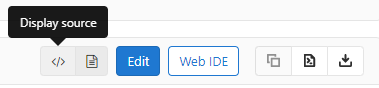

# Syntaxe Markdown
> * Auteurs : Benoit Papegay — Philippe Marquet (Université de Lille)
> * Source utilisée : [_La syntaxe markdown_](https://docs.framasoft.org/fr/mattermost/help/messaging/formatting-text.html) sur [docs.framasoft.org](https://docs.framasoft.org/fr/)
> * Adaptation : Gwénaël LAURENT
> * Date : 27/09/2024

 [Licence Creative Commons](https://creativecommons.org/licenses/by-nc-sa/3.0/fr/)


- [Syntaxe Markdown](#syntaxe-markdown)
- [1. Présentation](#1-présentation)
- [2. La syntaxe markdown](#2-la-syntaxe-markdown)
  - [2.1. Titres et sections](#21-titres-et-sections)
  - [2.2. Styles de texte (gras, italique, ...)](#22-styles-de-texte-gras-italique-)
  - [2.3. Blocs de code](#23-blocs-de-code)
  - [2.4. Liens](#24-liens)
  - [2.5. Images](#25-images)
  - [2.6. Citations](#26-citations)
  - [2.7. Listes](#27-listes)
  - [2.8. Tableaux](#28-tableaux)
  - [2.9 Formules mathématiques](#29-formules-mathématiques)
- [3. Documentation](#3-documentation)

# 1. Présentation

Le code source Markdown est un **format texte simple lisible par tous**. Il peut être transmis en tant que tel.

Les fichiers au format Markdown (extension `.md`) sont reconnus par les plateformes GitLab et GitHub qui en proposent une visualisation HTML (conversion automatique). \
Markdown s'impose alors comme le **format de documentation des projets GitLab et GitHub**.

Les fichiers Markdown peuvent être traduits en HTML, PDF, EPUB, LaTeX, et bien d'autres formats, par exemple via Pandoc [pandoc.org ](https://pandoc.org/) ou l'extension VScode "[Markdown PDF (yzane)](https://marketplace.visualstudio.com/items?itemName=yzane.markdown-pdf)" \

> Le présent fichier est bien entendu écrit en Markdown.\
> Vous pouvez visualiser le code source via les boutons "_Display source_" ou "_Open raw_" situés en haut à droite des pages GitLab ou GitHub.\
> 

# 2. La syntaxe markdown

## 2.1. Titres et sections

Vous pouvez précéder le texte d'un ou plusieurs `#` pour créer des titres 

```
# Un titre du niveau le plus haut 
## Un titre de niveau inférieur
### Un titre de niveau moindre
```

etc. jusqu'à 6 niveaux.

## 2.2. Styles de texte (gras, italique, ...)

Vous pouvez utiliser `_` ou `*` autour d'un mot pour le mettre en italique. Mettez-en deux pour le mettre en gras.
*  `_italique_` s'affiche ainsi : _italique_
*  `**gras**` s'affiche ainsi : **gras**
* `**_gras-italique_**` s'affiche ainsi : **_gras-italique_**
* `~~barré~~` s'affiche ainsi : ~~barré~~


## 2.3. Blocs de code

Entourez les éléments de code de 3 backquote (accent grave, AltGr+7). Ainsi

    ```
    Des extraits de `code` en ligne sont `entourés de backquote` !
    ```

s'affiche ainsi :

```
bloc de code
```

Précisez le langage pour profiter de la prise en charge la coloration syntaxique :

    ```python
    def next(i, s) :
        j = i+1
        t = s + 'un'
        return j, t 
    ```

s'affiche

```python
def next(i, s) :
    j = i+1
    t = s + 'un'
    return j, t 
```

    ```html
    <html>
      <head><title>Title!</title></head>
      <body>
        <p id="foo">Hello, World!</p>
        <script type="text/javascript">var a = 1;</script>
        <style type="text/css">#foo { font-weight: bold; }</style>
      </body>
    </html>
    ```

s'affiche

```html
<html>
  <head><title>Title!</title></head>
  <body>
    <p id="foo">Hello, World!</p>
    <script type="text/javascript">var a = 1;</script>
    <style type="text/css">#foo { font-weight: bold; }</style>
  </body>
</html>
```

_GitLab utilise la biblithèque [Rouge Ruby](http://rouge.jneen.net/) pour cette coloration syntaxique. Consultez la liste des langages supportées sur le site de Rouge._


## 2.4. Liens

Créez un lien intégré en mettant le texte désiré entre crochets et le lien associé entre parenthèses.

```
Consultez [la documentation officielle de Python](https://docs.python.org/3/) !
```

s'affichera :

Consultez [la documentation officielle de Python](https://docs.python.org/3/) !

Plus simplement, écrivez `https://docs.python.org/3/` pour afficher https://docs.python.org/3/

Utilisez des chemins relatifs ou abolus pour crer des liens vers les fichiers locaux :

```
Consultez [la page d'accueil de mes docs](../readme.md).
```

s'affichera :

Consultez [la page d'accueil de mes docs](../readme.md).

## 2.5. Images

Affichez une image en ligne en utilisant la syntaxe des liens MAIS avec un **```!```** devant.


```

```

donnera :


Utilisez simplement un chemin (absolu, ou relatif) pour désigner une image locale :

```

```

donnera :


## 2.6. Citations

Les citations se font avec le signe `>` :

```
> Oh la belle prise !
```
s'affichera :

> Oh la belle prise !

Et sur plusieurs lignes :

```
> L'optimisation prématurée est la racine de tous les maux (ou, du moins, la plupart d'entre eux) en programmation.  
> _(en) Premature optimization is the root of all evil (or at least most of it) in programming.  
> Donald Knuth (trad. Wikiquote), Decembre 1974, Conférence du Prix Turing 1974, dans Communications of the ACM.
```

s'affichera :

> L'optimisation prématurée est la racine de tous les maux (ou, du moins, la plupart d'entre eux) en programmation.  
> _(en) Premature optimization is the root of all evil (or at least most of it) in programming._  
> Donald Knuth (trad. Wikiquote), Decembre 1974, Conférence du Prix Turing 1974, dans Communications of the ACM.

## 2.7. Listes

Vous pouvez créer des listes en préfixant le texte par les caractères `* ` ou `- ` pour des listes non ordonnées ou avec des nombres pour des listes ordonnées.

Une liste non ordonnée :

```
* un élément
* un autre
  * un sous élément
  * un autre sous élément
* un dernier élément
```

* un élément
* un autre
  * un sous élément
  * un autre sous élément
* un dernier élément

Une liste ordonnée :

```
1. élément un
2. élément deux
```

1. élément un
2. élément deux

La valeur des nombres importe peu :

```
1. élément un
1. élément deux
```

1. élément un
1. élément deux


## 2.8. Tableaux

Pour créer un tableau vous devez placer une ligne de tirets (`-`) sous la ligne d'entête et séparer les colonnes avec des `|` (AltGr+6). Vous pouvez aussi préciser l'alignement en utilisant des `:`. :

```
| Aligné à gauche  | Centré          | Aligné à droite |
| :--------------- |:---------------:| -----:|
| ce texte         | ce texte        |  ce texte |
| est              | est             |  est |
| aligné à gauche  | centré  |  aligné à droite |
```

| Aligné à gauche  | Centré          | Aligné à droite |
| :--------------- |:---------------:| -----:|
| ce texte         | ce texte        |  ce texte |
| est              | est             |  est |
| aligné à gauche  | centré  |  aligné à droite |

Remarquez que les `|` ne sont pas nécessairement alignés dans le texte source Markdown.


## 2.9 Formules mathématiques
Les formules mathématiques et autres sont prises en charge grâce à l'utilisation du balisage LaTeX

En LaTeX, les formules sont encadrées par `$....$`

Exemple :

```
$V_{sphere} =\dfrac{4}{3} \times \pi \times r^3$
```
$V_{sphere} =\dfrac{4}{3} \times \pi \times r^3$

<!-- [GitLab : Handbook Markdown Guide > Math](https://handbook.gitlab.com/docs/markdown-guide/#math) -->

Pour la syntaxe LaTeX, consultez [WIKIBOOKS : LaTeX/Mathematics](https://en.wikibooks.org/wiki/LaTeX/Mathematics)

# 3. Documentation

[GitLab : Handbook Markdown Guide](https://handbook.gitlab.com/docs/markdown-guide/)


<!-- *Ajout Gwen*

Exemple d'utilisation de pandoc pour créer un PDF : 
```
pandoc -t beamer --slide-level 2 -V "aspectratio=1610" -s fichier_source.md -o fichier_destination.pdf
```
Le paramètre ```--slide_level``` va changer de page à chaque titre de niveau 1 ou de niveau 2

Une première page sera générée pour les informations de titre écrites de cette façon :

```
---
title: Diplôme inter-universitaire - Enseigner l'informatique au lycée
subtitle: Université de Lille 
author: |
        | Benoit Papegay — Philippe Marquet
        | 
        | diu-eil@univ-lille.fr
date: mai 2019
lang: fr
---
``` -->
