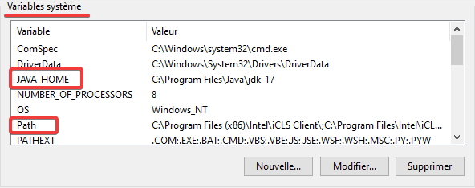
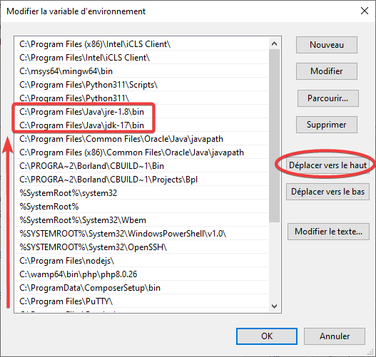
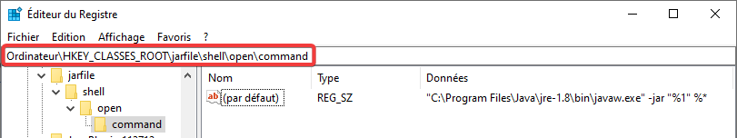
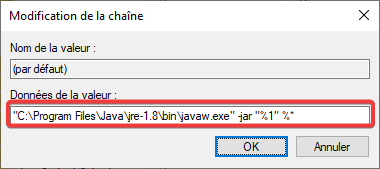

# Installation de Java (JRE et JDK)

> * Auteur : Gwénaël LAURENT
> * Date : 24/07/2023
> * OS : Windows 10 (version 22H2)

 [Licence Creative Commons](https://creativecommons.org/licenses/by-nc-sa/3.0/fr/)

- [Installation de Java (JRE et JDK)](#installation-de-java-jre-et-jdk)
- [1. Présentation de Java](#1-présentation-de-java)
- [2. Vérifiez si la JRE et le JDK sont déjà installés sur votre machine](#2-vérifiez-si-la-jre-et-le-jdk-sont-déjà-installés-sur-votre-machine)
- [3. Installer le JDK (Java Development Kit)](#3-installer-le-jdk-java-development-kit)
- [4. Installer la JRE (Java Runtime Edition)](#4-installer-la-jre-java-runtime-edition)
- [5. Modifier les variables d'environnements pour Java](#5-modifier-les-variables-denvironnements-pour-java)
- [6. Associer les fichiers .jar avec la JRE](#6-associer-les-fichiers-jar-avec-la-jre)
  - [6.1 Tester l'association](#61-tester-lassociation)
  - [6.2 Corriger l'association dans la base de registre](#62-corriger-lassociation-dans-la-base-de-registre)


# 1. Présentation de Java
Java est un **langage de programmation multiplateforme**, orienté objet et centré sur le réseau. Il s'agit d'un langage de programmation rapide, sécurisé et fiable qui permet de tout coder, des applications mobiles aux logiciels d'entreprise en passant par les applications de big data et les technologies côté serveur.
 * Le code source java est pré-compilé pour donner un fichier "**bytecode java**"
 * Le bytecode est décodé et interprété par une machine virtuelle java qu'il faut installer sur l'OS : la **JRE (Java Runtime Edition)**
 * Pour créer un programme Java, il faut installer le **JDK (Java Development Kit)**

Les technologies Java appartiennent à la société **Oracle** (développées initialement par Sun Microsystems puis acquises par Oracle à la suite du rachat de l'entreprise en 2010).

# 2. Vérifiez si la JRE et le JDK sont déjà installés sur votre machine
Emplacement des fichiers :
* La JRE est installée en C:\Program Files\Java\jre-1.8\
* Le JDK est installé en C:\Program Files\Java\jdk-17\

Ouvrez une invite de commande (touche Windows > recherchez "invite" > Cliquez sur "Invite de commandes").

* Vérifiez que le terminal utilise la bonne version de la ```JRE``` (au moins 1.8):
    ```shell
    >java -version
    java version "1.8.0_371"
    Java(TM) SE Runtime Environment (build 1.8.0_371-b11)
    Java HotSpot(TM) 64-Bit Server VM (build 25.371-b11, mixed mode)
    ```

* Vérifiez que le terminal utilise la bonne version du ```JDK``` (au moins 1.7):
    ```shell
    >javac -version
    javac 17.0.7
    ```
    
* Vérifiez que la variable d'environnement ```JAVA_HOME``` pointe bien vers l'emplacament du JDK:
    ```shell
    >echo %JAVA_HOME%
    C:\Program Files\Java\jdk-17
    ```
    


# 3. Installer le JDK (Java Development Kit)
Téléchargez le JDK chez Oracle https://www.oracle.com/fr/java/technologies/downloads/ :
* Prendre la version LTS (long-term support) : JDK 17 > Windows > x64 Installer
* Double cliquez sur le fichier téléchargé : jdk-17_windows-x64_bin.exe 
* Installation en : C:\Program Files\Java\jdk-17


# 4. Installer la JRE (Java Runtime Edition)
Téléchargez la JRE chez Java https://www.java.com/fr/download/ :
* Le site web détecte la version de votre OS : Java 64 bits pour Windows
* Cliquez sur "Télécharger Java" (c'est la dernière version)
* Double cliquez sur le fichier téléchargé : jre-8u371-windows-x64.exe 
* Installation en : C:\Program Files\Java\jre-1.8


# 5. Modifier les variables d'environnements pour Java
Affichez la fenêtre de modification des variables d'environnement système :
  * Touche Windows > recherchez "variables" > Cliquez sur "Modifier les variables d'environnement système" > Cliquez sur le bouton "Variables d'environnement" 

  

Dans la zone "```Variables système```"

* Ajoutez une variable d'environnement système ```JAVA_HOME``` :
  * Sous la zone "Variables système", cliquez sur "```Nouvelle...```"
  * Nom de la variable : ```JAVA_HOME```
  * Valeur de la variable : ```C:\Program Files\Java\jdk-17``` (à adapter suivant la version que vous avez installée)

* Modifiez la variable d'environnement système ```Path``` : sélectionnez la variable ```Path``` > "```Modifier```" 

  * pour la JRE ajoutez une nouvelle valeur ```Nouveau``` (à adapter suivant la version que vous avez installée):
    ```
    C:\Program Files\Java\jre-1.8\bin
    ```

  * pour le JDK ajoutez une nouvelle valeur ```Nouveau``` (à adapter suivant la version que vous avez installée):
      ```
      C:\Program Files\Java\jdk-17\bin
      ```

  * Modifier l'ordre des dossiers de la variable path : Les emplacements C:\Program Files\Java\jre-1.8\bin et C:\Program Files\Java\jdk-17\bin doivent se situer **AVANT (plus haut)** C:\Program Files\Common Files\Oracle\Java\javapath

    

> Remarque : les modifications des variables d'environnement ne sont pas prises en compte dans les fenêtres d'invite de commandes déjà ouvertes. Il faut donc absolument en ouvrir une nouvelle pour tester les modifications.

Ouvrez une **nouvelle fenêtre** d'invite de commande et testez vos modifications avec les 3 commandes précédentes :
```cmd
java -version
javac -version
echo %JAVA_HOME%
```

# 6. Associer les fichiers .jar avec la JRE
## 6.1 Tester l'association
Les fichiers "bytecode java" avec une extension en .jar (jar = Java Archive) doivent être associés à la JRE pour être exécutés simplement avec un double-clic dessus.

* Si vous disposez d'un fichier .jar, essayez de double-cliquer dessus à partir de l'explorateur de fichier de windows. 

* Si vous n'avez pas de fichier .jar, vous pouvez télécharger l'utilitaire Open Source **```mqtt-spy```** sur 
[https://github.com/eclipse/paho.mqtt-spy/wiki/Downloads](https://github.com/eclipse/paho.mqtt-spy/wiki/Downloads). C'est un logiciel Java graphique qui permet de tester les communications avec un broker MQTT (communications en mode subscriber-publisher). Pour ce qui nous concerne ici, il suffit juste que le logiciel démarre quand on double-clic sur le fichier mqtt-spy-1.0.0.jar (et peu importe le rôle de ce logiciel pour l'instant...).

Si les fichiers .jar ne s'exécutent pas quand on clique dessus, il faut modifier l'association des fichiers jar avec la JRE dans la base de registre de Windows.

## 6.2 Corriger l'association dans la base de registre
> ATTENTION : toute modification de la base de registre de Windows est potentiellement dangereuse pour la stabilité de l'OS. Ne modifiez rien si vous ne savez pas ce que vous faites ! Il est vivement conseillé de faire une sauvegarde des clés de registre avant de les modifier : ça vous permettra de revenir en arrière si vos modifications n'ont pas eu l'effet escompté.

Lancez le logiciel REGEDIT : Touche Windows > recherchez "regedit" > Cliquez sur "Editeur de registre"

* Dans la colonne de gauche, ouvrez la branche **Ordinateur\HKEY_CLASSES_ROOT\jarfile**
* Clic droit sur la branche "jarfile" > Exporter > donner un nom au fichier > sauvegardez l'état actuel de cette branche de la base de registre (pour restaurer cette version de la branche en cas de problème, il suffira de double-cliquer sur le fichier .reg sauvegardé).
* Dans la colonne de gauche, ouvrez maintenant la clé **Ordinateur\HKEY_CLASSES_ROOT\jarfile\shell\open\command**
  
* Dans la colonne de droite, double-cliquez sur le nom de la valeur "(par défaut)"
* Modifiez les données de la valeur pour utiliser la JRE (à la place du jdk)
  ```
  "C:\Program Files\Java\jre-1.8\bin\javaw.exe" -jar "%1" %*
  ```
  
* Cliquez sur OK pour enregistrer la modification
* Testez l'association des fichiers .jar avec la JRE comme précédemment
* Fermez l'éditeur de registre
