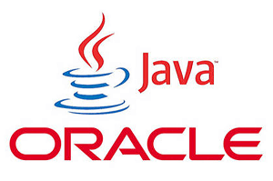

# Ressources pour la programmation Java

> * Auteur : Gwénaël LAURENT
> * Date : 24/07/2023
> * OS : Windows 10 (version 22H2)

 [Licence Creative Commons](https://creativecommons.org/licenses/by-nc-sa/3.0/fr/)

* [Installation de Java (JRE et JDK)](installer_java.md)
