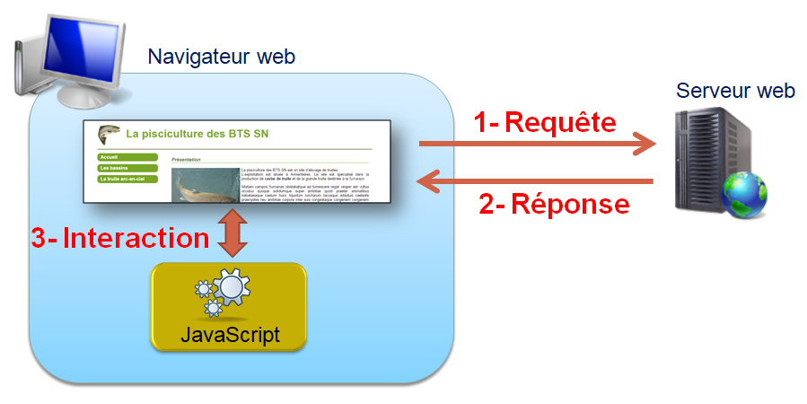
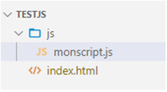
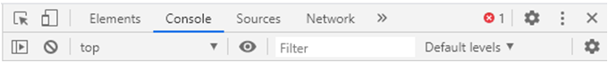
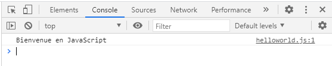

# Introduction au JavaScript

> * Auteur : Alain BRASSART
> * Date de publication : 07/03/2021
> * OS: Windows 10 (version 20H2)
> * VS Code : version 1.53.2 (system setup)
> * Chrome : version 87.0.4280.141

 [Licence Creative Commons](https://creativecommons.org/licenses/by-nc-sa/3.0/fr/)

## Sommaire

  - [1. Qu'est ce que JavaScript ?](#1-quest-ce-que-javascript-)
  - [2. Comment ajouter du code JavaScript ?](#2-comment-ajouter-du-code-javascript-)
  - [3. Stratégie de chargement du script](#3-stratégie-de-chargement-du-script)
  - [4. Console Web](#4-console-web)
  - [5. La fonction console.log()](#5-la-fonction-consolelog)
  - [6. Les commentaires en JavaScript](#6-les-commentaires-en-javascript)
  - [Activité : Projet Hello World](#activité-projet-hello-world)
  - [Références MDN](#références-mdn)

## 1. Qu'est ce que JavaScript ?

JavaScript (JS en abrégé) est un langage de script orienté objet, principalement connu comme le langage de script des pages web. Mais il est aussi utilisé dans de nombreux environnements extérieurs aux navigateurs web tels que Node.js.
Le code JavaScript est interprété ou compilé à la volée (JIT) et éxécuté par le navigateur. C'est un langage de programmation qui ajoute de l'interactivité aux pages web :

* Gestion des évènements utilisateurs (clics sur les boutons)
* Modification du code HTML/CSS affiché dans le navigateur (DOM)
* Requêtes réseau (AJAX)

## 2. Comment ajouter du code JavaScript ?

* Il est conseillé d'écrire le code JavaScript dans un fichier externe portant l'extension .js

    

    > Le fichier .js doit être créé dans le répertoire qui contient le fichier html, il peut être placé dans un sous-dossier particulier pour améliorer la structure du projet

* Il est ensuite appelé depuis la page Web au moyen de la balise <code>\   

## 3. Stratégie de chargement du script

Par défaut le chargement du script est bloquant, il faut donc éviter que le reste de la page (code html) soit bloqué tant que le script n'est pas chargé.

* **Première solution :** placer la balise script en fin de code html juste avant la balise fermante <code>\</body></code> 

* **Deuxième solution :** utiliser un attribut spécifique avec la balise <code>\<script></code>. L'attribut <code>defer</code> permet notamment d'indiquer au navigateur que le code JavaScript ne doit être exécuté qu'une fois que le code HTML a fini d'être analysé.

* L'attribut <code>defer</code> permet également d'exécuter les scripts dans l'ordre donné dès la fin du chargement de la page.

## 4. Console Web

A l'heure actuelle, tous les navigateurs sont équipés d'une console de développement Web permettant notamment de tester du code JavaScript, grâce à cette console, on peut :

* afficher des messages
* entrer et tester des instructions à la volée (avec auto-complétion)
* tester des fonctions en ligne
* voir les erreurs et les avertissements détectés lors de l'exécution du script
* visualiser les valeurs des variables
* interagir avec la page web

> Pour accéder à la console dans Chrome : taper F12 puis sélection l'onglet "Console".

## 5. La fonction console.log()

**console.log()** est une fonction JavaScript qui permet d'afficher un message dans la console du navigateur.  

        console.log(obj);

**obj** est de manière générale un objet JavaScript, mais on peut utiliser cette fonction sur tout type de variable comme une simple chaîne de caractères :

        console.log("Hello World");

> Comme dans la plupart des langages de programmation, toute instruction codée en JavaScript se termine par un point-virgule.

## 6. Les commentaires en JavaScript

Il est possible d'intégrer des commentaires dans du code JavaScript, de la même manière que dans les CSS :  

        /* Ceci est un commentaire 
           sur plusieurs lignes */
Si votre commentaire tient sur une ligne, vous pouvez utiliser aussi deux barres obliques :  

        // Ceci est un commentaire sur une ligne

***

## Activité \: Projet Hello World

Dans VS Code créez le dossier racine de votre projet **HelloWorld_JS** et un sous-dossier **js**  

Ajoutez dans ce dossier un fichier **index.html** et générer la structure en html5 de cette page  

Ajoutez un fichier Javascript **helloworld.js** dans le sous-dossier js.  

Ajoutez dans le fichier index.html le lien vers le fichier js  

Coder l'instruction qui permet d'afficher le message **"Bienvenue en JavaScript"** dans la console du navigateur  

Charger la page web dans le navigateur en utilisant la commande **"Open with Live Server"** de VS Code  

Vérifier que le message est bien affiché dans la console du navigateur comme dans l'aperçu ci-dessous :

***
## Références MDN

* Intégration du code JavaScript :
    <https://developer.mozilla.org/fr/docs/Learn/JavaScript/First_steps/What_is_JavaScript>  
    Paragraphe : "Comment ajouter du Javascript à votre page ?  

* Console Web : <https://developer.mozilla.org/fr/docs/Outils/Console_Web>

***
