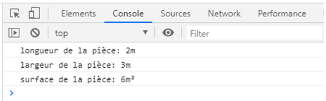
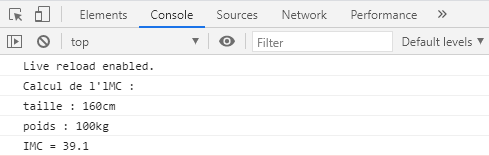
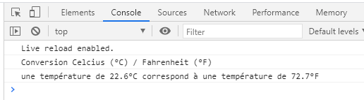

# Variables et Opérateurs en JavaScript

> * Auteur : Alain BRASSART
> * Date de publication : 07/03/2021
> * OS: Windows 10 (version 20H2)
> * VS Code : version 1.53.2 (system setup)
> * Chrome : version 87.0.4280.141

 [Licence Creative Commons](https://creativecommons.org/licenses/by-nc-sa/3.0/fr/)

## Sommaire

 - [1. Les variables](#1-les-variables-)
   - [1.1 Déclaration](#11-déclaration)
   - [1.2 Les types de variables](#12-les-types-de-variable)
   - [1.3 Noms de variables](#13-noms-de-variables)
 - [2. Les opérateurs](#2-les-opérateurs-)
   - [2.1 Les opérateurs arithmétiques](#21-les-opérateurs-arithmétiques) 
   - [2.2 Les opérateurs d'assignation](#22-les-opérateurs-dassignation) 
   - [2.3 Les opérateurs de comparaison](#23-les-opérateurs-de-comparaison)
 - [Activité : Calcul d'une surface](#activité-calcul-dune-surface)
 - [Références MDN](#références-mdn)
 - [Exercices](#exercices)
   - [Exercice 1 : Calcul d'IMC](#exercice-1-calcul-dimc)
   - [Exercice 2 : Conversion Celcius/Farenheit](#exercice-2-conversion-celciusfahrenheit)   

## 1. Les variables :

### 1.1 Déclaration

En JavaScript les variables peuvent être déclarées de deux manières différentes :

* Déclaration avec <code>let</code> :  

        let x;
        let y = 5;

> avec <code>let</code> la portée des variables est au niveau **bloc**

* Déclaration avec <code>var</code> :  

        var x;
        var y = 5;

> avec <code>var</code> la portée des variables est au niveau **fonction**

Il existe en plus la possibilité de déclarer une variable en lecture seule (ou constante nommée) avec <code>const</code> :  

        const pi = 3.1416 ;

> comme avec <code>var</code>, les variables déclarées avec <code>const</code> ont une portée au niveau fonction

### 1.2 Les types de variable

Les variables JavaScript n'ont pas de type défini à la conception (typage à l’exécution) :

* Nombre (type **Number**) : entiers ou réels  

        let age = 10;
        let taille = 1.5;
* Chaîne de caractères (type **String**) :  

        let texte = 'bonjour';

* Booléen (type **Boolean**) :  

        let estActif = true;
        let estPair = false;

> Une variable déclarée sans valeur initiale vaudra <code>undefined</code>

### 1.3 Noms de variables

JavaScript est sensible à la casse, il fait une différence entre les majuscules et les minuscules.
> Les variables lastName et lastname sont deux variables différentes.  

        let lastName = 'Dupond';
        let lastname = 'Durand';
Standard de nommage :

* Les noms d’objets commencent par une majuscule
* Les noms des fonctions et des variables commencent par une minuscule

## 2. Les opérateurs :

### 2.1 Les opérateurs arithmétiques

Les opérateurs arithmétiques en Javascript permettent d’effectuer toutes sortes d’opérations mathématiques entre les valeurs de type <code>Number</code> contenues dans différentes variables.  
On retrouve les opérateurs suivants :

* l'addition : +
* la soustraction : -
* la multiplication : *
* la division : /
* le modulo (reste de la division euclidienne) : %

On peut y ajouter :

* l'opérateur d'incrémentation : ++
* l'opérateur de décrémentation : --  

Quelques exemples d'instructions de calcul : 

       // Déclaration des variables de type Number
       let x = 5;
       let y = 23;
       let z = 2.36;
       // Instructions de calcul
       let somme = x + y;        // addition
       let diff = y – z;         // soustraction
       let prod = x * z;         // multiplication
       let div = z / x;          // division
       let mod = y % x ;         // modulo
       x++;                      // incrémentation de x
       y--;                      // décrémentation de y

> L'opérateur modulo ne s'utilise que sur les nombres entiers
Contrairement au C++, la division entre deux entiers ne donne pas forcément la valeur entière du quotient

Les opérateurs d'incrémentation et de décrémentation peuvent être utilisés de deux manières différentes :

* en post-incrémentation (ou post-décrémentation) : <code>x++;</code>
la valeur de la variable est utilisée pour effectuer le calcul puis est incrémentée  

        let x = 5, y = 2;
        y = x++;                 // y = 5 et x = 6
* en pré-incrémentation (ou pré-décrémentation) : <code>++x;</code> la valeur de la variable est d'abord incrémentée puis utilisée pour effectuer le calcul  

        let x = 5, y = 2;
        y = ++x;                 // y = 6 et x = 6

### 2.2 Les opérateurs d'assignation

Les opérateurs d'assignation permettent de fixer la valeur d'une variable, à la base on utilise l'opérateur =
Il existe également d'autres opérateurs qui permettent de combiner une assignation avec une autre opération :

| Opération | Symbole | Exemple | Interprétation |
|-----------|---------|---------|----------------|
|Assignation avec addition| <code>+=</code>| <code>x+=3;</code>| <code>x = x + 3;</code>
|Assignation avec soustraction| <code>-=</code>| <code>x-=3;</code>| <code>x = x - 3;</code>|
|Assignation avec multiplication| <code>\*=</code>|<code>x*=3;</code>|<code>x = x * 3;|
|Assignation avec division| <code>/=</code>| <code>x/=3;</code>| <code>x = x / 3;</code>|

### 2.3 Les opérateurs de comparaison

Les opérateurs de comparaison sont utilisés pour effectuer des tests,  le résultat renvoyé par ces opérateurs est toujours un booléen qui vaut true ou false :

| Type de comparaison | Symbole | Exemple | Résultat |
 |---------------------|---------|---------|----------|
 |égal à| <code>==</code>| <code>x == 3;</code>| true si x vaut 3, false sinon|
 |différent de| <code>!=</code>| <code>x != 3;</code>| true si x différent de 3, false sinon|
 |inférieur à| <code><</code>| <code>x < 3;</code>| true si x strictement plus petit que 3, false sinon|
 |supérieur à| <code>></code>| <code>x > 3;</code>| true si x strictement plus grand que 3, false sinon|
 |inférieur ou égal| <code><=</code>| <code>x <= 3;</code>| true si x plus petit ou égal à 3, false sinon|
 |supérieur ou égal| <code>>=</code>| <code>x >= 3;</code>|  true si x plus grand ou égal à 3, false sinon|

> En Javascript, les opérateurs <code>==</code> et <code>!=</code> testent uniquement les valeurs mais pas si les types de données sont les mêmes. Il existe des versions strictes (<code>===</code> et <code>!==</code>) pour ces deux opérateurs qui testent à la fois les valeurs et les types de données.

Il existe également des opérateurs qui permettent de combiner plusieurs expressions de comparaison entre elles :

| Opération | Symbole | Exemple |
|-----------|---------|---------|
|ET| <code>&&</code>| <code>(x>0)&&(x<3)</code> permet de vérifier que x est compris entre 0 et 3|
|OU| <code>\|\|</code>| <code>(x===3)\|\|(x===5)</code> permet de vérifier si x vaut 3 ou 5|
|NON (inversion)| !| <code>!(x===3)</code> permet de vérifier que x est n'est pas égal à 3|

***

## Activité \: Calcul d'une surface

Créez un nouveau projet html5 dans VS Code incluant un fichier Javascript :

* nom du dossier racine : **Calcul_Surface**
* nom du fichier js : **surface.js**  

Codez les instructions javascript qui permettent de calculer la surface en m² d'une pièce rectangulaire à partir de sa longueur et de sa largeur  
Affichez dans la console du navigateur les valeurs de la longueur, de la largeur et de la surface calculée.

> En JavaScript, il est possible de concaténer directement des chaînes de caractères avec des variables en utilisant l'opérateur <code>+</code>
Ainsi on peut utiliser la fonction console.log() de la manière suivante : <code>console.log("nom de variable = " + variable);</code>
***

## Références MDN

* Variables :  
<https://developer.mozilla.org/fr/docs/Learn/JavaScript/First_steps/Variables>
<https://developer.mozilla.org/fr/docs/Web/JavaScript/Guide/Types_et_grammaire>  

* Opérateurs :  
<https://developer.mozilla.org/fr/docs/Learn/JavaScript/First_steps/Math>

***
## Exercices

### Exercice 1 \: calcul d'IMC

Coder une application en javascript qui permet de calculer l'indice de masse corporel (IMC) d'une personne et de l'afficher dans la console du navigateur.  
On rappelle que l'IMC se calcule en divisant le poids (en kg) par la taille (en m) au carré.     
Pour cette application, on souhaite notamment que :

* la taille soit spécifiée en cm et le poids en kg
* la valeur de l'IMC soit affichée avec une précision de 1 chiffre après la virgule.

Exemple de résultat attendu :

> La fonction **toFixed()** permet de choisir la précision avec laquelle les valeurs seront affichées

### Exercice 2 \: conversion Celcius/Fahrenheit

Coder une application en javascript qui convertit en degrés Fahrenheit (°F) une température donnée en degrés Celcius (°C). 
On rappelle que T(°F) = T(°C) x 1,8 + 32.
L'application devra en plus afficher ces températures avec leur unité respectives dans la console du navigateur.

Exemple de résultat attendu :

