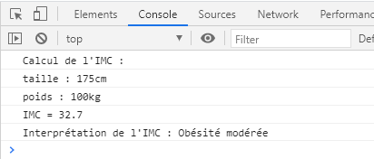
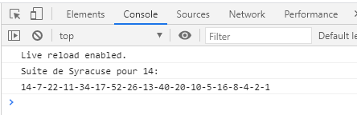
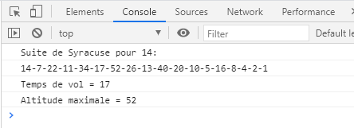

# Les structures de contrôle en JavaScript

> * Auteur : Alain BRASSART
> * Date de publication : 29/03/2021
> * OS: Windows 10 (version 20H2)
> * VS Code : version 1.53.2 (system setup)
> * Chrome : version 87.0.4280.141

 [Licence Creative Commons](https://creativecommons.org/licenses/by-nc-sa/3.0/fr/)

## Sommaire
 
  - [1. La structure conditionnelle if (Si)](#1-la-structure-conditionnelle-if-si)
    - [1.1 La forme de base : Si ... Alors ... Sinon ...](#11-la-forme-de-base-si-alors-sinon-)
    - [1.2 La forme simplifiée : Si ... Alors ...](#12-la-forme-simplifiée-si-alors-)
    - [1.3 Les conditions multiples](#13-les-conditions-multiples)
    - [1.4 Extension avec else if](#14-extension-avec-else-if)
  - [2. La structure conditionnelle à choix multiple switch (Selon)](#2-la-structure-conditionnelle-à-choix-multiple-switch-selon)
  - [Activité : Interprétation de l'IMC](#activité-interprétation-de-limc)
  - [3. Les structures de boucle](#3-les-structures-de-boucle)
    - [3.1 La boucle while (Tant que ... Faire)](#31-la-boucle-while-tant-que-faire)
    - [3.2 La boucle do ... while (Répéter ... Tant que ...)](#32-la-boucle-do-while-répéter-tant-que-)
    - [3.3 La boucle for (Pour)](#33-la-boucle-for-pour)
  - [Activité : Conjecture de Syracuse](#activité-conjecture-de-syracuse)
  - [Références MDN](#références-mdn)
  - [Exercices](#exercices)
    - [Exercice 1 : Calcul de factorielle](#exercice-1-calcul-de-factorielle)
    - [Exercice 2 : Conversion Euros/Dollars](#exercice-2-conversion-eurosdollars)
    - [Exercice 3 : Nombres triples](#exercice-3-nombres-triples)
    - [Exercice 4 : Suite de Fibonacci](#exercice-4-suite-de-fibonacci)
    - [Exercice 5 : Table de multiplication](#exercice-5-table-de-multiplication)

## 1. La structure conditionnelle <code>if</code> (Si) 

### 1.1 La forme de base \: Si ... Alors ... Sinon ...

Algorithme :

        Si (condition vraie) Alors
                Actions à exécuter si la condition est vraie
        Sinon
                Actions à exécuter si la condition est fausse
        Fin Si

Codage en Javascript :

        if(condition) {
                code à exécuter si la condition vaut true
        } else {
                code à exécuter si la condition vaut false
        }

Exemple :

        let temperature = 15 ;
        let message ;
        if(temperature >= 20) {
                message = "Il fait chaud" ;
        } else {
                message = "Il fait froid" ;
        }
        console.log(message);

### 1.2 La forme simplifiée \: Si ... Alors ...

Il n'est pas toujours nécessaire d'avoir à coder des instructions si la condition est fausse, dans ce cas, le codage de la structure sera plus simple

        if(condition) {
                code à exécuter si la condition vaut true
        }

Exemple :

        let temperature = 15 ;
        if(temperature > 20) {
                console.log("Attention la température a dépassé les 20° ) ;
        }

### 1.3 Les conditions multiples 

Dans certains cas, il peut être necessaire de combiner les résultats de plusieurs comparaisons pour obtenir la condition souhaitée. Pour cela on utilise les opérateurs booléens **ET** (symbole <code>&&</code>) ou **OU** (symbole <code>||</code>).

Exemple : lorsqu'on souhaite vérifier qu'une variable est comprise entre 2 valeurs, il faut vérifier d'une part si elle supérieure à la plus petite des deux valeurs **et** d'autre part si elle est inférieure à la plus grande

        let temperature = 15 ;
        if((temperature>10) && (temperature<20)) {
                console.log("La température mesurée est correcte) ;
        }

>Ce code permet d'afficher un message indiquant que la température est correcte lorsqu'elle est comprise entre 10° et 20°

### 1.4 Extension avec <code>else if</code> 

La séquence <code>if ... else if ... else</code> est une structure conditionnelle qui permet d'étendre le nombre de cas que l'on souhaite vérifier à l'intérieur d'une structure <code>if ... else...</code>.  
En effet, il est possible d'écrire autant de <code>else if</code> que l'on veut dans une structure <code>if ... else...</code> 
En plus de <code>if...else</code> chaque <code>else if</code> permettra de tester une nouvelle condition.

Codage en JavaScript :

        if(condition 1) {
                code à exécuter si condition 1 vaut true
        } else if(condition 2) {
                code à exécuter si condition 2 vaut true
        } else if(condition 3) {
                code à exécuter si condition 3 vaut true
        } else {
                code à exécuter si aucune condition vaut true
        }

Exemple :

        let x = 0.5 ;
        let message ;
        if(x > 1) {
                message = "x contient une valeur strictement supérieure à 1";
        } else if (x == 1) {
                message = "x contient la valeur 1";
        } else {
                message = "x contient une valeur strictement inférieure à 1";
        }
        console.log(message) ;

## 2. La structure conditionnelle à choix multiple <code>switch</code> (Selon)

Cette structure permet d'exécuter du code en fonction de la valeur d'une variable, comme l'instruction <code>else if</code>, elle offre la possibilité de gérer autant de cas qu'on le souhaite.
L'instruction <code>switch</code> représente une alternative à l'utilisation de la forme <code>if ... else if ... else ...</code> mais n'est pas strictement équivalente car chaque cas est associé à une et une seule valeur particulière. 
En effet, l'instruction <code>switch</code> ne supporte pas l'utilisation des opérateurs de supériorité ou d'infériorité.

Algorithme :

        Selon (variable_A_Tester) Parmi:
                Cas valeur1 :
                        code à exécuter si variable_A_Tester vaut valeur1
                Cas valeur2 :
                        code à exécuter si variable_A_Tester vaut valeur2
                ....
                Autrement
                        code à exécuter si variable_A_Tester ne vaut aucune des valeurs précédentes
        Fin Selon

> Attention, les valeurs à tester ne peuvent être que des valeurs entières ou éventuellement des chaines de caractères

Codage en JavaScript :

        switch(variable_A_Tester) {
                case valeur1:
                        code à exécuter si variable_A_Tester vaut valeur1
                        break;
                case valeur2:
                        code à exécuter si variable_A_Tester vaut valeur2
                        break;
                ....
                default:
                        code à exécuter si variable_A_Tester ne vaut aucune des valeurs précédentes
        }

>Chaque <code>case</code> doit se terminer par une instruction <code>break</code> pour indiquer à JavaScript qu'il doit sortir du <code>switch</code> et ne pas continuer à tester les autres <code>case</code> dès que l'un d'entr'eux correspond à la valeur de la variable testée.

Exemple :

        let nombre = 1 ;
        let codeBinaire ;
        switch (nombre) {
                case 0: 
                     codeBinaire = "00";
                     break;
                case 1:
                     codeBinaire = "01";
                     break;
                case 2:
                     codeBinaire = "10";
                     break;
                case 3:
                     codeBinaire = "11";
                     break;
                default:
                     codeBinaire = "inconnu";      
        }
        console.log(codeBinaire);
***
## Activité \: Interprétation de l'IMC

L'interprétation de l'IMC permet de fournir une description correspondant à la corpulence d'une personne, elle se fait selon les critères définis par l'OMS (Organisation Mondiale de la santé)

|   IMC   | Interprétation |
|---------|----------------|
| moins de 16,5 | Dénutrition|
| 16,5 à 18,5 |  Maigreur |
| 18,5 à 25 | Corpulence normale |
| 25 à 30 | Surpoids |
| 30 à 35 | Obésité modérée |
| 35 à 40 | Obésité sévère |
| plus de 40 | Obésité morbide |

Compléter l'application de calcul d'IMC avec la séquence qui permet de donner l'interprétation correspondant à la valeur de l'IMC. L'interprétation sera affichée dans la console du navigateur à la suite de la valeur de l'IMC

***
## 3. Les structures de boucle 

### 3.1 La boucle <code>while</code> \: (Tant que ... Faire)

Cette boucle permet de répéter une série d'instructions tant qu'une condition donnée est vraie c'est à dire tant que la condition de sortie n'est pas vérifiée.

Algorithme :

        Tant que (condition vraie) Faire
                instructions à répéter tant que la condtion est vraie
        Fin Tant que

Codage en JavaScript :

        while (condition) {
                // code à exécuter tant que la condition est vraie 
        }

Exemple :

        let n = 1 ;
        while (n <= 30) {
                n = n * 5 ;
                console.log(n) ;
        }

>les  valeurs affichées une fois la boucle terminée seront : 5,25,125

### 3.2 La boucle <code>do ... while</code> \: (Répéter ... Tant que ...)

La boucle <code>do ... while</code> permet de répéter une suite d'instructions jusqu'à ce qu'une condition ne soit plus vérifiée. 

Algorithme :

        Répéter
                instructions à répéter tant que la condition est vraie
        Tant que (condition vraie)

Codage en JavaScript :

        do {
                // code à exécuter tant que la condition est vraie
        } while (condition vraie) ;

Exemple :

        let n = 10 ;
        do {
                console.log(n) ;
                n-- ;
        } while (n > 0) ;

>Cette boucle permet d'afficher les valeurs de n tant que n > 0 donc jusqu'à ce que n = 0. 
Les valeurs affichées une fois la boucle terminée seront : 10,9,8,7,6,5,4,3,2,1

La boucle <code>do ... while</code> est relativement semblable à la boucle <code>while</code>, la différence se situe simplement au niveau de l'ordre dans lequel vont se faire les opérations. Dans le cas de la boucle <code>do.. while</code>, le code contenu dans la boucle sera exécuté avant que la condition de sortie soit évaluée.

Cela signifie qu'à la différence de la boucle <code>while</code>, on effectuera toujours un passage dans une boucle <code>do.. while</code> même si la condition de sortie est vraie dès le départ.

### 3.3 La boucle <code>for</code> \: (Pour)

La boucle <code>for</code> permet de répéter une suite d'instructions un nombre de fois déterminé à l'avance. Ce type de boucle nécessite un compteur de boucle. Ce compteur est un nombre entier. Pour ce compteur, il faut :
* une valeur initiale (par défaut 0)
* un nombre de boucles à exécuter (constante NB_BOUCLES) -> une condition pour rester dans la boucle
* une incrémentation automatique de 1 à la fin de l'exécution du contenu de la boucle

Algorithme :

        Pour variableCompteur Allant de 0 A (NB_BOUCLES-1) au pas de 1
                instructions à répéter le nombre de fois correspondant à NB_BOUCLES
        Fin Pour

Codage en JavaScript :

        for(variableCompteur = 0; variableCompteur < NB_BOUCLES; variableCompteur++) {
                // code à répéter dans la boucle
        }

>Pour que la boucle soit répétée NB_BOUCLES fois, la condition pour rester dedans est variableCompteur < NB_BOUCLES

Exemple :

        for(let i = 0; i < 10; i++) {
              console.log(i) ;  
        }

>Dans cet exemple, la variable représentant le compteur de boucle est i, cette variable peut être déclarée directement dans la boucle avant d'être initialisée à 0. Le nombre de passages dans la boucle est spécifié dans la condition de sortie avec la valeur 10.
A chaque passage dans la boucle, la valeur de i est affichée dans la console puis incrémentée automatiquement. 
Les valeurs affichées une fois la boucle terminée seront : 0,1,2,3,4,5,6,7,8 et 9
***
## Activité \: Conjecture de Syracuse

En mathématiques, on appelle **suite de Syracuse** une suite d'entiers naturels définie de la manière suivante :
* On part d'un nombre entier N plus grand que zéro
* Si N est pair on le divise par 2, sinon on le multiplie par 3 et on ajoute 1
* On répète cette opération tant que la dernière valeur calculée n'est pas arrivée à 1

Les différente valeurs obtenues constituent la suite de Syracuse pour N

Créez un nouveau projet html5 dans VS Code incluant un fichier Javascript :

* nom du dossier racine : **Suite_Syracuse**
* nom du fichier js : **syracuse.js**  

Codez les instructions javascript qui permettent de calculer et d'afficher dans la console du navigateur les valeurs constituant la suite de Syracuse d'un nombre N.
* le nombre N sera directement initialisé dans le programme
* pour tester si un nombre est pair avec l'opérateur modulo (%) : x % 2 = 0 si x est pair
* les différentes valeurs de la suite seront stockées dans une chaine de caractères avant d'être affichées

Exemple pour tester votre programme :

Compléter cette application de manière à ce qu'elle affiche en plus des valeurs de la suite :
* le temps de vol : c'est à dire le nombre d'itérations qui ont été réalisées pour arriver à 1
* l'altitude maximale : c'est à dire la valeur maximale de la suite

***
## Références MDN

* Conditions :   
<https://developer.mozilla.org/fr/docs/Apprendre/JavaScript/Building_blocks/conditionals>

* Boucles :  
<https://developer.mozilla.org/fr/docs/Apprendre/JavaScript/Building_blocks/Looping_code>

***
## Exercices 

### Exercice 1 \: Calcul de factorielle

>Pour tout nombre entier n > 1, la factorielle (noté n!) est définie par : 
n! = n x (n-1) x (n-2) x ... x 1
 Et par convention : 0! = 1

Exemples : 

* 1! = 1
* 2! = 1 x 2 = 2
* 3! = 1 x 2 x 3 = 6
* 4! = 1 x 2 x 3 x 4 = 24
* 10! = 1 x 2 x 3 x 4 x 5 x 6 x 7 x 8 x 9 x 10 = 3 628 800

Codez une application JavaScript qui permet de calculer et afficher dans la console du navigateur la factorielle d'un nombre en utilisant une boucle <code>for</code>

### Exercice 2 \: Conversion Euros/Dollars

Codez une application JavaScript qui affiche une table de conversion de sommes d'argent exprimées en euros, en dollars canadiens. La progression des sommes de la table sera "géométrique", comme dans l'exemple ci-dessous

        1 euro(s) = 1.65 dollar(s)
        2 euro(s) = 3.30 dollar(s)
        4 euro(s) = 6.60 dollar(s)
        8 euro(s) = 13.20 dollar(s)
        etc.. (s'arrêter à 16384 euros) 

### Exercice 3 \: Nombres triples

Codez une application JavaScript qui calcule et affiche une suite de 12 nombres dont chaque terme soit égal au triple du terme précédent. La valeur de départ pourra être choisie.

Exemple :

        Valeur de départ : 2
        Valeurs de la suite : 2 6 18 54 162 486 .... 

### Exercice 4 \: Suite de Fibonacci

> La suite de Fibonacci est une suite d'entiers dans laquelle chaque terme est la somme des deux termes qui le précèdent. Elle commence par les termes 0 et 1.

        Suite de Fibonacci : 0 1 1 2 3 5 8 13 21 ....

Codez une application JavaScript qui calcule et affiche les 17 premiers nombres de la suite de Fibonacci

### Exercice 5 \: Table de multiplication

Codez une application JavaScript qui calcule et affiche les 20 premiers termes de la table de multiplication par 7, en signalant au passage (à l'aide d'une astérisque) ceux qui sont multiples de 3.

Exemple :

        7 14 21 * 28 35 42 * ...

