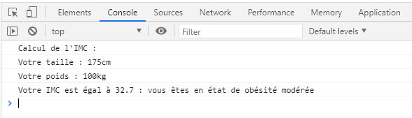
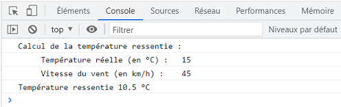
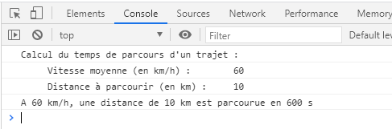
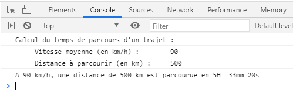
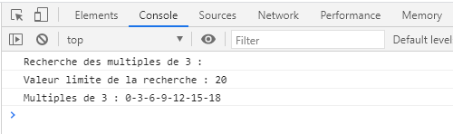

# Les fonctions en JavaScript

> * Auteur : Alain BRASSART
> * Date de publication : 07/03/2021
> * Mise à jour : 10/05/2023
> * OS: Windows 10 (version 22H2)
> * VS Code : version 1.78.1 (system setup)
> * Chrome : version 113.0.5672.92

 [Licence Creative Commons](https://creativecommons.org/licenses/by-nc-sa/3.0/fr/)

## Sommaire

  - [1 Présentation](#1-présentation)
    - [1.1 Déclarer une fonction en JavaScript](#11-déclarer-une-fonction-en-javascript)
    - [1.2 Appeler une fonction](#12-appeler-une-fonction)
    - [1.3 Portée des variables](#13-portée-des-variables)
    - [1.4 Fonctions imbriquées](#14-fonctions-imbriquées)
  - [Activité \: Codage de fonctions pour calculer et interpréter l'IMC](#activité-codage-de-fonctions-pour-calculer-et-interpréter-limc)
  - [2. Fonctions anonymes](#2-fonctions-anonymes)
    - [2.1 Déclarer une fonction anonyme](#21-déclarer-une-fonction-anonyme)
    - [2.2 Exécuter une fonction anonyme en utilisant une variable](#22-exécuter-une-fonction-anonyme-en-utilisant-une-variable)
    - [2.3 Auto-invoquer une fonction anonyme](#23-auto-invoquer-une-fonction-anonyme)
    - [2.4 Exécuter une fonction anonyme lors du déclenchement d'un évènement](#24-exécuter-une-fonction-anonyme-lors-du-déclenchement-dun-évènement)
  - [3. Les fonctions fléchées](#3-les-fonctions-fléchées) 
    - [3.1 Expression de fonction](#31-expression-de-fonction)
    - [3.2 Qu'est ce qu'une fonction fléchée ?](#32-quest-ce-quune-fonction-fléchée)
    - [3.3 Cas particulier](#33-cas-particulier)
    - [3.4 Les fonctions fléchées multilignes](#34-les-fonctions-fléchées-multilignes) 
  - [Exercices](#exercices)
    - [Exercice 1 : Calcul de la température ressentie](#exercice-1-calcul-de-la-température-ressentie) 
    - [Exercice 2 : Calcul du temps de parcours d'un trajet](#exercice-2-calcul-du-temps-de-parcours-dun-trajet)
    - [Exercice 3 : Recherche du nombre de multiples de 3](#exercice-3-recherche-du-nombre-de-multiples-de-3)
    - [Exercice 4 \: Utilisation des fonctions fléchées](#exercice-4-utilisation-des-fonctions-fléchées)

## 1 Présentation

De manière générale, en programmation, une fonction correspond à une portion de code réalisant un traitement spécifique qui pourra être appelé ultérieurement dans le reste du programme par une simple ligne. L'utilisation des fonctions permet d'éviter d'écrire plusieurs fois le même code et améliore la lisibilité du programme.  

### 1.1 Déclarer une fonction en JavaScript

Avant tout, une fonction doit être déclarée dans le script où elle sera utilisée. La déclaration d'une fonction s'effectue en utilisant le mot clé ```function``` suivi par :

* le nom de la fonction
* la liste des paramètres à passer à la fonction, entre paranthèses et séparés par des virgules, si la fonction n'utilise pas de paramètres, les parenthèses doivent restées vides.
* les instructions correspondant au traitement que doit réaliser la fonction, entre accolades, { }

Le code suivant, par exemple, définit une fonction intitulée ```calculerSurface()```  :

```javascript
function calculerSurface(prmLongueur,prmLargeur) {
        let surface ;
        surface = prmLongueur * prmLargeur;
        return surface ;
}
```

La fonction ```calculerSurface()``` prend deux paramètres ```prmLongueur``` et ```prmLargeur``` correspondant à la longueur et à la largeur. Elle est composée des instructions qui permettent de calculer et de retourner la surface définie par ces deux paramètres.

> L'instruction ```return``` spécifie la valeur qui est renvoyée par la fonction

### 1.2 Appeler une fonction

Pour exécuter le code d'une fonction, il faut appeler celle-ci en utilisant son nom et en lui spécifiant les valeurs à prendre en compte pour les paramètres. Si la fonction retourne un résultat, il est conseillé d'utiliser une variable pour le récupérer.

Le code suivant permet d'appeler la fonction ```calculerSurface()``` : 
```javascript 
let surface = calculerSurface(4,3);
```

Cette instruction permet d'appeler la fonction ```calculerSurface()``` pour calculer la surface correspondant à une longueur et à une largeur définies par les valeurs 4 et 3. La valeur calculée sera retournée dans la variable ```surface```  

> Il est possible également d'appeler une fonction en passant par des variables pour les paramètres.

```javascript
let longueur = 4;
let largeur = 3;
let surface = calculerSurface(longueur,largeur);
```

### 1.3 Portée des variables

La portée d'une variable désigne l'espace du script dans lequel cette variable sera accessible. En JavaScript, il n'existe que deux espaces de portée différents : l'espace **global** et l'espace **local**. De manière simple, l'espace global désigne la totalité d'un script excepté l'intérieur des fonctions, l'espace local désigne, à l'inverse, l'espace dans une fonction.

> Une variable globale sera accessible à travers tout le script y compris depuis une fonction. En revanche, une variable locale ne sera accessible que dans la fonction où elle a été déclarée et ne pourra pas être manipulée depuis l'espace global.

Exemple :
```javascript
let a = 5 ;         // a est une variable globale
test() ;
        
function test() {
        let b = 3 ;     // b est une variable locale à la fonction test()
        b = b * a ;     // la variable a peut être utilisée dans la fonction
        console.log(b) ;
}
```

En terme de qualité de codage, il est impératif de favoriser au maximum l'utilisation des variables locales grâce au passage de paramètres dans les fonctions.

### 1.4 Fonctions imbriquées

En JavaScript, il est possible de définir dans une fonction d'autres fonctions qui sont alors dites fonctions internes et pour lesquelles des règles de visibilité s'appliquent.

* une fonction interne a accès aux variables définies dans la fonction qui la contient
* par contre, une fonction n'a pas accès aux variables définies dans ses fonctions internes

Exemple :
```javascript
function calculerSurface() {
        // déclaration des variables locales
        let longueur;
        let largeur;
        // déclaration des fonctions internes
        function initialiserLongueur() {        
                longueur = 4;
        }
        function initialiserLargeur() {
                largeur = 3;
        }
        // appel des fonctions internes
        initialiserLongueur();
        initialiserLargeur();
        // retour du résultat
        return largeur * longueur;
}

let surface = calculerSurface();
console.log(surface);
```

Dans cet exemple, les fonctions internes ```initialiserLongueur()``` et ```initialiserLargeur()``` sont utilisées par la fonction ```calculerSurface()``` pour initialiser les valeurs des variables locales ```longueur``` et ```largeur```   

***
## Activité \: Codage de fonctions pour calculer et interpréter l'IMC

Reprendre l'application de calcul d'IMC en utilisant :
* une fonction ```calculerIMC()``` qui reçoit en paramètres la taille en cm et le poids en kg et qui retourne la valeur de l'IMC correspondante.

```javascript
function calculerIMC(prmTaille,prmPoids) {
        let valIMC;
        // codage
        return valIMC;
}
```
* une fonction ```interpreterIMC()``` qui recoit en paramètre la valeur de l'IMC et qui retourne l'interprétation correspondante.

```javascript
function interpreterIMC(prmIMC) {
        let interpretation = "";
        // codage
        return interpretation;
}
```

Coder une nouvelle version basée sur l'utilisation des fonctions imbriquées, pour cela :

* prévoir une fonction ```decrire_corpulence(prmTaille, prmPoids)``` qui retourne un message contenant la valeur de l'IMC et l'état de corpulence correspondant.
* coder les fonctions ```calculerIMC()``` et ```interpreterIMC()``` en tant que fonctions internes à la fonction ```decrire_corpulence(prmTaille, prmPoids)```
* les variables représentant l'IMC et l'interprétation de l'IMC seront déclarées en tant que variables locales à la fonction ```decrire_corpulence()``` et pourront donc être utilisées directement dans les fonctions internes.

Exemple de résultat attendu :


***

## 2. Fonctions anonymes

### 2.1 Déclarer une fonction anonyme

En JavaScript, il est possible de créer une fonction anonyme de la même manière qu'une fonction classique en utilisant le mot clé ```function``` mais sans spécifier de nom pour cette fonction.

Exemple :

```javascript
function() {
        console.log("Je suis une fonction anonyme");
}
```

Dans cet exemple, on a déclaré une fonction anonyme dont la tâche est d'afficher le message "Je suis une fonction anonyme" dans la console du navigateur.

Le problème est de savoir maintenant comment appeler cette fonction pour qu'elle soit exécutée. Pour cela, ll existe plusieurs possibilités, notamment :

* enfermer le code de la fonction dans une variable et utiliser cette variable comme une fonction
* auto-invoquer la fonction
* utiliser un évènement pour déclencher l'exécution de la fonction

### 2.2 Exécuter une fonction anonyme en utilisant une variable 

Ici le principe consiste à déclarer une variable et à lui affecter une fonction anonyme

Exemple :

```javascript
let afficherMessage = function() {
        console.log("Je suis une fonction anonyme");
}
```

Dans l'exemple ci-dessus, la variable ```afficherMessage``` contient une fonction anonyme qui va afficher le message "Je suis une fonction anonyme".


Pour appeler la fonction anonyme et exécuter son code, il faut utiliser le nom de la variable qui la contient suivi d'un couple de parenthèses. Ceds parenthèses sont des parenthèses dites **appelantes** car elles servent à exécuter la fonction qui les précède.

Exemple :

```javascript
let afficherMessage = function() {
        console.log("Je suis une fonction anonyme");
}

afficherMessage();      // exécution de la fonction anonyme contenue dans la variable afficherMessage
```

### 2.3 Auto-invoquer une fonction anonyme 

Une fonction anonyme peut être créée pour s'invoquer (ou s'appeler ou encore s'exécuter) elle-même dès sa création.
Pour auto-invoquer une fonction anonyme, il faut qu'elle soit inscrite elle-même entre parenthèses et suivi d'un couple de parenthèses appelantes.

Exemple :

```javascript
(function() {
        console.log("Je suis une fonction anonyme auto-invoquée");
})();
```

> une fonction auto-invoquée s'exécutera toujours juste après sa déclaration et ne pourra pas être rappelée plus tard dans le script qui la contient.

### 2.4 Exécuter une fonction anonyme lors du déclenchement d'un évènement 

Il est enfin possible également de rattacher une fonction anonyme à ce qu'on appelle des **"gestionnaires d'évènements"** en JavaScript.

Le langage JavaScript permet de répondre à des évènements, c'est à dire d'exécuter une séquence de code lorsqu'un évènement survient.

Le JavaScript permet de répondre à de nombreux types d'évènements tels que un clic sur un élément de la page, l'appui sur une touche du clavier, le chargement d'une nouvelle page ...

Pour définir la réponse à un évènement en particulier, on utilise un gestionnaire d'évènement qui est une fonction prévue pour exécuter le code voulu lorsque l'évènement en question se produit.

Dans ce contexte, on pourra passer une fonction anonyme à un gestionnaire d'évènement pour qu'elle soit exécutée lors du déclenchement de l'évènement que ce gestionnaire prend en charge.

> L'utilisation pratique des fonctions anonymes avec les gestionnaires d'évènements sera vue plus tard au cours de la formation

## 3. Les fonctions fléchées

### 3.1 Expression de fonction

Jusqu'ici, on dispose de deux manières d'écrire une fonction en JavaScript :

* en la déclarant nominativement, c'est à dire en utilisant le mot clé ```function``` suivi du nom de la fonction, comme dans l'exemple suivant :

```javascript
function afficherBonjour() {
    console.log("Bonjour");
}
```
* ou alors en utilisant une fonction anonyme, comme dans l'exemple ci-dessous :

```javascript
let afficherBonjour = function() {
    console.log("Bonjour");
};
```
Dans les deux cas, l'appel de la fonction s'effectue en utilisant directement le nom de la fonction ou le nom de la variable qui contient la fonction anonyme suivi des parenthèses :

```javascript
afficherBonjour();      // exécute la fonction afficherBonjour() ou la fonction anonyme contenue dans la variable afficherBonjour
```
> La syntaxe qui consiste à utiliser une fonction anonyme pour créer une fonction est appelée ***Expression de fonction*** 

### 3.2 Qu\'est ce qu\'une fonction fléchée ?

Une fonction fléchée permet d'utiliser une syntaxe plus simple et plus concise pour créer une fonction qu'une expression de fonction.

Une fonction fléchée utilise le signe => d'où son nom

La syntaxe d'une fonction fléchée peut se définir de la manière suivante :

```javascript
let func = (arg1, arg2, ...., argN) => expression;
```
Cela correspond à dire que l'on crée une fonction ```func``` qui accepte les arguments ```arg1```, ```arg2```, .... ```argN``` puis qui évalue l'```expression``` sur le côté droit et retourne le résultat.

C'est donc une version raccourcie de :

```javascript
let func = function(arg1, arg2, ..., argN) {
    return expression;
}
```
Exemple

```javascript
let somme = (a,b) => a + b;

/* Cette fonction fléchée est la forme raccourcie de :

let somme = function(a,b) {
    return a + b;
};

*/

// appel de la fonction
let result = somme(1,2);  // result = 3 
```
L'expression ```(a,b) => a + b``` représente une fonction qui accepte 2 arguments nommés ```a``` et ```b``` et qui, lorsqu'elle est appelée, évalue l'expression ```a + b``` et retourne le résultat.

### 3.3 Cas particulier

Dans le cas d'une fonction n'utilisant qu'un seul argument, les parenthèses autour de cet argument peuvent être omises pour simplifier encore plus l'écriture

Exemple :

```javascript
let double = n => n * 2;

/* forme raccourcie de l'expression

let double = function(n) {
    return n * 2;
};

*/

let result = double(3);  // result = 6
```
S'il n'y a pas d'argument, les parenthèses seront alors vides mais doivent être présentes.

Exemple :

```javascript
let afficherBonjour = () => console.log("Bonjour");

afficherBonjour();
```

### 3.4 Les fonctions fléchées multilignes

Dans tous les exemples vus jusqu'ici, les fonctions fléchées ont été déclarées sur une seule ligne mais il est également possible de déclarer une fonction fléchée sur plusieurs lignes si cela est nécessaire. 

Dans ce cas, la syntaxe diffère un peu dans le sens où il faut à nouveau utiliser les accolades et le mot clé ```return```

Exemple :

```javascript
let estMageur = age => {  // les accolades ouvre une fonction multiligne
    let reponse = false;
    if (age > 18) {
        reponse = true;
    }
    return reponse;     // le return est nécessaire du fait des accolades
};

let majorite = estMajeur(19);  // majorite = true
```

## Exercices 

### Exercice 1 \: calcul de la température ressentie

On souhaite calculer et afficher la "température ressentie" en fonction de la température réelle et de la vitesse du vent.

> Pour l'exercice, on considère que la température ressentie est égale à la température réelle moins 10% de la vitesse du vent.

La température et la vitesse du vent seront données respectivement en °C et en km/h.

Le programme devra afficher les informations suivantes dans la console du navigateur :



Codez le programme de manière à ce que le calcul de la température ressentie soit réalisé par une fonction ```calculerTemp_Ressentie()```. Cette fonction recevra en paramètres la température réelle et la vitesse du vent et retournera la valeur de la température ressentie en °C.

> **Attention** :  la température ressentie sera affichée depuis le programme principal et non depuis la fonction. 

Tester et validez ce programme

### Exercice 2 \: calcul du temps de parcours d'un trajet

On souhaite calculer le temps de parcours d'un trajet en voiture. Pour cela, on fournit au programme la vitesse moyenne et la distance à parcourir, ensuite le programme calcule et affiche le temps nécessaire en secondes.
On définit les unités à respecter suivantes :

* vitesse :     km/h
* distance :    km
* temps :       s

Exemple :



Codez le programme de manière à ce que le calcul du temps de parcours soit réalisé par une fonction ```calculerTempsParcoursSec()```. Cette fonction recevra en paramètres la vitesse et la distance et retournera la valeur du temps en secondes.

> **Attention** :  le temps sera affiché depuis le programme principal et non depuis la fonction 

> **Note** : vous pourrez utiliser la fonction ```Math.floor(x)``` qui renvoie le plus grand entier qui est inférieur ou égal à x 

Tester et validez ce programme

On souhaite maintenant afficher le temps de parcours en Heures/Minutes/Secondes (on négligera les 1/10ème de seconde).

Exemple :



Modifiez et complétez le programme de manière à ce que la durée exprimée en Heures/Minutes/Secondes soit calculée et retournée sous forme d'une chaine de caractères par une fonction ```convertir_h_min_sec()``` qui recevra en paramètre le temps en secondes.  

> **Attention** :  le temps sera affiché depuis le programme principal et non depuis la fonction 

Tester et validez ce programme

### Exercice 3 \: recherche du nombre de multiples de 3

On souhaite afficher la liste des valeurs multiples de 3 comprises entre 0 et un nombre entier au choix. 

Exemple :



Codez le programme de manière à ce que la recherche des multiples entre 0 et le nombre choisi soit réalisée par une fonction ```rechercher_Mult3()```. Cette fonction recevra en paramètre le nombre choisi et retournera une chaine de caractères correspondant à la liste des valeurs trouvées.

>**Attention** : La liste des valeurs sera affichée depuis le programme principal et non depuis la fonction

Tester et validez ce programme

### Exercice 4 \: Utilisation des fonctions fléchées

Codez les solutions des exercices 1 et 2 en utilisant des fonctions fléchées.
