# Les objets en JavaScript

> * Auteur : Alain BRASSART
> * Date de publication : 07/03/2021
> * Mise à jour : 11/05/2023
> * OS: Windows 10 (version 22H2)
> * VS Code : version 1.78.1 (system setup)
> * Chrome : version 113.0.5672.93

 [Licence Creative Commons](https://creativecommons.org/licenses/by-nc-sa/3.0/fr/)

## Sommaire

  - [1. Introduction](#1-introduction)
  - [2. Objet littéral](#2-objet-littéral)
    - [2.1 Créer un objet littéral](#21-créer-un-objet-littéral)
    - [2.2 Accèder aux propriétés d'un objet](#22-accèder-aux-propriétés-dun-objet)
    - [2.3 Appeler une méthode de l'objet](#23-appeler-une-méthode-de-lobjet)
    - [2.4 Modifier une propriété](#24-modifier-une-propriété)
    - [2.5 Ajouter un nouveau membre](#25-ajouter-un-nouveau-membre)
    - [2.6 Accéder aux propriétés avec les crochets](#26-accéder-aux-propriétés-avec-les-crochets)
  - [Activité \: Création d'un objet littéral pour le calcul de l'IMC](#activité-création-dun-objet-littéral-pour-le-calcul-de-limc)
  - [3. Constructeur d'objet](#3-constructeur-dobjet)
  - [Activité \: Codage d'un constructeur d'objet pour le calcul de l'IMC](#activité-codage-dun-constructeur-dobjet-pour-le-calcul-de-limc)
  - [4. Utilisation du constructeur Object()](#4-utilisation-du-constructeur-object)
  - [5. Les prototypes objet](#5-les-prototypes-objet)
    - [5.1 Introduction](#51-introduction)
    - [5.2 Prototype vs Classe](#52-prototype-vs-classe)
    - [5.3 Les propriétés <code>prototype</code> et <code>\_\_proto\_\_</code>](#53-les-propriétés-prototype-et-__proto__)
    - [5.4 Chaine de prototypage](#54-chaine-de-prototypage)
  - [Activité \: Optimisation du codage du constructeur pour le calcul de l'IMC](#activité-optimisation-du-codage-du-constructeur-pour-le-calcul-de-limc)
  - [6. Héritage entre objets](#6-héritage-entre-objets)
    - [6.1 Intérêt de l'héritage](#61-intérêt-de-lhéritage)
    - [6.2 Mise en place de l'héritage](#62-mise-en-place-de-lhéritage)
  - [Activité : Implémentation de l'héritage pour gérer les professeurs et les élèves](#activité-implémentation-de-lhéritage-pour-gérer-les-professeurs-et-les-élèves)
  - [7. Les objets globaux](#7-les-objets-globaux)
    - [7.1 Valeurs primitives et objets](#71-valeurs-primitives-et-objets)
    - [7.2 L'opérateur <code>typeof</code>](#72-lopérateur-typeof)
    - [7.3 Les wrappers de valeurs primitives](#73-les-wrappers-de-valeurs-primitives)
  - [Références MDN](#références-mdn)
  - [Exercice](#exercice)

## 1. Introduction

Comme de nombreux autres langages, le JavaScript permet de programmer en utilisant des **objets** : on dit que ce langage est orienté objet. Il dispose d'un certain nombre d'objets prédéfinis (objets globaux) et permet d'en créer d'autres spécifiques à nos besoins.

De manière générale, un objet est une **entité** qui possède un ensemble cohérent de **propriétés** et de **méthodes**. Les propriétés correspondent aux **données** qui caractéristisent l'objet et les méthodes correspondent aux **actions** réalisables sur ces données ou avec ces données. Ces actions se traduisent par des fonctions.

Exemple :

>On peut utiliser un objet pour décrire une **personne**, pour cet objet on pourra définir certaines propriétés comme le **nom** de la personne, son **prenom**, son **age**, **sa ville** de résidence ... et des méthodes qui permettront, par exemple, de **décrire** la personne ou de **modifier sa ville** de résidence .

En JavaScript, il existe plusieurs possibilités pour créer un objet :

* créer un objet littéral
* utiliser un constructeur personnalisé
* utiliser le constructeur ```Object()```
* créer un objet à partir d'une classe

Ces différentes possibilités seront utilisées dans des contextes différents, selon ce que l'on souhaite réaliser.

## 2. Objet littéral

On parle d'objet littéral lorsque l'on définit chacune de ses propriétés et de ses méthodes lors de sa création.

### 2.1 Créer un objet littéral

Pour créer un objet littéral, il suffit de déclarer la variable destinée à le contenir et à initialiser cette variable avec une paire d'accolades.

Exemple : création de l'objet ```objPersonne``` 

```javascript
let objPersonne = {};
```

On complète ensuite la description de l'objet avec l'ensemble des membres qui le constituent:

* Chaque membre représente une propriété ou une méthode et se décrit par un couple ```clé : valeur```. 
* La clé représente le nom de la propriété ou de la méthode et doit être séparée de sa valeur par le caractère des deux-points (:). 
* Les différents membres de l'objet doivent être séparés les uns des autres par une virgule.

Exemple : définition des membres de l'objet ```objPersonne```

```javascript
let objPersonne = {
    nom : 'Dupond',
    prenom : 'Jean',
    age : 25,
    ville : 'Armentières',
    decrire : function() {
                .....
    },
    modifier_Ville : function() {
        ......
     }
};
```

### 2.2 Accèder aux propriétés d'un objet

Pour accéder aux propriétés d'un objet, on utilise généralement la **notation avec un point** (.) en commençant par spécifier le nom de l'objet puis la propriété à laquelle on souhaite accéder : ```nomObjet.nomPropriété```

Exemple :

```javascript
objPersonne.nom                // permet d'accéder à la propriété nom
objPersonne.ville              // permet d'accéder à la propriété ville
```
L'accès à une propriété d'un objet permet de récupérer sa valeur pour pouvoir la traiter ensuite en dehors de l'objet :

Exemple : affichage des propriétés de l'objet ```objPersonne```

```javascript
let objPersonne = {
    nom : 'Dupond',
    prenom : 'Jean',
    age : 25,
    ville : 'Armentières',
    decrire : function() {
        .....
    },
    modifier_Ville : function() {
        ......
    }
};

console.log(objPersonne.nom);          // affiche Dupond
console.log(objPersonne.prenom);       // affiche Jean
console.log(objPersonne.age);          // affiche 25
console.log(objPersonne.ville);        // affiche Armentières
```
On peut inclure ces accès dans d'autres expressions plus complexes.

Exemple : affichage des propriétés de l'objet ```objPersonne``` en une seule ligne

```javascript
let objPersonne = {
    nom : 'Dupond',
    prenom : 'Jean',
    age : 25,
    ville : 'Armentières',
    decrire : function() {
        .....
    },
    modifier_Ville : function() {
        ......
    }
};
// Affichage de la description de la personne à partir des propriétés
console.log(objPersonne.prenom + " " + objPersonne.nom + " est agé de " + objPersonne.age + " ans et réside à " + objPersonne.ville) ;
```

### 2.3 Appeler une méthode de l'objet

De la même manière que pour les propriétés, on utilise la notation avec un point pour appeler une méthode de l'objet: ```nomObjet.nomMéthode()```

Exemple : affichage des propriétés de l'objet ```objPersonne``` depuis la méthode ```decrire()```

```javascript
let objPersonne = {
    nom : 'Dupond',
    prenom : 'Jean',
    age : 25,
    ville : 'Armentières',
    decrire : function() {
        let description;
        description = this.prenom + " " + this.nom + " est agé de " + this.age + " ans et réside à " + this.ville;
        return description;
    },
    modifier_Ville : function() {
        ......
    }
};
// Affichage de la description de la personne à partir de la méthode decrire()
console.log(objPersonne.decrire()) ;
```

Dans cet exemple, la méthode ```decrire()``` retourne une variable contenant une chaine de caractères qui a été construite à partir des propriétés de l'objet. On y utilise le mot clé ```this``` pour désigner l'objet courant dans lequel le code est écrit, dans le cas présent ```this``` est équivalent à ```objPersonne```.

### 2.4 Modifier une propriété

Il est possible d'accéder à une propriété pour en modifier la valeur :

* directement en utilisant la syntaxe : ```nomObjet.nomPropriété = nouvelleValeur;```

Exemple : modification de l'age pour l'objet ```objPersonne``` :

```javascript
let objPersonne = {
    nom : 'Dupond',
    prenom : 'Jean',
    age : 25,
    ville : 'Armentières',
    decrire : function() {
        let description;
        description = this.prenom + " " + this.nom + " est agé de " + this.age + " ans et réside à " + this.ville;
        return description;
    },
    modifier_Ville : function() {
        //......
    }
};
        
console.log(objPersonne.decrire());
// Message affiché : "Jean Dupond est agé de 25 ans et réside à Armentières"
        
// Modification de la propriété "age"
objPersonne.age = 30 ;
console.log(objPersonne.decrire());
// Message affiché : "Jean Dupond est agé de 30 ans et réside à Armentières
```

* à partir d'une méthode de l'objet

Exemple : modification de la propriété ```ville``` de l'objet ```objPersonne``` depuis la méthode ```modifier_Ville()```

```javascript
let objPersonne = {
    nom : 'Dupond',
    prenom : 'Jean',
    age : 25,
    ville : 'Armentières',
    decrire : function() {
        let description;
        description = this.prenom + " " + this.nom + " est agé de " + this.age + " ans et réside à " + this.ville;
        return description;
    },
    modifier_Ville : function(prmVille) {
        this.ville = prmVille;
    }
};
        
console.log(objPersonne.decrire());
// Message affiché : "Jean Dupond est agé de 25 ans et réside à Armentières"
        
// Modification de la propriété "age"
objPersonne.age = 30 ;
        
// Modification de la propriété "ville" à partir de la méthode modifier_Ville()
objPersonne.modifier_Ville('Lille');
        
console.log(objPersonne.decrire());
// Message affiché : "Jean Dupond est agé de 30 ans et réside à Lille
```

Dans cet exemple, la méthode ```modifier_Ville()``` reçoit en paramètre la nouvelle valeur et l'affecte à la propriété ```ville``` de l'objet.


### 2.5 Ajouter un nouveau membre 

JavaScript offre la possibilité de créer et d'ajouter dynamiquement de nouvelles propriétés ou méthodes à un objet déjà créé.

Exemple : ajout de la propriété ```emploi``` et de la méthode ```decrirePlus()``` à l'objet ```objPersonne```

```javascript
let objPersonne = {
    nom : 'Dupond',
    prenom : 'Jean',
    age : 25,
    ville : 'Armentières',
    decrire : function() {
        let description;
        description = this.prenom + " " + this.nom + " est agé de " + this.age + " ans et réside à " + this.ville;
        return description;
    },
    modifier_Ville : function(prmVille) {
        this.ville = prmVille;
    }
};
        
// Affichage du message: "Jean Dupond est agé de 25 ans et réside à Armentières"
console.log(objPersonne.decrire());
        
// Ajout de la propriété "emploi"
objPersonne.emploi = "agent municipal";
        
// Ajout de la méthode decrirePlus()
objPersonne.decrirePlus = function () {
    let description;
    description = this.prenom + " " + this.nom + " est agé de " + this.age + " ans et réside à " + this.ville + ". ";
    description += "Cette personne est employée comme " + this.emploi;
    return description;
}

// Affichage du message: "Jean Dupond est agé de 25 ans et réside à Armentières. Cette personne est employée comme agent municipal"
console.log(objPersonne.decrirePlus());
```

### 2.6 Accéder aux propriétés avec les crochets

Il est également possible d'utiliser la notation avec les crochets ```[]``` plutôt que le point pour accéder aux propriétés des objets, mettre à jour leurs valeurs ou en définir de nouvelles. Toutefois, cette possibilité ne s'applique pas sur les méthodes.

Dans ce cas, on commence par spécifier le nom de l'objet puis la propriété à laquelle on souhaite accéder entre crochets et entre apostrophes ('') : ```nomObjet['nomPropriété']```

Exemple : utilisation de la notation avec les crochets pour l'objet ```objPersonne```

```javascript
let objPersonne = {
    nom: 'Dupond',
    prenom: 'Jean',
    age: 25,
    ville: 'Armentières',
    decrire: function () {
        let description;
        description = this['prenom'] + " " + this['nom'] + " est agé de " + this['age'] + " ans et réside à " + this['ville'];
        return description;
    },
    modifier_Ville: function (prmVille) {
        this['ville'] = prmVille;
    }
};

console.log(objPersonne.decrire());
```

Dans cet exemple, on a utilisé la notation entre crochets au sein des méthodes ```decrire()``` et ```modifier_Ville()``` pour accéder aux propriétés.

## Activité \: Création d'un objet littéral pour le calcul de l'IMC

On souhaite restructurer l'application qui permet de calculer et interpréter l'IMC d'une personne à partir d'un objet littéral représentant un "patient" et qui possède les caractéristiques suivantes :

* une propriété ```nom``` avec la valeur ```Dupond``` 
* une propriété ```prenom``` avec la valeur ```Jean``` 
* une propriété ```age``` avec la valeur ```30``` 
* une propriété ```sexe``` avec la valeur ```masculin``` 
* une propriété ```taille``` avec la valeur ```180``` correspondant à la taille en cm 
* une propriété ```poids``` avec la valeur ```85``` correspondant au poids en kg
* une méthode ```decrire()``` qui renvoie la description du patient
* une méthode ```calculer_IMC()``` qui renvoie la valeur de l'IMC
* une méthode ```interpreter_IMC()``` qui retourne l'interprétation de l'IMC

Créez un nouveau projet html5 dans VS Code incluant un fichier JavaScript

Codez les instructions qui permettent : 

* de créer l'objet ```objPatient``` 
* d'afficher sa description
* de calculer et afficher la valeur de son IMC
* de donner son état de corpulence 

Exemple de résultat attendu :

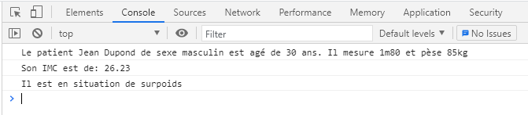


Créer une nouvelle version de l'objet qui utilise une méthode <code>definir_corpulence()</code> pour retourner en une seule fois le message contenant la valeur de l'IMC et l'état de corpulence correspondant. Les méthodes <code>calculer_IMC()</code> et <code>interpreter_IMC()</code> seront utilisées comme des fonctions internes. 

## 3. Constructeur d'objet 

En JavaScript, il est possible de créer des objets à partir de fonctions spéciales appelées **constructeurs**. Un constructeur d'objet est une fonction qui va nous permettre de créer des objets semblables c'est à dire dont les propriétés et les méthodes sont les mêmes.
Dans une fonction "constructeur", on va définir l'ensemble des propriétés et des méthodes avec lesquelles les objets vont être créés.

Pour construire des objets à partir d'une fonction "constructeur", il faudra :

* définir la fonction qui fait office de constructeur
* appeler cette fonction utilisant le mot clé ```new```

Exemple : création de l'objet ```objPersonne``` avec un constructeur
 ```javascript
// On définit la fonction constructeur Personne
function Personne(prmNom,prmPrenom,prmAge,prmVille) {
    this.nom = prmNom ;
    this.prenom = prmPrenom ;
    this.age = prmAge ;
    this.ville = prmVille ;
    this.decrire = function() {
        let description;
        description = this.prenom + " " + this.nom + " est agé de " + this.age + " ans et réside à " + this.ville ;
        return description;
    } ;
    this.modifier_Ville = function(prmVille) {
        this.ville = prmVille;
    } ;
}

// on crée l'objet "objPersonne" en appellant la fonction Personne avec le mot clé new
let objPersonne = new Personne('Dupond', 'Jean', 30, 'Armentières') ;

// on affiche la description
console.log(objPersonne.decrire()) ;
```

Dans cet exemple, la fonction ```Personne()``` contient la définition des propriétés et des méthodes des objets que l'on pourra créer avec. Le mot clé ```this``` permet de faire référence à l'objet qui sera créé lors de l'appel de cett fonction.

Les paramètres (prmNom, prmPrenom,..) passés à la fonction ```Personne()``` permettent de choisir les valeurs avec lesquelles les propriétés de l'objet seront initialsées au moment de sa création.

> Par convention, les noms des fonctions de type constructeur commencent généralement par une majuscule pour les discerner des fonctions classiques

Après avoir défini complétement la fonction ```Personne()```, on l'appelle en utilisant le mot clé ```new```, pour cela : 
* on déclare une variable à laquelle on affecte l'objet créé par la fonction ```Personne()```  
* on passe en paramètre les valeurs avec lesquelles les propriétés de l'objet seront initialisées.

Une fonction de type constructeur peut être appelée autant de fois qu'on le souhaite pour créer d'autres objets basés sur le même modèle.

Exemple :

```javascript
// Définition de la fonction constructeur
function Personne(prmNom,prmPrenom,prmAge,prmVille) {
    this.nom = prmNom ;
    this.prenom = prmPrenom ;
    this.age = prmAge ;
    this.ville = prmVille ;
    this.decrire = function() {
        let description;
        description = this.prenom + " " + this.nom + " est agé de " + this.age + " ans et réside à " + this.ville ;
        return description;
    } ;
    this.modifier_Ville = function(prmVille) {
        this.ville = prmVille;
    } ;
}

// création des objets
let objPersonne1 = new Personne('Dupond', 'Jean', 30, 'Armentières') ;
let objPersonne2 = new Personne('Martin', 'Eric', 42, 'Lille') ;

// affichage de la description des objets
console.log(objPersonne1.decrire()) ;
console.log(objPersonne2.decrire()) ;
```
Dans cet exemple, on crée deux objets ```objPersonne1``` et ```objPersonne2``` à partir du constructeur ```Personne()```, chaque objet possède les mêmes propriétés mais avec leurs valeurs propres et les mêmes méthodes.

## Activité \: Codage d'un constructeur d'objet pour le calcul de l'IMC

Reprenez dans un nouveau projet la dernière version de l'application pour le calcul d'IMC (version pour laquelle les fonctions ```calculer_IMC()``` et ```interprreter_IMC()``` sont définies comme des fonctions internes)

Remplacez la déclaration de l'objet litteral ```objPatient``` par une fonction de type constructeur ```Patient()``` pour créer les objets définissant un patient. 

Créez le patient "Jean Dupond" à l'aide de ce constructeur puis affichez :

* sa description
* son IMC
* son état de corpulence

Exemple de résultat attendu :

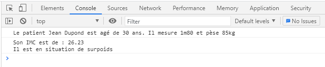

Dans cette version, on envisage en plus de corriger l'interprétation de l'IMC en fonction du sexe du patient. En effet, d'après certaines études, en conservant les mêmes seuils de corpulence pour l'interprétation, l'IMC d'un homme devrait être de 2 points plus élevé que celui d'une femme. 

Par exemple, on peut considérer que pour une femme, la limite pour ne pas être en surpoids est d'avoir un IMC < 25 alors que pour un homme elle serait d'avoir un IMC < 27.

Modifiez la fonction ```interpreter_IMC()``` afin que la correction sur l'interprétation de l'IMC selon le sexe soit prise en compte.

On souhaite aussi tenir compte du sexe du patient pour l'affichage des messages dans la console.

Modifiez les méthodes ```decrire()``` et ```definir_corpulence()``` afin qu'elles retournent un message adapté au sexe du patient.


Créez 2 patients supplémentaires et de sexe différent puis affichez pour chacun d'entr'eux :
* leur description
* leur IMC
* leur état de corpulence

Exemple de résultat attendu :

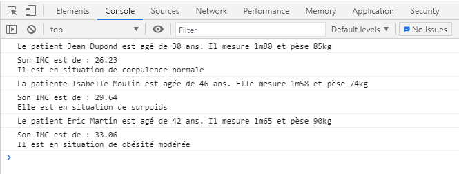

## 4. Utilisation du constructeur Object()

Une autre possibilité de créer un objet en JavaScript consiste à utiliser le constructeur ```Object()```. Pour cela, il suffit de déclarer la variable destinée à contenir l'objet et à l'initialiser en appelant le constructeur ```Object()``` avec le mot clé ```new```

Exemple : création de l'objet objPersonne

```javascript
let objPersonne = new Object();
```

Dans cet exemple, on stocke un objet vide dans la variable ```objPersonne```, il est possible ensuite d'ajouter des propriétés et des méthodes à cet objet en utilisant la notation avec un point ou avec les crochets

Exemple :

```javascript
let objPersonne = new Object();
objPersonne.nom = 'Dupond' ;
objPersonne.prenom = 'Jean' ;
objPersonne.age = 30;
objPersonne.ville = 'Armentières';
objPersonne.decrire = function() {
        let description;
        description = this.prenom + " " + this.nom + " est agé de " + this.age + " ans et réside à " + this.ville ;
        return description;
};
```

Il est également possible de passer un objet en paramètre au constructeur ```Object()```

Exemple :

```javascript
let objPersonne = new Object({
    nom: 'Dupond',
    prenom: 'Jean',
    age: 30,
    ville: 'Armentières',
    decrire: function() {
        let description;
        description = this.prenom + " " + this.nom + " est agé de " + this.age + " ans et réside à " + this.ville ;
        return description;            
    }
});
```

## 5. Les prototypes objet

### 5.1 Introduction

Lorsqu'on crée plusieurs objets à partir d'une fonction constructeur, chaque objet créé va disposer de sa propre copie des propriétés et méthodes de ce constructeur.

Exemple : si on reprend le cas des objets créés avec le constructeur ```Personne()```

```javascript
function Personne(prmNom,prmPrenom,prmAge,prmVille) {
    this.nom = prmNom ;
    this.prenom = prmPrenom ;
    this.age = prmAge ;
    this.ville = prmVille ;
        this.decrire = function() {
        let description;
        description = this.prenom + " " + this.nom + " est agé de " + this.age + " ans et réside à " + this.ville ;
        return description;
    } ;
    this.modifier_Ville = function(prmVille) {
        this.ville = prmVille;
    } ;
}

let objPersonne1 = new Personne('Dupond', 'Jean', 30, 'Armentières') ;
    let objPersonne2 = new Personne('Martin', 'Eric', 42, 'Lille') ;
```

En écrivant l'équivalent des objets sous la forme littérale, on obtient :

```javascript
let objPersonne1 = {
    nom : 'Dupond',
    prenom : 'Jean',
    age : 30,
    ville : 'Armentières',
    decrire : function() {
        let description;
        description = this.prenom + " " + this.nom + " est agé de " + this.age + " ans et réside à " + this.ville;
        return description;
    },
    modifier_Ville : function(prmVille) {
        this.ville = prmVille;
    }
};

let objPersonne2 = {
    nom : 'Martin',
    prenom : 'Eric',
    age : 42,
    ville : 'Lille',
    decrire : function() {
        let description;
        description = this.prenom + " " + this.nom + " est agé de " + this.age + " ans et réside à " + this.ville;
        return description;
    },
    modifier_Ville : function(prmVille) {
        this.ville = prmVille;
    }
};
```
Dans le cas présent, on peut constater que le code n'est pas optimal puisqu'en utilisant plusieurs fois le constructeur ```Personne()``` on va copier à chaque fois les méthodes ```decrire()``` et ```modifier_ville()``` qui sont identiques pour chaque objet.

L'idéal serait donc que ces méthodes ne soient définies qu'une seule fois pour tous les objets créés et que chaque objet puisse y avoir accès. Cette solution existe en JavaScript grâce aux **prototypes**.

### 5.2 Prototype vs Classe

Le JavaScript est un langage objet basé sur la notion de prototypes.

En programmation, il existe deux types de langages objet :

* les langages basés sur les classes
* les langages basés sur les prototypes

Dans le cas des langages objet basés sur les classes, tous les objets sont créés à partir de classes et vont hériter directement des propriétés et des méthodes définies dans la classe à laquelle ils appartiennent.

Dans le cas des langage objet basés sur les prototypes, tout est objet, il n'existe pas de classes et l'héritage va se faire au moyen de prototypes. On dit que chaque objet peut avoir un **prototype objet** dont il hérite des propriétés et des méthodes.

### 5.3 Les propriétés ```prototype``` et <code>\_\_proto\_\_</code>

Avant tout, il faut bien se rappeler que les fonctions en JavaScript sont également des objets.

Comme pour tout objet, lorsqu'on crée une fonction, JavaScript va automatiquement lui ajouter une propriété ```prototype```. La valeur de cette propriété est elle même un objet dont on peut afficher le contenu dans la console, on parle alors "d'objet prototype".

Exemple : affichage de l'objet prototype pour le constructeur d'objet ```Personne```

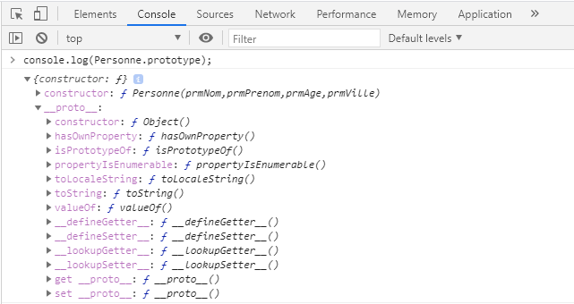

Par défaut, la propriété ```prototype``` d'un constructeur ne contient que deux propriétés :

* une propriété ```constructor``` qui renvoie vers le constructeur contenant le prototype
* une propriété <code> \_\_proto\_\_ </code> qui contient elle même de nombreuses propriétés et méthodes.

Lorsqu'on crée un objet à partir d'un constructeur, JavaScript va ajouter automatiquement une propriété <code>\_\_proto\_\_</code> à l'objet créé dans laquelle il va recopier le contenu de la propriété ```prototype``` du constructeur qui a servi à créer l'objet.

Exemple : affichage de la propriété <code>\_\_proto\_\_</code> pour l'objet ```objPersonne1``` créé avec le constructeur ```Personne()``` 

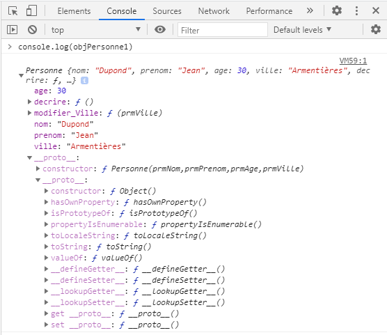

Dans cet exemple, JavaScript a ajouté une propriété <code>\_\_proto\_\_</code> à l'objet ```objPersonne1``` dans laquelle il a recopié le contenu de la propriété ```prototype``` du constructeur ```Personne()```

En fait, le contenu de la propriété ```prototype``` d'un constructeur va contenir toutes les propriétés et les méthodes dont pourront hériter tous les objets créés à partir de ce constructeur.

Comme cette propriété est un elle-même un objet, on pourra lui ajouter les propriétés et les méthodes qui devront être partagées par tous les objets sans que ceux-ci aient à les redéfinir comme c'était le cas jusqu'à maintenant.

En règle générale, pour optimiser le codage, les proriétés des objets (dont les valeurs doivent être spécifiques à l'objet) seront déclarées au sein du constructeur et les méthodes (que tous les objets vont pouvoir appeler de la même façon) dans la propriété ```prototype``` du constructeur.

Exemple : héritage des méthodes pour le constructeur ```Personne()```

```javascript
function Personne(prmNom,prmPrenom,prmAge,prmVille) {
    this.nom = prmNom ;
    this.prenom = prmPrenom ;
    this.age = prmAge ;
    this.ville = prmVille ;
}

Personne.prototype.decrire = function() {
    let description;
    description = this.prenom + " " + this.nom + " est agé de " + this.age + " ans et réside à " + this.ville ;
    return description;
}

Personne.prototype.modifier_Ville = function() {
    this.ville = prmVille;
}

let objPersonne1 = new Personne('Dupond', 'Jean', 30, 'Armentières') ; 
let objPersonne2 = new Personne('Martin', 'Eric', 42, 'Lille') ;
```

Si on affiche le contenu des objets ```objPersonne1``` et ```objPersonne2```, on peut observer maintenant que les méthodes ```decrire()``` et ```modifier_Ville()``` ne sont plus définies directement dans les objets comme le sont les propriétés ```nom```, ```prenom```, ... mais comme étant des membres de la propriété <code>\_\_proto\_\_</code> .

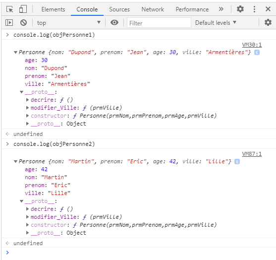

### 5.4 Chaine de prototypage

Au cours de l'exécution du code, lorsqu'on demande au navigateur d'accéder à un membre d'un objet, celui-ci va commencer par chercher ce membre au sein de l'objet.

S'il n'est pas trouvé, alors le membre va être cherché au sein de la propriété <code>\_\_proto\_\_</code> de l'objet dont le contenu correspond à celui de la propriété ```prototype``` du constructeur qui a servi à créer l'objet.

Si le membre est trouvé dans la propriété <code>\_\_proto\_\_</code> de l'objet, cela signifie qu'il est défini dans la propriété ```prototype``` du constructeur et peut être alors utilisé. Dans le cas contraire, le navigateur va aller chercher dans la propriété <code>\_\_proto\_\_</code> du constructeur qui correspond au prototype du constructeur du constructeur. Et ainsi de suite ...

Le processus décrit ainsi consiste à dire que le navigateur "remonte la chaine des prototypes des objets". A la base, tous les objets en JavaScript descendent par défaut de l'objet global ```Object```. Ainsi, lorsqu'on tente d'accéder à un membre d'un objet, ce membre est d'abord cherché dans l'objet, puis dans sa propriété <code>\_\_proto\_\_</code> s'il n'est pas trouvé dans l'objet puis dans la propriété <code>\_\_proto\_\_</code> de son constructeur et ainsi de suite jusqu'à remonter jusqu'au constructeur de ```Object```.

Exemple : on peut décrire la chaine de prototypage pour l'objet ```objPersonne1``` de la manière suivante :

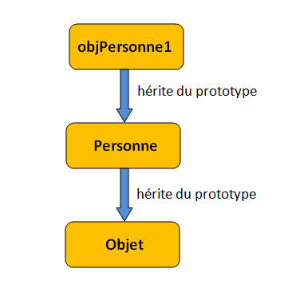

## Activité \: Optimisation du codage du constructeur pour le calcul de l'IMC

Modifier la dernière version de l'application de calcul d'IMC de manière à ce que les méthodes du constructeur ```Patient()``` ne soient plus redéfinies complétement dans les objets créés à partir de ce constructeur mais accessibles depuis son prototype.

## 6. Héritage entre objets 

### 6.1 Intérêt de l'héritage 

L'héritage va permettre de créer des familles d'objets partageant des similitudes sans à avoir à redéfinir pour chacune d'elle le constructeur entièrement. L'idée sera de créer un constructeur de base qui va contenir les propriétés et les méthodes communes à tous ces objets et ensuite des constructeurs plus spécialisés qui vont hériter de ce premier constructeur.

Exemple : 

on peut envisager de créer des objets représentant les professeurs et d'autres représentant les élèves à partir d'un objet représentant une personne.

Effectivement, les professeurs comme les élèves sont des personnes avec un nom, un prénom, un age, par contre un professeur enseigne une matière alors qu'un élève est dans une classe.
Dans ce cas, l'idée serait donc de créer un constructeur de base ```Personne()``` puis deux constructeurs spécifiques ```Professeur()``` et ```Eleve()``` qui héritent de ```Personne()```.

### 6.2 Mise en place de l'héritage 

Pour mettre en place un héritage entre objets, on procède en plusieurs étapes :

> on commence par créer le constructeur parent

Exemple : on crée le constructeur ```Personne()```

```javascript
function Personne(prmNom, prmPrenom, prmAge, prmSexe) {
    this.nom = prmNom;
    this.prenom = prmPrenom;
    this.age = prmAge;
    this.sexe = prmSexe;
}

Personne.prototype.decrire = function() {
    let description;
    description = "Cette personne s'appelle " + this.prenom + " " + this.nom + " elle est agée de " + this.age + " ans" ;
    return description;
}
```

On ajoute les méthodes dans le prototype du constructeur qui doivent être partagées par tous les objets créés à partir de ce dernier.

> on définit ensuite le constructeur enfant qui va appeler le constructeur parent 

Exemple : on crée le constructeur ```Professeur()```

```javascript
function Professeur(prmNom, prmPrenom, prmAge, prmSexe, prmMatiere) {
    Personne.call(this,prmNom, prmPrenom, prmAge, prmSexe);
    this.matiere = prmMatiere;
}
```
Lors de cette étape, on utilise la fonction ```call()``` qui permet d'appeler une fonction rattachée à un objet donné sur un autre objet.

Dans l'exemple ci-dessus, on utilise cette fonction pour faire appel au constructeur ```Personne()``` dans le constructeur ```Professeur()``` désigné par le paramètre ```this```. On passe ensuite les paramètres qui devront être initialisés par le constructeur ```Personne()```.
    
Ainsi lors de l'appel du constructeur ```Professeur()```, les propriétés ```nom```, ```prenom``` et ```age``` seront initialisées par le constructeur ```Personne()```, seule la propriété ```matiere``` sera initialisée par le constructeur ```Professeur()```

> le constructeur enfant doit hériter des méthodes définies dans le prototype du constructeur parent 

Exemple : le constructeur ```Professeur()``` doit hériter des méthodes définies dans le prototype du constructeur ```Personne()```

```javascript
Professeur.prototype = Object.create(Personne.prototype);
```
    
On utilise la méthode ```create()``` de l'objet global ```Object``` pour créer un objet à partir du prototype du constructeur ```Personne()``` et on assigne cet objet au prototype du constructeur ```Professeur()```.

> Il faut rétablir la valeur de la propriété ```constructor``` du prototype du constructeur enfant

L'étape précédente fait que pour le prototype du constructeur enfant, le constructeur est celui du constructeur parent.

Exemple : cas du constructeur ```Professeur()```

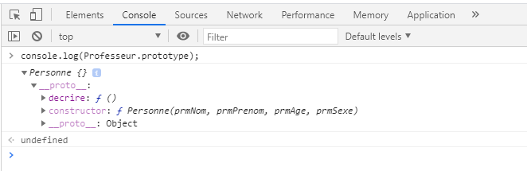

Après inspection dans la console du prototype de ce constructeur, on observe que le constructeur attribué à ce prototype est ```Personne()``` alors qu'il devrait s'agir du constructeur ```Professeur()```.

Il est donc nécessaire de réinitialiser cette propriété avec le nom du constructeur enfant

Exemple : on réinitialise la propriété ```constructor``` du prototype de ```Professeur()``` avec ```Professeur```

```javascript
Professeur.prototype.constructor = Professeur;
```

Si on inspecte à nouveau le prototype du constructeur ```Professeur()```, on s'aperçoit que sa propriété ```constructor``` a bien été réinitialisée avec le constructeur ```Professeur()```

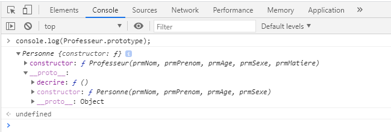

> Enfin, il est possible de définir de nouvelles méthodes spécifiques au constructeur enfant en les ajoutant à son prototype.

Exemple : on ajoute une méthode ```decrire_plus()``` au prototype du constructeur ```Professeur()```

```javascript
Professeur.prototype.decrire_plus = function() {
    let description;
    let prefixe;
    if(this.sexe == 'M') {
        prefixe = 'Mr';
    } else {
        prefixe = 'Mme';
    }
    description = prefixe + " " + this.prenom + " " + this.nom + " est professeur de " + this.matiere;
    return description;
}
```
Cette méthode permettra d'afficher une description spécifique à tout objet créé à partir du constructeur ```Professeur()``` notamment le préfixe Mr ou Mme selon le sexe de la personne ainsi que la matière enseignée.

Tout objet de type ```Professeur``` hérite maintenant de la méthode ```decrire()``` définie dans le prototype du constructeur ```Personne()``` et de la méthode ```decrire_plus()``` définie dans le prototype du constructeur ```Professeur()```.

```javascript
let objProfesseur1 = new Professeur('Dupond', 'Jean', 30, 'M', 'Mathématiques');
console.log(objProfesseur1.decrire());
console.log(objProfesseur1.decrire_plus());
```
Affichage obtenu dans la console :

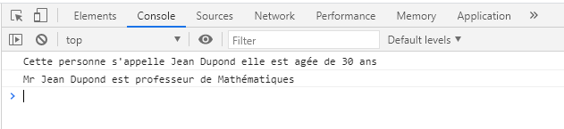

## Activité \: implémentation de l'héritage pour gérer les professeurs et les élèves

Créez un nouveau projet html5 dans VS Code incluant un fichier Javascript :

* nom du dossier racine : **Heritage_Proto**
* nom du fichier js : **heritage_proto.js**  

Codez les instructions javascript qui permettent d'implémenter:

* le constructeur ```Personne()``` tel qu'il a été défini dans l'exemple du cours
* les constructeurs ```Professeur()``` et ```Eleve()``` pour qu'ils héritent tout deux des propriétés et des méthodes du constructeur ```Personne()``` et qu'ils possédent chacun d'une méthode spécifique ```decrire_plus()```

Ajoutez les instructions qui permettent de créer un objet de chaque type (```Professeur``` et ```Eleve```) et de tester les méthodes ```decrire()``` et ```decrire_plus()``` sur chacun de ces objets.

Exemple de résultat attendu :

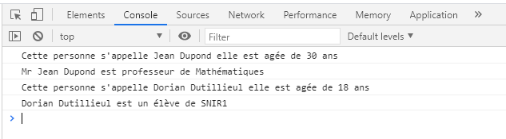

## 7. Les objets globaux

### 7.1 Valeurs primitives et objets

En Javascript, les types de données sont classés en deux catégories :

* les valeurs primitives

* les objets

Une valeur primitive est une donnée qui n'est pas un objet et qui ne peut pas être modifiée.

Au total, JavaScript intègre 7 types de valeurs différents :

* ```string``` : pour les chaines de caractères

* ```number``` : pour les nombres

* ```boolean``` : pour les valeurs booléennes (true ou false)

* ```null``` : pour indiquer qu'une variable pointe vers une référence qui n'existe pas

* ```undefined``` : pour indiquer q'une variable n'a pas de valeur

* ```symbol``` : pour définir une valeur unique et non modifiable (ce type a été introduit récemment avec ECMAScript 2015)

* ```object``` : pour les objets

Les valeurs appartenant aux 6 premiers types sont appelées des valeurs primitives, seules les valeurs appartenant au type ```object``` sont des objets.

### 7.2 L'opérateur ```typeof```

L'opérateur ```typeof``` renvoie une chaine qui indique le type de la valeur sur laquelle il est exécuté.

Syntaxe :

```javascript
typeof valeur
```

Exemples :

```javascript
typeof 42;          // renvoie 'number'
typeof 'snir'       // renvoie 'string'
typeof false        // renvoie 'boolean'
```

On peut utiliser aussi cet opérateur pour récupérer le type de valeur que contient une variable. 

Exemples :

```javascript
let data;
typeof data;                // renvoie 'undefined'
data = 12;
typeof data;                // renvoie 'number'
data = {nom : 'Dupond'};    
typeof data;                // renvoie 'object'
```

### 7.3 Les wrappers de valeurs primitives

Excepté pour les valeurs ```null``` et ```undefined```, il existe pour chaque valeur primitive un objet équivalent (wrapper) qui la contient.

* ```String``` pour la primitive ```string```

* ```Number``` pour la primitive ```number```

* ```Boolean``` pour la primitive ```boolean```

* ```Symbol``` pour la primitive ```symbol```

Tous ces objets possède une méthode ```valueOf()``` qui retourne la valeur primitive encapsulée correspondante.

Pour chacun de ces types, on peut donc déclarer une variable qui contient une valeur primitive ou le wrapper qui lui correspond.

Exemple :

```javascript
let chaine1 = 'Une chaine de caractères';                       // chaine1 contient une valeur primitive de type string
let objChaine2 = new String('Une chaine de caractères');        // objChaine2 contient un objet de type String
```
Dans le cas de cet exemple, pour la variable ```objChaine2```, il faudra utiliser la méthode ```valueOf()``` pour récupérer la chaine de caractères qu'elle contient.

```javascript
objChaine2.valueOf();          // retourne la chaine 'une chaine de caractères'
```
Les wrappers permettent de créer des objets qui héritent de propriétés et de méthodes grâce auxquelles on pourra manipuler la valeur primitive qu'ils contiennent. Par exemple, le wrapper ```String``` possède entre autre :

* la propriété ```length``` qui permet de connaître la longueur de la chaine de caractères

* la méthode ```toUpperCase()``` qui permet de renvoyer cette chaine en majuscules

Exemple :

```javascript
// Création d'un objet String
let objChaine1 = new String('une chaine de caractères');
        
// Calcul de la longueur de la chaine
let lgCh1 = objChaine1.length;                 // lgCh1 contiendra 24 (nombre de caractères compris dans le texte 'une chaine de caractères')
        
// Conversion de la chaine en majuscules
let ch1Maj = objChaine1.toUpperCase();         // ch1Maj contiendra 'UNE CHAINE DE CARACTERES'
```
JavaScript autorise l'accès aux propriétés et aux méthodes d'un wrapper depuis une valeur primitive en convertissant implicitement cette valeur en un objet.

Exemple :

```javascript
let ch1 = 'une chaine de caractères';   // ch1 contient une valeur primitive de type string
// Calcul de la longueur de la chaine
let lgCh1 = ch1.length; 
// Conversion de la chaine en majuscules
let ch1Maj = ch1.toUpperCase();
```                        

Dans cet exemple, JavaScript convertit implicitement la chaine contenue dans ```ch1``` en un objet de type ```String``` pour utiliser ensuite la propriété ```length``` et la méthode ```toUpperCase()```.

Les wrappers font partie des objets applelés globaux ou natifs du JavaScript, à ceux-ci s'ajoutent d'autres objets tels que ```Math```, ```Array``` ou encore ```Date```.

## Références MDN 

* Les bases de l'objet en JavaScript : <br/>
<https://developer.mozilla.org/fr/docs/Learn/JavaScript/Objects/Basics>

* Création d'un objet avec un constructeur : <br/>
<https://developer.mozilla.org/fr/docs/Learn/JavaScript/Objects/JS_orient%C3%A9-objet>

* Les prototypes objet : <br/>
<https://developer.mozilla.org/fr/docs/Learn/JavaScript/Objects/Prototypes_Objet>

* L'héritage : <br/>
<https://developer.mozilla.org/fr/docs/Learn/JavaScript/Objects/Heritage>

* Les objets globaux : <br/>
<https://developer.mozilla.org/fr/docs/Web/JavaScript/Reference/Objets_globaux> 
 
## Exercice

On souhaite développer une application qui permet de créer des objets représentant les personnages dans un jeu. Chaque personnage devra être créé avec un nom et un niveau représenté par un nombre entier. Il devra également appartenir à l'une des deux catégories de personnages prévues dans le jeu qui permettent de lui attribuer ses capacités spécifiques. Un personnage pourra donc représenter ici un guerrier ou un magicien. Les guerriers seront créés pour combattre avec une arme et les magiciens pour posséder un pouvoir.

Le développement de cette application se fera en respectant les étapes suivantes :

* créer une fonction constructeur ```Personnage()``` avec 2 paramètres : ```prmNom``` et ```prmNiveau```. Ce constructeur permettra que créer un personnage en lui attribuant un nom et un niveau.

* ajouter au prototype de ce constructeur une méthode ```saluer()``` pour permettre au personnage de se présenter. Pour cela, cette méthode doit retourner un message qui commence par le nom du personnage suivi de l'expression "vous salue !!".    

* créer le constructeur ```Guerrier()``` qui hérite du constructeur ```Personnage()``` et qui permet de créer un personnage représentant un guerrier avec son nom, son niveau et son arme.

* ajouter au prototype de ce constructeur une méthode ```combattre()``` qui retourne un message commençant par le nom du personnage suivi de l'expression "est un guerrier qui se bat avec" et se terminant par le nom de l'arme attribuée.

* créer le personnage "Arthur" correspondant à un guerrier de niveau 3 qui se bat avec une épé.

* tester dans la console du navigateur les fonctions ```saluer()``` et ```combattre()``` pour ce personnage

* créer le constructeur ```Magicien()``` qui hérite du constructeur ```Personnage()``` et qui permet de créer un personnage représentant un magicien avec son nom, son niveau et son pouvoir.

* ajouter au prototype de ce constructeur une méthode ```posseder()``` qui retourne un message commençant par le nom du personnage suivi de l'expression "est un magicien qui possède le pouvoir de" et se terminant par le nom du pouvoir attribué.

* créer le personnage "Merlin" correspondant à un magicien de niveau 2 qui possède le pouvoir de prédire les batailles.

* tester dans la console du navigateur les fonctions ```saluer()``` et ```posseder()``` pour ce personnage

