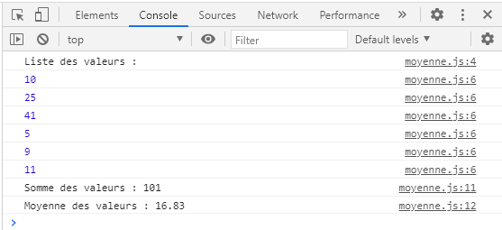
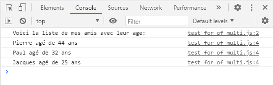
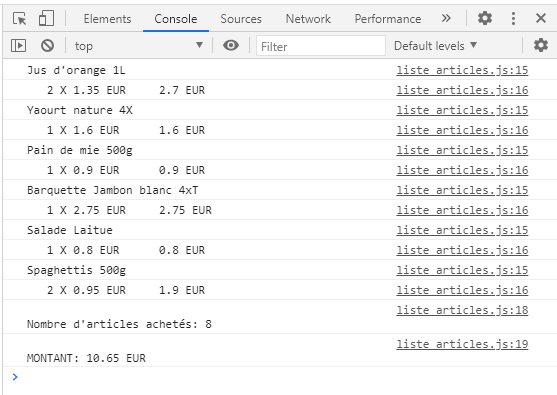
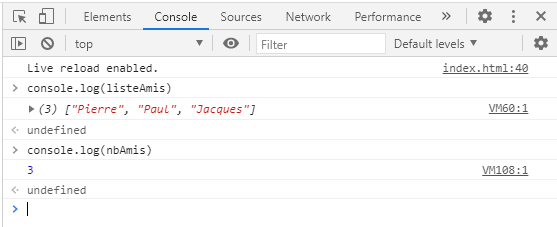
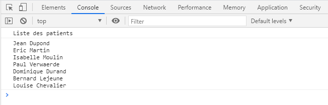
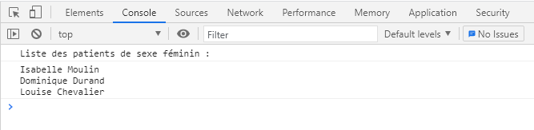
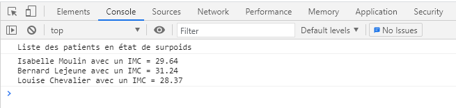
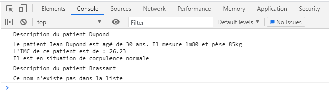
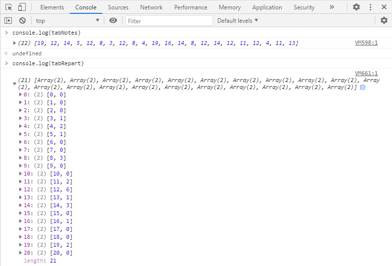
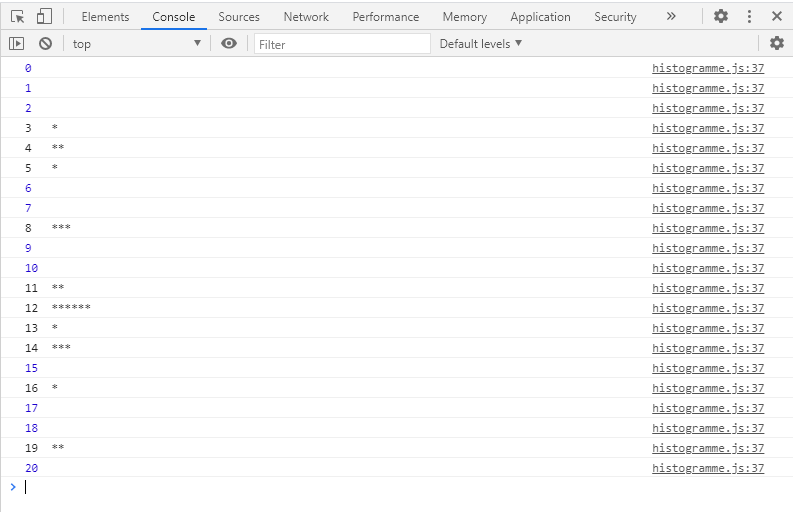

# Les tableaux en JavaScript et l'objet global Array

> * Auteur : Alain BRASSART
> * Date de publication : 07/03/2021
> * Mise à jour : 16/05/2023
> * OS: Windows 10 (version 22H2)
> * VS Code : version 1.78.1 (system setup)
> * Chrome : version 113.0.5672.93

 [Licence Creative Commons](https://creativecommons.org/licenses/by-nc-sa/3.0/fr/)

## Sommaire

  - [1. Introduction](#1-introduction)
  - [2. Pour commencer avec les tableaux](#2-pour-commencer-avec-les-tableaux)
    - [2.1 Déclarer et initialiser un tableau](#21-déclarer-et-initialiser-un-tableau)
    - [2.2 Lire ou modifier la valeur d'un élément du tableau](#22-lire-ou-modifier-la-valeur-dun-élément-du-tableau)
    - [2.3 Parcourir un tableau à l'aide de la boucle <code>for...of</code>](#23-parcourir-un-tableau-à-laide-de-la-boucle-forof)
  - [Activité \: Calcul de la moyenne d'une série de valeurs](#activité-calcul-de-la-moyenne-dune-série-de-valeurs)
  - [3. Les tableaux multidimensionnels](#3-les-tableaux-multidimensionnels)
    - [3.1 Présentation](#31-présentation)
    - [3.2 Déclarer et initialiser un tableau multidimensionnel](#32-déclarer-et-initialiser-un-tableau-multidimensionnel)
    - [3.3 Lire ou modifier les valeurs dans un tableau multidimensionnel](#33-lire-ou-modifier-les-valeurs-dans-un-tableau-multidimensionnel)
    - [3.4 Parcourir un tableau multidimensionnel à l'aide de la boucle <code>for...of</code>](#34-parcourir-un-tableau-multidimensionnel-à-laide-de-la-boucle-forof)
  - [Activité \: Gestion d'une liste d'articles](#activité-gestion-dune-liste-darticles)
  - [4. Propriétés et méthodes de l'objet global Array](#4-propriétés-et-méthodes-de-lobjet-global-array)
    - [4.1 La propriété <code>length</code>](#41-la-propriété-length) 
    - [4.2 Ajouter ou supprimer des éléments en fin de tableau avec les méthodes <code>push()</code> et <code>pop()</code>](#42-ajouter-ou-supprimer-des-éléments-en-fin-de-tableau-avec-les-méthodes-push-et-pop)
    - [4.3 Ajouter ou supprimer des éléments en début de tableau avec les méthodes <code>unshift()</code> et <code>shift()</code>](#43-ajouter-ou-supprimer-des-éléments-en-début-de-tableau-avec-les-méthodes-unshift-et-shift)
    - [4.4 Ajouter, supprimer ou remplacer des éléments dans un tableau avec la méthode <code>splice()</code>](#44-ajouter-supprimer-ou-remplacer-des-éléments-dans-un-tableau-avec-la-méthode-splice)
    - [4.5 Convertir un tableau en chaine de caractères avec la méthode <code>join()</code>](#45-convertir-un-tableau-en-chaine-de-caractères-avec-la-méthode-join)
    - [4.6 Extraire une partie d'un tableau avec la méthode <code>slice()</code>](#46-extraire-une-partie-dun-tableau-avec-la-méthode-slice)
    - [4.7 Vérifier l'existence d'une valeur avec la méthode <code>includes()</code>](#47-vérifier-lexistence-dune-valeur-avec-la-méthode-includes)
    - [4.8 Retrouver l'index d'un élément avec la méthode <code>indexOf()</code>](#48-retrouver-lindex-dun-élément-avec-la-méthode-indexof)
 - [Activité \: Utilisation d'un tableau pour gérer une liste de patients au niveau du calcul de l'IMC](#activité-utilisation-dun-tableau-pour-gérer-une-liste-de-patients-au-niveau-du-calcul-de-limc) 
 - [Références MDN](#références-mdn)
 - [Exercice \: Calcul et Affichage d'un Histogramme](#exercice-calcul-et-affichage-dun-histogramme)
  
## 1. Introduction

Les tableaux sont des variables particulières qui permettent de stocker plusieurs valeurs à la fois avec un sytème d'indice ou de clef associé à chaque valeur. Ils s'avèrent pratique pour traiter des listes de valeurs.
De manière générale, on distingue deux types de tableaux :

* les tableaux indexés dont les indices ou les clefs sont définis uniquement par des numéros 
* les tableaux associatifs dont les indices ou les clefs sont définis par des noms

JavaScript ne gère que les tableaux indexés, les indices associés à chaque valeur vont être générées automatiquement en partant de 0 pour la première valeur.  

Struture d'un tableau indexé :

| Indice | 0 | 1 | 2 | 3 |
|--------|---|---|---|---|
| **Valeur** | **valeur1** | **valeur2** | **valeur3** | **valeur4** |

Les valeurs stockées dans un tableau pourront être de type différents (nombre, chaine, objet ou encore autre tableau)

Exemple :

| Indice | 0 | 1 | 2 | 3 |
|--------|---|---|---|---|
| **Valeur** | **'Clio'** | **10000** | **5.6** | **'rouge'** |


Contrairement à d'autres langages, en JavaScript, les tableaux sont dynamiques, il n'est pas nécessaire de définir leur taille avant de les utiliser. D'autre part, ce sont des objets qui dépendent de l'objet global ```Array```

## 2. Pour commencer avec les tableaux

### 2.1 Déclarer et initialiser un tableau

Pour déclarer un tableau, on peut utiliser le constructeur de l'objet ```Array```

```javascript
let listeAmis = new Array();
``` 

ou utiliser la notation avec les crochets ```[]```

```javascript  
let listeAmis = [];
```

On peut initialiser le tableau avec des valeurs au moment de sa déclaration

```javascript
let listeAmis = new Array('Pierre','Paul','Jacques') ;
```
ou :

```javascript
let listeAmis = ['Pierre','Paul','Jacques'] ;
```

| Indice | 0 | 1 | 2 |
|--------|---|---|---|
| **Valeur** | **'Pierre'** | **'Paul'** | **'Jacques'**|


Il est possible également de déclarer un tableau vide et de le remplir par la suite

```javascript
let listeAmis = [];
listeAmis[0] = 'Pierre';
listeAmis[1] = 'Paul';
listeAmis[2] = 'Jacques';
```

### 2.2 Lire ou modifier la valeur d'un élément du tableau

Pour accéder à un élément du tableau, il suffit de préciser le nom du tableau auquel appartient cet élément suivi de l'indice qui lui est associé entre crochets : ```nom du tableau[indice de l'élément]```

Exemple : affichage des valeurs contenues dans le tableau ```listeAmis```

```javascript
let listeAmis = ['Pierre','Paul','Jacques'];
console.log(listeAmis[0]);        // affiche Pierre
console.log(listeAmis[1]);        // affiche Paul
console.log(listeAmis[2]);        // affiche Jacques
```

Il est également possible d'accéder à un élément pour en modifier la valeur en utilisant la syntaxe : ```nom du tableau[indice de l'élément] = nouvelleValeur;```

Exemple : modification d'un élément du tableau ```listeAmis```

```javascript
listeAmis[1] = 'Jean';      // remplace 'Paul' par 'Jean'
```
| Indice | 0 | 1 | 2 |
|--------|---|---|---|
| **Valeur** | **'Pierre'** | ***'Jean'*** | **'Jacques'**|


### 2.3 Parcourir un tableau à l'aide de la boucle <code>for...of</code>

Pour parcourir un tableau élément par élément, il existe en JavaScript la structure de boucle ```for...of``` spécialement créée dans ce but

Exemple : utilisation de la boucle ```for ... of``` pour afficher toutes les valeurs contenues dans le tableau ```listeAmis```

```javascript
let listeAmis = ['Pierre','Paul','Jacques'];
for(let nomAmi of listeAmis) {
        console.log(nomAmi);
}
```
On définit dans cette structure une variable (ici la variable ```nomAmi```) qui va servir à récupérer chacune des valeurs du tableau (ici le tableau ```listeAmis```) au fur et à mesure que celui ci est parcouru par la boucle. Lors de chaque passage dans la boucle, la valeur ainsi récupérée est affichée dans la console du navigateur.

## Activité \: Calcul de la moyenne d'une série de valeurs

Créez un nouveau projet html5 dans VS Code incluant un fichier Javascript :

* nom du dossier racine : **Calcul_Moyenne**
* nom du fichier js : **moyenne.js**  

Codez les instructions javascript qui permettent de :

* déclarer et initialiser un tableau ```listeValeurs``` avec une suite de valeurs entières comprises entre 0 et 100 (on se limitera à 10 valeurs max)
* d'afficher dans la console du navigateur cette suite de valeurs selon l'exemple donné ci-dessous
* de calculer et afficher la somme et la moyenne de ces valeurs

Exemple de résultat attendu :



## 3. Les tableaux multidimensionnels

### 3.1 Présentation

Un tableau multidimensionnel est un tableau qui contient lui même d'autres tableaux.

Exemple :

| Indice | 0  |  | 1 |  | 2 |  |
|--------|----|--|---|--|---|--|
|        | **tableau 1** | | **tableau 2**| | **tableau 3** |
|        | 0 | 1 | 0 | 1 | 0 | 1 |
| **Valeurs**  |**'Pierre'**| **44** |**'Paul'**| **32** |**'Jacques'**| **25** | 

Cet exemple correspond à un tableau à 2 dimensions, chaque élément de ce tableau est lui même un tableau qui contient 2 valeurs représentant une chaine de caractères et un nombre.

### 3.2 Déclarer et initialiser un tableau multidimensionnel

Pour déclarer et initialiser un tableau multidimensionnel, on peut utiliser le constructeur de ```Array``` pour créer tout d'abord tous les tableaux élémentaires qu'il devra contenir 

```javascript
let ami1 = new Array('Pierre',44);
let ami2 = new Array('Paul',32);
let ami3 = new Array('Jacques',25);
```
puis utiliser à nouveau le constructeur de <code>Array</code> pour déclarer et initialiser le tableau principal avec ces éléments

```javascript
let listeAmis2 = new Array(ami1,amis2,amis3);
```

Il est possible aussi d'employer la notation avec crochets 

```javascript
let listeAmis2 = [['Pierre',44],['Paul',32],['Jacques',25]];
```

### 3.3 Lire ou modifier les valeurs dans un tableau multidimensionnel

La position de chaque valeur contenue dans un tableau multidimensionnel est définie par 2 indices :

* l'indice qui correspond à la position du tableau interne dans lequel se trouve la valeur
* l'indice qui correspond à la position de la valeur dans ce tableau interne

```valeur = nom du tableau[indice du tableau interne][indice dans le tableau interne]```

Exemple : affichage des valeurs contenues dans le tableau ```listeAmis2```

```javascript
let listeAmis2 = [['Pierre',44],['Paul',32],['Jacques',25]];
console.log(listeAmis2[0][0]);          // affiche 'Pierre"
console.log(listeAmis2[0][1]);          // affiche 44
console.log(listeAmis2[1][0]);          // affiche 'Paul'
console.log(listeAmis2[1][1]);          // affiche 32
console.log(listeAmis2[2][0]);          // affiche 'Jacques'
console.log(listeAmis2[2][1]);          // affiche 25
```
Il est également possible de modifier une valeur dans un tableau multidimensionnel en utilisant la syntaxe : 
```nom du tableau[indice du tableau interne][indice dans le tableau interne] = nouvelleValeur;```

Exemple : modification d'une valeur dans le tableau ```listeAmis2```

```javascript
listeAmis2[1][1] = 36;      // remplace 32 par 36
```

| Indice | 0  |  | 1 |  | 2 |  |
|--------|----|--|---|--|---|--|
|        | **tableau 1**| | **tableau 2** | | **tableau 3** |
|        | 0 | 1 | 0 | 1 | 0 | 1 |
| **Valeurs**  |**'Pierre'**| **44** |**'Paul'**| ***36*** |**'Jacques'**| **25** | 

### 3.4 Parcourir un tableau multidimensionnel à l'aide de la boucle ```for...of```

On peut utiliser la structure de boucle ```for...of``` pour accéder à chacun des tableaux internes puis aux valeurs contenues dans ces tableaux en utilisant l'indexation.

Exemple : utilisation de la boucle ```for ... of``` pour afficher toutes les valeurs contenues dans le tableau ```listeAmis2```

```javascript
let listeAmis2 = [['Pierre',44],['Paul',32],['Jacques',25]];
console.log('Voici la liste de mes amis avec leur age: ');
for(let ami of listeAmis2) {
        console.log(ami[0] + ' agé de ' + ami[1] + ' ans');
}
```
Aperçu dans la console du navigateur :



## Activité \: Gestion d'une liste d\'articles

Créez un nouveau projet html5 dans VS Code incluant un fichier Javascript :

* nom du dossier racine : **Liste_Articles**
* nom du fichier js : **liste_articles.js**  

Codez les instructions javascript qui permettent de :

* déclarer et initialiser un tableau multidimensionnel ```listeArticles``` dans lequel chaque article est défini lui même par un tableau de trois éléments :
  
  *  une chaine de caractères correspondant à la désignation de l'article
  *  un nombre correspondant au prix unitaire en euros
  *  un nombre correspondant à la quantité achetée
  
* d'afficher dans la console du navigateur la liste des articles avec, pour chaque article, la quantité achetée et le prix correspondant (voir exemple donné ci-dessous)
* de calculer et afficher le nombre total d'articles achetés ainsi que le montant total des achats au centime près.

Exemple de résultat attendu :



## 4. Propriétés et méthodes de l'objet global Array

### 4.1 La propriété ```length```

L'objet ```Array``` ne possède qu'une seule propriété, ```length``` qui retourne le nombre d'éléments contenus dans un tableau.

Exemple :

```javascript
let listeAmis = ['Pierre','Paul','Jacques'];
let nbAmis = listeAmis.length;

// nbAmis vaut 3
```
Après l' exécution de ce script, la variable ```nbAmis``` contient le nombre d'éléments contenus dans le tableau ```listaAmis```, soit ici 3 éléments.

Aperçu dans la console du navigateur :



La propriété ```length``` peut être utilisée dans une boucle pour parcourir le tableau au même titre que la boucle ```for ...of```

Exemple : utilisation de la propriété ```length``` dans une boucle ```for``` pour afficher toutes les valeurs contenues dans le tableau ```listeAmis```

```javascript
let listeAmis = ['Pierre','Paul','Jacques'];
for(let i=0; i<listeAmis.length; i++) {
        console.log(listeAmis[i]);
}
```
Cette propriété peut également être utilisée pour vider un tableau :

```javascript
listeAmis.length = 0 ;          // vide le tableau listeAmis
```
### 4.2 Ajouter ou supprimer des éléments en fin de tableau avec les méthodes ```push()``` et ```pop()```

La méthode ```push()``` permet d'ajouter des éléments en fin de tableau. Les valeurs des éléments à ajouter sont passées en arguments et la nouvelle taille du tableau est retournée par la méthode.

Exemple :

```javascript
let listeAmis = ['Pierre','Paul','Jacques'] ;
let nbAmis = listeAmis.push('Jean','Martin');
```
Après l' exécution de ce script, le tableau ```listeAmis``` contient 5 éléments 

| Indice | 0 | 1 | 2 | 3 | 4 |
|--------|---|---|---|---|---|
| **Valeur** | **'Pierre'** | **'Paul'** | **'Jacques'**| ***'Jean'*** | ***'Martin'*** |


Les valeurs ```Jean``` et ```Martin``` sont ajoutées à la fin du tableau.

La variable ```nbAmis``` permet de récupérer en même temps la nouvelle taille du tableau. 

La méthode ```pop()``` permet de supprimer le dernier élément du tableau et retourne la valeur de cet élément.

Exemple :

```javascript
let listeAmis = ['Pierre','Paul','Jacques'] ;
let supprime = listeAmis.pop();
```
Après l' exécution de ce script, le tableau <code>listeAmis</code> ne contient plus que 2 éléments 

| Indice | 0 | 1 |
|--------|---|---|
| **Valeur** | **'Pierre'** | **'Paul'** | 

La valeur ```Jacques``` est supprimée du tableau et retournée dans la variable ```supprime```

### 4.3 Ajouter ou supprimer des éléments en début de tableau avec les méthodes ```unshift()``` et ```shift()```

La méthode ```unshift()``` permet d'ajouter des éléments en début de tableau. Les valeurs des éléments à ajouter sont passées en arguments et la nouvelle taille du tableau est retournée par la méthode.

Exemple :

```javascript
let listeAmis = ['Pierre','Paul','Jacques'] ;
let nbAmis = listeAmis.unshift('Jean','Martin');
```
Après l' exécution de ce script, le tableau ```listeAmis``` contient 5 éléments 

| Indice | 0 | 1 | 2 | 3 | 4 |
|--------|---|---|---|---|---|
| **Valeur** |'***Jean***'|***'Martin'***|**'Pierre'**|**'Paul'**|**'Jacques'**|

Les valeurs ```Jean``` et ```Martin``` sont ajoutées en début de tableau.

La variable ```nbAmis``` permet de récupérer en même temps la nouvelle taille du tableau.

La méthode ```shift()``` permet de supprimer le premier élément du tableau et retourne la valeur de cet élément.

Exemple :

```javascript
let listeAmis = ['Pierre','Paul','Jacques'] ;
let supprime = listeAmis.shift();
```

Après l' exécution de ce script, le tableau ```listeAmis``` ne contient plus que 2 éléments 

| Indice | 0 | 1 |
|--------|---|---|
| **Valeur** | **'Paul'** | **'Jacques'** | 

La valeur ```Pierre``` est supprimée du tableau et retournée dans la variable ```supprime```

### 4.4 Ajouter, supprimer ou remplacer des éléments dans un tableau avec la méthode ```splice()```

La méthode ```splice()``` permet de supprimer ou de remplacer une partie d'un tableau. Elle va pouvoir prendre trois paramètres :

* l'indice à partir duquel doit commencer le changement dans le tableau
* le nombre d'éléments à supprimer
* les valeurs des éléments qui devront être ajoutés

Cette méthode retourne également un tableau contenant les éléments supprimés.

Exemple : 

```javascript
let listeAmis = ['Pierre','Paul','Jacques'] ;
let listeSupp = listeAmis.splice(1,1,'Jean') ;
```

Dans cet exemple, la méthode ```splice()``` supprime un élément à partir de l'index 1 et insère la valeur ```Jean```. Après l'exécution de ce script, le contenu du tableau ```listeAmis``` sera le suivant :

| Indice | 0 | 1 | 2 |
|--------|---|---|---|
| **Valeur** | **'Pierre'** | ***'Jean'*** | **'Jacques'** |


La variable ```listeSupp``` est un tableau contenant le seul élément qui a été supprimé ```Paul``` 

> Si aucune valeur n'est spécifiée pour les éléments à ajouter, alors la méthode supprime les éléments qui se situent à partir de l'index spécifié par le premier paramètre et selon le nombre d'éléments à supprimer spécifié par le second paramètre.

Exemple :

```javascript
let listeAmis = ['Pierre','Paul','Jacques'] ;
let listeSupp = listeAmis.splice(1,1) ;
```
Cette fois-ci, la méthode ```splice()``` ne fait que supprimer un élément à partir de l'index 1. Après l'exécution de ce script, le contenu du tableau ```listeAmis``` sera le suivant :

| Indice | 0 | 1 |
|--------|---|---|
| **Valeur** | **'Pierre'** | **'Jacques'** |

```listeSupp``` est toujours un tableau contenant l' élément qui a été supprimé ```Paul``` 

### 4.5 Convertir un tableau en chaine de caractères avec la méthode ```join()```

La méthode ```join()``` retourne une chaine de caractères qui correspond à la concaténation de toutes les valeurs contenues dans un tableau, le séparateur utilisé par défaut entre chaque valeur est la virgule mais il est possible de passer en paramètre tout autre caractère comme séparateur.

Exemple : 

```javascript
let listeAmis = ['Pierre','Paul','Jacques'] ;
let chaineListeAmis = listeAmis.join(-) ;    
```
Après l' exécution de ce script, la variable ```chaineListeAmis``` contient la chaine de caractères : ``` "Pierre-Paul-Jacques" ```

### 4.6 Extraire une partie d'un tableau avec la méthode ```slice()```

La méthode ```slice()``` permet de récupérer une partie des éléments contenus dans un tableau. Pour cela, elle va pouvoir prendre deux paramètres :

* l'indice de début qui correspond à celui à partir duquel commence la partie à récupérer
* l'indice de fin qui correspond à celui à partir duquel la récupération s'arrête (l'élément correspondant à cet indicie n'est pas récupéré)

Cette méthode retourne alors un nouveau tableau contenant les éléments extraits, le tableau original n'est pas modifié.

Exemple : 

```javascript
let listeAmis = ['Pierre','Paul','Jacques','Jean','Martin'] ;
let listeAmisProches = listeAmis.slice(1,3);

// listeAmis vaut ['Pierre','Paul','Jacques','Jean','Martin']
// listeAmisProches vaut ['Paul','Jacques']
```
Dans cet exemple, la méthode ```slice()``` extrait les deuxième et troisième éléments du tableau ```listeAmis``` (les éléments d'indice 1 et 2) et retourne dans la variable ```listeAmisProches``` un tableau contenant les éléments ```Paul``` et ```Jacques```

> Lorsqu'une seule valeur est passée en argument et qu'elle est positive, elle est considérée par ```slice()``` comme l'indice de début et ```slice()``` retourne l'ensemble des éléments qui se trouvent à partir de cet indice.

Exemple : 

```javascript
let listeAmis = ['Pierre','Paul','Jacques','Jean','Martin'] ;
let listeAmisProches = listeAmis.slice(2);

// listeAmis vaut ['Pierre','Paul','Jacques','Jean','Martin']
// listeAmisProches vaut ['Jacques','Jean','Martin']
```
Dans cet exemple, la méthode ```slice()``` extrait les éléments du tableau ```listeAmis``` situés à partir de l'indice 2 (les éléments d'indice 2, 3 et 4) et retourne dans la variable ```listeAmisProches``` un tableau contenant les éléments ```Jacques```, ```Jean```, ```Martin```.

> Lorsqu'une seule valeur est passée en argument et qu'elle est négative, elle indique un décalage depuis la fin de la séquence et ```slice()``` retourne l'ensemble des éléments qui se trouvent dans l'intervalle correspondant à ce décalage.

Exemple :

```javascript
let listeAmis = ['Pierre','Paul','Jacques','Jean','Martin'] ;
let listeAmisProches = listeAmis.slice(-2);

// listeAmis vaut ['Pierre','Paul','Jacques','Jean','Martin']
// listeAmisProches vaut ['Jean','Martin']
```
Dans cet exemple, la méthode ```slice()``` extrait les avant-dernier et dernier éléments du tableau ```listeAmis``` (les éléments d'indice 3 et 4) et retourne dans la variable ```listeAmisProches``` un tableau contenant les éléments ```Jean``` et ```Martin```.

> Lorsque deux valeurs sont passée en argument, ll est possible également d'utiliser une valeur négative pour le deuxième argument qui indique aussi un décalage depuis la fin de la séquence. Dans ce cas, ```slice()``` retourne l'ensemble des éléments qui se trouvent dans l'intervalle défini par l'indice de début et le décalage depuis la fin.

Exemple :

```javascript
let listeAmis = ['Pierre','Paul','Jacques','Jean','Martin'] ;
let listeAmisProches = listeAmis.slice(1,-1);

// listeAmis vaut ['Pierre','Paul','Jacques','Jean','Martin']
// listeAmisProches vaut ['Paul','Jacques','Jean']
```
Dans cet exemple, la méthode ```slice()``` extrait  du deuxième à l'avant-dernier élément du tableau ```listeAmis``` (les éléments d'indice 1, 2 et 3) et retourne dans la variable ```listeAmisProches``` un tableau contenant les éléments ```Paul```,```Jacques``` et ```Jean```.

> Si aucun indice n'est passé en argument à ```slice()``` alors celle-ci renvoie une copie complète du tableau de départ.

### 4.7 Vérifier l'existence d'une valeur avec la méthode ```includes()```

La méthode ```includes()``` permet de déterminer si un tableau contient une valeur passée en argument. Si la valeur a été trouvée, ```includes()``` retourne la valeur ```true```.

Exemple :

```javascript
let listeAmis = ['Pierre','Paul','Jacques','Jean','Martin'] ;
let estMonAmi = listeAmis.includes('Jean');
        
// estMonAmi vaut true car la valeur 'Jean' est dans le tableau

let estMonAmi = listeAmis.includes('René');

// estMonAmi vaut false car la valeur 'René' ne fait pas partie du tableau
```
### 4.8 Retrouver l'index d'un élément avec la méthode ```indexOf()```

La méthode ```indexOf()``` retourne le premier indice pour lequel la valeur d'un élément spécifié a été trouvée dans le tableau. Si l'élément cherché n'est pas présent dans le tableau ```indexOf()``` renverra -1.

Exemple :

```javascript
let listeAmis = ['Pierre','Paul','Jacques','Jean','Martin'] ;
let index_Jean = listeAmis.indexOf('Jean');

// index_Jean vaut 3
```
Par défaut, la méthode ```indexOf()``` commence la recherche de l'élément à partir de l'indice 0 et le tableau est parcouru dans sa totalité. Cependant, il est possible d'ajouter un second paramètre pour spécifier le rang à partir duquel on souhaite 
commencer la recherche.

Exemple :

```javascript
let listeAmis = ['Pierre','Paul','Jacques','Jean','Martin'] ;
let index_Jean = listeAmis.indexOf('Jean', 2);
let index_Pierre = isteAmis.indexOf('Pierre', 2);
        
// index_Jean vaut toujours 3 mais index_Pierre vaut -1
```
## Activité \: Utilisation d'un tableau pour gérer une liste de patients au niveau du calcul de l'IMC

Créez un nouveau projet html5 dans VS Code incluant un fichier JavaScript :

* nom du dossier racine : **Tableau_Patient_IMC**
* nom du fichier js : **tab_Patients_IMC.js**

Recopiez dans le fichier js, les instructions JavaScript qui correspondent à la toute dernière définition du constructeur ```Patient()``` vue dans le chapitre précédent. (cf. Activité Optimisation du codage du constructeur pour le calcul de l'IMC avec fonctions internes).

Créez les objets représentant les patients qui seront mis dans la liste à partir du tableau suivant :

| Nom | Prénom | Age | Sexe | Taille (cm) | Poids (kg) |
|-----|--------|-----|------|-------------|------------|
| Dupond | Jean | 30 | masculin | 180 | 85   |
| Martin | Eric | 42 | masculin | 165 | 90   |
| Moulin | Isabelle | 46 | féminin | 158 | 74 |
| Verwaerde | Paul | 55 | masculin | 177 | 66 |
| Durand | Dominique | 60 | féminin | 163 | 54 |
| Lejeune | Bernard | 63 | masculin | 158 | 78 |
| Chevalier | Louise | 35 | féminin | 170 | 82 |
|           |        |    |         |     |    |

Déclarez et initialisez le tableau ```tabPatients``` avec ces objets.

Déclarez et codez la fonction ```afficher_ListePatients(prmTabPatients)```. Cette fonction doit retourner une chaine de caractères constituée des noms et prénoms de tous les patients contenus dans le tableau passé en paramètre.

Testez cette fonction en affichant la liste dans la console du navigateur

Exemple de résultat attendu :



Déclarez et codez la fonction ```afficher_ListePatients_Par_Sexe(prmTabPatients,prmSexe)```. Cette fonction doit retourner une chaine de caractères constituée des noms et prénoms de tous les patients contenus dans le tableau passé en paramètre et donc le sexe correspond à la valeur du paramètre ```prmSexe```

Testez cette fonction en affichant la liste dans la console du navigateur

Exemple de résultat attendu :



Déclarez et codez la fonction ```afficher_ListePatients_Par_Corpulence(prmTabPatients,prmCorpulence)```. Cette fonction doit retourner une chaine de caractères constituée des noms et prénoms ainsi que de l'IMC concernant tous les patients contenus dans le tableau passé en paramètre et dont l'état de corpulence correspond à celui du paramètre ```prmCorpulence```.

Dans le cas où aucun patient ne répond au critère de corpulence spécifié, la fonction devra retourner un message indiquant qu'aucun patient patient ne correspond à cet état de corpulence.

Pour cette fonction, il sera nécessaire de compléter le constructeur ```Patient()``` en lui ajoutant des propriétés qui représentent la valeur de l'IMC ainsi que l'état de corpulence correspondant. Les valeurs de ces propriétés devront être mises à jour grâce à la méthode ```definir_corpulence()```

Testez cette fonction en affichant la liste dans la console du navigateur

Exemple de résultat attendu :



Déclarez et codez la fonction ```afficher_DescriptionPatient(prmTabPatients, prmNom)```. Cette fonction doit retourner une chaine de caractères correspondant à la description d'un patient appartenant au tableau passé en paramètre et dont le nom correspond à celui du paramètre ```prmNom```

Dans le cas où le nom spécifié ne correspond à aucun patient contenu dans le tableau, la fonction devra retourner un message indiquant que ce nom n'existe pas dans la liste. 

Testez cette fonction en affichant la description de l'un des patients se trouvant dans le tableau dans la console du navigateur puis en utilisant le nom d'un patient qui n'existe pas.

Exemple de résultat attendu :



## Références MDN

* Présentation des tableaux en JavScript : <br/>
<https://developer.mozilla.org/fr/docs/Learn/JavaScript/First_steps/Arrays> 

* L'objet global <code>Array</code> : <br/>
<https://developer.mozilla.org/fr/docs/Web/JavaScript/Reference/Global_Objects/Array>

* Les collections indexées : <br/>
<https://developer.mozilla.org/fr/docs/Web/JavaScript/Guide/Indexed_collections>

## Exercice \: Calcul et Affichage d'un Histogramme

On souhaite développer une application qui affiche dans la console du navigateur un histogramme correspondant à la répartition des notes obtenues par les élèves de la classe pour un devoir.

Les notes saisies seront comprises entre 0 et 20 et correspondront à un nombre entier de points (pas de demi-point), plusieurs élèves pourront avoir la même note et certaines valeurs pourront ne pas avoir été attribuées (aucun élève n'a eu 1 ou 19 par exemple).

L'application utilisera deux fonctions :

* une fonction ```calculerRepartition(prmTabNotes)``` qui retournera un tableau représentant la répartion des valeurs contenues dans le tableau passé en paramètre ```prmTabNotes```

* une fonction ```tracerHisto(prmTabRepart)``` qui servira à construire et afficher l'histogramme dans la console du navigateur à partir du tableau passé en paramètre ```prmTabRepart``` contenant la répartition des notes.

Créez un nouveau projet html5 dans VS Code incluant un fichier Javascript :

* nom du dossier racine : **Histogramme**
* nom du fichier js : **histogramme.js**  

Le tableau retourné par la fonction <code>calculerRepartition()</code> est un tableau multidimensionnel dans lequel chaque élément correspond à un tableau interne constitué chacun de deux éléments :

* la note (toutes les valeurs comprises entre 0 et 20, y compris celle qui ne se trouvent pas dans le tableau de départ)
* le nombre de fois que cette note se trouve dans le tableau de départ (on mettra 0 pour toute note qui ne se trouve pas dans ce tableau)

Exemple de résultat attendu :



Codez les instructions javascript qui permettent de tester la fonction ```calculRepartition()```

Pour tracer l'histogramme dans la console du navigateur, on part du principe que la fonction ```tracerHisto()``` doit créer et afficher pour chaque élément contenu dans le tableau de répartition passé en paramètre, une chaine de caractère qui comprend :

* uniquement la note si celle-ci n'a pas été attribuée
* la note suivie d'une tabulation (```'\t'```) puis du caractère ```'*'``` x le nombre de fois que la note a été attribuée 

Exemple de résultat attendu :



Codez les instructions javascript qui permettent de tester la fonction ```tracerHisto()```


