# Les chaines de caractères en JavaScript et l'objet global String

> * Auteur : Alain BRASSART
> * Date de publication : 03/05/2021
> * Mise à jour : 24/05/2023
> * OS: Windows 10 (version 22H2)
> * VS Code : version 1.78.1 (system setup)
> * Chrome : version 113.0.5672.93

 [Licence Creative Commons](https://creativecommons.org/licenses/by-nc-sa/3.0/fr/)

## Sommaire

  - [1. Rappel](#1-rappel)
  - [2. Propriétés et méthodes de l'objet String](#2-propriétés-et-méthodes-de-lobjet-string)
    - [2.1 La propriété <code>length</code>](#21-la-propriété-length)
    - [2.2 La concaténation avec l'opérateur +](#22-la-concaténation-avec-lopérateur-)
    - [2.3 Récupérer un caractère avec <code>charAt()</code>](#23-récupérer-un-caractère-avec-charat)
    - [2.4 Rechercher une expression avec <code>indexOf()</code> et <code>lastIndexOf()</code>](#24-rechercher-une-expression-avec-indexof-et-lastindexof)
    - [2.5 Extraire une chaine avec <code>substring()</code> et <code>slice()</code>](#25-extraire-une-chaine-avec-substring-et-slice)
    - [2.6 Remplacer une expression avec <code>replace()</code>](#26-remplacer-une-expression-avec-replace)
    - [2.7 Vérifier l'existence d'une expression avec la méthode <code>includes()</code>](#27-vérifier-lexistence-dune-expression-avec-la-méthode-includes)
    - [2.8 Vérifier qu'une chaine commence ou se termine par une expression particulière avec les méthodes <code>startsWith()</code> et <code>endWith()</code>](#28-vérifier-quune-chaine-commence-ou-se-termine-par-une-expression-particulière-avec-les-méthodes-startswith-et-endwith)
    - [2.9 Découper une chaine de caractères avec la méthode <code>split()</code>](#29-découper-une-chaine-de-caractères-avec-la-méthode-split)
  - [3. Les fonctions de conversion <code>parseInt()</code> et <code>parseFloat()</code>](#3-les-fonctions-de-conversion-parseint-et-parsefloat) 
    - [3.1 La fonction <code>parseInt()</code>](#31-la-fonction-parseint) 
    - [3.2 La fonction <code>parseFloat()</code>](#32-la-fonction-parsefloat)
  - [Références MDN](#références-mdn)
  - [Activité \: décodage de trame GPS](#activité-décodage-de-trame-gps)

## 1. Rappel 

En JavaScript, les chaines de caractères peuvent être manipulées à l'aide des méthodes de l'objet global **```String```**

Pour déclarer une chaine de caractères, on peut utiliser les guillemets(```""```) ou les apostrophes (```''```)

```javascript
let chaine1 = "Bonjour";
let chaine2 = 'les SNIR' ;
```
Dans l'exemple ci-dessus, les variables ```chaine1``` et ```chaine2``` peuvent être assimilés à  des objets de type ```String``` sur lesquels on peut appliquer les propriétés et les méthodes définies pour ce type d'objet.

## 2. Propriétés et méthodes de l'objet String

### 2.1 La propriété ```length```

Comme pour ```Array```, l'objet ```String``` ne possède qu'une seule propriété, ```length``` qui retourne le nombre de caractères contenus dans une chaine.

Exemple :
```javascript
let chaine = "azerty";
let tailleChaine = chaine.length;
```

Après l' exécution de ce script, la variable ```tailleChaine``` contient le nombre de caractères de la chaine de caractères contenue dans la variable ```chaine```, ici 6 caractères

Aperçu dans la console du navigateur :

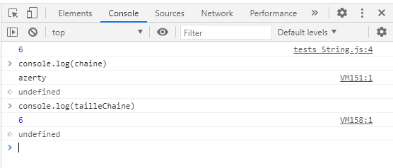

### 2.2 La concaténation avec l'opérateur +

La concaténation est une opération qui consiste à assembler deux chaines en une seule, elle s'effectue à l'aide de l'opérateur ```+```

Exemple :
```javascript
let chaine1 = "Bonjour ";
let chaine2 = "les SNIR";
let chaine = chaine1 + chaine2;
```

La variable ```chaine``` contient après l'exécution de ce script ```"Bonjour les SNIR"```.

Aperçu dans la console du navigateur :

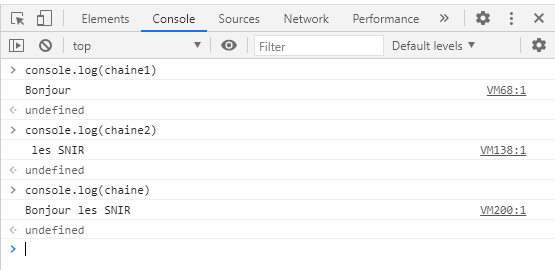

>Attention à ne pas confondre l'opérateur de concaténation avec l'opérateur d'addition qui s'applique aux nombres

Exemple :
```javascript
let chaine1 = "2";
let chaine2 = "3";
let chaine = chaine1 + chaine2;
```

La variable ```chaine``` contient après l'exécution de ce script ```"23"``` et non pas le nombre 5

Aperçu dans la console du navigateur :

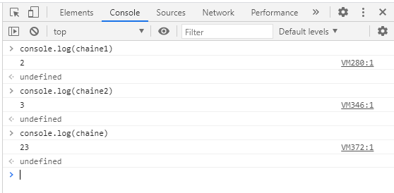

Il est également possible d'utiliser l'opérateur ```+=``` pour ajouter du texte à une chaine déjà existante.

Exemple :
```javascript
let chaine1 = "Bonjour ";
chaine1 += "les SNIR";
```

La variable ```chaine1``` contient après l'exécution de ce script ```"Bonjour les SNIR"```.

### 2.3 Récupérer un caractère avec ```charAt()```

La méthode ```charAt()```permet de récupérer un caractère de la chaine sur laquelle elle s'applique. Le caractère retourné est celui dont la position est indiquée en argument.

> Attention la position du premier caractère correspond à l'indice 0.

Exemple :
```javascript
let chaine = "azerty";
let car = chaine.charAt(1);
```

Après l'exécution de ce script, la variable ```car``` contient le caractère ```"z"```

Aperçu dans la console du navigateur :

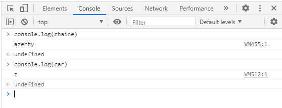

> L'indice fourni doit être un nombre compris entre ```0``` et ```chaine.length-1```, dans le cas contraire, si l'indice fourni est en dehors de cet intervalle, la méthode ```charAt()``` renverra une chaine vide, et si aucun indice n'est fourni, la valeur par défaut utilisée sera 0.

### 2.4 Rechercher une expression avec ```indexOf()``` et ```lastIndexOf()```

La méthode ```indexOf()``` permet de récupérer la position de la première occurence d'un caractère ou d'une chaine de caractères contenu dans la chaine sur laquelle elle s'applique.

Cette méthode recherche l’expression passée en argument dans la chaine de caractères et renvoie la position à laquelle cette expression a été trouvée la première fois ou la valeur -1 si l’expression n’a pas été trouvée. 

Exemple :
```javascript
let chaine = "azerty";
let index = chaine.indexOf("z");
```
Après l'exécution de ce script, la variable ```index``` contiendra la valeur 1 

Aperçu dans la console du navigateur :

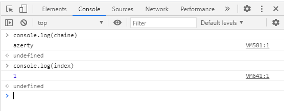

> Si l'expression recherchée est une chaine de caractères, la méthode ```indexOf()``` retourne l'index correspondant à la position du premier caractère

Exemple :
```javascript
let chaine = "azerty";
let index = chaine.indexOf("rty");        
```

Après l'exécution de ce script, la variable ```index``` contiendra la valeur 3

Aperçu dans la console du navigateur :

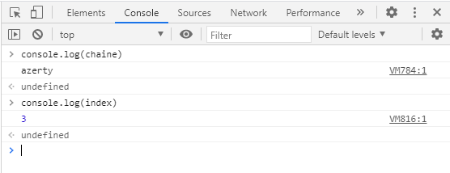

Par défaut, la recherche s'effectue dans toute la chaine, mais il est possible de passer un deuxième paramètre à la méthode ```indexOf()``` qui permet de choisir la position à partir de laquelle on souhaite démarrer la recherche.

Exemple :
```javascript
let chaine = "azerty ou qwerty";
let index = chaine.indexOf("rty",4);
```

Après l'exécution de ce script, la variable ```index``` contiendra la valeur 13. En effet ici, la recherche de l'expression ```"rty"```  se fait à partir du 5ème caractère de la chaine. Ce caractère correspondant à la lettre ```"t"``` du mot ```"azerty"```, la première occurence de l'expression ```"rty"``` contenue dans ce mot  ne sera donc pas trouvée mais elle le sera dans le mot ```"qwerty"```.

Aperçu dans la console du navigateur :

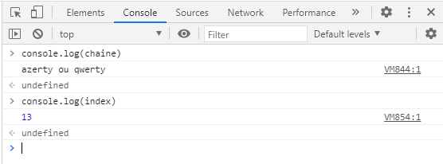

La méthode ```lastIndexOf()``` va fonctionner de la même manière que ```indexOf()``` à la différence près qu'elle va renvoyer la position de la dernière occurence correspondant à l'expression recherchée (ou -1 si l'expression n'est pas trouvée)

### 2.5 Extraire une chaine avec ```substring()``` et ```slice()```

La méthode ```substring()``` retourne une partie de la chaîne courante, comprise entre un indice de début et un indice de fin. Le caractère dont la position correspond à l'indice de fin n'est pas retourné.

Exemple :
```javascript
let chaine = "azerty";
let ss_chaine = chaine.substring(1,3);
```

Après l'exécution de ce script, la variable ```ss_chaine``` contient la chaine de caractères ```"ze"```

Aperçu dans le navigateur :

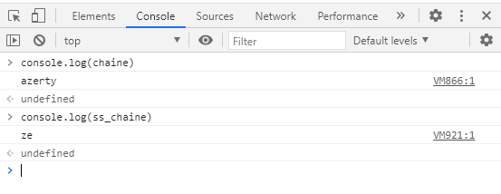

> Si les indices de début et de fin ont la même valeur ```substring()``` retourne une chaine vide.

```javascript
let chaine ="azerty";
let ss_chaine = chaine.substring(1,1);  
```
Après l'exécution de ce script, la variable ```ss_chaine``` contient une chaine de caractères vide ```""```

Aperçu dans le navigateur :

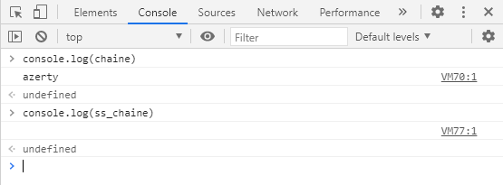

> Si l'indice de fin n'est pas spécifié, ```substring()``` effectuera l'extraction des caractères jusqu'à la fin de la chaine.

```javascript
let chaine ="azerty";
let ss_chaine = chaine.substring(3); 
```

Après l'exécution de ce script, la variable ```ss_chaine``` contient la chaine de caractères ```"rty"```

Aperçu dans le navigateur :

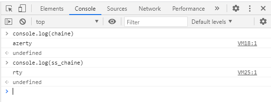

>Si l'un des indices est plus grand que ```chaine.length```, il sera traité comme ```chaine.length```

```javascript
let chaine ="azerty";
let ss_chaine = chaine.substring(1,7);
```

Après l'exécution de ce script, la variable ```ss_chaine``` contient la chaine de caractères ```"zerty"```

Aperçu dans le navigateur :

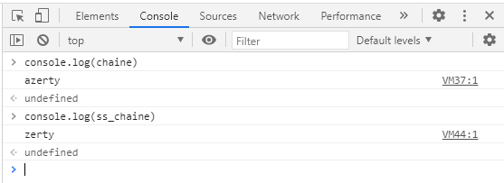

> Si les indices sont inversés, ```substring()``` rétablit l'ordre logique afin de les traiter comme si ils avaient été passés dans le bon ordre.
>
```javascript
let chaine ="azerty";
let ss_chaine = chaine.substring(3,1);
```

Après l'exécution de ce script, la variable ```ss_chaine``` contient la chaine de caractères ```"ze"```

Aperçu dans le navigateur :

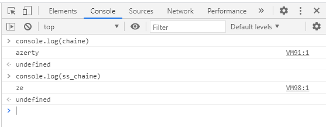

```slice()``` est une méthode d'extraction qui ressemble fortement à ```substring()``` mais avec une option en plus. Si une valeur négative est transmise pour la position de fin, ```slice()``` va extraire la chaine jusqu'à la fin, en décomptant le nombre de caractères correspondant.

Exemple :
```javascript
let chaine = "azerty";
let ss_chaine = chaine.slice(0,-3);
```

Après l'exécution de ce script, la variable ```ss_chaine``` contient la chaine de caractères ```"aze"```

L'utilisation de ```substring()``` dans les mêmes conditions donnerait en retour une chaine vide car toute valeur d'indice négative est remplacée par 0 pour cette fonction.

D'autre part, contrairement à ```substring()```, ```slice()``` ne change pas l'ordre des indices, si l'indice de fin est inférieur à celui du début, ```slice()``` retournera une chaine vide.

### 2.6 Remplacer une expression avec ```replace()```

La méthode ```replace()``` recherche une expression dans une chaine de caractères et la remplace par une autre. Elle utilise deux paramètres :

* le premier correspond à l'expression qui doit être recherchée et remplacée
* le second correspond à l'expression qui doit être utilisée pour le remplacement

La méthode ```replace()``` retourne une nouvelle chaine de caractères qui contient les modifications, la chaine de départ n'est pas modifiée.
  
Exemple :
```javascript
let chaine1 = "azerty";
let chaine2 = chaine1.replace("az", "qw");
```

Après l'exécution de ce script, la variable ```chaine2``` contient la chaine de caractères ```"qwerty"```

Aperçu dans le navigateur :

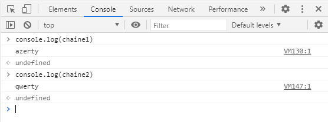

> Dans le cas où l'expression à rechercher est une chaine de caractères, seule la première occurence de cette expression est remplacée, pour remplacer toutes les occurences, il faut passer par une expression régulière. (Cette partie sera vue plus tard)

### 2.7 Vérifier l'existence d'une expression avec la méthode ```includes()```

La méthode ```includes()``` permet de déterminer si une chaine de caractères est inclue dans une autre. Si la chaine recherchée a été trouvée, ```includes()``` retourne la valeur ```true```.

Exemple :
```javascript
let chaine = "azerty" ;
let verif = chaine.includes("er");
        
// verif vaut true car l'expression "er" est présente dans la chaine "azerty"

let verif = chaine.includes("et");

// verif vaut false car l'expression "et" n'est pas présente dans la chaine "azerty"
```

Par défaut, ```includes()``` commence la recherche de à partir du premier caractère (indice 0) et la chaine est parcourue dans sa totalité. Cependant, il est possible d'ajouter un second paramètre pour spécifier le rang à partir duquel on souhaite commencer la recherche.

Exemple :
```javascript
let chaine = "azerty" ;
let verif = chaine.includes("er",1);
        
// verif vaut toujours true car l'expression "er" est toujours présente dans la partie de la chaine qui commence à partir du caractère de rang 1 "zerty"

let verif = chaine.includes("er",3);

// verif vaut false car l'expression "er" n'est plus présente dans la partie de la chaine qui commence à partir du caractère de rang 3 "rty"
```

### 2.8 Vérifier qu'une chaine commence ou se termine par une expression particulière avec les méthodes ```startWith()``` et ```endWith()```

La méthode ```startWith()``` permet de déterminer si une chaine de caractères commence par une expression en particulier. Dans ce cas, ```startWith()``` retourne la valeur ```true```.

Exemple :
```javascript
let chaine = "azerty" ;
let verif = chaine.startWith("az");
        
// verif vaut true car la chaine "azerty" commence bien par l'expression "az" 

let verif = chaine.includes("ty");

// verif vaut false car la chaine "azerty" ne commence pas par l'expression "ty"
```

La méthode ```endWith()``` permet de déterminer si une chaine de caractères se termine par une expression en particulier. Dans ce cas, ```endWith()``` retourne la valeur ```true```.

Exemple :
```javascript
let chaine = "azerty" ;
let verif = chaine.endWith("ty");
        
// verif vaut true car la chaine "azerty" se termine bien par l'expression "ty" 

let verif = chaine.includes("az");

// verif vaut false car la chaine "azerty" ne se termine pas par l'expression "az"
```

### 2.9 Découper une chaine de caractères avec la méthode ```split()```

La méthode ```split()``` découpe une chaine de caractères en plusieurs sous-chaines à l'aide d'un séparateur et retourne un tableau contenant l'ensemble de ces sous-chaines. Cette méthode nécessite un paramètre qui représente le séparateur utilisé.

Exemple :
```javascript
let chaine = "azerty et qwerty";
let tabMots = chaine.split(" ");   // le séparateur utilisé ici est le caractère correspondant à l'espace

// tabMots est un tableau qui contient les 3 sous-chaines ["azerty","et","qwerty"];
```

## 3. Les fonctions de conversion ```parseInt()``` et ```parseFloat()```

```parseInt()```et ```parseFloat()``` sont des fonctions globales de JavaScript, elles sont disponibles au plus haut niveau de l'environnement JavaScript et peuvent être appelées directement sans passer par un objet.

### 3.1 La fonction ```parseInt()```

La fonction ```parseInt()``` permet de convertir une chaine de caractères en un nombre entier si cela est possible, cette fonction utilise 2 paramètres :

* la chaine de caractère qui sera analysée pour effectuer la conversion
* un nombre entier qui représente la base utilisée pour calculer la valeur qui devra être retournée.

Exemple :
```javascript
let chaineNum = "12";
let valNum_10 = parseInt(chaineNum,10);
// valNum_10 contient un nombre entier qui vaut 12
let valNum_12 = parseInt(chaineNum,16);
// valNum_12 contient un nombre entier qui vaut 18 car parseInt calcule 12 en base 16
```

> Si le premier caractère de la chaine ne permet pas d'obtenir un nombre d'après la base fournie, ```parseInt()``` renvoie la valeur ```NaN``` (Not a Number)

Exemple :
```javascript
let chaineNum = "A3";
let valNum_10 = parseInt(chaineNum,10);
// valNum_10 contient la valeur Nan car le caractère "A" ne correspond pas à un chiffre en base 10 
let valNum_12 = parseInt(chaineNum,16);
// valNum_12 contient un nombre entier qui vaut 163 car le caractère "A" correspond à un chiffre en base 16  
```

> Si, lors de l'analyse de la chaine, ```parseInt()``` rencontre un caractère qui n'est pas un chiffre dans la base donnée, ce caractère ainsi que les suivants seront ignorés.

Exemple :
```javascript
let chaineNum = "3AFJ";
let valNum_10 = parseInt(chaineNum,10);
// valNum_10 contient la valeur 3 car parseInt() ignore le caractère "A" et les suivants 
let valNum_12 = parseInt(chaineNum,16);
// valNum_12 contient un nombre entier qui vaut 943 car cette fois-ci les trois premiers caractères de la chaine représentent bien des chiffres en base 16 
```

### 3.2 La fonction ```parseFloat()```

La fonction ```parseFloat()``` permet de convertir une chaine de caractères en un nombre flottant si cela est possible. 

Exemple :
```javascript
let chaineNum = "23.58";
let valNum = parseFloat(chaineNum);

// valNum contient le nombre flottant 23.58        
```

> **Attention** pour cette fonction, le séparateur décimal qui convient est le point et non la virgule

Exemple :
```javascript
let chaineNum = "23,58";
let valNum = parseFloat(chaineNum);

// valNum contient le nombre 23 car la virgule n'est pas reconnue comme séparateur décimal    
```

> Par contre, la notation avec un exposant (à l'aide du caractère ```'e'```ou ```'E'```)est interprétée correctement par ```parseFloat()```

Exemple :
```javascript
let chaineNum = "2358e-2";
let valNum = parseFloat(chaineNum);

// valNum contient le nombre 23.58   
```

> Si, lors de l'analyse de la chaine, ```parseFloat()``` rencontre un caractère qui n'est pas un chiffre, un point, un exposant ou le signe + ou - , ce caractère ainsi que les suivants seront ignorés.

Exemple :
```javascript
let chaineNum = "23.5v85";
let valNum = parseFloat(chaineNum);

// valNum contient le nombre 23.5 car parseFloat() ignore le caractère "v" et les suivants     
```
## Références MDN

* Les chaines de caractères en JavScript : <br/>
<https://developer.mozilla.org/fr/docs/Learn/JavaScript/First_steps/Strings> 

* Formatage de texte : <br/>
<https://developer.mozilla.org/fr/docs/Web/JavaScript/Guide/Text_formatting> 

* Référence JavaScript sur l'objet String : <br/>
<https://developer.mozilla.org/fr/docs/Web/JavaScript/Reference/Global_Objects/String>  

## Activité \: décodage de trame GPS

Le récepteur de position GPS fournit des trames ASCII au format NMEA 0183 (trames de type RMC). Ce type de trame est décrit en [annexe](Trames_GPS_Anx.pdf). Elle contient les informations de position mais aussi de date et d’heure en temps universel (temps UTC). Elle peut être stockée sous la forme d'une chaine de caractères pour pouvoir être ensuite décodée par une application.
        
Exemple de trame :

```"$GPRMC,161229.487,A,3723.2475,N,12158.3416,W,0.13,309.62,120598,,*10\r\n"```

Créez un nouveau projet html5 dans VS Code incluant un fichier JavaScript :

* nom du dossier racine : **Decodage_Trame_GPS**
* nom du fichier js : **decodage_trame_gps.js**

Pour traiter le contenu de la trame, on envisage d'utiliser une classe ```Decodage_Trame_GPS``` qui sera développée progressivement au cours de l'activité.

### Déclarations et initialisations

Déclarez la classe ```Decodage_Trame_GPS``` avec une propriété ```trame``` qui sera initialisée par le constructeur et une méthode ```decoder()``` qui sera vide pour l'instant.

Déclarez une variable ```trame_gps``` et initialisez cette variable avec la chaine de caractères correspondant à l'exemple donné dans l'énoncé.

Créez un objet ```objDecodage_Trame_GPS``` de la classe ```Decodage_Trame_GPS``` et dont la propriété ```trame``` sera initialisée avec la variable ```trame_gps```

Vérifiez dans la console du navigateur que l'objet ```objDecodage_Trame_GPS``` a bien été instancié et que sa propriété ```trame``` a bien été initialisée correctement.

Résultat attendu :

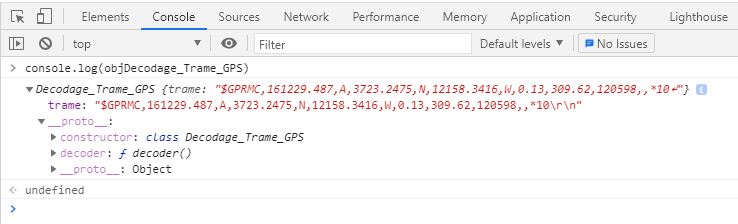

### Préparation de la trame au décodage

Avant de procéder au décodage proprement dit, on envisage de 'spliter' la trame afin de récupérer dans un tableau les différents champs qu'elle contient (voir leurs définitions en annexe)

Ajoutez dans la classe ```Decodage_Trame_GPS``` une nouvelle propriété ```tabChamps``` et utilisez cette propriété pour récupérer les différents champs de la trame.

Vérifiez dans la console du navigateur que l'objet ```objDecodage_Trame_GPS``` a bien été mis à jour et que sa propriété ```tabChamps``` contient bien les différents champs de la trame.

Résultat attendu :

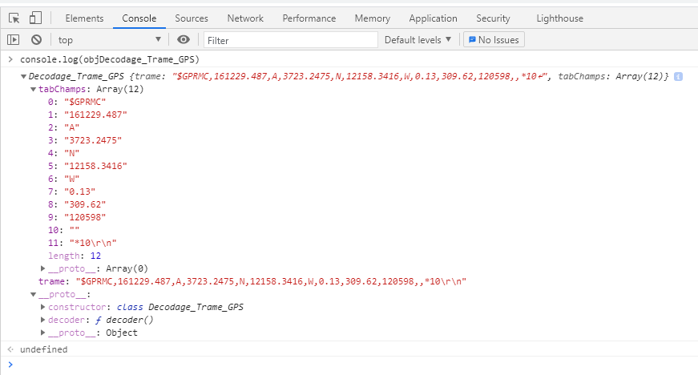

### Vérification de la validité de la trame

On commence le décodage de la trame en vérifiant sa validité. Pour cela, on prévoit d'utiliser une propriété de type Boolean ```est_RMC``` qui aura la valeur ```false``` par défaut. La valeur de cette propriété sera mise à jour et retournée par la méthode ```decoder()```. 

La vérification de la validité de la trame se fera dans la méthode ```decoder()``` à l'aide d'une fonction interne ```verifier_RMC()``` qui devra renvoyer ```true``` si la trame présente dans la propriété ```trame``` est une trame complète (test sur le nombre de caractères) et qu'elle est de type RMC (elle débute par ```"$GPRMC"```).

> Attention, on rappelle qu'une fonction interne n'a pas accés directement aux propriétés définies dans le constructeur de la classe. Il faudra donc passer par des variables locales qui seront déclarées dans la méthode qui la contient. (la méthode <code>decoder()</code> dans le cas présent)

Ajoutez et initialisez la propriété ```est_RMC``` avec sa valeur par défaut.

Déclarez et codez la fonction interne ```verifierRMC()```

Complétez la méthode ```decoder()``` avec les instructions qui permettent de mettre à jour la valeur de propriété ```est_RMC``` et de la retourner.

Vérifiez alors que la méthode ```decoder()``` renvoie :

* ```true``` si la trame correspond bien à une trame RMC de bonne longueur
* ```false``` si la trame est d'un autre type mais de bonne longueur
* ```false``` si la trame est de type RMC mais incorrecte (il manque le dernier octet par exemple ou il y a un octet en trop).

### Extraction des informations de position latitude et longitude

Si la trame est valide, on peut en extraire les informations utiles comme la latitude et la longitude. Pour chacune de ces informations, la méthode ```decoder()``` devra mettre à jour les propriétés suivantes :

* pour la latitude :

  * la propriété ```nbDegreLat``` nombre entier qui représente la partie degrés de la latitude 
  * la propriété ```nbMinLat``` nombre décimal qui représente la partie minutes de la latitude
  * la propriété ```latNS``` caractère qui représente l'initiale de l'hémisphère terrestre. N pour Nord et S pour Sud

* pour la longitude :
  
  * la propriété ```nbDegreLong``` nombre entier qui représente la partie degrés de la longitude 
  * la propriété ```nbMinLong``` nombre décimal qui représente la partie minutes de la longitude
  * la propriété ```longEW``` caractère E pour désigner une longitude Est et W pour désigner une longitude Ouest

Pour extraire les informations de position contenues dans la trame et mettre à jour ces propriétés la méthode ```decoder()``` fera appel à une fonction interne ```extrairePosition()```. 

> Comme pour la fonction ```verifierRMC()```, la fonction ```extrairePosition()``` n'a pas accés directement aux propriétés définies dans le constructeur de la classe. Il faut donc passer par des variables locales qui seront déclarées dans la méthode ```decoder()```

Ajoutez et initialisez les 6 nouvelles propriétés avec leurs valeurs par défaut (0 pour les propriétés de type ```number``` et chaine vide pour les propriétés de type ```string```) 

Déclarez et codez la fonction interne ```extrairePosition()```. Cette fonction doit extraire les informations de position (latitude et longitude) depuis la chaine contenue dans la propriété ```trame``` et fournir à la méthode ```decoder()``` les valeurs qui devront être attribuées à chacune des propriétés définies ci-dessus    

Sachant que le décodage des informations ne doit être exécuté que si la trame est valide, complétez la méthode ```decoder()``` avec les instructions qui permettent de mettre à jour les valeurs des propriétés de latitude et de longitude.

Vérifiez dans la console du navigateur que la méthode ```decoder()``` a bien mis à jour les propriétés relatives à la latitude et la longitude.

Résultat attendu :

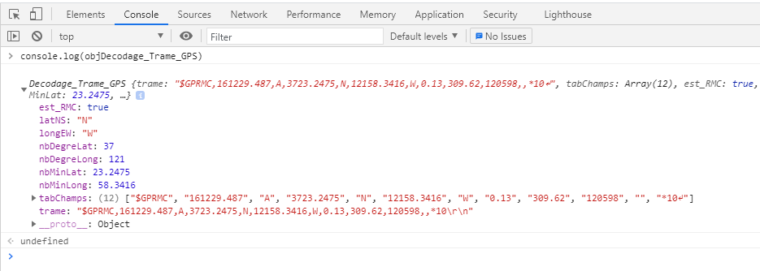

### Lecture de la latitude et de la longitude

On souhaite maintenant disposer dans la classe ```Decodage_Trame_GPS``` de deux méthodes ```lireLatitude()``` et ```lireLongitude()``` qui permettent de compiler et retourner les informations de latitude et de longitude selon les formats suivants : 

* pour la latitude : dd ° mm.mmmm ' N (ou S) 
* pour la longitude : dd ° mm.mmmm ' E (ou W)

Déclarez et codez les méthodes ```lireLatitude()``` et ```lireLongitude()```

Codez les instructions qui permettent de tester ces méthodes

Résultat attendu :

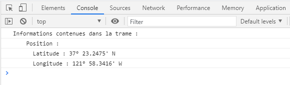

### Extraction des informations relatives à la date

En plus des informations de position, il faudra extraire les informations concernant la date. Pour chacune de ces informations, la méthode ```decoder()``` devra mettre à jour de nouvelles propriétés :

* la propriété ```jour``` nombre entier qui représente le numéro du jour dans le mois 
* la propriété ```mois``` chaine de caractères qui représente le mois en écriture abrégé (voir tableau ci-dessous) 
* la propriété ```annee``` nombre qui représente l'année ramenée entre 1950 et 2050

Tableau des mois en écriture abrégée :

|   Mois   | Ecriture abrégée |
|---------|----------------|
| Janvier | Janv.|
| Février | Fevr. |
| Mars | Mars |
| Avril | Avr. |
| Mai | Mai |
| Juin | Juin |
| Juillet | Juil. |
| Août |  Août |     
| Septembre | Sept.|
| Octobre | Oct.|
| Novembre | Nov.|
| Décembre | Dec.|

<br/>

Pour extraire la date contenue dans la trame et mettre à jour ces propriétés la méthode ```decoder()``` fera appel à une fonction interne ```extraireDate()```.

Ajoutez et initialisez les propriétés ```jour```, ```mois```, et ```annee``` avec leurs valeurs par défaut (0 pour les propriétés de type ```number``` et chaine vide pour les propriétés de type ```string```)

Déclarez et codez la fonction interne ```extraireDate()```. Cette fonction doit extraire la date depuis la chaine contenue dans la propriété ```trame``` et fournir à la méthode ```decoder()``` les valeurs qui devront être attribuées à chacune des propriétés définies ci-dessus

Sachant que le décodage des informations ne doit être exécuté que si la trame est valide, complétez la méthode ```decoder()``` avec les instructions qui permettent de mettre à jour les valeurs des propriétés pour la date

Vérifiez dans la console du navigateur que la méthode ```decoder()``` a bien mis à jour les propriétés relatives à la date.

Résultat attendu :

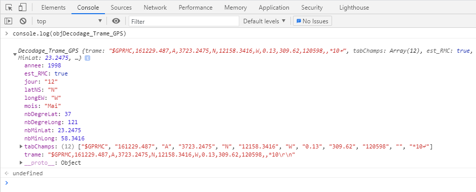

### Lecture de la date

Comme pour les informations concernant la latitude et la longitude, on souhaite disposer dans la classe ```Decodage_Trame_GPS``` d'une méthode ```lireDate()``` qui permet de compiler et retourner la date selon le format suivant : jour mois annee

Déclarez et codez la méthode ```lireDate()```

Codez les instructions qui permettent de tester cette méthode

Résultat attendu :

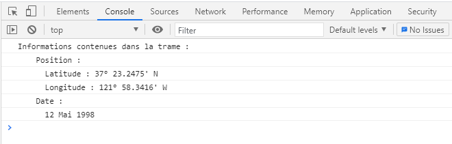

### Extraction des informations relatives à l'heure

Pour terminer le décodage, il faudra extraire les informations concernant l'heure. Pour chacune de ces informations, la méthode ```decoder()``` devra à nouveau mettre à jour des propriétés supplémentaires :

* la propriété ```heure``` nombre entier qui représente l'heure courante
* la propriété ```minute``` nombre entier qui représente les minutes 
* la propriété ```seconde``` nombre décimal qui représente les secondes

Pour extraire l'heure contenue dans la trame et mettre à jour ces propriétés la méthode ```decoder()``` fera appel à une fonction interne ```extraireHeure()```.

Ajoutez et initialisez les propriétés ```heure```, ```minute```, et ```seconde``` avec leurs valeurs par défaut (ici à 0)

Déclarez et codez la fonction interne ```extraireHeure()```. Cette fonction doit extraire l'heure depuis la chaine contenue dans la propriété ```trame``` et fournir à la méthode ```decoder()``` les valeurs qui devront être attribuées à chacune des propriétés définies ci-dessus

Sachant que le décodage des informations ne doit être exécuté que si la trame est valide, complétez la méthode ```decoder()``` avec les instructions qui permettent de mettre à jour les valeurs des propriétés pour l'heure

Vérifiez dans la console du navigateur que la méthode ```decoder()``` a bien mis à jour les propriétés relatives à l'heure.

Résultat attendu :

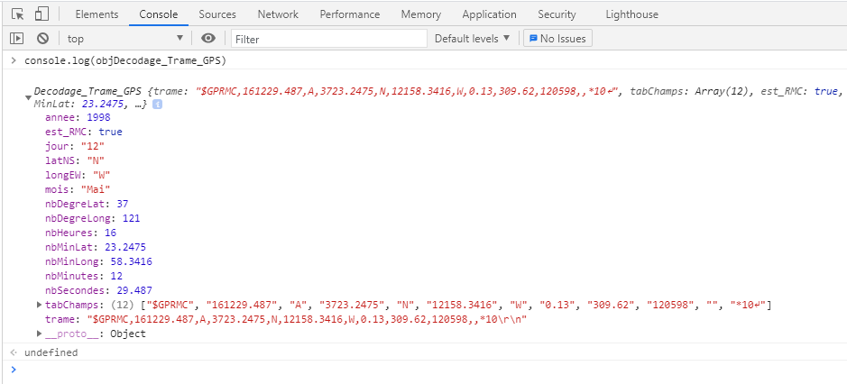

### Lecture de l'heure

La classe ```Decodage_Trame_GPS``` devra enfin disposer d'une méthode ```lireHeure()``` qui permet de compiler et retourner l'heure selon le format suivant : hh H mm mn ss.sss s

Déclarez et codez la méthode ```lireDate()```

Codez les instructions qui permettent de tester cette méthode

Résultat attendu :

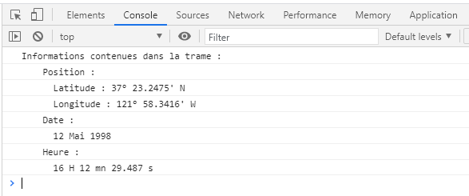


