# Interaction entre JavaScript et HTML

> * Auteur : Alain BRASSART
> * Date de dernière publication : 10/11/2021
> * OS: Windows 10 (version 20H2)
> * VS Code : version 1.60.1 (system setup)
> * Chrome : version 93.0.4577.82 (Build officiel) (64 bits)

 [Licence Creative Commons](https://creativecommons.org/licenses/by-nc-sa/3.0/fr/)

## Sommaire

  - [1. Introduction](#1-introduction)
  - [2. Qu'est ce que le DOM ?](#2-quest-ce-que-le-dom-)
  - [3. Accéder aux éléments du DOM](#3-accéder-aux-éléments-du-dom)
    - [3.1 Les interfaces ```Document``` et ```Element```](#31-les-interfaces-document-et-element)
    - [3.2 Récupérer un élément en fonction de son attribut id avec ```getElementById()```](#32-récupérer-un-élément-en-fonction-de-son-attribut-id-avec-getelementbyid)
    - [3.3 Récupérer les éléments en fonction de leur nom de balise avec ```getElementByTagName()```](#33-récupérer-les-éléments-en-fonction-de-leur-nom-de-balise-avec-getelementbytagname)
    - [3.4 Récupérer les éléments en fonction de leur attribut ```class``` avec ```getElementByClassName()```](#34-récupérer-les-éléments-en-fonction-de-leur-attribut-class-avec-getelementbyclassname)
    - [3.5 Récupérer un ou plusieurs éléments à partir de son sélecteur CSS avec ```querySelector()``` et ```querySelectorAll()```](#35-récupérer-un-ou-plusieurs-éléments-à-partir-de-son-sélecteur-css-avec-queryselector-et-queryselectorall)
  - [4. Accéder au texte contenu dans un élément du DOM avec ```textContent```](#4-accéder-au-texte-contenu-dans-un-élément-du-dom-avec-textcontent)
  - [5. Modifier le style d'un élément avec la propriété ```style```](#5-modifier-le-style-dun-élément-avec-la-propriété-style)
  - [Activités](#activités-)
    - [Calcul d'IMC - Affichage des informations du patient dans un formulaire HTML](#calcul-dimc-affichage-des-informations-du-patient-dans-un-formulaire-html) 
    - [Calcul d'IMC - Affichage des informations du patient dans un tableau HTML](#calcul-dimc-affichage-des-informations-du-patient-dans-un-tableau-html)
  - [6. Créer et ajouter de nouveaux éléments dans le DOM](#6-créer-et-ajouter-de-nouveaux-éléments-dans-le-dom)
    - [6.1 Créer un élément avec ```createElement()```](#61-créer-un-élément-avec-createelement) 
    - [6.2 Insérer un élément dans un autre avec ```append()``` et ```prepend()```](#62-insérer-un-élément-dans-un-autre-avec-append-et-prepend)
    - [6.3 Supprimer un ou plusieurs éléments du DOM avec ```remove()```](#63-supprimer-un-ou-plusieurs-éléments-du-dom-avec-remove)
  - [Activité : Calcul d'IMC - Affichage des données correspondant à une liste de patients dans un tableau HTML](#activité-calcul-dimc-affichage-des-données-correspondant-à-une-liste-de-patients-dans-un-tableau-html)
  - [7.  Gérer les évènements](#7-gérer-les-évènements)
    - [7.1 Définition](#71-définition) 
    - [7.2 Gestionnaire d'évènement](#72-gestionnaire-dévènement)
    - [7.3 Utiliser les attributs HTML pour gérer un évènement](#73-utiliser-les-attributs-html-pour-gérer-un-évènement)
    - [7.4 Utiliser les propriétés JavaScript pour gérer un évènement](#74-utiliser-les-propriétés-javascript-pour-gérer-un-évènement)
    - [7.5 Utiliser la méthode ```addEventListener()``` pour gérer un évènement](#75-utiliser-la-méthode-addeventlistener-pour-gérer-un-évènement)
    - [7.6 Annuler le comportement par défaut d'un évènement](#76-annuler-le-comportement-par-défaut-dun-évènement)
  - [8. Récupérer la valeur d'un élément avec la propriété ```value```](#8-récupérer-la-valeur-dun-élément-avec-la-propriété-value)
  - [9. Traitement des données saisies dans un formulaire en JavaScript](#9-traitement-des-données-saisies-dans-un-formulaire-en-javascript)
    - [9.1 Création du formulaire en HTML](#91-création-du-formulaire-en-html)
    - [9.2 Traitement des données saisies en JavaScript](#92-traitement-des-données-saisies-en-javascript)
    - [9.3 Exemple](#93-exemple)  
  - [Activité \: Calcul d'IMC avec saisie des patients et enregistrement dans un tableau](#activité-calcul-dimc-avec-saisie-des-patients-et-enregistrement-dans-un-tableau)
  

## 1. Introduction

Dans toute application web, on commence par utiliser les balises HTML pour créer l'affichage de la page web. On peut ensuite utiliser le JavaScript pour interagir avec l'affichage pour :

* Modifier le contenu ou le style d'une balise
* Ajouter ou supprimer des balises
* Récupérer les valeurs saisies par l'internaute (formulaire)
* Gérer les évènements (clics de souris) 

Ces opérations sont rendues possibles grâce à la manipulation du DOM par le navigateur.

## 2. Qu'est ce que le DOM ?

Le DOM, qui signifie **Document Object Model** est une interface de programmation pour les documents HTML (ou XML) qui représente le document (la page HTML) sous une forme permettant au JavaScript d'y accéder pour en manipuler le contenu et les styles.

Le DOM est créé automatiquement par le navigateur lors du chargement de la page, il correspond à une représentation structurée du document sous forme d'un arbre. Chaque branche de cet arbre se termine par ce qu’on appelle un nœud (node) qui va contenir les objets avec lesquels on va pouvoir travailler en JavaScript.

Exemple : on considère le code HTML suivant

```html
<!DOCTYPE html>
<html lang="en">
    <head>
        <title>My first web page</title>
    </head>
    <body>
        <h1>Hello, world!</h1>
        <p>How are you?</p>
    </body>
</html>
```

Le DOM de ce document peut être représenté comme une arborescence de noeuds :

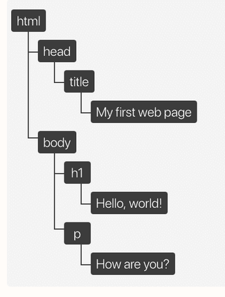

Le modèle objet d'un document HTML commence toujours avec l'élément ```html```, c'est le noeud racine du DOM.

A partir du noeud racine, le navigateur a créé ici deux branches qui aboutissent aux noeuds ```head``` et ```body```

En continuant ainsi à parcourir cet arbre, on peut dire que :

* à partir du noeud ```head```, le navigateur a créé une seule branche qui se termine par le noeud ```title```
* à partir du noeud ```body```, le navigateur a créé deux branches qui se termine par les noeuds ```h1``` et ```p```

L'arborescence du DOM se termine par des noeuds correspondants aux textes contenus dans les différentes balises.

De cet exemple, on peut en déduire que le DOM d'un document HTML peut contenir des noeuds qui représentent entr'autre :

* un élément HTML, on parle alors de noeud de type ```ELEMENT_NODE```
* un texte, on parle alors de noeud de type  ```TEXTE_NODE```

L’un des intérêts majeurs du DOM et des noeuds va être qu’on va pouvoir se déplacer de noeuds en noeuds pour manipuler des éléments en utilisant le JavaScript.

> Avant d'interagir avec le HTML, il faut attendre que le navigateur ait fini de charger le DOM, d'où l'utilisation obligatoire de l'attribut ```defer``` dans les balises ```<script>```  

```javascript
<script src="js/monscript.js" defer></script>
```

## 3. Accéder aux éléments du DOM

### 3.1 Les interfaces ```Document``` et ```Element```

L'interface ```Document``` représente la page web chargée dans le navigateur et sert de point d'entrée dans l'arborescence du DOM. Elle contient notamment les propriétés et les méthodes qui vont permettre au JavaScript d'accéder aux différents éléments du DOM.

Cette interface est automatiquement instanciée pour créer un objet ```document``` qui sera directement accessible dans le code JavaScript.

L'interface ```Element``` représente une partie de la page web. Elle permet de faire référence à un élément du DOM et d'avoir accès à son contenu et son style. Un élément est typiquement constitué d'une balise ouvrante avec ou sans attributs, du contenu et d'une balise fermante.

Exemple : 

```html
<h1>Titre principal</h1>
```
Tout élément du DOM récupéré par le JavaScript sera stocké dans une variable. 

### 3.2 Récupérer un élément en fonction de son attribut id avec ```getElementById()```

Pour récupérer un élément à partir de attribut id, on dispose de la méthode ```getElementById()``` que l'on va appeler depuis l'objet ```document```.

Cette méthode renvoie un objet ```Element``` qui représente l'élément dont l'attribut ```id``` correspond à la valeur spécifiée en argument.

> ```getElementById()``` permet d'accéder à un élément particulier dès lors qu'il possède un id

Exemple :

* code HTML :
  
```html
<h1 id="titre1">Titre principal<h1>
```
* code JavaScript :
  
```javascript
const titre1 = document.getElementById('titre1');
```

Les variables représentant une référence vers un élément du DOM peuvent être considérées comme des variable à assignation unique, leurs déclarations avec ```const``` parait mieux adaptée.

Aperçu dans la console du navigateur :

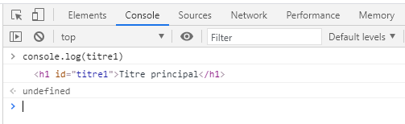

### 3.3 Récupérer les éléments en fonction de leur nom de balise avec ```getElementByTagName()```

Tout élément peut être aussi récupéré à partir de son nom de balise, pour cela, on dispose de la méthode ```getElementsByTagName()```.

Cette méthode renvoie une liste de type ```HTMLCollection``` qui contient tous les éléments trouvés dans le DOM et dont le nom de balise correspond à la valeur spécifiée en argument. Chaque élément peut alors être récupéré séparément en indexant la liste retournée.

Exemple :

* code HTML :
  
```html
<p>Un premier paragraphe</p>
<p>Un deuxième paragraphe</p>
```
* code JavaScript :
  
```javascript
const paras = document.getElementsByTagName('p');
```

Dans cet exemple, la méthode ```getElementsByTagName()``` retourne dans la variable ```paras``` une liste qui contient les deux éléments correspondant aux deux paragraphes contenus dans le document HTML.

* ```paras[0]``` fait référence au premier paragraphe trouvé dans le document
* ```paras[1]``` fait référence au deuxième paragraphe trouvé dans le document

Aperçu dans la console du navigateur :

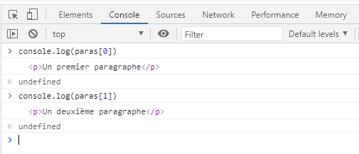

```getElementsByTagName()``` parcourt toutes les branches du DOM et met à jour la liste au fur et à mesure des éléments trouvés

Exemple :

* code HTML :
  
```html
<p>Un premier paragraphe</p>
<div>
  <p>Un deuxième paragraphe dans la div</p>
</div>
<p>Un autre paragraphe</p>
```
* code JavaScript :
  
```javascript
const paras = document.getElementsByTagName('p');
```

Aperçu dans la console du navigateur :

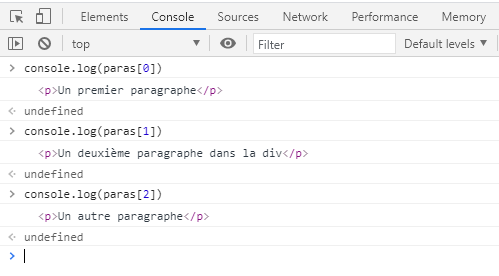

```getElementsByTagName()``` peut être utilisée aussi depuis l'interface ```Element``` pour récupérer des éléments contenus uniquement dans une partie du DOM.

Exemple :

* code HTML :
  
```html
<p>Un premier paragraphe</p>
<div id="div1">
  <p>Un deuxième paragraphe dans la div</p>
</div>
<p>Un autre paragraphe</p>
```
* code JavaScript :
  
```javascript
const div1 = document.getElementById('div1');   // on récupère dans le DOM la partie  correspondant à la div qui a pour id "div1"
const p_div1 = div1.getElementsByTagName('p');  // on récupère la liste des paragraphes contenus uniquement dans cette div
```

Aperçu dans la console du navigateur :

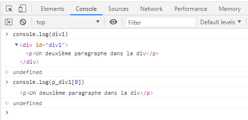

### 3.4 Récupérer les éléments en fonction de leur attribut ```class``` avec ```getElementByClassName()```

Tout élément peut être aussi récupéré à partir de son attribut ```class```, pour cela, on dispose de la méthode ```getElementsByClassName()```.

Cette méthode renvoie une liste de type ```HTMLCollection``` qui contient tous les éléments trouvés dans le DOM et dont l'attribut ```class``` correspond à la valeur spécifiée en argument. Chaque élément peut alors être récupéré séparément en indexant la liste retournée.

Exemple :

* code HTML :

```html
<h1 id="titre1">Titre principal</h1>
<p class="article">Un premier paragraphe de la classe "article"</p>
<div id="div1">
  <p>Un deuxième paragraphe qui n'est pas de la classe "article"</p>
</div>
<p class="article">Un autre paragraphe de la classe "article"</p>
```

* code JavaScript :

```javascript
const p_article = document.getElementsByClassName('article');
```

Dans cet exemple, ```getElementsByClassName()``` retourne dans la variable ```p_article``` la liste de tous les éléments contenus dans le document HTML et qui ont la classe "article" 

Aperçu dans la console du navigateur :

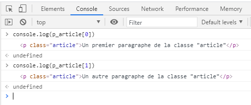

Comme pour ```getElementsByTagName()```, la méthode ```getElementsByClassName()```  parcourt toutes les branches du DOM et met à jour la liste au fur et à mesure des éléments trouvés

Exemple :

* code HTML :
  
```html
<h1 class="titre">Titre principal</h1>
<p class="article">Un premier paragraphe de la classe "article"</p>
<div id="div1">
  <h2 class="titre">Sous titre</h2>
  <p>Un deuxième paragraphe qui n'est pas de la classe "article"</p>
</div>
<p class="article">Un autre paragraphe de la classe "article"</p>
```

* code JavaScript :

```javascript
const titres = document.getElementsByClassName('titre');
```

Aperçu dans la console du navigateur :

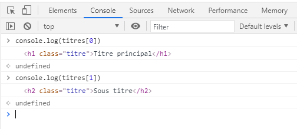

De même, ```getElementsByClassName()``` peut être utilisée depuis l'interface ```Element``` pour récupérer des éléments contenus uniquement dans une partie du DOM.

Exemple :

* code HTML :
  
```html
<h1 class="titre">Titre principal</h1>
<p class="article">Un premier paragraphe de la classe "article"</p>
<div id="div1">
  <h2 class="titre">Sous titre</h2>
  <p>Un deuxième paragraphe qui n'est pas de la classe "article"</p>
</div>
<p class="article">Un autre paragraphe de la classe "article"</p>
```

* code JavaScript :

```javascript
const div1 = document.getElementsById('div1');  // on récupère dans le DOM la partie  correspondant à la div qui a pour id "div1"
const titres_div1 = div1.getElementsByClassName('titre');  // on récupère la liste des éléments qui ont la classe "titre" uniquement dans cette div
```

Aperçu dans la console du navigateur :

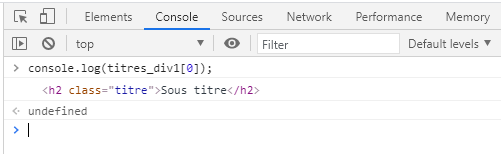

### 3.5 Récupérer un ou plusieurs éléments à partir de son sélecteur CSS avec ```querySelector()``` et ```querySelectorAll()```

La dernière possibilité de récupérer un élément du DOM est de le faire en le ciblant avec le sélecteur CSS qui lui est associé.

Rappel :

Un sélecteur CSS permet de désigner un ou plusieurs éléments du code HTML sur lesquels s'applique une régle CSS. Un sélecteur CSS peut être un sélecteur simple ou composé, ou encore une chaîne de sélecteurs simples ou composés séparés par des combinateurs qui correspondent aux signes > ou + ou espace blanc.

Exemples de sélecteurs CSS :

| Syntaxe | Critère de sélection |
|---------|----------------------|
|  ```"#madiv"``` | valeur de l'attribut ```id``` (```id="madiv1"```) |
|  ```".maclass"``` |  valeur de l'attribut ```class``` (```class="maclass"```)|  
|  ```"p"``` | nom de la balise (```<p>```)|
|  ```"div span"``` | sélecteur descendant (balise ```<span>``` contenue dans une balise ```<div>```) |
| ```"div > p"``` | sélecteur enfant direct (balise ```<p>``` qui se trouve directement sous la balise ```<div>```)
| ```"div+p"``` | sélecteur de frére adjacent (première balise ```<p>``` placée après une balise ```<div>```) |
| ```"div p:first-child"``` | sélecteur avec pseudo-classe "premier enfant" (première balise ```<p>``` contenue dans une balise ```<div>```)
|

Pour plus d'infos sur les sélecteurs CSS : 
http://www.w3schools.com/cssref/css_selectors.asp

Pour récupérer un élément du DOM à partir de son sélecteur CSS, on dispose de la méthode ```querySelector()```.

Cette méthode renvoie le premier élément trouvé dans le document qui correspond au sélecteur ou au groupe de sélecteurs spécifiés.

Exemple :

* code HTML :
  
```html
<h1 class="titre">Titre principal</h1>
<p class="article">Un premier paragraphe de la classe "article"</p>
<div id="div1">
  <h2 class="titre">Sous titre</h2>
  <p>Un deuxième paragraphe qui n'est pas de la classe "article"</p>
</div>
<p class="article">Un autre paragraphe de la classe "article"</p>
```

* code JavaScript :

```javascript
const titre1 = document.querySelector('.titre');  // on récupère dans le DOM le premier élément dont l'attribut class est égal à "titre"
const div1 = document.querySelector('#div1');     // on récupère la balise <div> dont l'attribut id est égal à "div1"
const p_div1 = document.querySelector('#div1 p'); // on récupère la première balise <p> se trouvant dans la balise <div> dont l'attribut id est égal à "div1"
```

Aperçu dans la console du navigateur :

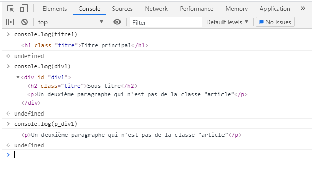

La méthode ```querySelector()``` peut se substituer à la méthode ```getElementById()``` 

Exemple :

```javascript
const div1 = document.getElementsById('div1');
```
et 

```javascript
const div1 = document.querySelector('#div1');
``` 
fournissent le même résultat.

Il existe également la méthode ```querySelectorAll()``` qui permet de récupérer la liste des éléments qui correspondent au groupe de sélecteurs spécifiés.

Exemple :

* code HTML :
  
```html
<h1 class="titre">Titre principal</h1>
<p class="article">Un premier paragraphe de la classe "article"</p>
<div id="div1">
  <h2 class="titre">Sous titre1</h2>
  <p>Un deuxième paragraphe qui n'est pas de la classe "article"</p>
  <h2 class="titre">Sous titre2</h2>
  <p>Un troisième paragraphe qui n'est pas de la classe "article"</p>
</div>
<p class="article">Un autre paragraphe de la classe "article"</p>
```

* code JavaScript :

```javascript
const paras = document.querySelectorAll('p');  // on récupère tous les  éléments du DOM qui correspondent à une balise <p>
const titres = document.querySelectorAll('.titre');     // on récupère  tous les éléments du DOM dont l'attribut class est égal à "titre"
const paras_div1 = document.querySelectorAll('#div1 p'); // on récupère tous les éléments qui correspondent à une balise <p> et qui se trouvent à l'intérieur de la balise <div> dont l'attribut id est égal à "div1"
```

Dans chaque cas, ```querySelectorAll()``` retourne dans la variable correspondante une liste qui contient les éléments ciblés par le sélecteur CSS utilisé.
Chacun de ces éléments est accessible en indexant cette liste. 

Aperçu dans la console du navigateur :

* Liste des éléments contenus dans la variable ```paras```
  
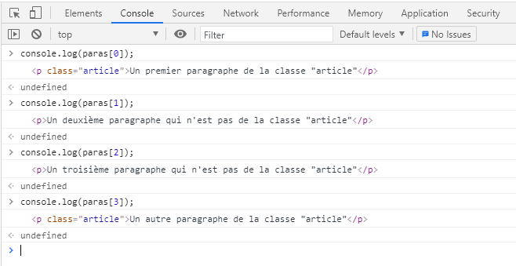

* Liste des éléments contenus dans la variable ```titres```
  
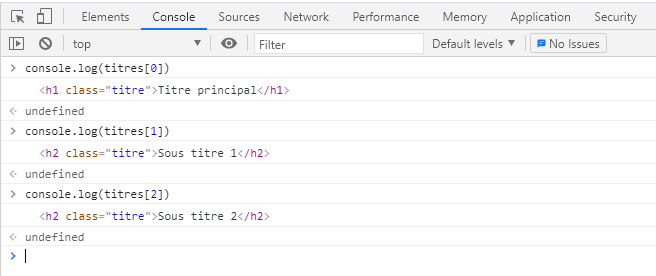

* Liste des éléments contenus dans la variable ```paras_div1```

 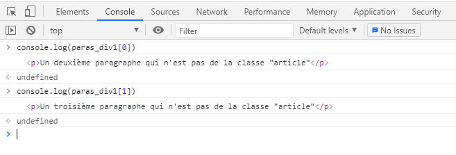

La méthode ```querySelectorAll()``` peut se substituer aux méthodes ```getElementsByTagName()``` et   ```getElementsByClassName()```.

Exemples :

Les instructions 
```javascript
const paras = document.getElementsByTagName('p');
``` 
et 
```javascript
const paras = document.querySelectorAll('p');
``` 
fournissent le même résultat.

De même que les instructions 
```javascript
const titres = document.getElementsByClassName('titre');
``` 
et 

```javascript
const titres = document.querySelectorAll('.titre');
``` 
fournissent le même résultat.

```querySelector()``` et ```querySelectorAll()``` peuvent être utilisées aussi depuis l'interface ```Element``` pour récupérer des éléments contenus uniquement dans une partie du DOM.

Exemple :

* code HTML :

```html
<p>Un premier paragraphe qui n'est pas dans une div</p>
<div>
  <p>Un deuxième paragraphe qui est dans la première div</p>
  <p>Un troisième paragraphe qui est dans la première div</p>
</div>
<div>
  <p>Un quatrième paragraphe qui est dans la deuxième div</p>
</div>
<p>Un dernier paragraphe qui n'est pas dans une div</p>
```

* code JavaScript :

```javascript
const document_div = document.querySelector('div');     // on récupère la première div du document HTML
const div_Paras = document_div.querySelectorAll('p');   // on récupère tous les paragraphes contenus dans la première balise <div>
```

Aperçu dans la console du navigateur :

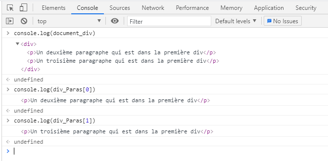

## 4. Accéder au texte contenu dans un élément du DOM avec ```textContent```

La propriété ```textContent``` permet de récupérer et de modifier le texte contenu dans un élément du DOM. Pour cela, il faut définir une référence vers l'élément en question puis utiliser la propriété ```textContent``` sur cette référence.

Exemple :

* code HTML

```html
<p id="p1">Bonjour je m'appelle Henri</p>
```
* code JavaScript
  
```javascript
const p1 = document.getElementById('p1');   // référence vers le paragraphe dont on veut récupérer le texte
let texte_p1 = p1.textContent;              // récupération du texte dans la variable texte_p1
```
Aperçu dans la console du navigateur :

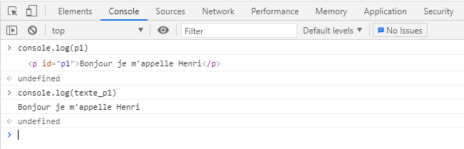

Pour modifier le texte contenu dans un élément, il suffit alors de modifier la valeur de ```textContent```

Exemple :

```javascript
const p1 = document.getElementById('p1');   // référence vers le paragraphe dont on veut récupérer le texte
let texte_p1 = p1.textContent;              // récupération du texte dans la variable texte_p1
texte_p1 = texte_p1 + " et j'ai 19 ans";    // modification du texte
p1.textContent = texte_p1;                  // mise à jour du texte dans le  paragraphe                
```

Aperçu dans la console du navigateur :

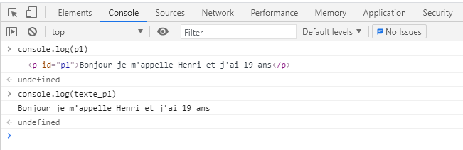

La page Web correspondant au fichier HTML est également mise à jour :

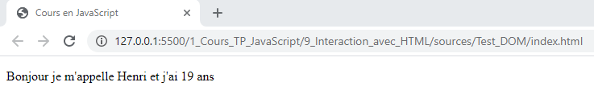

## 5. Modifier le style d'un élément avec la propriété ```style```

La propriété ```style``` est définie dans l'interface ```HTMLElement```, elle permet de définir les styles en ligne d'un élément HTML (les styles seront placés dans la balise ouvrante de l'élément).

Cette propriété retourne un objet représentant l'attribut ```style```dont les propriétés JavaScript représentent les propriétés CSS de l'élément.

Pour modifier une propriété CSS d'un élément du DOM, il faut définir une référence vers l'élément en question puis utiliser la propriété ```style``` sur cette référence et enfin désigner la propriété qui doit être modifiée avec la nouvelle valeur

Exemple : 

* code HTML
  
```html
<p id="p1">Bonjour je m'appelle Henri</p> 
```

* code JavaScript

```javascript
const p1 = document.getElementById('p1');   // référence vers le paragraphe dont on veut modifier une  propriété CSS
p1.style.color = 'red';                     // modification de la couleur du texte contenu dans le paragraphe p1
p1.style.fontSize = '20px';                 // modification de la taille de la police
```
Aperçu dans la console du navigateur

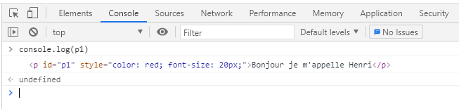

JavaScript a ajouté dans la balise l'attribut ```style``` avec toutes les propriétés qui ont été modifiées.

La page Web correspondant au fichier HTML est également mise à jour :

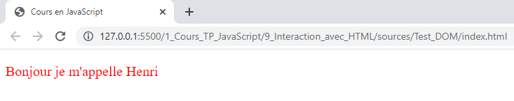

Les noms utilisés avec ```style``` pour définir les propriétés CSS doivent respecter la norme "lower camel case" : elles doivent être écrites sans espace ni tiret, avec une majuscule au début de chaque mot sauf pour le premier.

Exemple : la propriété CSS ```background-color``` s'écrira ```backgroundColor```

> La propriété ```style``` ne permet pas de récupérer le style de l'élément en général, puisqu'elle ne représente que les déclarations CSS définies dans l'attribut style de l'élément, et pas celles qui viennent d'autres règles de style, comme celles qui peuvent se trouver dans la section <head> ou des feuilles de style externes.

## Activités : 

## Calcul d'IMC \- Affichage des informations du patient dans un formulaire HTML

Dans un premier temps, on souhaite afficher les informations du patient dans une page Web en utilisant un formulaire.

Créez un nouveau projet html5 dans VS Code **"Patient_IMC_Form"**

Ajoutez dans ce projet

* un sous-dossier **"css"** contenant une feuille de sytles CSS **"style.css"** 
* un sous-dossier **"js"** contenant le fichier JavScript **patient_IMC.js**

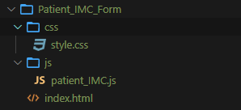

Codez les liaisons entre les fichiers css et js dans le fichier HTML

Créez le formulaire dans le fichier HTML :

* tous les éléments du formulaire doivent être codés à l'intérieur d'un bloc ```<form></form>```
* on peut regrouper les éléments à l'intérieur d'une balise ```fieldset``` pour l'affichage d'un cadre autour des éléments avec un titre.
  
```html
<form>
  <fieldset>
    <legend>Informations patient</legend>
         // codage des éléments du formulaire
  </fieldset>
</form>
```
* la largeur du formulaire peut être ajustée en ajoutant dans le fichier CSS une règle fixant la valeur de la propriété  ```width``` pour la balise ```<fieldset>```

```css
fieldset
{
  width: 300px;
}
```
Aperçu du résultat

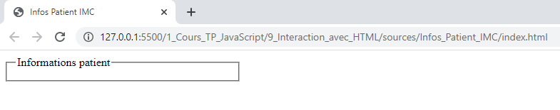

Les informations du patient seront affichées dans le formulaire en utilisant des balises ```<p>```, pour chacune de ces balises on la complétera avec un texte qui correspond à l'information qu'elle contient et une balise ```<span>``` avec un attribut id pour afficher la valeur.

Exemple :

```html
<p>Nom : <span id="nom"></span></p>
```
Complétez le formulaire de manière à ce que toutes les informations du patient puissent être affichées dedans.

Aperçu du résultat :

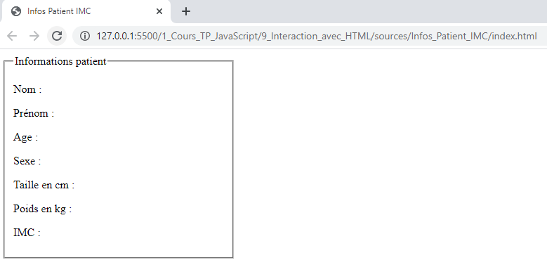

Complétez le fichier CSS en ajoutant une règle qui permet d'afficher en plus gras le texte contenu dans la balise ```<span>``` représentant l'IMC.

Codez dans le fichier js, les instructions JavaScript qui correspondent à la définition de la classe ```Patient``` :

* le constructeur de cette classe devra initialiser les propriétés qui caractérisent le patient : ```nom```, ```prenom```, ```age```, ```sexe```, ```taille``` et ```poids```
* en plus du constructeur, cette classe comprendra :
    * la méthode ```calculerIMC()``` pour à mettre à jour la propriété ```imc```
    * la méthode ```interpreterIMC()``` pour retourner l'interprétation de l'IMC en tenant compte de la correction à apporter selon le sexe du patient (cf. Chapitre 5 - Activité \: Codage d'un constructeur d'objet pour le calcul de l'IMC, 2ème version)

> **Attention** : dans cette version, les méthodes  ```calculerIMC()``` et  ```interpreterIMC()``` ne seront plus des fonctions internes et devront donc pouvoir être appelées directement depuis l'objet

Créez l'objet ```objPatient``` à partir des données suivantes :

| Nom | Prenom | Age | Sexe | Taille | Poids |
|-----|--------|-----|------|--------|-------|
| Dupond | Jean | 30 | masculin | 180 | 85 |

Codez les instructions qui permettent de définir les références vers les balises ```<span>``` contenues dans le formulaire.

> On notera ces références ```text_xxx``` avec xxx désignant la propriété associée (par exemple, ```text_nom``` pour la référence vers la balise ```<span>``` qui contient le nom du patient).

Codez les instructions qui permettent de mettre à jour le texte contenu dans les balises ```<span>``` du formulaire avec les valeurs des propriétés de l'objet ```objPatient```

Testez votre programme et vérifiez que les valeurs sont bien affichées dans le formulaire.

Aperçu du résultat :

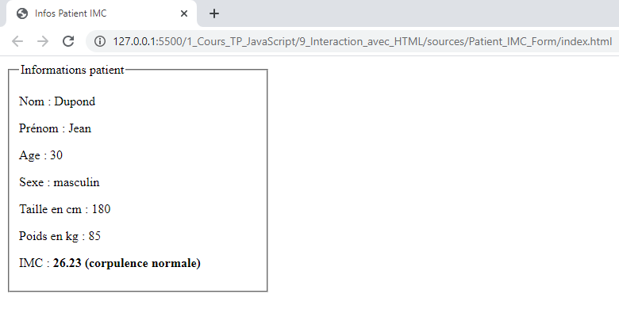

Pour afficher l'IMC, on souhaite utiliser des couleurs différentes selon la situation dans laquelle se trouve le patient :

| Situation du patient | Couleur | Code RGB |
|----------------------|---------|----------|
| dénutrition | orange | #FF6600 |
| maigreur | jaune | #FFCC00 |
| corpulence normale | vert | #008000 |
| surpoids | jaune | #FFCC00 |
| obésité modérée | orange | #FF6600 |
| obésité sévère | rouge | #FF0000 |
| obésité morbide | rouge foncé | #660000 |

Pour spécifier la couleur du texte on utilisera une chaine de caractères qui contient son code RGB 

Codez les instructions JavaScript qui permettent d'adapter la couleur du texte qui sera affiché pour l'IMC en fonction de la situation du patient

Aperçu du résultat :

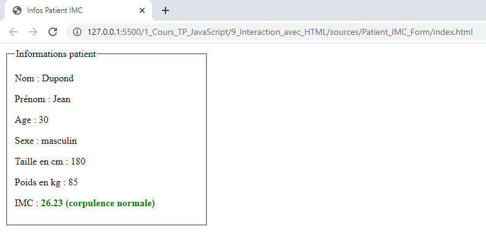

## Calcul d'IMC \- Affichage des informations du patient dans un tableau HTML

On souhaite maintenant afficher les informations du patient en utilisant un tableau HTML.

Créez une copie du projet **"Patient_IMC_Form"** et nommez la **"Patient_IMC_Tab"**

Supprimez le contenu du fichier CSS

Remplacez le formulaire par un tableau dans le fichier HTML :

* le contenu du tableau doit être codé à l'intérieur d'un bloc ```<table></table>```
* dans ce bloc, on doit trouver les deux blocs secondaires ```<thead></thead>``` pour les titres des colonnes et ```<tbody></tbody>``` pour les données qui seront affichées dans le tableau
* pour créer une ligne dans le tableau, on crée une ligne dans le bloc on utilise la balise ```<tr>```
* pour ajouter des cellules correspondant aux titres des colonnes, on ajoute une ligne dans le bloc ```<thead></thead>``` puis à l'intérieur de cette ligne, on utilise la balise  ```<th>``` pour chaque cellule.
* pour ajouter les cellules qui contiennent les valeurs du tableau, on ajoute une ligne dans le bloc ```<tbody></tbody>``` puis on utilise la balise ```<td>```

```html
<table>
  <thead>
   <tr>                          // ligne contenant les entêtes du tableau
     <th>Entête colonne 1</th>     
     <th>Entête colonne 2</th>     
     .
     .
   </tr>
  </thead>
  <tbody>
   <tr>                          // première ligne du tableau contenant des valeurs
     <td>Valeur</td>       
     <td>Valeur</td>       
   </tr>
   <tr>                          // deuxième ligne du tableau contenant des valeurs
     <td>Valeur</td>       
     <td>Valeur</td>       
   </tr>
   .
   .
  </tbody>
</table>
```
* on pourra appliquer un minimum de style au tableau en ajoutant dans le fichier CSS les règles suivantes :

```css
table
{
  border-collapse: collapse;
}

th, td
{
    border: 1px solid black;
    padding: 10px;
    text-align: center;
}
```

Aperçu du résultat

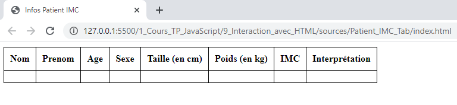

Les informations du patient seront affichées dans le tableau en utilisant pour chaque cellule un identifiant qui correspond à l'information qu'elle contient.

Complétez les codages HTML et CSS du tableau de manière : 
* à attribuer à toutes les cellules leur identifiant
* à ce que le texte affiché dans les cellules représentant l'IMC et son interprétation soit affiché en gras 

Modifiez le code JavaScript afin de mettre à jour le contenu des cellules du tableau avec les valeurs des propriétés de l'objet ```objPatient```

Codez les instructions JavaScript qui permettent d'adapter selon la situation du patient la couleur du texte affiché dans les cellules qui contiennent l'IMC et son interprétation.

Testez votre programme et vérifiez que les valeurs sont bien affichées dans le tableau

Aperçu du résultat :

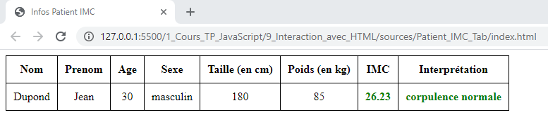

Mise en forme du tableau avec Bootstrap

Bootstrap dispose de classes css permettant d'avoir une mise en forme du tableau plus aboutie qu'avec le code css de base. Pour utiliser ces classes, il est nécessaire d'ajouter les fichiers ```bootstrap.min.css``` et ```bootstrap.min.js``` dans les dossiers ```css``` et ```js``` du projet.

Complétez l'arborescence du projet comme ci-dessous :

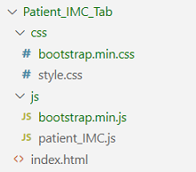

Ajoutez dans le fichier ```index.html``` les balises permettant de spécifier l'emplacement de ces fichiers, attention ces balises devront être placées avant les balises prévues pour ajouter les autres fichiers ```css``` et ```js``` utilisés dans l'application.

```html
<link rel="stylesheet" href="css/bootstrap.min.css">
<link rel="stylesheet" href="css/style.css">
<script src="js/bootstrap.min.js" defer></script>
<script src="js/liste_patients_IMC.js" defer></script>
```
Ajoutez une balise ```<div>``` avec la classe ```.container``` pour la mise en page du contenu.

```html
<body>
  <div class="container">
            
  </div>
</body>
```
Pour la mise en forme du tableau, utilisez la balise ```<table>``` avec les classes ```.table```, ```table-striped``` et ```table-bordered```

Pour mettre en fond noir l'entête du tableau, utilisez la balise ```<thead>``` avec la classe ```.table-dark```

```html
<div class="container">
  <table class="table table-striped table-bordered">
    <thead class="table-dark">

    </thead>
    <tbody>

    </tbody>
  </table>
</div>
```
Le contenu actuel du fichier ```style.css``` sera supprimé et remplacé par le code suivant :

```css
.container {
  padding-top: 2rem;
}
```
Aperçu du résultat

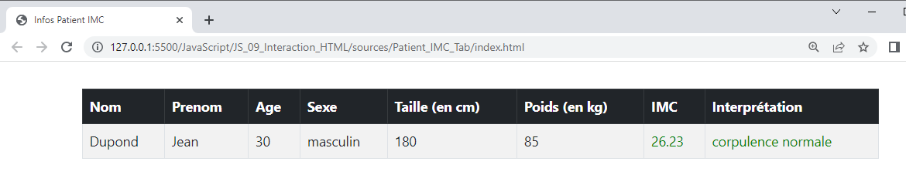

## 6. Créer, ajouter ou supprimer un élément dans le DOM

### 6.1 Créer un élément avec ```createElement()```

Pour créer un nouvel élément HTML en JavaScript, on dispose de la méthode ```createElement()``` de l'interface ```Document```.

Cette méthode doit être appelée depuis l'objet ```document``` et va prendre en argument une chaine de caractère qui correspond au nom de l'élément HTML (tagName) que l'on souhaite créer.

Exemple :

```javascript
const newPara = document.createElement('p');
```
Cette instruction a permis de créer une nouvelle balise ```<p>``` qui ne contient pour l'instant ni attribut ni texte et qui n'a pas encore été inséré dans le DOM.

Pour insérer du texte dans ce nouvel élément, on pourra utiliser la propriété ```textContent```

```javascript
const newPara = document.createElement('p');
newPara.textContent = 'nouveau paragraphe créé par JavaScript';
```

### 6.2 Insérer un élément dans un autre avec ```append()``` et ```prepend()```

Les méthodes ```append()``` et ```prepend()``` permettent d'insérer un nouvel élément à l'intérieur d'une balise.

* ```prepend()``` permet d'insérer le nouvel élément en tant que premier enfant de la balise sélectionnée (juste après la balise ouvrante)
* ```append()``` permet d'insérer le nouvel élément en tant que dernier enfant de la balise sélectionnée (juste avant la balise fermante)

Exemple :

```html
<body>
  <div>
    <p>Un premier paragraphe créé par HTML</p>
  <div>
</body>
```
```javascript
 // définition de la référence vers la div dans laquelle on veut insérer les nouveaux éléments
const div = document.querySelector('div'); 

// création des paragraphes à insérer  
const newPara1 = document.createElement('p');       
const newPara2 = document.createElement('p');

// initialisation du contenu textuel des paragraphes
newPara1.textContent = 'Un second paragraphe créé par JavaScript et inséré au début de la div';              
newPara2.textContent = 'Un troisième paragraphe créé par JavaScript et inséré à la fin de la div';

//insertion du premier paragraphe au tout début de la div
div.prepend(newPara1);

//insertion du second paragraphe à la fin de la div
div.append(newPara2);
```
Aperçu dans la console du navigateur

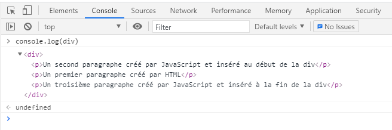

La page Web correspondant au fichier HTML est également mise à jour :

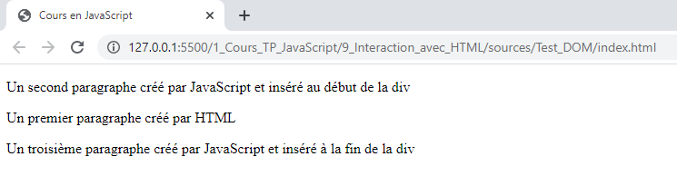

### 6.3 Supprimer un ou plusieurs éléments du DOM avec ```remove()```

La méthode ```remove()``` permet de retirer un élément dans l'arborescence du DOM

Exemple :

```javascript
newPara2.remove();   // supprime le paragraphe newPara2 du DOM
```
On peut également utiliser cette fonction pour supprimer une liste d'éléments.

Exemple : suppression de tous les paragraphes contenus dans le bloc div

```javascript
let paras = div.querySelectorAll('p');    // on sélectionne tous les paragraphes contenus dans le bloc div
for (let i = 0; i < paras.length; i++) {
    paras[i].remove();    // on parcourt la liste des paragraphes pour les supprimer un à un
}
```

## Activité \: Calcul d'IMC \- Affichage des données correspondant à une liste de patients dans un tableau HTML

On souhaite afficher dans une page Web et à l'aide d'un tableau HTML les données concernant une liste de patients, ces données étant stockées dans un tableau  JavaScript. La mise en page se fera à l'aide de Bootstrap.

Créez un nouveau projet html5 dans VS Code **"Liste_Patients_IMC"** en respectant l'arborescence suivante :

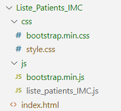

Codez les liaisons entre les fichiers css et js dans le fichier HTML

Ajoutez la balise ```<div>``` avec la classe ```.container``` pour la mise en page du contenu 

Créez le tableau dans le fichier HTML en lui attribuant l'identifiant ```table_patients_IMC```.
Utilisez les classes ```css``` de Bootstrap pour sa mise en forme
et ajoutez uniquement la ligne qui contient les entêtes. Les lignes contenant les données seront créées dynamiquement par le code JavaScript.

Recopiez dans le fichier CSS, les règles CSS définies pour le tableau dans le projet précédent

Recopiez dans le fichier js, les instructions JavaScript qui correspondent à la définition de la classe ```Patient```.

Créez les objets représentant les patients qui seront mis dans la liste à partir du tableau suivant :

| Nom | Prénom | Age | Sexe | Taille (cm) | Poids (kg) |
|-----|--------|-----|------|-------------|------------|
| Dupond | Jean | 30 | masculin | 180 | 85   |
| Martin | Eric | 42 | masculin | 165 | 90   |
| Moulin | Isabelle | 46 | féminin | 158 | 74 |
| Verwaerde | Paul | 55 | masculin | 177 | 66 |
| Durand | Dominique | 60 | féminin | 163 | 54 |
| Lejeune | Bernard | 63 | masculin | 158 | 78 |
| Chevalier | Louise | 35 | féminin | 170 | 82 |
|           |        |    |         |     |    |

Déclarez et initialisez le tableau ```tabPatients``` avec ces objets.

Créez une variable ```tbody_Patients_IMC``` représentant la balise ```<tbody>``` du tableau ```table_Patients_IMC```. Utilisez pour cela la méthode ```querySelector()```. 

Déclarez et codez la fonction ```ajouter_Patient(prmPatient)```. Cette fonction doit retourner un élément HTML correspondant à la ligne qui sera ajoutée au tableau dans la page Web. Cette ligne devra contenir toutes les cellules dans lesquelles seront affichées les informations du patient.

Pour cela, dans la fonction ```ajouter_Patient(prmPatient)``` on devra :

* créer l'élément HTML correspondant à la ligne du tableau qui devra être ajoutée
* créer dans un tableau les éléments HTML correspondant aux cellules qui devront être ajoutées à la ligne précédente
* attribuer aux différentes cellules les valeurs correspondant aux informations contenues dans l'objet représenté par le paramètre ```prmPatient```
* modifer la propriété CSS qui permet d'afficher en gras le texte pour les cellules représentant l'IMC et son interprétation.
* attribuer à ce même texte la couleur qui correspond à la situation du patient.
* ajouter les cellules à la ligne
* retourner la ligne

Codez les instructions qui permettent d'appeler la fonction ```ajouter_Patient(prmPatient)``` pour compléter le tableau HTML avec toutes les informations contenues dans le tableau ```tabPatients```. Pour cela, chaque ligne retournée par cette fonction devra être ajoutée dans la partie ```<tbody>``` du tableau HTML.  

Aperçu du résultat :

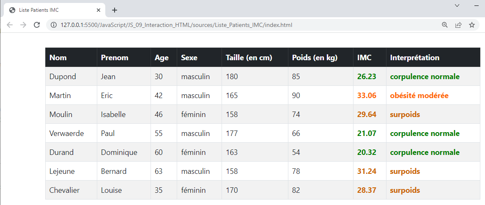

## 7. Gérer les évènements 

### 7.1 Définition

De manière générale, un évènement correspond à une action qui est détectée par le système lorsqu'elle se produit. Chaque évènement peut être écouté, cela signifie que l'on peut demander au système de nous tenir informé lorsqu'il se produit. On pourra alors répondre à cet évènement en lui attachant un code qui sera exécuté à chaque fois qu'il se produit.

JavaScript permet de gérer un grand nombre d'évènements qui ont lieu dans le DOM grâce à son interface ```Event```

Parmi eux, on peut citer notamment les évènements générés par l'utilisateur comme par exemple :

* le clic sur un élément de la page (bouton, div, paragraphe ...)
* le survol d'un élément ou d'une zone avec la souris
* l'appui sur une touche du clavier
* etc ...

### 7.2 Gestionnaire d'évènement

Pour écouter et répondre à un évènement, il est nécessaire de définir un gestionnaire d'évènement.
Un gestionnaire d'évènement est toujours défini en deux parties :
* une première partie qui va servir à écouter l'évènement 
* une deuxième partie qui va contenir le code qui doit être exécuté lorsque l'évènement se produit (en général, il s'agit d'une fonction) 

En JavaScript, il existe trois façons d'implémenter un gestionnaire d'évènement :
* en utilisant des attributs HTML de type évènement
* en utilisant des propriétés JavaScript liées aux évènements
* en utilisant la méthode ```addEventListener()```

### 7.3 Utiliser les attributs HTML pour gérer un évènement

L'utilisation d'attributs HTML pour prendre en charge un évènement existe toujours mais son utilisation n'est plus recommandée par la communauté des développeurs JavaScript car elle oblige quelque part à avoir du code HTML et du code JavaScript mélangé dans le même fichier.

L'idée est donc ici d'insérer le gestionnaire d'évènement en tant qu'attribut HTML dans la balise ouvrante de l'élément à partir duquel le déclenchement de l'évènement associé à ce gestionnaire va pouvoir être détecté.

Les attributs HTML désignant un gestionnaire d'évènement porte un nom du type ```on*event*```` où event représente le type d'évènement qui doit être écouté comme par exemple :

* ```onclick``` pour détecter le click sur un élément
* ```onkeypress``` pour détecter l'appui sur une touche
* ```onmouseover``` pour détecter le passage de la souris sur un élément
* etc...

On passe ensuite à ces attributs une valeur qui représente le code JavaScript à exécuter lors du déclenchement de l'évènement. La plupart du temps, il s'agit d'une fonction.

Exemple :

* code HMTL
  
```html
<button onclick="afficher()">Cliquez pour afficher le texte</button>
<p id="text"></p>
```
* code JavaScript

```javascript
function afficher() {  // fonction appelée par le gestionnaire d'évènement onclick associé au bouton
    const p_text = document.getElementById("text");
    p_text.textContent = "Hello World !!";
}
```
Dans cet exemple, on crée un bouton sur la page Web et on lui associe en attribut le gestionnaire d'évènement ```onclick```. Un clic sur ce bouton déclenchera alors l'exécution du code JavaScript contenu dans la fonction ```afficher()``` qui est passée en valeur.

Cette fonction met à jour le texte contenu dans le paragraphe ayant pour id "text" avec l'expression "Hello Word !!"

Aperçu dans le navigateur :

* avant le clic :
  
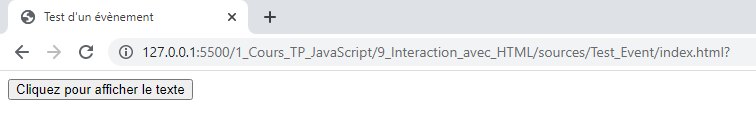

* après le clic :
  
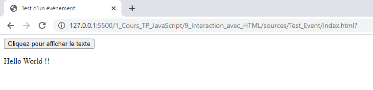

### 7.4 Utiliser les propriétés JavaScript pour gérer un évènement

En JavaScript, les gestionnaires d'évènement font parties des propriétés que l'on peut utiliser entr'autre sur un objet de type ```Element```

Ces propriétés portent des noms similaires à ceux des attributs HTML vus précédemment.

On passe également à ces propriétés une valeur qui représente le code JavaScript à exécuter lors du déclenchement de l'évènement. Généralement, il s'agit d'une fonction anonyme.

Exemple :

* code HTML 
  
```html
<button id="btn1">Cliquez pour afficher le texte</button>
<p id="text"></p>
```

* code JavaScript 
  
```javascript
const btn1 = document.getElementById("btn1");  // référence vers le bouton 
const p_text = document.getElementById("text");

btn1.onclick = function() {     // on associe le gestionnaire d'évènement onclick au bouton et on définit la fonction anonyme  qui sera appelée par ce gestionnaire
    p_text.textContent = "Hello World !!";
}
```

Dans cet exemple, on attribue au bouton un identifiant "btn1" et on crée une référence vers ce bouton dans le code JavaScript. 

On utilise ensuite la propriété ```onclick``` sur cette référence pour détecter et gérer le clic sur le bouton. 

On affecte à cette propriété une fonction anonyme contenant le code qui sera exécuté lorsque l'utilisateur cliquera sur le bouton.

### 7.5 Utiliser la méthode ```addEventListener()``` pour gérer un évènement

Cette dernière possibilité pour gérer les évènements en JavaScript est la plus récente et la plus recommandée par la communauté des développeurs.

La méthode ```addEventListener()``` peut être utilisée avec un objet de type ```Element``` pour lui associer un ou plusieurs gestionnaires d'évènement.

Cette méthode va prendre en argument le nom de l'évènement qui doit être géré et le code (une fonction) qui doit être exécuté lors du déclenchement de cet évènement.

Exemple :

* code HTML 
  
```html
<button id="btn1">Cliquez pour afficher le texte</button>
<p id="text"></p>
```

* code JavaScript 
  
```javascript
const btn1 = document.getElementById("btn1");  // référence vers le bouton 
const p_text = document.getElementById("text");

btn1.addEventListener('click', function () {  // on utilise la méthode addEventListener() pour gérer le clic sur le bouton 
    p_text.textContent = "Hello World !!";
});
```
Dans cet exemple, on attribue au bouton un identifiant "btn1" et on crée une référence vers ce bouton dans le code JavaScript. Cette référence est un objet de type ```Element```. 

On peut donc utiliser la méthode ```addEventListener()``` sur cette référence pour lui associer un gestionnaire d'évènement. 

On passe en paramètre le nom de l'évènement pour lequel ce gestionnaire doit être enregistré (ici ```'click'```) et la fonction anonyme contenant le code qui sera exécuté en réponse à cet évènement.

Il est tout à fait possible d'utiliser une fonction nommée à la place d'une fonction anonyme, dans ce cas, il suffit de la définir en dehors de la méthode ```addEventListener()``` et de passer son nom en argument.

Exemple :

```javascript
const btn1 = document.getElementById("btn1");  // référence vers le bouton 
const p_text = document.getElementById("text");

btn1.addEventListener('click', afficherTexte); // la fonction afficherTexte() contient le code qui sera exécuté lorsque l'utilisateur cliquera sur le bouton 

function afficherTexte() {
   p_text.textContent = "Hello World !!";
}
```
Contrairement aux deux possibilités vues précédemment, la méthode ```addEventListener()``` permet de réagir plusieurs fois et de manière différente à un même évènement.

Exemple :

```javascript
const btn1 = document.getElementById("btn1");
const p_text = document.getElementById("text");

btn1.addEventListener('click', afficherTexte);
btn1.addEventListener('click', mettreEnGras);

function afficherTexte() {
    p_text.textContent = "Hello World !!";
}

function mettreEnGras() {
    p_text.style.fontWeight = 'bold';
}
```

Dans cet exemple, les fonctions ```afficherTexte()``` et ```mettreEnGras()```seront systématiquement exécutées lorsque l'utilisateur cliquera sur le bouton.

### 7.6 Annuler le comportement par défaut d'un évènement

Dans certains cas, on peut être amené à désactiver le comportement par défaut d'un évènement pour pouvoir le traiter comme on le souhaite en JavaScript. Par exemple, pour gérer le clic sur un lien ```<a>``` en JavaScript, il faut d'abord désactiver le comportement normal de ce lien pour empêcher le navigateur de charger une nouvelle page.

Dans ce cas, il faut appeler la méthode ```preventDefault()``` sur l'objet évènement en question.

Exemple :

* code HTML
  
```html
<a id="modif">Modifier</a>
<p id="text">Bonjour !!</p>
```

* code JavaScript

```javascript
const a_modif = document.getElementById("modif");
const p_text = document.getElementById("text");

a_modif.addEventListener('click', modifier);

function modifier(e) {
  // on désactive le comportement par défaut du lien
  e.preventDefault();
  // on peut maintenant traiter le click ici
  p_text.textContent = "Au revoir !!";
}
```

## 8. Récupérer la valeur d'un élément avec la propriété ```value```

Certains éléments HTML tels que les balises de type ```<input>``` sont prévus pour créer des champs de saisie qui permettent à l'utilisateur d'entrer des données. Le type de donnée à saisir est défini par l'attribut ```type```, parmi les options possibles, on peut citer entre autre :

* le type _text_ pour saisir un texte (comportement par défaut de la balise)
```html 
<input type="text">
``` 
* le type _number_ pour saisir un nombre
```html 
<input type="number">
``` 
* le type _email_ pour saisir une adresse électronique
```html 
<input type="email">
``` 
* le type _radio_ pour sélectionner une seule valeur parmi un groupe
```html 
<input type="radio">
``` 

Pour avoir la liste complète des options à utiliser, voir le lien suivant

https://developer.mozilla.org/fr/docs/Web/HTML/Element/input

Côté JavaScript, lorsqu'on souhaite récupérer la valeur du champ de saisie défini par une balise ```<input>```, on peut utiliser la propriété ```value``` de l'objet ```HTMLInputElement``` 

Exemple :

* code HTML
```html
<input type="text" id="input_text">
```
* code JavaScript
```javascript
// on définit une référence vers la balise input dont on souhaite récupérer la valeur
const input_text = document.getElementById("input_text");
// on récupère la valeur en utilisant la propriété value
let text = input_text.value ;
```
Comment récupérer une valeur parmi plusieurs avec le type _radio_ ?

L'utilisation du type _radio_ avec la balise ```<input>``` permet de créer une liste d'options parmis lesquelles on ne peut en choisir qu'une seule à la fois à l'aide de boutons de type radio.

* Les boutons radio sont mutuellement exclusifs :


* Les boutons radio appartenant à un même groupe ont le même attribut ```name```
* L'attribut ```value``` permet de définir la valeur correspondant au choix
* L'attribut ```checked``` peut être ajouté pour désigner le bouton qui doit être coché par défaut
* Les boutons radio possèdent également un identifiant unique (id) qui est utilisé pour rattacher le libellé fourni par l'élément <label> via l'attribut for.


Exemple : 

* code HTML
  
```html
<p>
  <strong>Mes amis</strong>
</p>
<p>
  <input type="radio" name="amis" id="rb_pierre" value="Pierre" checked>
  <label for="rb_pierre">Pierre</label>
</p>
<p>
  <input type="radio" name="amis" id="rb_paul" value="Paul">
  <label for="rb_paul">Paul</label>
</p>
<p>
  <input type="radio" name="amis" id="rb_jacques" value="Jacques">
  <label for="rb_jacques">Jacques</label>
</p>
```
* Aperçu du résultat

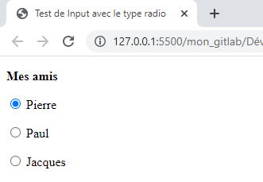

Pour récupérer la valeur du bouton sélectionné en JavaScript :

* on déclare une référence vers le groupe auquel appartient ce bouton

```javascript
const rbs_amis = document.querySelectorAll('input[name="amis"]');
```
* on accède ensuite tour à tour à chacun des boutons du groupe à l'aide d'une boucle et on vérifie pour chacun d'eux la valeur de la propriété ```checked```

  * Si ```checked``` vaut ```true``` on récupère la valeur de la propriété ```value``` et on quitte la boucle
  * Si ```checked``` vaut ```false``` on passe au bouton suivant
 
```javascript
for(const rb_ami of rbs_amis) {
  if(rb_ami.checked === true) {
    ami = rb_ami.value;
    break;
  }
}
```
## 9. Traitement des données saisies dans un formulaire en JavaScript

### 9.1 Création du formulaire en HTML

* tous les éléments du formulaire doivent être codés à l'intérieur d'un bloc ```<form></form>``` auquel on attribut un identifiant unique.

```html
<form id="myForm">
  
</form>
```
* On ajoute les différents champs de saisie du formulaire à l'aide de balises ```<input>``` en leur attribuant également un identifiant unique et en leur associant un libellé (```<label>```)

```html
<form id="myForm">
  <p>
    <label for="input_nom">Votre nom</label>
    <input type="text" name="nom" id="input_nom" required>
  </p>
</form>
```
* On termine le formulaire par un bouton de type ```submit``` qui va servir à valider la saisie des données

```html
<form id="myForm">
  <p>
    <label for="input_nom">Votre nom</label>
    <input type="text" name="nom" id="input_nom" required>
  </p>
  <p>
    <button type="submit">Valider</button>
  </p>
</form>
```

### 9.2 Traitement des données saisies en JavaScript

* On commence par déclarer une référence vers le formulaire et les balises ```<input>``` qu'il contient. Le bouton de validation n'a pas besoin d'être référencé ici
  
```javascript
const myForm = document.getElementById("myForm");
const input_nom = document.getElementById("input_nom");
```

* On crèe un gestionnaire d'évenement associé directement au formulaire, ce gestionnaire devra capturer l'évènement ```submit``` et appeler la fonction qui permettra de traiter les données du formulaire
* 
```javascript
myForm.addEventListener('submit',afficher);
```

* On déclare la fonction qui sera appelée de manière à ce que le comportement par défaut de l'évènement ```submit```soit désactivé

```javascript
function afficher(e) {
    // On désactive le comportement par défaut
    e.preventDefault();
}
```
* On peut ensuite récupérer la valeur saisie dans l'un des champs du formulaire en utilisant la propriété ```value```

```javascript
function afficher(e) {
    // On désactive le comportement par défaut
    e.preventDefault();
    // On récupère les valeurs saisies dans le formulaire
    let nom = input_nom.value;
}
```
### 9.3 Exemple

On considère une page web qui comprend :

* un formulaire constitué d'un seul champ qui permet à l'utilisateur de saisir son nom
et d'un bouton de validation
* un paragraphe dans lequel un message de bienvenue personnalisé sera affiché lorsqu'on cliquera sur le bouton de validation
 
code HTML
```html
<form id="myForm">
  <p>
    <label for="input_nom">Votre nom</label>
    <input type="text" name="nom" id="input_nom" required>
  </p>
  <p>
    <button type="submit">Valider</button>
  </p>
</form>
<p id="p_mess"></p>
```
Aperçu du formulaire au chargement de la page :

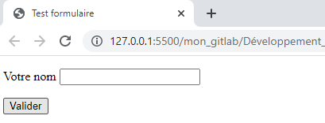

code JavaScript
```javascript
// Déclaration de la référence vers le formulaire
const myForm = document.getElementById("myForm");
// Déclaration des références vers les éléments appartenant au formulaire
const input_nom = document.getElementById("input_nom");
// Déclaration des références vers les autres éléments de la page
const p_mess = document.getElementById("p_mess");

// Création du gestionnaire d'évènement associé au formulaire
myForm.addEventListener('submit',afficher);

// Fonction afficher() qui sera appelée lorsque l'utilisateur cliquera sur le bouton de validation du formulaire
function afficher(e) {
    // On désactive le comportement par défaut
    e.preventDefault();
    // On récupère les valeurs saisies dans le formulaire
    let nom = input_nom.value;
    // On met à jour la page web à partir de ces valeurs
    p_mess.textContent = "Bienvenue " + nom ;
}
```
Aperçu du résultat :

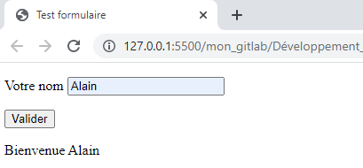

## Activité \: Calcul d'IMC avec saisie des patients et enregistrement dans un tableau

Au cours de cette activité, on souhaite développer une application qui permet à l'utilisateur de saisir à l'aide d'un formulaire les informations relatives à un patient et de les reporter au fur et à mesure dans un tableau.

Au lancement de l'application, seule l'entête du tableau est affichée et un message indique qu'il n'y a aucun patient enregistré pour l'instant. L'utilisateur devra cliquer sur le bouton d'inscription pour ajouter un patient.

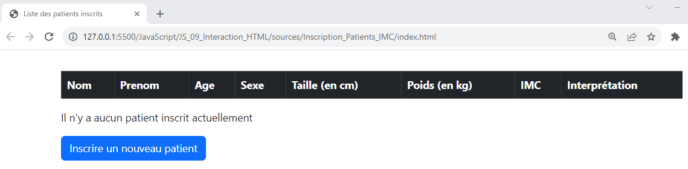

Lorsque l'utilisateur clique sur le bouton d'inscription, l'application ouvre le formulaire de saisie

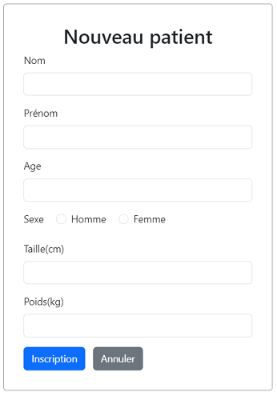

Si toutes les informations sont correctement saisies dans le formulaire et que l'utilisateur clique sur le bouton "Enregistrer", l'application ferme le formulaire, ajoute une ligne au tableau avec toutes les données du nouveau patient et met à jour le message indiquant le nombre de patients enregistrés.
Dans le cas où l'utilisateur clique sur le bouton "Annuler", le formulaire est directement fermé et le contenu du tableau n'est pas modifié.

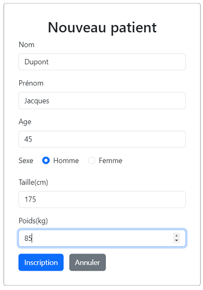

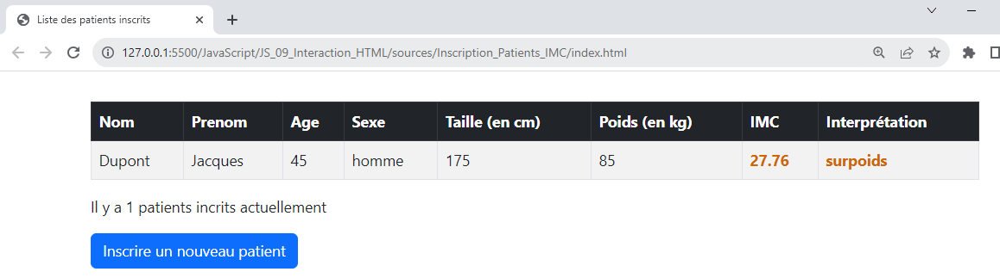

Créez un nouveau projet html5 dans VS Code **"Inscription_Patients_IMC"**

Arborescence du projet :

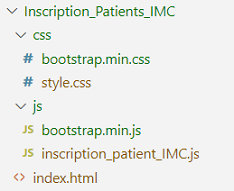

Codez les liaisons entre les fichiers css et js dans le fichier HTML

Créez dans le fichier ```index.html``` les différents éléments constituant la page web c'est à dire :

* le tableau avec uniquement la ligne contenant les entêtes, les autres lignes seront créées dynamiquement par le code JavaScript.
* le paragraphe pour le nombre de patients inscrits
* le bouton pour inscrire un nouveau patient
* le formulaire d'inscription 

Code HTML du formulaire :

```html
<div class="popup">
  <div class="popup-form" id="div_popup">
    <h2>Nouveau patient</h2>
    <form id="form_inscription">
      <div class="mb-3">
        <label for="input_nom" class="form-label">Nom</label>
        <input type="text" class="form-control" id="input_nom" name="nom" required>
      </div>
      <div class="mb-3">
        <label for="input_prenom" class="form-label">Prénom</label>
        <input type="text" class="form-control" id="input_prenom" name="prenom" required>
      </div>
      <div class="mb-3">
        <label for="input_age" class="form-label">Age</label>
        <input type="number" class="form-control" id="input_age" name="age" required min="0" max="100">
      </div>
      <div class="mb-3">
        <label class="form-label">Sexe</label>
        <div class="form-check form-check-inline">
          <input class="form-check-input" type="radio" name="sexe" id="homme" value="homme" required>
          <label class="form-check-label" for="homme">Homme</label>
        </div>
        <div class="form-check form-check-inline">
          <input class="form-check-input" type="radio" name="sexe" id="femme" value="femme" required>
          <label class="form-check-label" for="femme">Femme</label>
        </div>
      </div>
      <div class="mb-3">
        <label for="input_taille" class="form-label">Taille(cm)</label>
        <input type="number" class="form-control" id="input_taille" name="taille" required min="0" max="250">
      </div>
      <div class="mb-3">
        <label for="input_poids" class="form-label">Poids(kg)</label>
        <input type="number" class="form-control" id="input_poids" name="poids" required min="0" max="200">
      </div>
      <button type="submit" class="btn btn-primary">Inscription</button>
      <button type="button" class="btn btn-secondary ms-2" id="btn_annuler">Annuler</button>
    </form>
  </div>
</div>
```
Créez une feuille de style ```style.css``` et complétez cette feuille avec les règles suivantes :
  
```css
* {
  box-sizing: border-box;
}

.container {
  padding-top: 2rem;
}

/* règle de style pour les éléments du formulaire */

.popup {
  position: relative;
  width: 100%;
}

.popup-form {
  display: none;
  position: fixed;
  left: 50%;
  top: 15%;
  transform: translate(-50%, 5%);
  border: 1px solid #999999;
  padding: 2rem;
  border-radius: 5px;
  z-index: 9;
  width: 25%;
}

.popup-form h2
{
  text-align: center;
}

.form-label {
  margin-right: 1rem;
}

```

Recopiez dans le fichier js, les instructions qui correspondent à la définition de la classe ```Patient```.

Déclarez les références vers les différents éléments HTML, en particulier une référence vers la balise ```<tbody>``` du tableau pour ajouter chaque ligne correspondant à un nouveau patient.

Un clic sur le bouton d'inscription doit déclencher l'appel d'une fonction ```ouvrir()``` qui affiche le formulaire. 

* Créez le gestionnaire d'évènement associé à ce bouton
* Déclarez et codez la fonction ```ouvrir()```

Lorsque le formulaire est affiché, un clic sur le bouton "Annuler" doit déclencher l'appel d'une fonction ```fermer()``` qui ferme le formulaire.

* Créez le gestionnaire d'évènement associé à ce bouton
* Déclarez et codez la fonction ```fermer()```

> Pour ouvrir ou fermer le formulaire vous utiliserez la propriété CSS ```display``` avec les valeurs ```block``` et ```none```

 Un clic sur le bouton "Enregistrer" pour valider la saisie des données doit déclencher l'appel d'une fonction ```ajouter()```

 * Créez le gestionnaire d'évènement associé au formulaire qui permettra de traiter les données dans la fonction ```ajouter()```.
 * Déclarez et codez la fonction ```ajouter()``` en respectant les étapes suivantes :
     * désactiver le comportement par défaut de l'évènement 
     * récupérer les valeurs saisies dans des variables locales
     * créer un objet de type ```Patient``` à partir des valeurs saisies
     * stocker cet objet dans un tableau
     * ajouter et remplir une nouvelle ligne dans le tableau HTML avec les données du nouveau patient (en conservant les règles de présentation appliquée dans l'activité précédente) 
     * fermer le formulaire
     * mettre à jour le message pour le nombre de patients saisis

**Amélioration :**

La solution proposée jusqu'ici présente le défaut de ne pas vider le formulaire avant l'inscription d'un nouveau patient ou bien après une annulation.

Pour répondre à ce problème, on envisage de faire appel à une fonction ```vider_formulaire()``` lorsque l'utilisateur clique sur l'un des boutons du formulaire.

Déclarez et codez la fonction  ```vider_formulaire()```

> Pour vider le champ d'un formulaire, il suffit de remplacer la valeur qu'il contient par une chaine vide.</br>
> Dans le cas d'un bouton radio, il faut mettre la propriété ```checked``` à ```false```

Placez au bon endroit les instructions correspondant à l'appel de cette fonction.


  