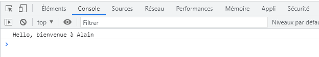
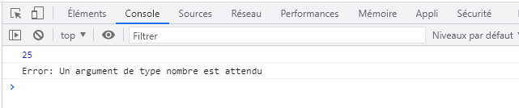
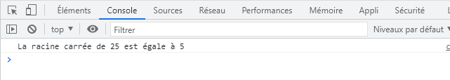
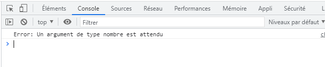
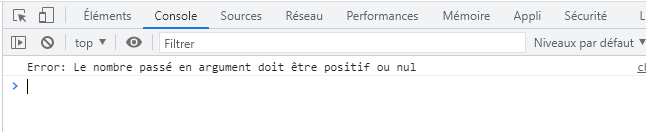

# Le fonctionnement asynchrone en JavaScript

> * Auteur : Alain BRASSART
> * Date de dernière publication : 04/10/2021
> * OS: Windows 10 (version 20H2)
> * VS Code : version 1.60.1 (system setup)
> * Chrome : version 93.0.4577.82 (Build officiel) (64 bits)

 [Licence Creative Commons](https://creativecommons.org/licenses/by-nc-sa/3.0/fr/)

## Sommaire

 - [1. Introduction](#1-introduction)
 - [2. Les fonctions de rappel (fonctions de callback)](#2-les-fonctions-de-rappel-fonctions-de-callback)
   - [2.1 Principe](#21-principe) 
   - [2.2 Utilisation avec les fonctions asynchrones](#22-utilisation-avec-les-fonctions-asynchrones)
   - [2.3 Gestion des erreurs](#23-gestion-des-erreurs)
   - [2.4 Le callback hell](#24-le-callback-hell)
 - [3. Les promesses](#3-les-promesses)
   - [3.1 Présentation et définition](#31-présentation-et-définition) 
   - [3.2 Création d'une promesse](#32-création-dune-promesse)
   - [3.3 Exploitation du résultat avec ```then()``` et ```catch()```](#32-exploitation-du-résultat-avec-then-et-catch)
   - [3.4 Activité : codage de la fonction ```calculerCarre()``` avec une promesse](#34-activité--codage-de-la-fonction-calculercarre-avec-une-promesse)
   - [3.5 Chainage des promesses](#35-chainage-de-promesses)  
   - [3.6 Activité \: chaine de promesses pour le calcul de la racine carrée d'un nombre](#36-activité--chaine-de-promesses-pour-le-calcul-de-la-racine-carrée-dun-nombre)
  
## 1. Introduction

Par défaut, le JavaScript est un langage synchrone, bloquant et ne s'exécutant que sur un seul thread.

> Un thread est un processus unique correspondant à l'exécution d'un programme. Chaque thread ne peut effectuer qu'une seule tâche à la fois.

Cela signifie que pour le JavaScript :

* Les différentes opérations vont s'exécuter les unes à la suite des autres (elles sont synchrones)
* Chaque nouvelle opération doit attendre que la précédente soit terminée pour commencer à son tour (fonctionnement bloquant)
* Une seule instruction peut être exécutée à la fois (fonctionnement mono-thread)

Dans certaines situations, cela peut poser problème, notamment dans le cas où une fonction ou une boucle mettent beaucoup de temps à s'exécuter. Tant que cette fonction ou cette boucle ne sera pas terminée, la suite du script ne pourra pas être exécutée et l'application dans son ensemble paraitra complétement bloquée du point de vue de l'utilisateur.

Pour éviter ce type de problème, la solution serait que ce genre d'opérations puisse s'exécuter de manière asynchrone, c'est à dire en marge du reste du code afin que ce dernier puisse continuer à être exécuté. Cela est rendu possible aujourd'hui grâce aux outils que propose JavaScript pour créer du code asynchrone.

## 2. Les fonctions de rappel (fonctions de callback)

### 2.1 Principe

Une fonction de _callback_ est une fonction qui est passée en argument à une autre fonction dite d'ordre supérieur. Elle est prévue pour être appelée par la fonction d'ordre supérieur pour indiquer que celle-ci a terminé son traitement. 

Exemple :

```javascript
// fonction saluer() qui utilise une fonction de callback
function saluer(name, callback) {
    let message = "Hello, bienvenue à " + name;
    callback(message);
}

// fonction de callback qui sera appelée par la fonction saluer()
function afficherMsg(msg) {
    console.log(msg);
}

// appel de la fonction saluer() dans le script principal
saluer("Alain",afficherMsg);
```

Aperçu du résultat dans la console du navigateur :



Dans cet exemple, ```saluer()``` est la fonction d'ordre supérieur qui accepte deux arguments, le second étant la fonction de callback. La fonction ```afficherMsg()``` est transmise en tant que fonction de callback.

> Lors de l'appel de la fonction ```saluer()```, il est à noter que les parenthèses ne sont pas utilisées avec la fonction ```afficherMsg()``` pour éviter qu'elle ne soit exécutée immédiatement, il s'agit ici de transmettre la définition de cette fonction à la fonction ```saluer()``` afin qu'elle puisse être exécutée quand il le faut.

Une fonction anonyme peut être transmise en tant que callback

Exemple : on remplace la fonction de callback ```afficherMsg()``` de l'exemple précédent par une fonction anonyme

```javascript
// fonction saluer() qui utilise une fonction de callback
function saluer(name, callback) {
    let message = "Hello, bienvenue à " + name;
    callback(message);
}
// la fonction de callback est une fonction anonyme
saluer("Alain", function(msg) {
    console.log(msg);
});
```
### 2.2 Utilisation avec les fonctions asynchrones

En JavaScript, les fonctions de callback font partie des solutions utilisées régulièrement pour gérer les appels à des fonctions asynchrones.

On retrouve leur utilisation notamment dans la gestion des évènements avec la fonction ```addEventListener()```. Cette fonction est une fonction asyncrhone qui prend en argument le nom de l'évènement qui doit être pris en compte et la fonction de callback qui doit être appelée.

```javascript
btn1.addEventListener('click',afficher);

function afficher() {
    // afficher un message dans la page Web
}
```
Dans cet exemple, la fonction ```afficher()``` qui est envoyée à ```addEventListener()``` est une fonction de callback. Elle n'est pas appelée tout de suite, mais seulement à partir du moment où l'utilisateur clique sur le bouton ```btn1```. Cela permet de ne pas bloquer l'exécution du code et de traiter le clic sur le bouton au moment voulu.

Un autre exemple avec la fonction ```setInterval()```, cette fonction permet d'appeler à intervalles de temps réguliers une fonction de callback.

```javascript
setInterval(afficher,1000);

function afficher() {
    // affiche une valeur toutes les secondes
}
```
Les fonctions de callback sont aussi souvent utilisées dans tout ce qui est exécution d'opérations d'entrées/sorties de données nécessitant un fonctionnement asynchrone (requêtes sur le réseau par exemple).

### 2.3 Gestion des erreurs

Pour gérer les erreurs avec les callbacks, la méthode la plus utilisée est de passer deux paramètres à la fonction de callback, le premier représentant une erreur (```err```) plus précisément une instance de type ```Error``` et le second la donnée (```data```).

Lorsque la fonction de callback est appelée, il faut alors vérifier la valeur du paramètre ```err```. Si ce paramètre n'est pas ```null```, cela signifie qu'une erreur s'est produite et qu'elle doit être gérée. Dans le cas contraire, on pourra récupérer la donnée qui se trouve dans le paramètre ```data```.

Exemple :

```javascript
function calculerCarre(nombre, callback) {
    if(typeof nombre !== "number") {
        // si le paramètre "nombre" n'est pas de type number, on passe en argument une instance de Error à la fonction de callback
        callback(new Error("Un argument de type nombre est attendu"));
    } else {
        // si le paramètre "nombre" est de type number, on passe en premier argument la valeur null et en second argument le résultat à la fonction de callback
        let carre = nombre * nombre;
        callback(null, carre);
    }
}

function carreCallback(err, data) {
    if(err !== null) {
        // la fonction de callback affiche le message d'erreur
        console.log(String(err));
    } else {
        // la fonction de callback affiche le résultat
        console.log(data);
    }
}

calculerCarre(5,carreCallback);
calculerCarre("a",carreCallback);
```

Aperçu du résultat dans la fenêtre du navigateur :



### 2.4 Le callback hell

Dans certains cas, l'exécution d'une opération asynchrone peut dépendre de l'exécution d'une autre opération asynchrone.

```javascript
seConnecter(param,callback_Connect); // fonction asynchrone permettant de se connecter à un serveur distant

// fonction de callback permettant de savoir si la connexion avec le serveur a réussi
function callback_Connect(err) {
    if(err !== null) {
        // connexion échouée
    } else {
        // la connexion avec le serveur est établie, on appelle alors une autre fonction asynchrone pour envoyer une requête au serveur
        envoyerRequete(requete,callback_requete);
    }
}

function callback_requete(err, reponse) {
    if(err !== null) {
        // erreur
    } else {
        // on peut lire la réponse du serveur
    }
}
```
Le callback hell se produit lorsque l'on commence à enchainer un trop grand nombre de fonctions asynchrones dépendantes l'une de l'autre. Dans ce cas, le code devient difficile à suivre et à tester.

C'est essentielleement pour cette raison que JavaScript a été doté récemment d'un nouvel outil pour générer du code asynchrone en travaillant avec des _promesses_ (ou _promises_)

## 3. Les promesses

Les promesses sont utilisées aujourd'hui par la plupart des API JavaScript modernes pour exécuter des opérations asynchrones et tendent à remplacer l'utilisation directe des fonctions de callback. 

Elles présentent l'avantage de pouvoir chainer les opérations asynchrones avec la garantie qu'elles vont s'exécuter dans l'ordre voulu, ainsi qu'une gestion simplifiée des erreurs tout en évitant le "callback hell".

### 3.1 Présentation et définition

Une promesse est une instance de l'objet global ```Promise``` qui représente l'état d'une opération asynchrone. On considère que toute opération asynchrone peut être dans l'un des trois états suivants :

* opération en cours (non terminée)
* opération terminée avec succès (=> promesse résolue)
* opération terminée ou plus exactement stoppée après un échec (=> promesse rejetée ou rompue)

Une promesse est un objet qui est renvoyé par une fonction asynchrone et auquel on attache les fonctions de callbacks plutôt que de les passer en argument directement à la fonction.

### 3.2 Création d'une promesse

Pour créer une promesse, il faut faire appel au constructeur ```Promise```. Ce constructeur va prendre en argument une fonction qui va contenir le code de la tâche à exécuter et qui va à son tour prendre deux autres fonctions en arguments. La première sera appelée si la tâche s'est déroulée avec succès tandis que la seconde sera appelée si la tâche a échoué.

```javascript
const promesse = new Promise(function(resolve,reject) {
    // Tâche asynchrone à réaliser
    /* Appel de la fonction resolve() si la promesse est résolue
       ou
       Appel de la fonction reject() si la promesse est rejetée */
})
```
Une fois créée, une promesse possède deux propriétés internes :

* une propriété ```state``` dont la valeur représente l'état de la promesse (en attente, tenue ou résolue, rompue ou rejetée)
* une propriété ```result``` qui contiendra le résultat de la promesse (la valeur que l'on souhaite récupérée selon l'état de la promesse)

Pour attribuer une valeur à la propriété ```result```, il suffit de la passer en argument à la fonction ```resolve()``` ou à la fonction ```reject()```

Enfin, en pratique, on va créer des fonctions asynchrones qui vont renvoyer des promesses avec un resultat ou une erreur

```javascript
function executerTacheAsync() {
    return new Promise(function(resolve,reject) {
        // tâche à exécuter
        // si tâche exécutée avec succés on appelle la fonction resolve() et on transmet le resultat du traitement
        resolve(resultat);
        // sinon, on appelle la fonction reject() et on transmet l'erreur
        reject(erreur);
    });
}

const promesse = executerTacheAsync();
```
Exemple :

```javascript
function jouer() {
    return new Promise(function(resolve, reject){
        // tirage d'un nombre aléatoire
        let resultat = Math.random();
        console.log("Le résultat est : " + resultat);
        if(resultat > 0.5) {
            resolve("Bravo vous avez gagné");   // si le nombre obtenu est supérieur à 0,5 la promesse est tenue
        } else {
            reject(new Error("Désolé vous avez perdu"));   // si le nombre est inférieur à 0,5 la promesse rejetée
        }
    })
}

let promesse = jouer();
```

### 3.3 Exploitation du résultat avec ```then()``` et ```catch()```

Pour exploiter le résultat d'une promesse, on doit utiliser dans un premier temps la méthode ```then()``` du constructeur ```Promise```.

Cette méthode reçoit en argument deux fonctions de callback qui seront appelées selon l' état de la promesse :
* une première fonction qui va être appelée si la promesse est résolue et qui va recevoir le résultat de cette promesse
* une seconde qui va elle être appelée dans le cas où la promesse a été rompue et qui va recevoir l'erreur.

```javascript
promesse.then(callback_Succes,callback_Echec);

function callback_Succes(result) {
    console.log(result);
}

function callback_Echec(error) {
    console.log(error);
}
```

La fonction ```jouer()```retourne une promesse à laquelle on a attaché les fonctions de callback ```callback_Succes()``` et ```callback_Echec()```.

> A noter qu'il est possible de pouvoir utiliser ```then()```en ne lui passant qu'une seule fonction de callback en argument qui sera alors appelée uniquement si la promesse est tenue.

En complément de la méthode ```then()```, il existe la méthode ```catch()```. Cette méthode accepte une seule fonction de callback qui va être appelée uniquement si la promesse est rejetée.

Plutôt que d'utiliser la méthode ```then()``` seule avec deux fonctions de callback, on peut utiliser à la fois ```then()``` et ```catch()``` pour traiter totalement une promesse.

```javascript
promesse.then(callback_Succes)
        .catch(callback_Echec);
```

Enfin, il est possible aussi de passer des fonctions anonymes en callback

```javascript
promesse
    .then(function(result) {
        console.log(result);
    })
    .catch(function(error) {
        console.log(String(error));
    });
```

### 3.4 Activité \: codage de la fonction ```calculerCarre()``` avec une promesse

Créez un nouveau projet html5 dans VS Code **"Promise_Carre"**

Ajoutez dans ce projet

* un fichier ```index.html``` qui servira uniquement à charger et exécuter le script depuis le navigateur 
* un sous-dossier **"js"** contenant le fichier JavScript ```promise_carre.js```

Dans le fichier ```promise_carre.js```, codez la fonction ```calculerCarre()``` vue en exemple avec les fonctions de callback pour qu'elle retourne cette fois-ci une promesse.
Si la promesse est résolue alors on affiche la valeur du résultat dans la console du navigateur, dans le cas contraire, on affiche le message d'erreur.

### 3.5 Chainage de promesses

Le chainage des promesses permet d'exécuter plusieurs opérations asynchrones à la suite et dans un ordre bien précis.

Pour cela, on part du principe que la méthode ```then()``` retourne automatiquement une nouvelle promesse. Il sera donc possible d'utiliser une autre méthode ```then()```sur le résultat renvoyé par la première méthode ```then()```et ainsi de suite.

```javascript
// on définit les différentes promesses qui vont être chainées

function executerTache_1() {
    return new Promise(function(resolve,reject) {
        //.....
    });
}

function executerTache_2() {
    return new Promise(function(resolve,reject) {
        //.....
    });
}

// on appelle les promesses en les chainant avec la méthode then()

executerTache_1().then(function(result) {
    console.log(result);
    return executerTache_2();  // on attend que la première promesse soit traitée pour traiter la deuxième
})
.then(function(result){
    console.log(result);
});
```
La première promesse est exécutée, à la fin de son exécution, la première méthode ```then()```est appelée. Cette méthode contient un "return" de la deuxième promesse qui est alors exécutée à son tour. La deuxième méthode ```then()``` est alors appelée une fois que la seconde promesse a été traitée.

Exemple : connexion et envoie d'une requête à un serveur distant en utilisant des promesses

```javascript
// définition de la prommesse pour se connecter au serveur

function seConnecter(param) {
    return new Promise(function(resolve,reject){
        // tentative de connexion avec le serveur
        if(connexion_Ok) {
            resolve("Connexion établie avec le serveur");
        } else {
            reject(new Error("Echec de connexion avec le serveur"));
        }
    });
}

// définition de la promesse pour envoyer une requête au serveur

function envoyerRequete(requete) {
    return new Promise(function(resolve,reject){
        // on envoie une requête au serveur et on attend la réponse
        if(reponse_OK) {
            resolve(reponse);
        } else {
            reject(new Error("Le traitement de la requête a échoué"));
        }
    });
}


// on enchaine l'exécution des promesses de manière à ce que l'envoi d'une requête au serveur ne soit effectué qu'une fois connecté au serveur

seConnecter(/*paramètres de connexion*/).then(function(result){
    console.log(result);
    return envoyerRequete(/*requête*/);
})
.then(function(result){
    console.log(result);
});
```
Enfin pour traiter les cas d'erreur dans une chaine de promesse, il suffit d'utiliser une seule fois la méthode ```catch()```. Cette méthode sera automatiquement appelée dès qu'une promesse est rejetée.

```javascript
seConnecter(/*paramètres de connexion*/).then(function(result){
    console.log(result);
    return envoyerRequete(/*requête*/);
})
.then(function(result){
    console.log(result);
})
.catch(function(error){
    // dès qu'une promesse est rejetée, on affiche le message d'erreur correspondant
    console.log(String(error));
});
```
Les chaines de promesses peuvent être construites aussi avec des fonctions fléchées pour une meilleure lisibilité du code.

```javascript
seConnecter(/*paramètres de connexion*/)
    .then((result) => envoyerRequete(/*requête*/))
    .then((result) => {
        console.log(result);
    })
    .catch(function(error){
        console.log(String(error));
    });
```
### 3.6 Activité \: chaine de promesses pour le calcul de la racine carrée d'un nombre

Créez un nouveau projet html5 dans VS Code **"Promises_Racine"**

Ajoutez dans ce projet

* un fichier ```index.html``` qui servira uniquement à charger et exécuter le script depuis le navigateur 
* un sous-dossier **"js"** contenant le fichier JavScript ```promises_racine.js```

Pour calculer la racine carrée d'un nombre, on envisage une solution basée sur l'enchainement de deux promesses :

* une promesse ```verifierNombre(nombre)```qui est résolue si l'argument passé est bien du type ```number``` et qui renvoie alors comme résultat la valeur de cet argument. Dans le cas contraire, si cette promesse est rompue, elle retournera le message d'erreur : ```"Un argument de type nombre est attendu"```    

* une promesse ```calculerRacine(nombre)``` qui est résolue si l'argument passé est un nombre positif ou nul et qui renvoie alors comme résultat la valeur de la racine carrée de ce nombre.  Dans le cas contraire, si cette promesse est rompue, elle retournera le message d'erreur : ```"Le nombre passé en argument doit être positif ou nul"```


Dans le fichier ```promises_racine.js```, codez la définition des promesses ```verifierNombre()``` et ```calculerRacine()```.

Codez ensuite le chainage de ces promesses de sorte que le calcul de la racine carrée soit exécuté correctement.

Testez les différents cas de figure possibles.

Aperçus du résultat dans le navigateur :

* les deux promesses ont bien été résolues


  
* la promesse ```verifierNombre()```a été rejetée



* la promesse ```calculerRacine()```a été rejetée

