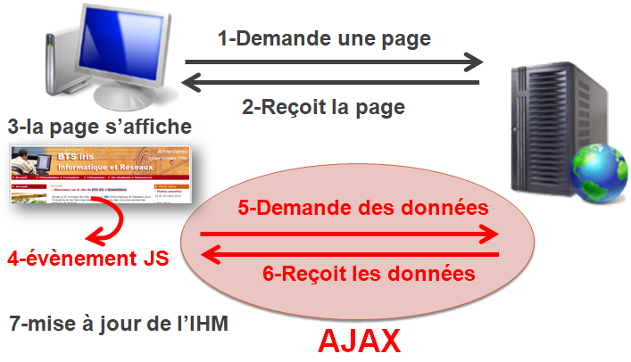
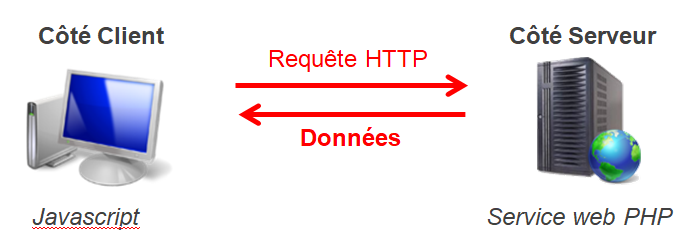
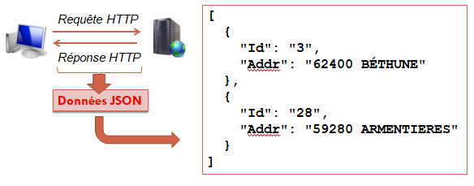
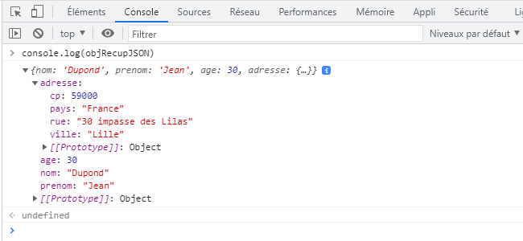
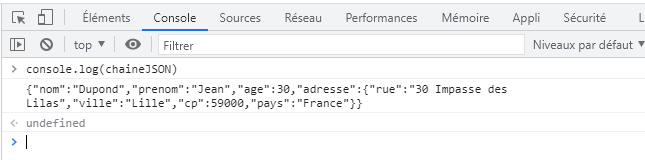
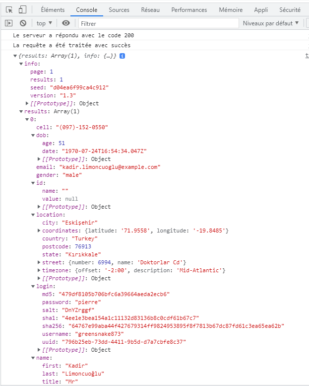

# Les requêtes AJAX

> * Auteur : Alain BRASSART
> * Date de dernière publication : 15/11/2021
> * OS: Windows 10 (version 20H2)
> * VS Code : version 1.60.1 (system setup)
> * Chrome : version 93.0.4577.82 (Build officiel) (64 bits)

 [Licence Creative Commons](https://creativecommons.org/licenses/by-nc-sa/3.0/fr/)

## Sommaire

 - [1. Introduction](#1-introduction)
 - [2. Le format JSON](#2-le-format-json)
   - [2.1 Qu'est ce que JSON ?](#21-quest-ce-que-json-) 
   - [2.2 Représentation des données en JSON](#22-représentation-des-données-en-json)
   - [2.3 Traitement des données JSON avec JavaScript](#23-traitement-des-données-json-avec-javascript)
 - [3. Traiter les requêtes AJAX avec Fetch](#3-traiter-les-requêtes-ajax-avec-fetch)
   - [3.1 Qu'est ce que Fetch ?](#31-quest-ce-que-fetch-)
   - [3.2 Envoi de la requête avec la méthode ```fetch()```](#32-envoi-de-la-requête-avec-la-méthode-fetch)
   - [3.3 Récupération de la réponse](#33-récupération-de-la-réponse)
   - [Activité \: exploitation de l'API "Random User"](#activité--exploitation-de-lapi-random-user)
   - [3.4 Les options de requête avec ```fetch()```](#34-les-options-de-requête-avec-fetch)
   - [3.5 Utilisation des options pour configurer une requête de type POST](#35-utilisation-des-options-pour-configurer-une-requête-de-type-post) 
- [4. Exploiter des données OpenData avec AJAX et JavaScript](#4-exploiter-des-données-opendata-avec-ajax-et-javascript)
- [5. Utiliser des requêtes AJAX vers un service web PHP](#5-utiliser-des-requêtes-ajax-vers-un-service-web-php)

## 1. Introduction


AJAX (**A**synchronous **J**avaScript **A**nd **X**ML) n'est pas une nouvelle technologie en soi mais plutôt une solution qui permet de réaliser des **requêtes HTTP** vers un serveur Web de manière **asynchrone** et de mettre à jour tout ou partie du contenu d'une page Web sans devoir la recharger.



AJAX utilise un ensemble de technologies existantes dont 
* le HTML
* les feuilles de style CSS 
* JavaScript
* le modèle objet de document (DOM)
* l'objet XMLHttpRequest pour le dialogue asynchrone avec le serveur Web
* le JSON pour le format des données

Côté serveur, les requêtes AJAX sont souvent traitées par un service web.



> Un service web est un programme hébergé sur un serveur web qui renvoie des données (à la place d'une page web)

## 2. Le format JSON

### 2.1 Qu'est ce que JSON ?

A sa création, AJAX utilisait le format XML pour échanger les données avec le serveur. Aujourd'hui, le XML a été largement délaissé au profit du format JSON (**J**ava**S**cript **O**bject **N**otation) qui offre une notation plus simple et plus lisible.



JSON est un format de données textuel indépendant de tout langage mais dérivé de la notation des objets en JavaScript (mais ce n'est pas du JavaScript). Il permet de représenter de l'information structurée et de sérialiser un grand nombre de types de données telles que des objets, des tableaux, des nombres, des chaines de caractères ou encore des booléens.

### 2.2 Représentation des données en JSON

La construction d'un document au format JSON est basée sur l'utilisation de deux types de blocs :

* le bloc de type "**objet**"
* le bloc de type "**tableau**"

Un bloc de type objet sera placé entre accolades ```{``` et ```}``` et contiendra des paires clé/valeur écrites sous la forme ```clé : valeur``` et séparées les unes des autres par des virgules.

Dans une paire clé/valeur, la clé est toujours une chaine de caractères entourée par des guillemets doubles et la valeur peut être chaine de caractères, un nombre, un booléen, la valeur ```null```, un objet ou un tableau.

Exemple :

```json
{
    "nom" : "Dupond",
    "prenom" : "Jean",
    "age" : 30,
    "adresse" : {
        "rue" : "30 Impasse des Lilas",
        "ville" : "Lille",
        "cp" : 59000,
        "pays" : "France"
    } 
}
```

Cet exemple est la représentation au format JSON d'un objet qui contient 4 membres :

* une **chaine de caractères** pour désigner le nom d'une personne
* une **chaine de caractères** pour désigner le prénom de cette personne
* un **nombre** pour désigner son age
* un **objet** pour désigner son adresse

L'objet "adresse" contient lui même 4 membres pour désigner la rue, la ville, le code postal et le pays de la résidence.

Un bloc de type tableau sera utilisé pour établir une liste ordonnée de valeurs. Un tableau commence et se termine avec les crochets ```[``` et ```]``` et les valeurs contenues dans le tableau sont séparées par une virgule.

Exemple :

```json
{
    "nom" : "Dupond",
    "prenom" : "Jean",
    "age" : 30,
    "adresse" : {
        "rue" : "30 Impasse des Lilas",
        "ville" : "Lille",
        "cp" : 59000,
        "pays" : "France"
    },
    "mails" : [
        "jean.dupond@gmail.com",
        "dupond.jean@laposte.net"
    ]
}
```

Ici, on a ajouté un tableau pour désigner la liste des adresses mails que possède la personne.

### 2.3 Traitement des données JSON avec JavaScript

En JavaScript, on peut traiter les données au format JSON grâce à l'objet global ```JSON```. Cet objet possède les méthodes ```parse()``` et ```stringify()```pour interpréter le format JSON.

La méthode ```parse()``` analyse une chaine de caractères au format JSON et construit la valeur ou l'objet JavaScript décrit par cette chaine.

Exemple :

```javascript
let chaineJSON = '{"nom":"Dupond","prenom":"Jean","age":30,"adresse":{"rue":"30 impasse des Lilas","ville":"Lille","cp":59000,"pays":"France"}}';
// chaineJSON est une chaine de caractères contenant la description d'un objet au format JSON
let objRecupJSON = JSON.parse(chaineJSON);
// objRecupJSON est l'objet JavaScript décrit dans chaineJSON
```
Aperçu dans la console du navigateur :



On peut alors ensuite récupérer les valeurs des données en utilisant la notation pointée.

Exemple :

```javascript
// récupération des données de objRecupJSON
let nom = objRecupJSON.nom;
let prenom = objRecuptJSON.prenom;
let age = objRecupJSON.age;
// pour l'adresse on peut récupérer chacune des données à partir de l'objet qui les contient 
let rue = objRecupJSON.adresse.rue;
let ville = objRecupJSON.adresse.ville;
let pays = objRecupJSON.adresse.pays;
let codePostal = objRecupJSON.adresse.cp;
```

La méthode ```stringify()``` convertit une valeur ou un objet JavaScript en une chaine de caractères au format JSON.

Exemple :

```javascript
let objPersonne = {
    nom: "Dupond",
    prenom: "Jean",
    age: 30,
    adresse: {
        rue: "30 Impasse des Lilas",
        ville: "Lille",
        cp: 59000,
        pays: "France"
    }
}
// objPersonne est un objet JavaScript
let chaineJSON = JSON.stringify(objPersonne);
// chaineJSON est une chaine de caractères contenant la description de objPersonne au format JSON
```
Aperçu dans la console du navigateur :



## 3. Traiter les requêtes AJAX avec Fetch

### 3.1 Qu'est ce que Fetch ?

Fetch est une API récente qui a été conçue pour réaliser des requêtes AJAX en proposant un ensemble de fonctionnalités plus souples et plus puissantes que l'objet ```XMLHttpRequest```

Fetch dispose d'une méthode globale ```fetch()``` qui permet l'échange de données avec un serveur web de manière asynchrone.

### 3.2 Envoi de la requête avec la méthode ```fetch()```

Pour commencer, cette méthode doit être appelée en lui passant comme argument une chaine de caractères qui correspond au chemin (ou à l'URL) de la ressource qu'on souhaite récupérer. 

Il est possible aussi de lui passer en argument facultatif un objet littéral contenant une liste d'options pour préciser la méthode d'envoi, les  en-têtes ...

> Par défaut, ```fetch()``` utilise la méthode GET pour l'envoi de la requête

D'autre part, ```fetch()``` renvoie une promesse (objet de type ```Promise```) qui va se résoudre avec un objet de type ```Response```. Cette promesse est résolue dès que le serveur a renvoyé les en-têtes HTTP, c'est à dire avant même qu'on ai reçu le corps de la réponse.

La promesse sera rompue seulement si la requête HTTP n'a pas pu être effectuée. En revanche, l'envoi des codes d'erreur HTTP par le serveur ne va pas être considéré comme un échec et n'empêchera pas la promesse d'être résolue.

Il sera donc nécessaire de vérifier le statut HTTP de la réponse à l'aide des  propriétés ```ok``` et ```status``` de l'objet ```Response``` renvoyé.

* la propriété ```ok``` est un booléen qui vaut ```true``` si le code HTTP de la réponse du serveur est compris entre 200 et 299 (codes de réponse avec succès) et ```false``` dans le cas contraire.
* la propriété ```status``` contient le code HTTP de la réponse

Exemple : envoi d'une requête vers un service web distant 

```javascript
// on déclare une chaine de caractères contenant l'URL du service web à interroger
let url = "https://randomuser.me/api/?results=1";
// appel de la fonction globale fetch() pour envoyer la requête et traitement de la promesse
fetch(url)
// la promesse est résolue, traitement de la réponse
.then(function(reponse){
    // on affiche le code HTTP de la réponse du serveur grâce à la propriété status
    console.log("Le serveur a répondu avec le code " + reponse.status);
    // on vérifie avec la propriété ok si la requête a été traitée avec succés
    if(reponse.ok === true) {
        console.log("La requête a été traitée avec succès");
    } else {
        console.log("La requête n'a pas pu traitée correctement");
    }
})
// la promesse a été rejetée, traitement de l'erreur
.catch(function(error){
    console.log("La requête n'a pas abouti");
});
```

### 3.3 Récupération de la réponse

Pour récupérer le corps de la réponse, On doit utiliser l'une des méthodes suivantes de l'interface ```Response```. Chacune de ces méthodes permet de récupérer les données selon le format souhaité :

* la méthode ```text()``` retourne la réponse sous forme d'une chaine de caractères
* la méthode ```json()``` retourne la réponse en tant qu'objet ```JSON```
* la méthode ```formData()``` retourne la réponse en tant qu'objet ```FormData```
* la méthode ```arrayBuffer()```retourne la réponse en tant qu'objet ```ArrayBuffer```
* la méthode ```blob()```retourne la réponse en tant qu'objet ```Blob```

Chacune de ces méthodes retoune la réponse à l'aide d'une promesse qu'il faut chainer avec celle retournée par la méthode ```fetch()``` 

Exemple : récupération des données dans un objet JSON

```javascript
let url = "https://randomuser.me/api/?results=1";
fetch(url)
.then(function(reponse){
    console.log("Le serveur a répondu avec le code " + reponse.status);
    if(reponse.ok === true) {
        console.log("La requête a été traitée avec succès");
    } else {
        console.log("La requête n'a pas pu traitée correctement");
    }
    // on retourne la promesse en utilisant la méthode json()
    return reponse.json();
})
.then(function(reponse){
    // la promesse retournée par json() a été résolue, on récupère la réponse dans un objet au format JSON
    console.log(reponse);
})
.catch(function(error){
    console.log("la requête n'a pas abouti");
});
```
Aperçu de la réponse dans la console du navigateur



### Activité \: exploitation de l'API "Random User"

L'API "Random User" est un service web qui génére automatiquement un certain nombre d'utilisateurs aléatoires. Son URL d'accès est https://randomuser.me/api/?result=xx avec xx comme étant le nombre d'utilisateurs souhaités.

Créez un nouveau projet html5 dans VS Code **"RandomUser"**

Ajoutez dans ce projet

* un fichier ```index.html``` qui servira uniquement à charger et exécuter le script depuis le navigateur 
* un sous-dossier **"js"** contenant le fichier JavScript ```randomuser.js```

Dans le fichier ```randomuser.js```, codez la séquence de programme qui permet d'envoyer une requête AJAX au service web "Random User" pour récupérer 5 utilisateurs aléatoires différents.

Affichez ensuite les noms et prénoms de chacun des utilisateurs dans la console du navigateur.

### 3.4 Les options de requête avec ```fetch()```

Rappel : sans options,```fetch(url)``` exécute une requête GET téléchargeant le contenu de l'url.

Si on souhaite utiliser des options pour configurer la requête, il faut appeler la fonction ```fetch()``` avec un paramètre supplémentaire. Ce paramètre est un objet JavaScript qui contient chacune de ces options  

```javascript
fetch(url, {
    options..
})
```

Parmi les options disponibles, on peut citer :

* ```method``` : permet de choisir la méthode HTTP qui sera utilisée pour envoyer la requête (GET, POST,...)
* ```headers``` : pour ajouter des entêtes à la requête
* ```body``` :  pour ajouter un corps à la requête (pour une requête de type POST par exemple) 

La liste compléte des options avec leur définition est disponible sur le site MDN à l'adresse suivante :

https://developer.mozilla.org/fr/docs/Web/API/fetch

### 3.5 Utilisation des options pour configurer une requête de type POST

Rappel : avec la méthode POST, les variables sont passées dans le corps de la requête

Pour configurer une requête de ce type avec ```fetch()```, il faudra nécessairement utiliser les deux options suivantes :

* ```method``` : pour choisir la méthode POST
* ```body``` : pour envoyer les données

Il existe plusieurs façons d'envoyer les données notamment :

* en utilisant un objet de type ```FormData```
* en utilisant une chaine de caractères encodée au format JSON

Exemple avec un objet de type ```FormData``` :

```javascript
// On crée l'objet de type FormData qui contiendra les données
let datas = new FormData();
// On ajoute les données
datas.append("nom","Dupont");
datas.append("prenom","Jean");
// On envoie la requête avec la méthode POST et les données stockées dans l'objet datas sont passées dans le corps de la requête
fetch(url, {
    method: "POST",
    body: datas
})
```
Côté serveur, les données peuvent alors être récupérées à l'aide de la variable ```$_POST```

```php
$nom = $_POST["nom"];
$prenom = $_POST["prenom"];
```

Exemple avec une chaine de caractère encodée au format JSON :

```javascript
// On crée l'objet JavaScript qui contiendra les données
let datas = { nom: "Dupont",
              prenom: "Jean"
            };
// On envoie la requête avec la méthode POST et les données stockées dans l'objet datas sont passées dans le corps de la requête à l'aide d'une chaine de caractères au format JSON
fetch(url, {
    method: "POST",
    body: JSON.stringify(datas)
})
```
Côté serveur, on appelle la fonction PHP ```file_get_contents()``` pour lire le flux ```php://input``` qui contient les données brutes du corps de la requête.

```php
$json_datas = file_get_contents('php://input');
```
Puis on appelle la fonction ```json_decode()``` pour convertir la chaine JSON contenue dans la variable ```$json_datas``` en un objet PHP

```php
$datas = json_decode($json_datas);
```
Les données peuvent alors être récupérées à partir de cet objet

```php
$nom = $datas->nom;
$prenom = $datas->prenom;
```

## 4. Exploiter des données OpenData avec AJAX et JavaScript 

Pour ouvrir le sujet, cliquez sur le lien suivant : [AJAX-OpenData](TP_Ajax_Opendata/AJAX-OpenData.pdf) 

## 5. Utiliser des requêtes AJAX vers un service web PHP

Pour ouvrir le sujet, cliquez sur le lien suivant : [AJAX-WS-PHP](TP_Ajax_WS_PHP/Requêtes-AJAX-vers-WS-PHP.pdf)


