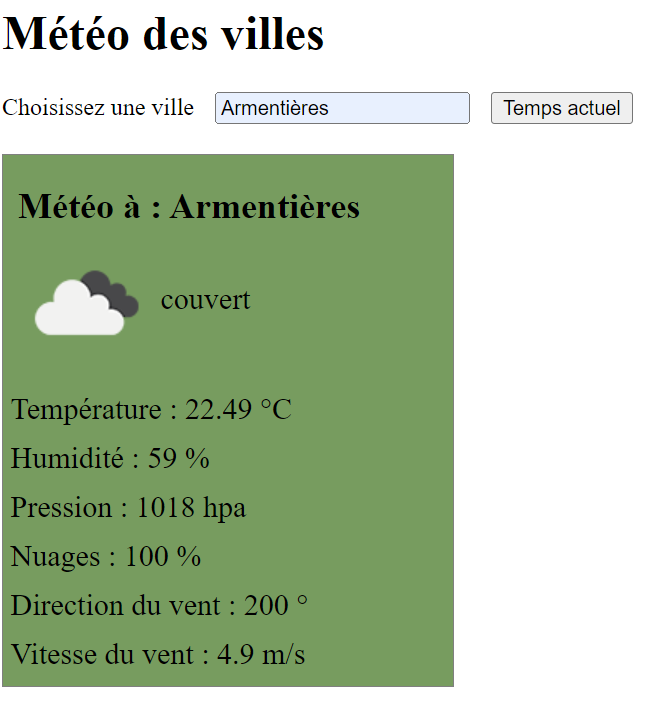
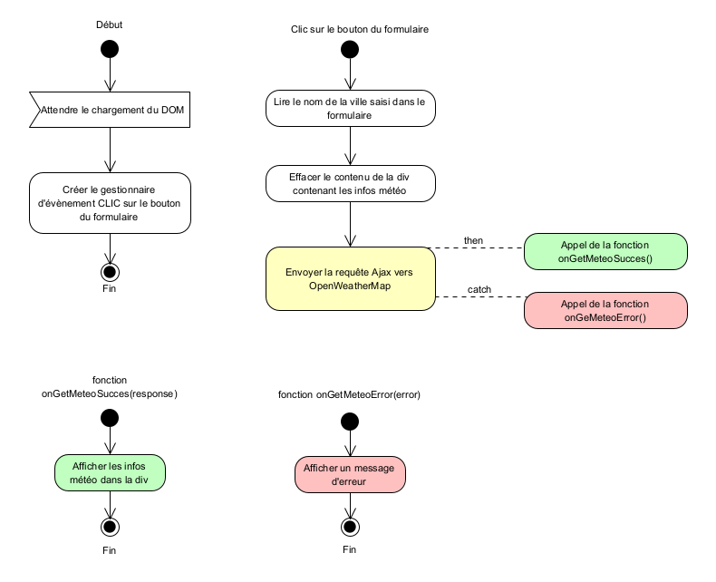

# TP Affichage des données météo

> * Auteur : Alain BRASSART
> * Date de publication : 26/09/2023
> * OS: Windows 10 (version 22H2)
> * VS Code : version 1.82.1 (system setup)
> * Chrome : version 93.0.4577.82 (Build officiel) (64 bits)

 [Licence Creative Commons](https://creativecommons.org/licenses/by-nc-sa/3.0/fr/)

## 1 Objectif

L'objectif de ce projet est de réaliser une page web qui permette d'afficher les informations météorologiques. Les informations en question seront affichées pour une ville dont le nom est saisie dans une zone d'édition. 

Exemple d'aperçu :



## 2 L'API d'OpenWeatherMap


**OpenWeatherMap** est un service en ligne, apartenant à OpenWeather Ltd, qui fournit des données météorologiques mondiales via plusieurs API.

Ces API permettent entr'autre de récupérer les données météorologiques actuelles ou les prévisions pour n'importe quel emplacement géographique.

Pour pouvoir utiliser les API OpenWeatherMap, il faut commencer par s'enregistrer sur le site officiel https://home.openweathermap.org/ avec une adresse mail valide.

Une fois votre compte créé, vous devez vous loguer sur le site à partir de votre adresse mail puis récupérer votre clé d'API (API Key) en déroulant le menu situé sous votre login.

Cette clé devra être ajoutée dans toutes vos requêtes vers le service web.

URL permettant de récupérer les données météo d'Armentières :

Current weather data :

http://api.openweathermap.org/data/2.5/weather?q=armentieres,fr&lang=fr&APPID=xxxxxxxxx

avec xxxxxxxxx votre clé d'API

Réponse JSON pour Current weather data

```json
{
    "coord": {
        "lon": 2.88,
        "lat": 50.69
    },
    "weather": [
        {
            "id": 500,
            "main": "Rain",
            "description": "légères pluies",
            "icon": "10d"
        }
    ],
    "base": "cmc stations",
    "main": {
        "temp": 274.931,
        "pressure": 1019.84,
        "humidity": 91,
        "temp_min": 274.931,
        "temp_max": 274.931,
        "sea_level": 1031.87,
        "grnd_level": 1019.84
    },
    "wind": {
        "speed": 7.75,
        "deg": 209.003
    },
    "rain": {
        "3h": 0.61
    },
    "clouds": {
        "all": 88
    },
    "dt": 1448349579,
    "sys": {
        "message": 0.0028,
        "country": "FR",
        "sunrise": 1448349471,
        "sunset": 1448380320
    },
    "id": 3036903,
    "name": "Armentieres",
    "cod": 200
}
```

## 3. Travail demandé 

* Le nom de la ville devra être saisi dans un formulaire

* Les informations météo seront affichées dans un bloc ```<div>``` dont le contenu sera construit entièrement de manière dynamique par le code JavaScript.

* Créer la requête AJAX avec ```fetch()``` pour récupérer les données de OpenWeatherMap pour la ville saisie (pour le temps actuel).
  
* Cette requête devra être envoyée au serveur lors du clic sur le bouton du formulaire.

* Mettre en forme les données correspondant au temps actuel en affichant dans la ```<div>``` la description du temps et son icône, la température, la vitesse du vent, la pression atmosphérique et le taux d'humidité.

Fonctionnement complet désiré :


