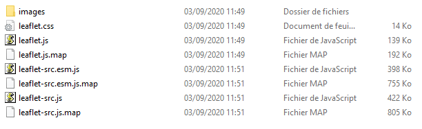
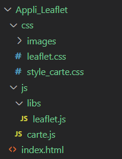
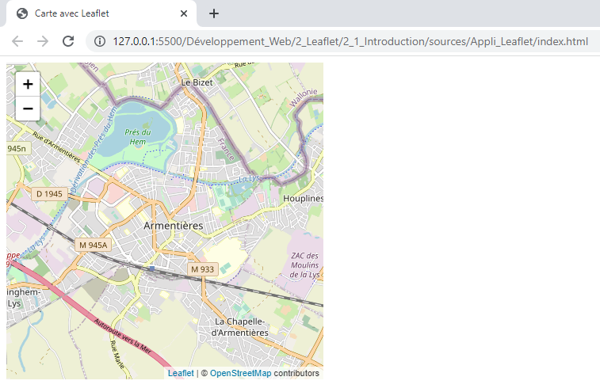
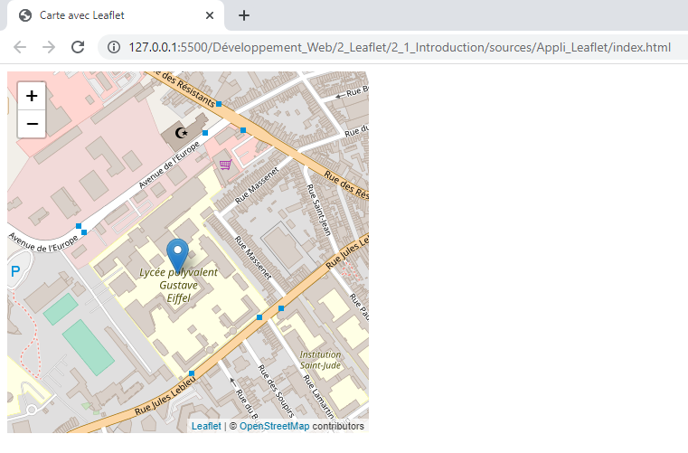
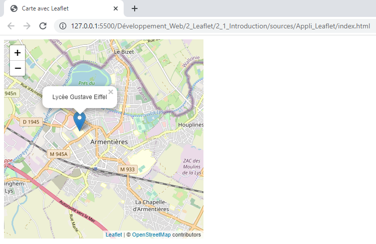
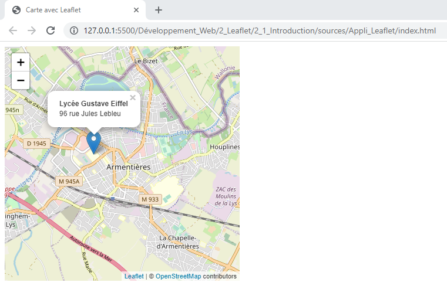
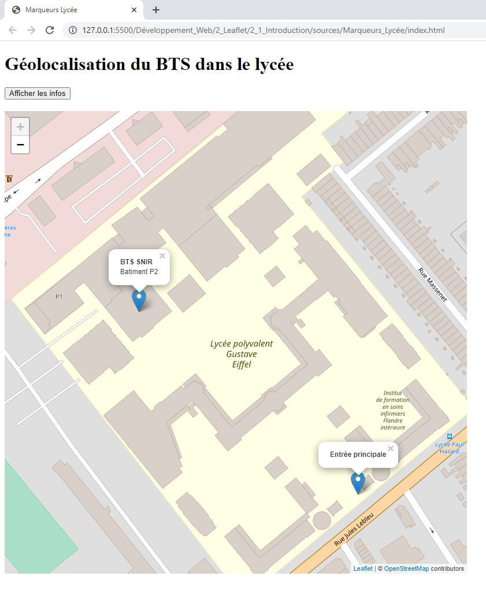
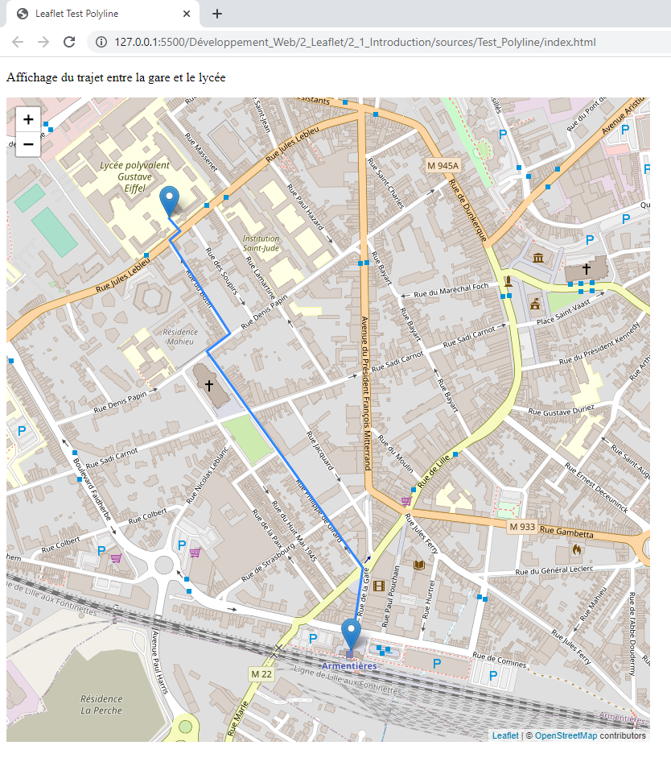
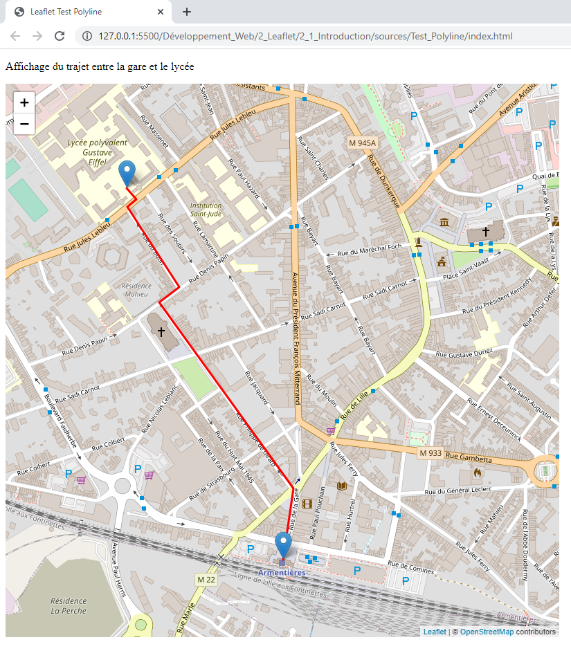

# Introduction à l'utilisation de Leaflet

> * Auteur : Alain BRASSART
> * Date de publication : 22/11/2021
> * OS: Windows 10 (version 20H2)
> * VS Code : version 1.62.0 (system setup)
> * Chrome : version 87.0.4280.141

 [Licence Creative Commons](https://creativecommons.org/licenses/by-nc-sa/3.0/fr/)

## Sommaire

  - [1. Qu'est ce que Leaflet ?](#1-quest-ce-que-leaflet-)
  - [2. Intégrer une carte avec Leaflet dans l'application](#2-intégrer-une-carte-avec-leaflet-dans-lapplication)
    - [2.1 Télécharger Leaflet](#21-télécharger-leaflet)
    - [2.2 Ajouter la librairie au projet](#22-ajouter-la-librairie-au-projet) 
    - [2.3 Configurer les fichiers HTML et CSS du projet](#23-configurer-les-fichiers-html-et-css-du-projet)
    - [2.4 Créer la carte dans le fichier JavaScript](#24-créer-la-carte-dans-le-fichier-javascript)
    - [2.5 Aperçu du résultat](#25-aperçu-du-résultat)
  - [3. Placer des informations sur la carte en utilisant des marqueurs](#3-placer-des-informations-sur-la-carte-en-utilisant-des-marqueurs)
    - [3.1 Créer et afficher un marqeur](#31-créer-et-afficher-un-marqeur)
    - [3.2 Ajouter un pop-up au marqueur](#32-ajouter-un-pop-up-au-marqueur)
    - [3.3 Effacer un marqueur](#33-effacer-un-marqueur)
    - [Activité: géolocaliser le site du BTS sur une carte](#activité--géolocaliser-le-site-du-bts-sur-une-carte)
  - [4. Tracer un trajet avec une polyline](#4-tracer-un-trajet-avec-une-polyline)
    - [4.1 Créer et afficher une polyline](#41-créer-et-afficher-une-polyline) 
    - [4.2 Modifier la couleur de la polyline](#42-modifier-la-couleur-de-la-polyline)
    - [4.3 Effacer une polyline](#43-effacer-une-polyline) 
  

## 1. Qu'est ce que Leaflet ?


Leaflet (http://leafletjs.com/) est une bibliothèque JavaScript, "open source", permettant d'afficher des cartes interactives dans une page web. C'est une alternative à l'API Google Maps qui est devenue payante.

Leaflet permet entre autres de :
* charger différentes cartes avec différents styles
* tracer des zones (polygones, cercles) sur la carte
* ajouter des marqueurs 
* gérer les intéractions (clics) et afficher des popups

**Attention**, il ne faut pas confondre Leaflet avec un fournisseur de carte. Leaflet est une bibliothèque chargée d'afficher et de gérer les intéractions avec une carte qu'on lui fourni.

Les fournisseurs de carte mettent à dispositions des Tiles (des tuiles en français) qui correspondent à des images d'une zone du monde selon la latitude, la longitude et le zoom.

Certains fournisseurs sont gratuits, comme **OpenStreet Map**, d'autres sont payants mais avec des offres gratuites suffisantes pour la majorités des sites, comme **MapBox** par exemple.

## 2. Intégrer une carte avec Leaflet dans l'application

### 2.1 Télécharger Leaflet

Pour utiliser Leaflet dans un projet, il faut commencer par télécharger la bibliothèque sur le site https://leafletjs.com/download.html (choisir la dernière version stable 1.7.1 à ce jour) 

Il faut ensuite décompresser l'archive pour récupérer les fichiers qui devront être intégrés à l'application.

Contenu de la librairie **leaflet.zip**



### 2.2 Ajouter la librairie au projet

* Copier dans le dossier ```css``` du projet :
  * le dossier ```images``` de Leaflet (pour les marqueurs)
  * le fichier ```leaflet.css```

* Copier le fichier ```leaflet.js``` dans le dossier ```js/libs``` 

* Structure du projet

  

### 2.3 Configurer les fichiers HTML et CSS du projet 

Ajouter les liens vers la feuille de style ```leaflet.css``` et la librairie ```leaflet.js``` dans l'entête du fichier ```index.html``` en plus des liens vers la feuille de style et le script du projet

```html
<head>
  <!--      -->
  <link rel="stylesheet" href="css/leaflet.css">
  <link rel="stylesheet" href="css/style_carte.css">
  <script src="js/libs/leaflet.js" defer></script>
  <script src="js/carte.js" defer></script>
  <!--      -->
</head>
```
Ajouter une balise ```<div>``` pour afficher la carte

```html
<body>
    <div id="divCarte"></div>
</body>
```
Compléter le fichier ```css``` du projet pour fixer les dimensions de la div contenant la carte 

```css
#divCarte
{
    height: 400px;
    width: 400px;
}
```
### 2.4 Créer la carte dans le fichier JavaScript

Pour créer une carte, il faut ajouter dans le fichier JavaScript les instructions qui permettent de réaliser les opérations suivantes :

* créer et initialiser un objet ```map``` de Leaflet qui sera rattaché à la div prévue pour afficher la carte

```javascript
let carte = L.map("divCarte").setView([50.6873,2.88033],13);
```
La méthode ```setView()``` permet de choisir la position géographique sur laquelle sera centrée la carte ainsi que le niveau de zoom initial

* charger le fond cartographique à partir des ressources proposées par un fournisseur de carte (OpenStreetMap par exemple)

```javascript
L.tileLayer('https://{s}.tile.openstreetmap.org/{z}/{x}/{y}.png').addTo(carte);
```
La fonction ```tileLayer()``` permet de choisir l'URL à partir de laquelle le fond cartographique sera importé puis la fonction ```addTo()``` est appelée pour ajouter le fond à la carte.

> Généralement, on ajoute un lien de référence vers le fournisseur de carte utilisé 

```javascript
L.tileLayer('https://{s}.tile.openstreetmap.org/{z}/{x}/{y}.png', {
    attribution: '&copy; <a href="https://www.openstreetmap.org/copyright">OpenStreetMap</a> contributors'
}).addTo(carte);
```
### 2.5 Aperçu du résultat

Au chargement de la page, on obtient le résultat suivant :



## 3. Placer des informations sur la carte en utilisant des marqueurs

Un marqueur permet de repérer un emplacement précis sur la carte, il est représenté par une icône en forme de punaise.


### 3.1 Créer et afficher un marqeur

Pour ajouter un marqueur il faut tout d'abord le créer en appelant la méthode ```marker()``` depuis l'objet ```L``` de la librairie. Cette méthode prend en paramètre la position géographique du marqueur. 

Une fois créé, le marqueur peut être placé sur la carte en appelant la fonction ```addTo()``` qui prend en paramètre la variable stockant la carte.

```javascript
let lyceeMarker = L.marker([50.68899508457428,2.8718090057373047]).addTo(carte);
```
Aperçu du résultat



### 3.2 Ajouter un pop-up au marqueur

Il est possible d'associer au marqueur une info-bulle (appelée aussi pop-up) qui permet d'afficher des informations lorsque l'utilisateur clique dessus.

Pour cela, il faut appeler la méthode ```bindPopup()``` et lui passer en paramètre le contenu de l'info-bulle

```javascript
lyceeMarker.bindPopup("Lycée Gustave Eiffel");
```
Aperçu du résultat



> Le contenu de la pop-up peut être du code HTML

```javascript
lyceeMarker.bindPopup("<strong>Lycée Gustave Eiffel</strong><br>96 rue Jules Lebleu");
```
Aperçu du résultat



> Il est également possible d'afficher un pop-up sans devoir cliquer sur le marqueur en utilisant la fonction ```openPopup()```

```javascript
lyceeMarker.bindPopup("<strong>Lycée Gustave Eiffel</strong><br>96 rue Jules Lebleu");
lyceeMarker.openPopup();
```

> Par défaut, Leaflet n'autorise que l'affichage d'un seul pop-up à la fois et le ferme dès que l'utilisateur clique sur la carte. Il est possible de modifier ce comportement en utilisant les options ```closeOnClick``` et ```autoClose``` de la fonction ```bindPopup()```

```javascript
lyceeMarker.bindPopup("<strong>Lycée Gustave Eiffel</strong><br>96 rue Jules Lebleu",{ closeOnClick: false, autoClose: false });
lyceeMarker.openPopup();
```
### 3.3 Effacer un marqueur

Pour effacer un marqueur, il suffit d'utiliser la méthode ```removeLayer()```. Cette méthode doit être appelée depuis l'objet correspondant à la carte et prend en paramètre la variable contenant le marqueur qui doit être supprimé.

```javascript
carte.removeLayer(lyceeMarker);
```

### Activité \: géolocaliser le site du BTS sur une carte

On souhaite afficher dans une page web la carte du Lycée et ajouter deux marqueurs pour repérer d'une part l'entrée principale du Lycée et d'autre part le batiment P2 dans lequel se situe les locaux du BTS. Pour cela, il est demandé de respecter les points suivants :

* Au chargement la page, la carte devra être affichée et centrée sur le lycée avec un niveau de zoom suffisant pour afficher la totalité des batiments.
* Pour l'affichage de la carte on utilisera une div de 800px par 800px
* Un bouton permettra à l'utilisateur d'afficher les informations souhaitées à savoir    
  * les marqueurs correspondant aux positions géographiques de l'entrée principale et du batiment P2.
  * les infos-bulle associées à ces marqueurs (celles-ci devront s'afficher sans devoir cliquer sur les marqueurs)

> Les coordonnées géographiques des points particulier peuvent être récupérées en se rendant sur le site http://maps.google.fr. Il suffit d'afficher une carte contenant ce point puis d'effectuer un clic gauche sur ce point pour afficher les coordonnées. Celles-ci peuvent être copiées dans le presse papier en cliquant dessus dans le menu contextuel qui s'affiche. Pour repérer les lieux du lycée, afficher la carte en mode sattelite.

Aperçu du résultat attendu :



## 4. Tracer un trajet avec une polyline

Les polylines permettent d'afficher sur la carte un trajet passant par plusieurs points.

### 4.1 Créer et afficher une polyline

Pour ajouter un trajet sur la carte, il faut tout d'abord le créer en appelant la méthode ```polyline()``` depuis l'objet ```L``` de la librairie. Cette méthode prend en paramètre un tableau qui contiendra la succession des positions géographiques correspondant aux différents points de passage. 

Une fois créé, le trajet peut être placé sur la carte en appelant la fonction ```addTo()``` qui prend en paramètre la variable stockant la carte.

Exemple : tracé du trajet entre la gare et le lycée

```javascript
// Marqueurs pour repérer le début et la fin du trajet
let gareMarker = L.marker([50.680831393096696, 2.8776068991072656]).addTo(carte);
let lyceeMarker = L.marker([50.68813888375319, 2.8727590866854777]).addTo(carte);

// Tableau contenant la liste des points de passage
let tabPoints = [
    [50.680831393096696, 2.8776068991072656],
    [50.68223371543466, 2.8779227662148408],
    [50.685901516198555, 2.8737627599994187],
    [50.686196422711156, 2.8743873427307904],
    [50.68777241434704, 2.872771369053221],
    [50.687917841917546, 2.8730463056412296],
    [50.68813888375319, 2.8727590866854777]
];

// Création et affichage sur la carte de la polyline correspondant au trajet
let trajet = L.polyline(tabPoints).addTo(carte);
```
Aperçu du résultat



### 4.2 Modifier la couleur de la polyline

Il est possible de choisir la couleur avec laquelle on souhaite tracer la polyline en utilisant l'option ```color``` dans la fonction ```polyline()```

```javascript
let trajet = L.polyline(tabPoints, {color: 'red'}).addTo(carte);
```



### 4.3 Effacer une polyline

Comme pour effacer un marqueur, il suffit d'utiliser la méthode ```removeLayer()```. Cette méthode doit être appelée depuis l'objet correspondant à la carte et prend en paramètre la variable contenant la polyline qui doit être supprimée.

```javascript
carte.removeLayer(trajet);
```

