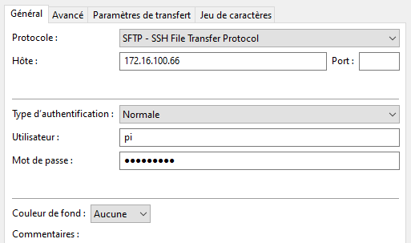
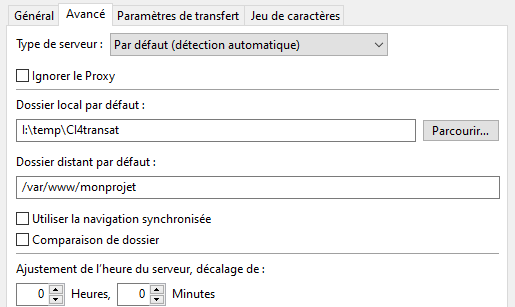
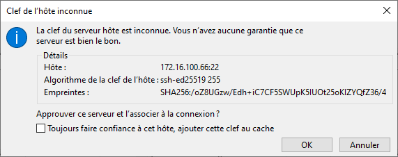
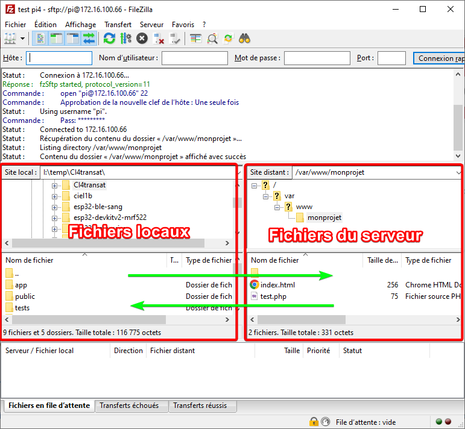
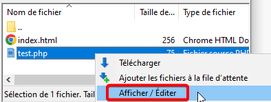

# Transférer des fichiers en utilisant SFTP

> * Auteur : Gwénaël LAURENT
> * Date : 28/03/2026
> * OS : Ubuntu 24.04.4 LTS (Noble Numbat) ```cat /etc/os-release```
> * Serveur SSH OpenSSH_9.6p1 ```ssh -V```
> * Apache/2.4.58 (Ubuntu) ```apache2 -v```
> * PHP 8.3.6 ```php --version```
> * mariadbd  Ver 10.11.14-MariaDB-0ubuntu0.24.04.1 ```mariadbd --version```
> * phpMyAdmin Version : 5.2.1deb3


 [Licence Creative Commons](https://creativecommons.org/licenses/by-nc-sa/3.0/fr/)

- [Transférer des fichiers en utilisant SFTP](#transférer-des-fichiers-en-utilisant-sftp)
- [1. Prérequis](#1-prérequis)
- [2. Présentation de LAMP](#2-présentation-de-lamp)
- [3. Objectifs](#3-objectifs)
- [4. Transfert SFTP avec FileZilla](#4-transfert-sftp-avec-filezilla)

# 1. Prérequis
Avant d'utiliser ce tuto, assurez vous d'avoir :
* Installé Ubuntu
* Mis à jour l'OS : `sudo apt update && sudo apt upgrade`
* Installé et configuré un serveur SSH

> **Remarque** : Dans ce tuto, j'utilise Ubuntu 24.04.4 LTS dans une VM virtualbox\
> -utilisateur : admin-a01\
> -nom de machine : admin-a01-VirtualBox\
> -addresse IP de la VM Ubuntu : 172.16.111.87 (client DHCP)


# 2. Présentation de LAMP
LAMP est l'acronyme de ```Linux Apache MySQL PHP```.

Installer LAMP sur Linux correspond à :
* installer le serveur web Apache
* installer le module PHP d'Apache
* installer le serveur de bases de données MySQL (ou MariaDB)
* installer phpMyAdmin (site web d'administration de MySQL)
* **fournir un moyen pour mettre à jour les fichiers du site web (SFTP)**


# 3. Objectifs
L'administrateur du site web (```admin-a01```) doit pouvoir transférer les fichiers du site web (html, php, css, jpg, ...) depuis sont ordinateur de développement vers le serveur de déploiement apache.

**Ce transfert doit pouvoir s'effectuer à distance et de manière sécurisée.**

Pour copier les fichiers de votre site dans la racine physique du site web d'apache, il existe plusieurs moyens :

* **```FTP```** (File Transfer Protocol) : 
  * Méthode historique
  * Non sécurisé (pas de chiffrement des communications)
  * NE PAS UTILISER

* **```FTPS```** (File Transfer Protocol over SSL/TLS) :
  * Ressemble au FTP mais les communications sont cryptées en SSL/TLS (comme le HTTPS)
  * Deux méthodes : avec chiffrement explicite ou avec chiffrement implicite.

* **```SFTP```** (SSH File Transfer Protocol) :
  * Utilise SSH pour transférer les fichiers en chiffrant les communications
  * Il suffit d'installer un serveur SSH (OpenSSH)
  * Un seul port utilisé (TCP/22)


# 4. Transfert SFTP avec FileZilla
L'administrateur du site devra utiliser un logiciel client SFTP. Il pourra par exemple utiliser **```FileZilla Client```** ([filezilla-project.org](https://filezilla-project.org/))

**Configuration de FileZilla :**
Ouvrez le gestionnaire de site : File > Gestionnaire de sites\
Cliquez sur "Nouveau" pour configurer l'accès SFTP vers le serveur Apache

Dans l'onglet "Général" il faut sélectionner et remplir :
* Protocole : **SFTP** - SSH File Transfer Protocol
* Hôte : adresse du serveur Apache (dans mon cas 172.16.100.66)
* Type d'authentification : Normale (si c'est votre ordi, sinon "Demander le mot de passe")
* Utilisateur : ```pi```
* Mot de passe : (le mot de passe de pi)



Dans l'onglet "Avancé", vous pouvez éventuellement enregistrer les dossiers à ouvrir par défaut :



Toujours à partir du gestionnaire de sites, vous pouvez cliquez sur **Connexion** pour lancer la connexion au serveur.

La première connexion vous demande d'approuver la connexion chiffrée avec ce serveur. Vérifiez que c'est le bon serveur et cliquez sur OK



L'interface de FileZilla affiche les fichiers locaux à gauche et les fichiers du serveur à droite



Les transfert de fichiers s'effectuent en **drag-and-drop** :
* de gauche à droite pour uploader des fichiers locaux vers le serveur
* de droite à gauche pour télécharger des fichiers distants

Vous pouvez aussi utiliser le menu contextuel du clic droit sur un fichier/dossier.

> Filezilla vous affichera un message de confirmation si un conflit de nom se produit.

Vous pouvez éditer un fichier distant en faisant un clic droit dessus > Afficher / Editer



L'éditeur de votre choix affichera le contenu du fichier et vous pourrez éventuellement le modifier.\
Il faut fermer l'éditeur pour que les modifications soient uploadées sur le serveur !
