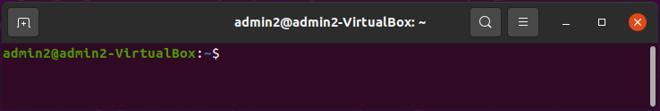
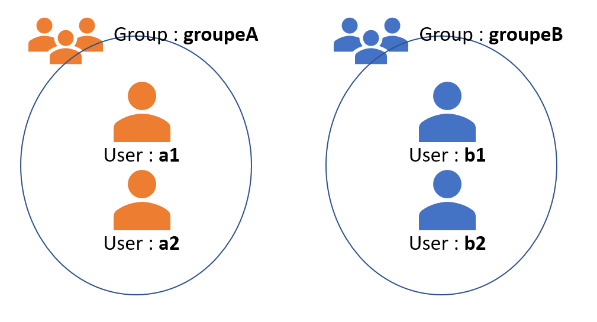
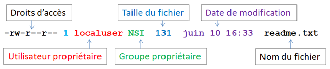
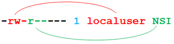
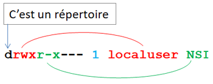
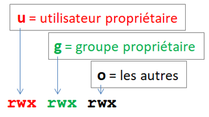
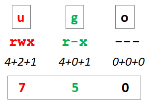
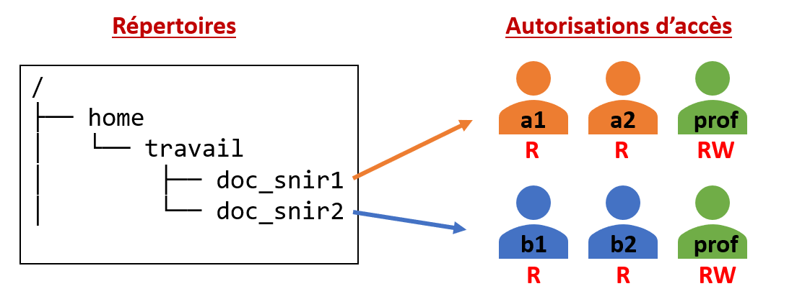

# TP : Droits et permissions d'accès aux fichiers

> * Auteur : Gwénaël LAURENT
> * Date : 7/11/2021


 [Licence Creative Commons](https://creativecommons.org/licenses/by-nc-sa/3.0/fr/)

- [TP : Droits et permissions d'accès aux fichiers](#tp--droits-et-permissions-daccès-aux-fichiers)
- [1. Présentation du TP](#1-présentation-du-tp)
  - [1.1 Objectifs](#11-objectifs)
  - [1.2 Eléments de cours](#12-eléments-de-cours)
  - [1.3 Machine Linux utilisée pour ce TP](#13-machine-linux-utilisée-pour-ce-tp)
- [2. Commandes de base pour se déplacer dans l'arborescence des fichiers](#2-commandes-de-base-pour-se-déplacer-dans-larborescence-des-fichiers)
- [3. Utilisateurs et groupes](#3-utilisateurs-et-groupes)
  - [3.1 Présentation](#31-présentation)
  - [3.2 Les utilisateurs et groupes dans ce TP](#32-les-utilisateurs-et-groupes-dans-ce-tp)
  - [3.3 Création d'utilisateur](#33-création-dutilisateur)
  - [3.4 Création de groupes](#34-création-de-groupes)
  - [3.5 Ajouter un utilisateur dans un groupe](#35-ajouter-un-utilisateur-dans-un-groupe)
- [4. Propriétaires des fichiers](#4-propriétaires-des-fichiers)
- [5. Les droits d'accès aux fichiers (permissions)](#5-les-droits-daccès-aux-fichiers-permissions)
  - [5.1 Présentation](#51-présentation)
  - [5.2 Les répertoires (ou dossier) : un cas particulier](#52-les-répertoires-ou-dossier--un-cas-particulier)
  - [5.3 Représentation des droits](#53-représentation-des-droits)
    - [Forme symbolique 'ugo'](#forme-symbolique-ugo)
    - [Forme numérique](#forme-numérique)
- [6. Changements des droits : **chmod**](#6-changements-des-droits--chmod)
  - [6.1 Exemples avec la forme symbolique](#61-exemples-avec-la-forme-symbolique)
  - [6.2 Exemples avec la forme numérique](#62-exemples-avec-la-forme-numérique)
- [7. Changement des proprétaires : **chown**](#7-changement-des-proprétaires--chown)
- [8. Exercice d'application](#8-exercice-dapplication)
  - [8.1 Objectifs](#81-objectifs)
  - [8.2 Création des répertoires](#82-création-des-répertoires)
  - [8.3 Création de l'utilisateur prof](#83-création-de-lutilisateur-prof)
  - [8.4 Modification des droits sur les répertoires](#84-modification-des-droits-sur-les-répertoires)
  - [8.5 Création de fichiers par le prof](#85-création-de-fichiers-par-le-prof)
  - [8.6 Tests des autorisations d'accès](#86-tests-des-autorisations-daccès)
  - [8.7 Droits sur les fichiers exécutables](#87-droits-sur-les-fichiers-exécutables)


# 1. Présentation du TP
## 1.1 Objectifs
* Utiliser les commandes shell
* Connaitre les commandes shell pour gérer les droits d'accès aux fichiers Linux

> **Toutes les manipulations de ce TP** doivent être réalisées via l'interpréteur de commandes Linux, **dans un terminal**. \
Vous trouverez un terminal dans la barre d'icônes de l'environnement graphique de Linux ou vous pouvez ouvrir un treminal avec la combinaison de touches **```Ctrl + Alt + T```**. 



## 1.2 Eléments de cours
* Consultez le document [Introduction à l'interpréteur de commandes UNIX](2.introduction_shell_unix.md)
* Consultez également [Wikipédia : Permissions UNIX](https://fr.wikipedia.org/wiki/Permissions_UNIX)
* Vous trouverez enfin un résumé sur la carte de référence Unix de Moïse Valvassori : [unix-refcard.pdf](unix-refcard.pdf)

## 1.3 Machine Linux utilisée pour ce TP
Vous utiliserez votre machine virtuelle Ubuntu 20.\
Logguez vous en **admin2**


# 2. Commandes de base pour se déplacer dans l'arborescence des fichiers
Logguez vous avec votre compte linux **admin2** et ouvrez un terminal.

1. Donnez la commande pour afficher le **```répertoire courant```** de l'utilisateur.
```


```
2. Donnez la commande pour afficher (sans changer de répertoire courant) le contenu du **```répertoire racine```**.
```


```
3. Donnez la commande pour vous déplacer dans le répertoire `etc` sous la racine en utilisant un **```chemin absolu```**
```


```
4. En partant du répertoire courant ```/etc```, donnez la commande pour vous déplacer dans le **```répertoire personnel```** de l'utilisateur admin2 en utilisant un **```chemin relatif```**
```


```

5. Donnez la commande qui permet de se déplacer dans le **```répertoire personnel de l'utilisateur logué```**, quelque soit le nom de l'utilisateur
   
```


```

# 3. Utilisateurs et groupes
## 3.1 Présentation
> Linux est un système multi-utilisateurs : sur la même machine, plusieurs utilisateurs peuvent se logguer en même temps.

Chaque personne qui utilise un système UNIX est authentifié par un `utilisateur`. Un utilisateur est reconnu par un nom unique et un numéro unique **```UID```** (la correspondance nom/numéro est stockée dans le fichier `/etc/passwd`).

Un utilisateur UNIX appartient à un ou plusieurs `groupes`. Les groupes servent à rassembler des utilisateurs afin de leur attribuer des droits communs. Un groupe est reconnu par un nom unique et un numéro unique **```GID```** (la correspondance nom/numéro et la liste des utilisateurs membres de chaque groupe sont stockées dans le fichier `/etc/group`)

La commande `id` permet de visualiser votre identifiant d'utilisateur (`uid`), votre groupe principal (`gid`) ainsi que les   groupes auxquels vous appartenez. 

1. Donnez le résultat de la commande `id` pour l'utilisateur admin2
```


```

> Remarque : La commande `id user1` permet d'afficher le même type d'information pour l'utilisateur `user1`

Dans un shell, la commande **```cat```** permet d'afficher le contenu d'un fichier. Il suffit de fournir le nom de ce fichier en *```argument```* de la commande cat.

1. Donnez les commandes qui permettent d'afficher le contenu des fichiers `/etc/passwd` et `/etc/group`
```


```
3. A partir du contenu de ces fichiers, en vous inspirant de la ligne correspondant à votre utilisateur, donnez l'UID de l'utilisateur `root`
```


```
> L’utilisateur **```root```** (racine) est un utilisateur particulier qui dispose de tous les droits sur le système, on dit qu'il dispose des droits d'administration, c'est le *```super-utilisateur```*.\
> On ne se loggue JAMAIS en tant que root ! Si on a besoin de faire des tâches d'administration, on utilise la commande shell **```sudo```** qui permet d'avoir temporairement les droits de root.

## 3.2 Les utilisateurs et groupes dans ce TP
La suite de ce document détaille la création de ces utilisateurs et groupes.



## 3.3 Création d'utilisateur
Pour créer un nouvel utilisateur linux, vous pouvez utiliser le script **```adduser```**. Il faut avoir les droits d'accès root pour exécuter cette commande. On utilise donc la ligne de commande suivante :

```
sudo adduser nom_du_nouvel_utilisateur
```
Il faut ensuite :
* Saisir le mot de passe de root (identique à celui de admin2, premier utilisateur créé pendant la phase d'installation de Linux)
* Choisir un mot de passe pour le nouvel utilisateur
* Saisir les coordonnées de l'utilisateur (Appuyer sur "Entrée" si vous ne voulez pas saisir ces informations)

> Remarque : Pour supprimer un utilisateur, il faut utiliser la commande ```sudo deluser nom_de_l_utilisateur```

1. Créez 4 nouveaux utilisateurs **```a1```**, **```a2```**, **```b1```** et **```b2```** avec des mots de passe identiques au nom d'utilisateur (utilisateur "a1", mot de passe "a1", ...). Donnez les commandes utilisées.
```


```

2. Pour chacun de ces 4 nouveaux utilisateurs, donnez l'UID de l'utilisateur, le groupe principal de l'utilisateur (nom + GID) et les groupes dont il fait partie. Vous donnerez également la commande shell utilisée.
```


```

**``Ouvrez une deuxième fenêtre de terminal``**. Changez d'utilisateur dans ce terminal pour être identifié comme `a1`. Utilisez la commande :
```
su - a1
```

3. A quoi sert la commande **```su```** ? A quoi sert le tiret "-" dans la commande ? Utilisez le **manuel en ligne** de la commande su pour obtenir la réponse à ces questions.
```


```

4. Dans le terminal de a1, donnez le **```prompt```** de a1. En comparant avec le prompt de l'utilisateur admin2, détaillez la composition du prompt sur un Linux Ubuntu.
```


```

5. Dans le terminal de a1, comment faites vous pour afficher le **```répertoire personnel```** de a1 ?
```


```

## 3.4 Création de groupes
Pour créer un nouveau goupe linux, vous pouvez utiliser le script **```addgroup```**. Il faut avoir les droits d'accès root pour exécuter cette commande. On utilise donc la ligne de commande suivante :

```
sudo addgroup nom_du_groupe
```

> Remarque : Pour supprimer un groupe, il faut utiliser la commande ```sudo delgroup nom_du_groupe```

1. Dans le terminal de admin2, créez deux nouveau groupes linux **```groupeA```** et **```groupeB```**. Donnez les commandes utilisées.
```


```

2. Quels sont les GID des 2 nouveaux groupes créés ? Comment faites vous pour trouver cette information après avoir créé les groupes ?
```


```

## 3.5 Ajouter un utilisateur dans un groupe
Pour qu'un utilisateur fasse partie d'un nouveau groupe il faut utiliser la commande :

```
sudo adduser nom_de_l_utilisateur nom_du_groupe 
```

> Remarque : Pour retirer l'utilisateur d'un groupe, il faut utiliser la commande ```sudo deluser nom_de_l_utilisateur nom_du_groupe```

1. Ajoutez les utilisateurs **```a1```** et **```a2```** au groupe **```groupeA```**. Puis ajoutez les utilisateurs **```b1```** et **```b2```** au groupe **```groupeB```**. Donnez les commandes utilisées.
```


```

2. Donnez deux méthodes pour vérifier que les utilisateurs font bien partie des groupes groupeA ou groupeB ?
```


```

# 4. Propriétaires des fichiers
Tout fichier UNIX possède un `utilisateur propriétaire`. Au départ, c'est l'utilisateur qui a créé le fichier. Seul le propriétaire du fichier et le super utilisateur (root) peuvent changer les droits d'accès au fichier.

Un fichier UNIX appartient aussi à un `groupe propriétaire`. Ceci donne pleinement son sens à la notion de groupe. On définit ainsi les actions du groupe sur ce fichier.

Pour afficher les propriétaires d'un fichier ou d'un dossier, on utilise la commande \
`ls -l nom_du_fichier` :



1. A quoi sert la commande **```ls```** ? A quoi sert l'option "-l" dans la commande ? Utilisez le **manuel en ligne** de la commande ls pour obtenir la réponse à ces questions.
```


```

2. Donnez l'utilisateur propriétaire et le groupe propriétaire du fichier `/etc/passwd`.
```


```
3. Ouvrez une troisième fenêtre de terminal et changez d'utilisateur dans ce terminal pour être identifié comme `a2`. Dans ce terminal, vous allez créé un fichier `message` à la racine du répertoire personnel de a2. Ce fichier contiendra le texte `coucou`. 

> Pour créer un nouveau fichier ou lire/modifier le contenu d'un fichier existant, vous pouvez utiliser l'application console **```nano```** qui est présente sur la majorité des distributions linux.
> ```
> nano nom_du_fichier
> ```
> Si le nom de fichier passé en argument n'existe pas, nano permettra de le créé (dans le répertoire courant si vous ne fournissez pas de chemin absolu)\
> Dans nano :
> * ```Ctrl+O``` pour enregistrer les modifications
> * ```Ctrl+X``` pour quitter

4. Quels sont les propriétaires du fichier `message`. Donnez la commande utilisée.
```


```

# 5. Les droits d'accès aux fichiers (permissions)
## 5.1 Présentation
Les droits d'accès gèrent quelles actions les utilisateurs ont le droit d'effectuer sur les fichiers (lecture **R**, écriture **W** et exécution **X**), selon qu'ils sont propriétaire du fichier, membre du groupe propriétaire du fichier ou ni l'un ni l'autre (_les autres_). 

> Les permissions d'accès aux fichiers suivent la norme [POSIX](https://fr.wikipedia.org/wiki/POSIX), elles sont inspirées des permissions d'accès UNIX.



Dans cet exemple : 
* L'utilisateur propriétaire `localuser` a les droits `rw-` donc il a les droits de lecture et de modification (et pas d'exécution) sur le fichier.

* Le groupe propriétaire `NSI` a les droits `r--` donc tous les utilisateurs membres du groupe `NSI` ont seulement le droit de lire le fichier (pas de modification ni d'exécution).

* Les autres utilisateurs (`Others`) ont les droits `---`, donc les utilisateurs qui ne sont pas `localuser` et qui ne font pas partie du groupe `NSI` n'ont aucun droit d'accès sur le fichier (ni lecture, ni modification, ni d'exécution)

1. L'utilisateur **```a1```** a-t-il le droit de **modifier** le contenu du fichier `/etc/passwd` ? Justifiez votre réponse et donnez les commandes utilisées pour cela.
```


```

## 5.2 Les répertoires (ou dossier) : un cas particulier


Pour un répertoire, les droits d'accès `rwx` ont une signification particulière :

* `r` signifie qu'on peut afficher la `liste des fichiers` contenus à la racine de ce répertoire (avec `ls` par exemple)
* `w` signifie qu'on peut `écrire` dans ce répertoire (création, suppression, renommage des fichiers)
* `x` signifie qu'on peut `accéder` au contenu du répertoire (pour ouvrir un fichier ou se déplacer dans un sous-répertoire)

1. L'utilisateur **```a1```** peut-il accéder au répertoire personnel de **```a2```** ? Justifiez votre réponse.
```


```
2. L'utilisateur **```a1```** peut-il créer un nouveau fichier dans le répertoire /home/a2 ? Justifiez votre réponse.
```


```

3. L'utilisateur **```a1```** peut-il **modifier** le fichier existant /home/a2/message ? Justifiez votre réponse
```


```

## 5.3 Représentation des droits
### Forme symbolique 'ugo'
Les droits sont affichés par une série de 9 caractères (rwxrwxrwx). Associés 3 par 3 (rwx rwx rwx) ils définissent les droits des 3 identités (`u` = user, `g` = group et `o` = others).



### Forme numérique
Une autre manière de représenter ces droits est sous forme `octale`. Chaque « groupement » de droits `rwx` sera représenté par un chiffre et à chaque droit correspond une valeur.
* r  = 4
* w  = 2
* x  = 1
* \- = 0



1. Donnez la représentation numérique des droits d'accès de `/root`, `/etc`, `/etc/shadow` et du répertoire personnel de admin2
```


```


# 6. Changements des droits : **chmod**
> Pour l'utilisation des commandes chmod et chown, consultez le [Wiki Ubuntu-fr : Gérer les droits d'accès §3 Modifier les permissions](https://doc.ubuntu-fr.org/permissions#modifier_les_permissions) ([ou copie locale en PDF](Wiki-Ubuntu-fr_Gerer-les-droits-d-acces.pdf))

Le changement de droits s'effectue avec la commande **```chmod```** (*change mode* - changer les permissions).

## 6.1 Exemples avec la forme symbolique

Enlever le droit d'écriture pour les autres.
```
chmod o-w fichier3
```
On peut aussi combiner plusieurs actions en même temps :
```
chmod u+rwx,g+rx-w,o+r-wx fichier3
```
* On ajoute la permission de lecture, d'écriture et d'exécution sur le fichier fichier3 pour le propriétaire
* On ajoute la permission de lecture et d'exécution au groupe propriétaire, on retire la permission d'écriture
* On ajoute la permission de lecture aux autres, on retire la permission d'écriture et d'exécution.

## 6.2 Exemples avec la forme numérique

Affecter les droits `rwxr-x---` au fichier3 :
```
chmod 750 fichier3
```

1. Modifiez les droits du fichier /home/a2/message pour ajouter le droit d'écriture aux autres (Others). Donnez la commande utilisée et les nouveaux droits sur le fichier.
```


```

2. L'utilisateur **```a1```** peut-il maintenant **modifier** le fichier /home/a2/message ? Justifiez votre réponse en prenant également en compte les droits d'accès au dossier /home/a2
```


```

# 7. Changement des proprétaires : **chown**
> Pour l'utilisation des commandes chmod et chown, consultez le [Wiki Ubuntu-fr : Gérer les droits d'accès §3 Modifier les permissions](https://doc.ubuntu-fr.org/permissions#modifier_les_permissions) ([ou copie locale en PDF](Wiki-Ubuntu-fr_Gerer-les-droits-d-acces.pdf))

Le changement de propriétaire ou de groupe propriétaire s'effectue avec la commande **```chown```** (*change owner* - changer le propriétaire).

Exemple pour changer en une seule commande le propriétaire et le groupe du fichier :
```
chown toto:lesPotes fichier1
```
Pour ne changer que le proprétaire :
```
chown toto fichier1
```
Pour ne changer que le groupe proprétaire :
```
chown :lesPotes fichier1
```


# 8. Exercice d'application

## 8.1 Objectifs
L'objectif est de créer des répertoires partagés pour certains utilisateurs seulement.



* Le répertoire doc_snir1 est accessible en lecture seule à a1 et a2.
* Le répertoire doc_snir2 est accessible en lecture seule à b1 et b2.
* L'utilisateur prof a accès en lecture et écriture aux répertoires doc_snir1 et doc_snir2.
* Seul l'utilisateur prof peut créer ou modifier des fichiers dans les répertoires.
* Les autres utilisateurs (par exemple, admin2) ne doivent pas avoir accès au contenu des répertoires doc_snir1 et doc_snir2. (Ils peuvent cependant voir la présence de ces répertoires)

## 8.2 Création des répertoires
Créez l'arborescence de dossiers suivante.
```
/
├── home
│   └── travail
│        ├── doc_snir1
│        └── doc_snir2
```

Donnez les commandes utilisées
```


```

## 8.3 Création de l'utilisateur prof
Créez un nouvel utilisateur **```prof```** (mot de passe "prof").

Donnez les commandes utilisées
```


```

## 8.4 Modification des droits sur les répertoires
Modifiez les propriétaires et les droits des dossiers travail, doc_snir1 et doc_snir2 pour avoir les autorisations d'accès désirées.

Donnez les commandes utilisées
```


```

## 8.5 Création de fichiers par le prof
Dans un terminal loggué en tant que prof, créez les 2 fichiers tpsnir1.md et tpsnir2.md dans leur dossier doc_snir1 et doc_snir2
```
/
├── home
│   └── travail
│        ├── doc_snir1
│        │      └── tpsnir1.md
│        └── doc_snir2
│               └── tpsnir2.md
```

Donnez les commandes utilisées
```


```


## 8.6 Tests des autorisations d'accès
> Attention : Pensez mettre à jour les informations de vos terminaux ouverts (appartenance aux groupes). Il suffit de se délogguer avec ```logout``` et de se reconnecter avec ```su - nom_d_utilisateur```

Testez les accès pour tous les utilisateurs (a1,a2,b1,b2,prof et admin2).

Pensez à tester les droits de lecture ET d'écriture.

Donnez la liste des tests que vous réalisez
```


```


## 8.7 Droits sur les fichiers exécutables
Dans le répertoire `doc_snir1` le prof veut créer un fichier de script exécutable par les utilisateurs a1 et a2.

Le fichier de script s'appellera `salut` et contient le code suivant :
```
#!/bin/bash
echo Hello World

```
> Ce fichier contient le nom du shell à utiliser (première ligne, après #!) et une commande linux. On parle alors de fichier `script shell`.

Dans un terminal en tant que prof, créez le fichier `salut`. Donnez la commande utilisée :
```


```

Sous linux, pour lancer un fichier exécutable qui se trouve dans le répertoire courant, il faut saisir :
```
./salut
```
Tentez d'exécuter le script `salut`. Que se passe-t-il ?
```


```

Modifiez les droits du fichier sous **forme symbolique** de manière à ce que seul les utilisateurs prof, a1 et a2 puissent l'exécuter. Faites les tests d'exécution pour les 3 utilisateurs. Donnez les commandes utilisées.
```


```
