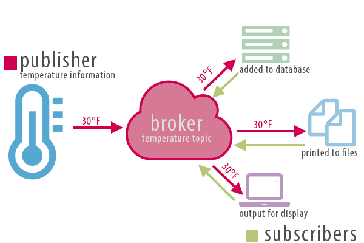
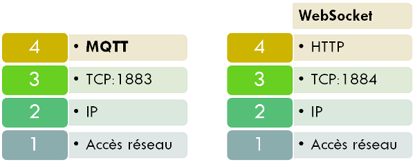
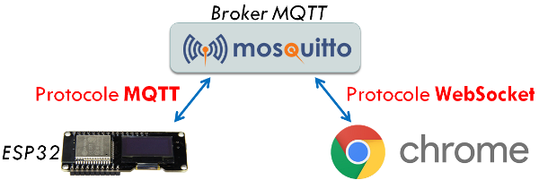
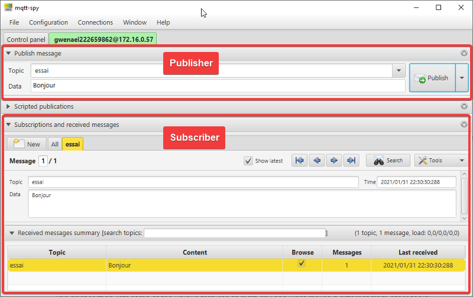

# Installer le broker MQTT mosquitto

> * Auteur : Gwénaël LAURENT
> * Date : 16/12/2023

 [Licence Creative Commons](https://creativecommons.org/licenses/by-nc-sa/3.0/fr/)

- [Installer le broker MQTT mosquitto](#installer-le-broker-mqtt-mosquitto)
- [1. MQTT (Message Queue Telemetry Transport)](#1-mqtt-message-queue-telemetry-transport)
  - [1.1 Présentation](#11-présentation)
  - [1.2 Implémentation](#12-implémentation)
  - [1.3 Avantages](#13-avantages)
  - [1.4 Inconvénients](#14-inconvénients)
- [2. Installation du broker Mosquitto sur Raspberry](#2-installation-du-broker-mosquitto-sur-raspberry)
  - [2.1 Installation du logiciel](#21-installation-du-logiciel)
  - [2.2 Vérification de l'installation de mosquitto](#22-vérification-de-linstallation-de-mosquitto)
  - [2.3 Configuration du broker mosquitto](#23-configuration-du-broker-mosquitto)
    - [2.3.1 Connexion anonymes à partir de n'importe quelle IP](#231-connexion-anonymes-à-partir-de-nimporte-quelle-ip)
    - [2.3.2 Authentifier les connexions](#232-authentifier-les-connexions)
- [3. Ajouter l'interfaçage WebSocket](#3-ajouter-linterfaçage-websocket)
  - [3.1 Pourquoi WebSocket ?](#31-pourquoi-websocket-)
  - [3.2 Configuration de mosquitto pour WebSocket](#32-configuration-de-mosquitto-pour-websocket)
- [4. Appli de test du broker MQTT](#4-appli-de-test-du-broker-mqtt)
- [5. Client websocket dans une page web](#5-client-websocket-dans-une-page-web)


> Ce tuto concerne l'installation de Mosquitto sur Raspberry mais est également valable pour une installation sur Linux Debian Buster (par exemple Ubuntu version > 18)

# 1. MQTT (Message Queue Telemetry Transport)
## 1.1 Présentation
Le protocole MQTT est un protocole de messagerie simple et léger, basé sur une **```architecture « publish/subscribe »```** spécifiquement conçue pour des applications M2M (Machine To Machine) et très utilisé dans l’IoT (Internet of Things). 

L’architecture publish/subscribe permet à un client MQTT (un capteur de température par exemple) de publier un message sur le réseau sans se soucier des destinataires du message. Le client est alors ce qu’on appelle un « **```publisher```** ».

Le client « publisher » publie son message sur un **```topic```** (sujet) auquel peuvent être abonnés les clients qui souhaitent recevoir ce type de message. Les clients abonnés au topic sont les «**```subscribers```** » de ce topic.

Le lien entre les « publishers » (ceux qui publient) et les « subscribers » (ceux qui souscrivent) est assuré par un serveur central appelé « **```broker```** » dont la principale fonction est de distribuer les messages publiés sur un topic aux abonnés de ce topic (les subscribers).

> Schéma de l’architecture Publish/Subscribe ([KEB america](https://www.kebamerica.com/blog/mqtt-industry-4-0/))


## 1.2 Implémentation
* Le protocole MQTT fonctionne sur TCP.
* Le broker le plus utilisé s'appelle **```Mosquitto```** (Eclipse open source EPL/EDL licensed)
* Mosquitto permet d'interfacer MQTT avec WebSockets (qui fonctionne sur HTTP)
* La bibliothèque cliente la plus utilisée s'appelle **```PubSubClient```**

Encapsulation des protocoles réseau :



## 1.3 Avantages
* **```Notification en temps réel```** de la publication des nouvelles données sans devoir
constamment interroger un serveur
* Un matériel connecté peut être à la fois publisher et subscriber. Il peut donc recevoir des données et renvoyer des données traitées.
* Le protocole MQTT peut envoyer tout type de donnée, que ce soit du texte ou des données binaires. Il suffit juste que l’entité qui reçoit la donnée sache l’interpréter et la traiter.
* Grâce aux Qualités de Service (QoS), le protocole MQTT gagne en fiabilité et assure la bonne réception des données.
* L’architecture publisher/subscriber est économe en énergie.

## 1.4 Inconvénients
* Toutes les données étant envoyées sur le broker, si ce dernier se déconnecte
d’internet, tout le réseau publisher/subscriber est paralysé.
* Le protocole MQTT n’est pas crypté par défaut. Il faut donc rajouter un protocole de sécurité comme TLS/SSL.

# 2. Installation du broker Mosquitto sur Raspberry


## 2.1 Installation du logiciel
Connectez vous au raspberry en ssh (login pi et adresse IP):
```cmd
ssh pi@172.16.0.57
```
Installation de mosquitto
```sh
sudo apt update
sudo apt install mosquitto
```
Après l'installation, mosquitto est démarré automatiquement avec son paramétrage par défaut (démarrage en tâche de fond en tant que daemon linux).

## 2.2 Vérification de l'installation de mosquitto
Tester si le daemon est démarré (dans les processus) :
```ssh
ps -ef | grep mosquitto
mosquit+   891     1  0 12:02 ?        00:00:00 /usr/sbin/mosquitto -c /etc/mosquitto/mosquitto.conf
```

Tester si le daemon est démarré (avec systemctl) :
```ssh
systemctl status mosquitto
● mosquitto.service - Mosquitto MQTT v3.1/v3.1.1 Broker
   Loaded: loaded (/lib/systemd/system/mosquitto.service; enabled; vendor preset: enabled)
   Active: active (running) since Sun 2021-01-31 12:02:46 GMT; 4min 46s ago
     Docs: man:mosquitto.conf(5)
           man:mosquitto(8)
 Main PID: 891 (mosquitto)
    Tasks: 1 (limit: 2063)
   CGroup: /system.slice/mosquitto.service
           └─891 /usr/sbin/mosquitto -c /etc/mosquitto/mosquitto.conf

Jan 31 12:02:46 raspberrypi systemd[1]: Starting Mosquitto MQTT v3.1/v3.1.1 Broker...
Jan 31 12:02:46 raspberrypi systemd[1]: Started Mosquitto MQTT v3.1/v3.1.1 Broker.
```

Après l'installation, le broker Mosquitto écoute (c'est un logiciel serveur TCP) sur le **port TCP:1883** mais n'accepte seulement que les communication **à partir de localhost** (en IPv4 127.0.0.1:1883 et en IPv6 ::1:1883)

Tester le port d'écoute de Mosquitto avec **```netstat```** ([doc des commandes netstat et ss ici](https://linuxize.com/post/check-listening-ports-linux/)) :
```ssh
sudo netstat -tunlp
Active Internet connections (only servers)
Proto Recv-Q Send-Q Local Address           Foreign Address         State       PID/Program name
tcp        0      0 127.0.0.1:631           0.0.0.0:*               LISTEN      631/cupsd
tcp        0      0 0.0.0.0:22              0.0.0.0:*               LISTEN      643/sshd: /usr/sbin
tcp        0      0 127.0.0.1:1883          0.0.0.0:*               LISTEN      1766/mosquitto
tcp6       0      0 ::1:1883                :::*                    LISTEN      1766/mosquitto
tcp6       0      0 ::1:631                 :::*                    LISTEN      631/cupsd
tcp6       0      0 :::22                   :::*                    LISTEN      643/sshd: /usr/sbin
udp        0      0 0.0.0.0:631             0.0.0.0:*                           702/cups-browsed
udp        0      0 0.0.0.0:5353            0.0.0.0:*                           447/avahi-daemon: r
udp        0      0 0.0.0.0:60782           0.0.0.0:*                           447/avahi-daemon: r
udp6       0      0 :::5353                 :::*                                447/avahi-daemon: r
udp6       0      0 :::56088                :::*                                447/avahi-daemon: r
```

Remarque : Sur Linux, la commande netstat est peu à peu remplacée par la commande **```ss```** :
```ssh
sudo ss -tunlp
Netid  State    Recv-Q   Send-Q     Local Address:Port      Peer Address:Port  Process
udp    UNCONN   0        0                0.0.0.0:631            0.0.0.0:*      users:(("cups-browsed",pid=702,fd=7))
udp    UNCONN   0        0                0.0.0.0:5353           0.0.0.0:*      users:(("avahi-daemon",pid=447,fd=12))
udp    UNCONN   0        0                0.0.0.0:60782          0.0.0.0:*      users:(("avahi-daemon",pid=447,fd=14))
udp    UNCONN   0        0                      *:5353                 *:*      users:(("avahi-daemon",pid=447,fd=13))
udp    UNCONN   0        0                      *:56088                *:*      users:(("avahi-daemon",pid=447,fd=15))
tcp    LISTEN   0        128            127.0.0.1:631            0.0.0.0:*      users:(("cupsd",pid=631,fd=7))
tcp    LISTEN   0        128              0.0.0.0:22             0.0.0.0:*      users:(("sshd",pid=643,fd=3))
tcp    LISTEN   0        100            127.0.0.1:1883           0.0.0.0:*      users:(("mosquitto",pid=1766,fd=5))
tcp    LISTEN   0        100                [::1]:1883              [::]:*      users:(("mosquitto",pid=1766,fd=6))
tcp    LISTEN   0        128                [::1]:631               [::]:*      users:(("cupsd",pid=631,fd=6))
tcp    LISTEN   0        128                 [::]:22                [::]:*      users:(("sshd",pid=643,fd=4))
```

## 2.3 Configuration du broker mosquitto
> La documentation officielle de mosquitto se trouve à cette adresse : https://mosquitto.org/documentation/

Le fichier de configuration principal de mosquitto est ```/etc/mosquitto/mosquitto.conf```, il indique que pour modifier la configuration de mosquitto, il faut ajouter des fichiers xxx.conf dans le dossier ```/etc/mosquitto/conf.d/```

### 2.3.1 Connexion anonymes à partir de n'importe quelle IP
Créez un fichier ```/etc/mosquitto/conf.d/mqtt_anonyme.conf``` :

```
sudo nano mqtt_anonyme.conf
```

et ajoutez la configuration suivante dans ce fichier :
```
listener 1883
allow_anonymous true
```
> Dans nano, Ctrl+O enregistre les modifications, Ctrl+X quitte le logiciel.

Redémarrez mosquitto pour que la nouvelle configuration soit prise en compte :
```
sudo systemctl restart mosquitto
```

Testez votre nouvelle configuration :
* avec **netstat** sur raspberry
* avec **mqtt-spy-1.0.0.jar** à partir d'un autre ordinateur du réseau (cf [4. Appli de test du broker MQTT](#4-appli-de-test-du-broker-mqtt))

> **Attention à la configuration du firewall** : Les distributions Raspbian ou Ubuntu peuvent intégrer un firewall logiciel (**```UFW Uncomplicated Firewall```**). Vérifiez s'il est activé :
> ```
> sudo ufw status
> ```
> S'il est activé, ce firewall bloque toutes les requêtes venant de l'extérieur de la machine. Pour accéder au broker Mosquitto, il faudra donc configurer UFW pour autoriser les requêtes entrantes sur le port 1883 (TCP).
> ```shell
> sudo ufw allow 1883
> ```
> Pour voir la configuration du firewall UFW :
> ```shell
> sudo ufw status verbose
> ```
> Pour l'arrêter ou le démarrer :
> ```
> sudo ufw disable
> sudo ufw enable
> ```

### 2.3.2 Authentifier les connexions

cf https://randomnerdtutorials.com/how-to-install-mosquitto-broker-on-raspberry-pi/#mosquitto-set-user-password

# 3. Ajouter l'interfaçage WebSocket
## 3.1 Pourquoi WebSocket ?
L'objectif est d'utiliser un **```client MQTT dans une page web```** (programmation en JavaScript). 

Comme les navigateurs web ne peuvent communiquer qu'avec le protocole HTTP, on ne peut pas utiliser le protocole MQTT directement (cf [pile de protocole plus haut dans ce document](#12-implémentation))

Le protocole WebSocket permet de combler ce manque car :
* c'est un protocole qui fonctionne au dessus de HTTP
* il permet le dialogue par notification nécessaire pour les subscribers

> WebSocket permet de créer et de garder ouvert un canal de communication HTTP entre le client web et le serveur web. Comme le canal reste ouvert, le serveur peut envoyer des messages de ```notifications``` au client (ce qui est impossible avec le fonctionnement requête/réponse du HTTP standard).



## 3.2 Configuration de mosquitto pour WebSocket
Pour pouvoir communiquer avec les clients WebSocket, le broker mosquitto doit agir comme un serveur WebSocket. Pour lui ajouter cette fonctionnalité, il faut modifier sa configuration au démarrage.

Créez un fichier de configuration supplémentaire pour mosquitto :
```ssh
sudo nano /etc/mosquitto/conf.d/websockets.conf
```

Contenu du fichier websockets.conf pour garder TCP:1883 pour les clients MQTT et ajouter TCP:1884 pour les clients WebSocket
```conf
listener 1884
protocol websockets
```
> Dans nano, Ctrl+O enregistre les modifications, Ctrl+X quitte le logiciel.

Redémarrer Mosquitto pour qu'il prenne en compte les modifications de sa config.
```ssh
sudo systemctl restart mosquitto
```

Vérifiez que mosquitto écoute bien sur les deux ports TCP:1883 et TCP:1884 :
```ssh
sudo netstat -tunlp
Active Internet connections (only servers)
Proto Recv-Q Send-Q Local Address           Foreign Address         State       PID/Program name
tcp        0      0 0.0.0.0:22              0.0.0.0:*               LISTEN      592/sshd
tcp        0      0 0.0.0.0:1883            0.0.0.0:*               LISTEN      1333/mosquitto
tcp        0      0 0.0.0.0:1884            0.0.0.0:*               LISTEN      1333/mosquitto
tcp6       0      0 :::22                   :::*                    LISTEN      592/sshd
tcp6       0      0 :::1883                 :::*                    LISTEN      1333/mosquitto
udp        0      0 0.0.0.0:68              0.0.0.0:*                           586/dhcpcd
udp        0      0 0.0.0.0:5353            0.0.0.0:*                           338/avahi-daemon: r
udp        0      0 0.0.0.0:39793           0.0.0.0:*                           338/avahi-daemon: r
udp6       0      0 :::5353                 :::*                                338/avahi-daemon: r
udp6       0      0 :::46989                :::*                                338/avahi-daemon: r
```


# 4. Appli de test du broker MQTT
Télécharger l'utilitaire Open Source **```mqtt-spy```** sur 
[https://github.com/eclipse/paho.mqtt-spy/wiki/Downloads](https://github.com/eclipse/paho.mqtt-spy/wiki/Downloads)

> Cet utilitaire nécessite une machine virtuelle JAVA version > 8u60

[Doc d'utilisation de mqtt-spy](https://github.com/eclipse/paho.mqtt-spy/wiki/Overview)

Connections > New Connection > Onglet Connectivity :
* Server URL : 172.16.0.57 (adresse IP du raspberry)
* Client ID : generate
* Open connection
* (enregistrer la config)

Sélectionnez l'onglet de la connexion (normalement en vert si la connexion au broker est établie)
* Abonnez vous à un topic "essai"
* Publiez un message sur le topic "essai"



> Vous pouvez aussi utiliser la Chrome App [MQTTLens](https://chrome.google.com/webstore/detail/mqttlens/hemojaaeigabkbcookmlgmdigohjobjm)

# 5. Client websocket dans une page web
Utilisation de la bibliothèque ```Eclipse Paho JavaScript Client```. 

[Site et documentation officiels](https://www.eclipse.org/paho/index.php?page=clients/js/index.php)

Exemple de codage javascript :
```html
<!DOCTYPE html>
<html lang="fr">

    <head>
        <meta charset="UTF-8">
        <meta name="viewport" content="width=device-width, initial-scale=1.0">
        <title>Test client MQQT avec websocket</title>
    </head>

    <body>
        <h1>Test client MQTT avec websocket</h1>
        <h2>Message reçu sur le topic "essai"</h2>
        <p id="mqtt_msg"></p>
        <script src="https://cdnjs.cloudflare.com/ajax/libs/paho-mqtt/1.0.1/mqttws31.js"
            type="text/javascript"></script>
        <script type="text/javascript">
            // Create a client instance
            client = new Paho.MQTT.Client("172.16.0.57", 1884, "clientId");

            // set callback handlers
            client.onConnectionLost = onConnectionLost;
            client.onMessageArrived = onMessageArrived;

            //options de connexion au broker
            let mqttClientOptions = {
                onSuccess: onConnect,
                onFailure: onFail
            };
            // connect the client
            client.connect(mqttClientOptions);
            console.log("Connexion au broker ...");

            // called when the client connects
            function onConnect() {
                // Once a connection has been made, make a subscription and send a message.
                console.log("Connexion au broker réussie");
                client.subscribe("essai");
                message = new Paho.MQTT.Message("Hello from websocket");
                message.destinationName = "essai";
                client.send(message);
            }

            function onFail(context) {
                console.log("Impossible de se connecter au broker : " + context.errorMessage);
            }

            // called when the client loses its connection
            function onConnectionLost(responseObject) {
                if (responseObject.errorCode !== 0) {
                    console.log("onConnectionLost:" + responseObject.errorMessage);
                }
            }

            // called when a message arrives
            function onMessageArrived(message) {
                console.log("onMessageArrived:" + message.payloadString);
                document.getElementById("mqtt_msg").innerHTML = message.payloadString
            };
        </script>
    </body>

</html>
```

**Remarque 1** : Il existe une version plus récente de la bibliothèque ```mqttws31.js```. Il faut la télécharger chez eclipse : [ paho.javascript-1.0.3.zip](https://www.eclipse.org/downloads/download.php?file=/paho/releases/1.0.3/paho.javascript-1.0.3.zip). La bibliothèque s'appelle ```paho-mqtt.js```. Elle s'utilise de la même façon mais permet en plus d'activer la réconnexion automatique au broker.
* [Dépôt GitHub](https://github.com/eclipse/paho.mqtt.javascript)
* [Documentation](https://www.eclipse.org/paho/files/jsdoc/index.html)

Il n'existe pas d'URL CDN pour cette bibliothèque, il faut donc la copier dans l'arborescence du site web.

Pour activer la reconnexion automatique après déconnexion du broker :
```js
//options de connexion au broker
let mqttClientOptions = {
    onSuccess: onConnect,
    onFailure: onFail,
    reconnect: true
};
```

**Remarque 2** : il existe une autre bibliothèque Javascript pour les web sockets ```MQTT.js```. Elle est beaucoup plus complète et existe en 2 versions : JavaScript pour node.js et Javascript pour les navigateurs
* [Dépôt Github](https://github.com/mqttjs/MQTT.js)
* [Exemple d'utilisation dans un navigateur](https://www.emqx.io/blog/connect-to-mqtt-broker-with-websocket)