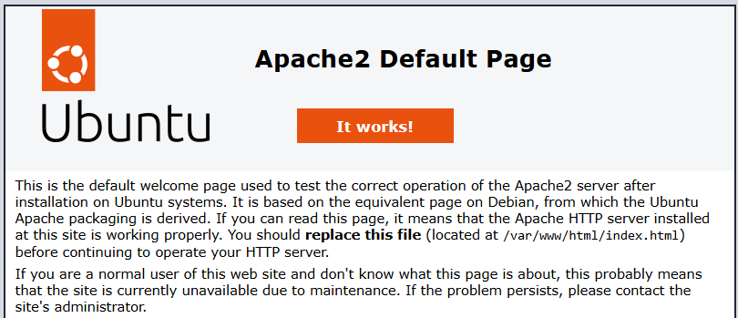
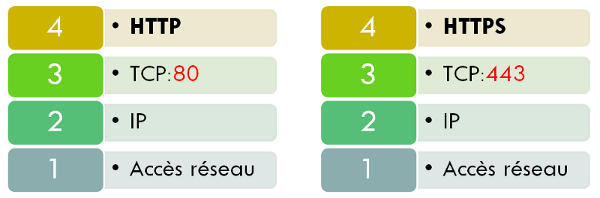
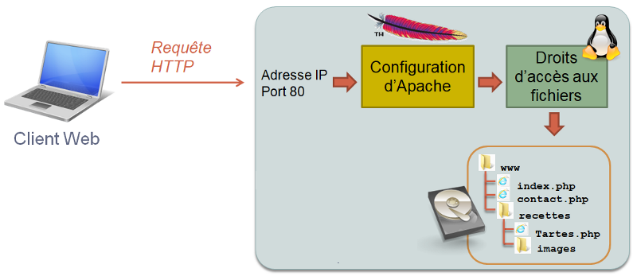
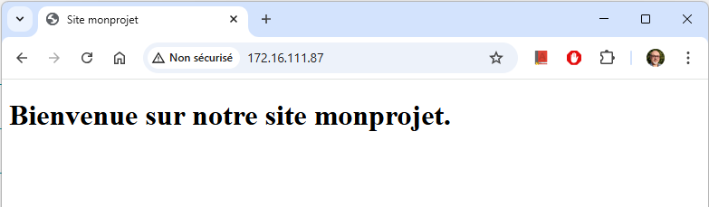

# Installer un serveur web apache2

> * Auteur : Gwénaël LAURENT
> * Date : 28/03/2026
> * OS : Ubuntu 24.04.4 LTS (Noble Numbat) ```cat /etc/os-release```
> * Serveur SSH OpenSSH_9.6p1 ```ssh -V```
> * Apache/2.4.58 (Ubuntu) ```apache2 -v```


 [Licence Creative Commons](https://creativecommons.org/licenses/by-nc-sa/3.0/fr/)

- [Installer un serveur web apache2](#installer-un-serveur-web-apache2)
- [1. Prérequis](#1-prérequis)
- [2. Présentation de LAMP](#2-présentation-de-lamp)
- [3. Installation d'Apache](#3-installation-dapache)
- [4. Fonctionnement du serveur web Apache](#4-fonctionnement-du-serveur-web-apache)
- [5. Les fichiers de configuration d'Apache](#5-les-fichiers-de-configuration-dapache)
- [6. Création d'un espace d'hébergement dans Apache](#6-création-dun-espace-dhébergement-dans-apache)
  - [6.1. Objectif](#61-objectif)
  - [6.2. Désactivation du site web principal](#62-désactivation-du-site-web-principal)
  - [6.3. Création d'un dossier 'racine physique' pour le nouveau site](#63-création-dun-dossier-racine-physique-pour-le-nouveau-site)
    - [6.3.1. Création du dossier](#631-création-du-dossier)
    - [6.3.2. Autorisations d'accès et propriétaires du dossier racine web](#632-autorisations-daccès-et-propriétaires-du-dossier-racine-web)
    - [6.3.3. Gestion automatique des _propriétaires_ pour les fichiers du site web (setGID)](#633-gestion-automatique-des-propriétaires-pour-les-fichiers-du-site-web-setgid)
    - [6.3.4. Gestion automatique des _autorisations_ pour les fichiers du site web (umask)](#634-gestion-automatique-des-autorisations-pour-les-fichiers-du-site-web-umask)
  - [6.4. Création d'un nouveau VirtualHost sur le port 80](#64-création-dun-nouveau-virtualhost-sur-le-port-80)
  - [6.5. Comment faire si le site ne s'affiche pas ?](#65-comment-faire-si-le-site-ne-saffiche-pas-)
- [7. Activer le mode rewrite dans Apache](#7-activer-le-mode-rewrite-dans-apache)

# 1. Prérequis
Avant d'utiliser ce tuto, assurez vous d'avoir :
* Installé Ubuntu
* Mis à jour l'OS : `sudo apt update && sudo apt upgrade`
* Installé et configuré un serveur SSH

> **Remarque** : Dans ce tuto, j'utilise Ubuntu 24.04.4 LTS dans une VM virtualbox\
> -utilisateur : admin-a01\
> -nom de machine : admin-a01-VirtualBox\
> -addresse IP de la VM Ubuntu : 172.16.111.87 (client DHCP)


# 2. Présentation de LAMP
LAMP est l'acronyme de ```Linux Apache MySQL PHP```.

Installer LAMP sur Linux correspond à :
* **installer le serveur web Apache**
* installer le module PHP d'Apache
* installer le serveur de bases de données MySQL (ou MariaDB)
* installer phpMyAdmin (site web d'administration de MySQL)
* fournir un moyen pour mettre à jour les fichiers du site web (SFTP)


> Apache est un des **```serveur HTTP```** les plus populaire (avec nginx). Il est produit par la [```Apache Software Foundation```](https://fr.wikipedia.org/wiki/Apache_Software_Foundation). C'est un logiciel libre fourni sous la [licence spécifique Apache](https://fr.wikipedia.org/wiki/Licence_Apache).


# 3. Installation d'Apache
> La configuration d'Apache présentée ici est extraite de la documentation [https://doc.ubuntu-fr.org/apache2](https://doc.ubuntu-fr.org/apache2)

Installez le serveur Apache.  
```shell
$ sudo apt install apache2
```
> *Remarque : si vous avez besoin de désinstaller un package :\
> ```sudo apt remove <nom du package>``` désinstalle mais garde certains fichiers de configuration\
> ```sudo apt purge <nom du package>``` désinstalle et supprime tous les fichiers*

Par défaut, le dossier racine du site web principal d'apache est ```/var/www/html/```

Après l'installation, Apache est démarré automatiquement avec son paramétrage par défaut (démarrage en tâche de fond en tant que daemon linux).

Pour connaitre la version d'apache installée :
```shell
$ apache2 -v
Server version: Apache/2.4.58 (Ubuntu)
Server built:   2026-03-05T17:31:54
```

Vérifiez si le daemon ```apache2``` est démarré (dans les processus) : S'il est démarré, vous devriez voir le processus ```/usr/sbin/apache2```
```ssh
$ ps -ef | grep apache2
root        4444       1  0 21:16 ?        00:00:00 /usr/sbin/apache2 -k start
www-data    4445    4444  0 21:16 ?        00:00:00 /usr/sbin/apache2 -k start
www-data    4446    4444  0 21:16 ?        00:00:00 /usr/sbin/apache2 -k start
www-data    4646       1  0 21:16 ?        00:00:00 /usr/bin/htcacheclean -d 120 -p /var/cache/apache2/mod_cache_disk -l 300M -n
admin-a+    5025    3305  0 21:17 pts/0    00:00:00 grep --color=auto apache2
```
Le logiciel Apache2 s'exécute en tant qu'utilisateur ```www-data```. Cet utilisateur fait partie du groupe de même nom ```www-data```. C'est la configuration par défaut dans ```/etc/apache2/envvars```.

Vérifiez si apache2 est démarré (avec systemctl) :
```shell
$ systemctl status apache2
● apache2.service - The Apache HTTP Server
     Loaded: loaded (/usr/lib/systemd/system/apache2.service; enabled; preset: enabled)
     Active: active (running) since Wed 2026-03-25 21:16:19 CET; 2min 30s ago
       Docs: https://httpd.apache.org/docs/2.4/
   Main PID: 4444 (apache2)
      Tasks: 55 (limit: 4597)
     Memory: 5.4M (peak: 5.6M)
        CPU: 250ms
     CGroup: /system.slice/apache2.service
             ├─4444 /usr/sbin/apache2 -k start
             ├─4445 /usr/sbin/apache2 -k start
             └─4446 /usr/sbin/apache2 -k start

mars 25 21:16:19 admin-a01-VirtualBox systemd[1]: Starting apache2.service - The Apache HTTP Server...
mars 25 21:16:19 admin-a01-VirtualBox apachectl[4443]: AH00558: apache2: Could not reliably determine the server's fully qualified doma>
mars 25 21:16:19 admin-a01-VirtualBox systemd[1]: Started apache2.service - The Apache HTTP Server.

```
S'il n'est pas démarré, il faut le démarrer :
```shell
$ sudo systemctl start apache2
```

Testez le port d'écoute d'Apache avec **```ss (anciennnement netstat)```**. Normalement Apache écoute sur le **port 80**. (cf. [doc des commandes ss et netstat ici](https://linuxize.com/post/check-listening-ports-linux/)) :
```shell
$ sudo ss -tunlp
Netid    State     Recv-Q    Send-Q       Local Address:Port         Peer Address:Port    Process  
...
tcp      LISTEN    0         511                      *:80                      *:*        users:(("apache2",pid=4446,fd=4),("apache2",pid=4445,fd=4),("apache2",pid=4444,fd=4))
```


A distance (depuis un autre ordinateur), vérifiez que vous avez accès au site web principal d'Apache : 
* Dans un navigateur web, saisissez l'adresse du linux (dans mon cas, http://172.16.111.87/), on doit voir la page d'accueil d'apache ```Apache2 Debian Default Page```.

> Cette page correspond au fichier ```/var/www/html/index.html```



> **Remarque** : Ubuntu possède par défaut un firewall logiciel (**```UFW Uncomplicated Firewall```**). Vérifiez s'il est activé :
> ```
> $ sudo ufw status
> ```
> Pour l'arrêter ou le démarrer :
> ```
> $ sudo ufw disable
> $ sudo ufw enable
> ```
> S'il est activé, ce firewall bloque toutes les requêtes venant de l'extérieur de la machine. Pour accéder au serveur web installé sur Ubuntu, il faudra donc configurer UFW pour autoriser les requêtes entrantes sur le port 80 (HTTP) et sur le port 443 (HTTPS). Dans les commandes suivantes on utilise les variables http et https qui sont définies parmi les ports bien connus (fichier /etc/services)
> ```shell
> $ sudo ufw allow http
> $ sudo ufw allow https
> ```
> Pour voir la configuration du firewall UFW :
> ```shell
> $ sudo ufw status verbose
> ```


# 4. Fonctionnement du serveur web Apache
Lorsqu'il démarre, Apache charge ses fichiers de configuration et se met en attente de requêtes sur les interfaces réseaux. **```On dit qu'il écoute certains ports```** (listen en anglais) : en général, Apache écoute le port 80 pour les communications HTTP, et le port 443 pour les communications en HTTPS.



Lorsqu'on utilise un navigateur web, que l'on clique sur un lien ou qu'on rentre directement une URL dans la barre d'adresse, on effectue **```une requête```** :

* Le navigateur résout le nom de domaine (il obtient l'adresse IP du serveur).
* Il envoie une requête HTTP avec la méthode GET à l'IP du serveur sur le port 80 (ou HTTPS sur le port 443) pour lui demander de retourner un contenu particulier.
* Le serveur HTTP reçoit la requête, et en fonction de divers paramètres (URL appelée, configuration du serveur, etc.), va chercher un contenu dans un fichier ou lance un script (PHP) qui va générer un contenu.
* Le serveur renvoie ce contenu à l'IP du navigateur.
* Le navigateur traite le contenu et le rend accessible à l'internaute (en l'affichant à l'écran).




# 5. Les fichiers de configuration d'Apache
Un seul serveur Apache permet de déployer simultanément plusieurs sites et services qu'il faut configurer individuellement.

Pour plus de clarté, la configuration d'Apache2 est morcelée. Toutefois, tous les fichiers de configuration se situent dans le répertoire **```/etc/apache2```** :

```sh
$ ls -l /etc/apache2
total 80
-rw-r--r-- 1 root root  7178 mars   5 18:31 apache2.conf
drwxr-xr-x 2 root root  4096 mars  25 21:16 conf-available
drwxr-xr-x 2 root root  4096 mars  25 21:16 conf-enabled
-rw-r--r-- 1 root root  1782 mars  18  2024 envvars
-rw-r--r-- 1 root root 31063 mars  18  2024 magic
drwxr-xr-x 2 root root 12288 mars  25 21:16 mods-available
drwxr-xr-x 2 root root  4096 mars  25 21:16 mods-enabled
-rw-r--r-- 1 root root   274 mars  18  2024 ports.conf
drwxr-xr-x 2 root root  4096 mars  25 21:16 sites-available
drwxr-xr-x 2 root root  4096 mars  25 21:16 sites-enabled

```

Configuration globale :
* **```apache2.conf```** est le fichier de configuration principal d'Apache. Normalement il n'a pas à être modifié. Toute la configuration devrait se faire dans les sous dossiers ```xxx-available```
* **```envvars```** contient les variables d'environnement utilisées par Apache
* **```ports.conf```** liste les ports d'écoute d'Apache

Configuration des sites (VirtualHost) :
* **```sites-available```** contient les fichiers de configuration des **sites** disponibles
* **```sites-enabled```** contient des *liens symboliques* vers les configurations  des sites activés (liens vers site-available)

Configuration des autres services (Alias, ...) :
* **```conf-available```** contient les fichiers de configuration des **autres services** disponibles
* **```conf-enabled```** contient des *liens symboliques* vers les configurations des autres services activés(liens vers conf-available)

Configuration des modules :
* **```mods-available```** contient les fichiers de configuration des **modules** d'Apache disponibles
* **```mods-enabled```** contient des *liens symboliques* vers les configurations des modules activés (liens vers mods-available) 

Les diverses configurations sont activées (**```a2en``` pour Apache2 enable**) ou désactivées (**```a2dis``` pour Apache2 disable**) avec les commandes suivantes :
```shell
$ sudo a2ensite [configuration d'un site à activer]
$ sudo a2dissite [configuration d'un site à désactiver]

$ sudo a2enconf [configuration d'un service à activer]
$ sudo a2disconf [configuration d'un service à désactiver]

$ sudo a2enmod [configuration d'un module à activer]
$ sudo a2dismod [configuration d'un module à désactiver]
```

Cela aura pour effet de créer ou supprimer les liens symboliques correspondants dans les répertoires ```xxx-enabled```.

Apache prendra alors en compte, ou pas, les fichiers de configuration concernés après rechargement :
```shell
$ sudo systemctl reload apache2
```

# 6. Création d'un espace d'hébergement dans Apache
> Apache peut héberger plusieurs sites en même temps. Il faut configurer un VirtualHost (espace d'hébergement web) pour chacun d'entre eux.

## 6.1. Objectif
Vous allez créez un nouveau site web dans Apache :

* Les fichiers de ce site seront stockés en ```/var/www/monprojet/```
* Ce site sera un ```VirtualHost``` (hôte virtuel) qui écoutera sur le port TCP/80
* Ce site devra remplacer le site web par défaut
* L'utilisateur linux ```admin-a01``` sera le seul administrateur du site (c'est lui qui publiera les nouveaux fichiers du site). C'est donc le seul utilisateur à disposer des droits d'écriture dans ce dossier.


## 6.2. Désactivation du site web principal
Après installation, il n'y a qu'un seul site actif ```000-default```, fichier de configuration ```000-default.conf``` :
```shell
$ ls -l /etc/apache2/sites-enabled/
total 0
lrwxrwxrwx 1 root root 35 mars  25 21:16 000-default.conf -> ../sites-available/000-default.conf
```

Désactivez le site ```000-default.conf``` :
```shell
$ sudo a2dissite 000-default
```

Recharger ensuite la configuration d'Apache :
```shell
$ sudo systemctl reload apache2
```
> Remarque : Si Apache n'a aucun site actif, sa configuration par défaut est active et c'est le site qui était créé à l'installation qui répond encore.


## 6.3. Création d'un dossier 'racine physique' pour le nouveau site
> Documentation ["What permissions should my website files/folders have on a Linux webserver?"](https://serverfault.com/questions/357108/what-permissions-should-my-website-files-folders-have-on-a-linux-webserver#357109)

### 6.3.1. Création du dossier

Créez le dossier racine du site ```/var/www/monprojet```
```shell
$ sudo mkdir /var/www/monprojet
```

Après la création du dossier ```monprojet```, les droits Unix sont les suivants :
```shell
$ ls -l /var/www
total 8
drwxr-xr-x 2 root root 4096 mars  25 21:16 html
drwxr-xr-x 2 root root 4096 mars  25 22:40 monprojet
```


### 6.3.2. Autorisations d'accès et propriétaires du dossier racine web

> Pour copier les fichiers de votre site web dans ```/var/www/monprojet``` il faut que l'utilisateur ```admin-a01``` (administrateur du Linux) possède les droits d'écriture dans ce dossier.

> Le logiciel Apache2 s'exécute en tant qu'utilisateur ```www-data```. Cet utilisateur fait partie du groupe de même nom ```www-data```.\
> Pour qu'apache puisse accèder aux fichiers du site web, il faut que le groupe ```www-data``` ait les accès en lecture et parcours de dossier.

Ajoutez l'utilisateur ```admin-a01``` dans le groupe ```www-data```. (il pourra ainsi modifier les droits d'accès aux fichiers/dossiers du site web)

```shell
$ sudo adduser admin-a01 www-data
```

Fermez votre session utilisateur (logout) et relogguez vous.

Vérifiez que admin-a01 appartienne bien au groupe www-data :

```shell
$ groups
```

Modifiez les droits d'accès du dossier ```/var/www/monprojet``` pour avoir :
* **utilisateur propriétaire :** ```admin-a01``` en RWX
* **groupe propriétaire :** ```www-data``` en R-X (utilisateur d'Apache)
* **les autres :** aucun accès
```shell
$ sudo chown -R admin-a01:www-data /var/www/monprojet
$ sudo chmod -R 750 /var/www/monprojet
```

Ce qui donne les droits suivants :
```shell
$ ls -l /var/www
total 8
drwxr-xr-x 2 root      root     4096 mars  25 21:16 html
drwxr-x--- 2 admin-a01 www-data 4096 mars  25 22:40 monprojet
```

### 6.3.3. Gestion automatique des _propriétaires_ pour les fichiers du site web (setGID)

La mise à jour des fichiers du site se fera à distance en SFTP. 
Ces mises à jour seront réalisées par l'administrateur du site web : ```admin-a01```

Par défaut sur Ubuntu, les fichiers/dossiers créés par l'utilisateur ```admin-a01``` ont les propriétaires suivants :
* utilisateur propriétaire : ```admin-a01```
* groupe propriétaire : ```admin-a01```

Il faut donc changer le groupe propriétaire car chaque nouveau fichier ou sous-dossier créé dans ```/var/www/monprojet``` doit appartenir au groupe ```www-data``` pour qu'apache puisse accèder aux fichiers du site web.

> Pour faire cela automatiquement, on active le bit "```set group ID```" (setGID) sur le dossier ```monprojet``` (avec chmod g+s /var/www/monprojet). Tous les sous-dossiers "hériteront" du groupe propriétaire du dossier parent.


Activez le "```set group ID```" sur le dossier ```monprojet```

```shell
$ sudo chmod g+s /var/www/monprojet
```

Ce qui donne maintenant les droits suivants (remarquez le 's' à la place du 'x'):
```shell
$ ls -l /var/www
total 8
drwxr-xr-x 2 root      root     4096 mars  25 21:16 html
drwxr-s--- 2 admin-a01 www-data 4096 mars  25 22:40 monprojet
```

Si vous crééz un dossier et un fichier dans le dossier du nouveau site, vous devriez donc avoir ```www-data``` en groupe propriétaire :
```shell
$ mkdir /var/www/monprojet/mondossier2
$ touch /var/www/monprojet/monfichier2
$ ls -l /var/www/monprojet/
total 4
drwxrwsr-x 2 admin-a01 www-data 4096 mars  25 22:56 mondossier2
-rw-rw-r-- 1 admin-a01 www-data    0 mars  25 22:56 monfichier2
```

### 6.3.4. Gestion automatique des _autorisations_ pour les fichiers du site web (umask)

La mise à jour des fichiers du site se fera à distance en SFTP. 
Ces mises à jour seront réalisées par l'administrateur du site web : ```admin-a01```

Par défaut sur Ubuntu, les fichiers/dossiers créés par l'utilisateur ```admin-a01``` ont les droits d'accès suivants :
* droits UGO sur les dossiers : ```rwxrwxr-x``` = 775
* droits UGO sur les fichiers : ```rw-rw-r--```= 664


Il faut changer ces droits d'accès pour **retirer tous les accès aux autres utilisateurs** et retirer les droits d'écriture à partir d'apache.

Il faut donc avoir les droit suivants sur tous les fichiers/dossiers :
* droits UGO sur les dossiers : ```rwxr-x---``` = **750**
* droits UGO sur les fichiers : ```rw-r-----```= **640**

Pour faire cela automatiquement, **il faut avoir une valeur de l'umask à 027**.
Tous les fichiers et sous-dossiers créés dans le dossier racine web auront alors les bons droits d'accès.

> Les droits d'accès sont issus des droits POSIX par défaut (777 sur les dossiers et 666 sur les fichiers) diminués de la valeur de l'**umask** (user file creation mode mask). 

> Le umask définit les permissions par défaut d'un répertoire ou d'un fichier créé. La valeur de l'umask est un nombre exprimé sous forme octale (valeur par défaut 022).\
> Les permissions seront obtenues par l'opération binaire 777 (ou 666) AND NOT x (x étant la valeur de l'umask). Autrement dit, les bits du masque sont annulés, ce qui signifie que les droits correspondant à ces bits sont supprimés.\
> 777 AND NOT 022 => 755\
> 666 AND NOT 022 => 644

Affichez la valeur actuelle de l'umask pour l'utilisateur ```admin-a01``` avec la commande :
```shell
$ umask
0002
```
Note : Le premier '0' signifie "notation octale" (notation par défaut). On peut afficher les droits max UGO accordées par l'umask avec la commande
```shell
$ umask -S
u=rwx,g=rx,o=rx
```

Modifiez la valeur de l'**umask pour tous les utilisateurs loggués** (Login shell, non-login shell, accès SSH et SFTP). 

Il faut pour cela éditer plusieurs fichiers systèmes qui configurent les ouvertures de sessions. Utilisez `nano` pour éditer les fichiers (Dans nano : ```Ctrl+O``` pour sauvegarder, puis ```Ctrl+X``` pour quitter.)

* Pour les logins console PAM
  ```shell
  $ sudo nano /etc/login.defs
  ```
  Recherchez et modifiez la valeur de l'umask
  ```conf
  UMASK 027
  ```
  Vérifiez que le fichier
  ```shell
  $ sudo nano /etc/pam.d/common-session
  ```
  contienne la ligne 
  ```conf
  session optional pam_umask.so
  ```
* Pour les Shell Bash (login)
  ```shell
  $ sudo nano /etc/profile
  ```
  Ajoutez en fin de fichier
  ```conf
  umask 027
  ```
* Pour les Shell Bash (non-login, terminaux graphiques)
  ```shell
  $ sudo nano /etc/bash.bashrc
  ```
  Ajoutez en fin de fichier
  ```conf
  umask 027
  ```
* Pour les accès SSH
  ```shell
  $ sudo nano /etc/ssh/sshd_config
  ```
  Vérifiez que le fichier contienne la ligne 
  ```conf
  UsePAM yes
  ```
* Pour les accès SFTP
  ```shell
  $ sudo nano /etc/ssh/sshd_config
  ```
  Si la ligne suivante est présente :
  ```conf
  Subsystem  sftp  /usr/lib/openssh/sftp-server
  ```
  Il faut ajouter la valeur de l'umask à la fin de la ligne :
  ```conf
  Subsystem  sftp  /usr/lib/openssh/sftp-server -u 027
  ```
  Puis redémarrez SSH
  ```shell
  $ sudo systemctl restart ssh
  ```

Fermez votre session utilisateur (logout) et relogguez vous.

Vérifiez que la modification de l'umask a bien été prise en compte :

```shell
$ umask
0027
```

Ce qui donne maintenant les droits suivants pour les nouveaux fichiers/dossiers :
```shell
$ mkdir /var/www/monprojet/mondossier3
$ touch /var/www/monprojet/monfichier3
$ ls -l /var/www/monprojet/
total 4
drwxr-s--- 2 admin-a01 www-data 4096 mars  26 00:03 mondossier3
-rw-r----- 1 admin-a01 www-data    0 mars  26 00:03 monfichier3

```

## 6.4. Création d'un nouveau VirtualHost sur le port 80
Apache permet de déployer simultanément plusieurs sites. Chaque site est soit un VirtualHost soit un Alias. Ici, vous allez créez un VirtualHost qui écoute sur le port 80.

La configuration du VirtualHost se fera dans un fichier dédié ```/etc/apache2/sites-available/monprojet.conf```

Créez ce fichier de configuration :
```shell
$ sudo nano /etc/apache2/sites-available/monprojet.conf
```

Copiez / collez cette configuration :
```conf
<VirtualHost *:80>
        DocumentRoot "/var/www/monprojet"
        <Directory "/var/www/monprojet">
                Options +FollowSymLinks -Indexes
                AllowOverride All
                Require all granted
        </Directory>
        ErrorLog /var/log/apache2/error.monprojet.log
        CustomLog /var/log/apache2/access.monprojet.log combined
</VirtualHost>
```
Dans nano : ```Ctrl+O``` pour sauvegarder, puis ```Ctrl+X``` pour quitter.

Explications de la configuration d'Apache pour ce VirtualHost :
* ```<VirtualHost *:80>``` : Déclaration du virtualhost. Il doit répondre aux requêtes qui s'adressent à toutes les adresses IP (*) du serveur sur le port 80. [Doc sur VirtualHost](https://httpd.apache.org/docs/2.2/fr/mod/core.html#virtualhost)
* ```DocumentRoot "/var/www-projet/public"``` : C'est le chemin absolu vers le dossier racine du site web
* ```<Directory "/var/www-projet/public">``` : regroupe un ensemble de directives qui ne s'appliquent qu'au répertoire concerné, à ses sous-répertoires, et à leur contenu. [Doc sur Directory](https://httpd.apache.org/docs/2.2/fr/mod/core.html#directory)
* ```Options +FollowSymLinks``` : ajoute l'option de négociation de contenu (sert par ex. pour détecter la langue du navigateur et fournir automatiquement le contenu dans la bonne langue)
* ```Options -Indexes``` : désactive l'affichage du contenu des dossiers si aucun fichier index.html n'y est présent.
* ```AllowOverride All``` : autorise l'utilisation des fichiers .htaccess dans l'arborescence du site web. [Doc sur AllowOverride](https://httpd.apache.org/docs/2.2/fr/mod/core.html#allowoverride), [Doc sur .htaccess](https://httpd.apache.org/docs/2.2/fr/howto/htaccess.html)
* ```Require all granted``` : autorise l'accès à distance au site web. [Doc sur require](https://httpd.apache.org/docs/2.2/fr/mod/core.html#require)
* ```ErrorLog``` et ```CustomLog``` : emplacement des fichiers journaux (log) d'erreurs et d'accès.


Il faut maintenant activer ce site :
```shell
$ sudo a2ensite monprojet
```

Rechargez ensuite Apache :
```shell
$ sudo systemctl reload apache2
```

Vérification : le nouveau site doit apparaitre dans la liste des VirtualHost chargés dans Apache :
```shell
$ sudo a2query -s
```

Pour les tests à distance, en tant qu'utilisateur ```admin-a01```, créez un fichier ```index.html``` dans le dossier racine du site ```/var/www/monprojet``` avec le contenu suivant :
```html
<!DOCTYPE html>
<html lang="fr">
<head>
    <meta charset="UTF-8">
    <meta name="viewport" content="width=device-width, initial-scale=1.0">
    <title>Site monprojet</title>
</head>
<body>
    <h1>Bienvenue sur notre site monprojet.</h1>
</body>
</html>
```
Pas besoin de recharger Apache, le fichier est directement accessible depuis une autre machine. Il suffit de saisir l'adresse IP du serveur apache comme URL:




## 6.5. Comment faire si le site ne s'affiche pas ?
Vérifiez que le site apparait dans la liste des VirtualHost chargés par Apache :
```shell
$ sudo a2query -s
```
Vérifiez que vous n'avez pas d'erreurs dans le fichier de configuration du VirtualHost :
```shell
$ sudo nano /etc/apache2/sites-available/monprojet.conf
```
Afficher les fichiers journaux du VirtualHost. Consultez les derniers accès et les dernières erreurs rencontrées par apache.\
Vous pouvez utiliser la commande linux ```tail``` pour n'afficher que les dernières lignes de ces fichiers (ici 20 lignes):
```shell
$ tail -20 /var/log/apache2/error.monprojet.log
$ tail -20 /var/log/apache2/access.monprojet.log
```

# 7. Activer le mode rewrite dans Apache
Activez maintenant le module ```rewrite``` de Apache (ré-écriture d'URL, utile pour les framework PHP dans les [fichiers .htaccess](https://httpd.apache.org/docs/2.2/fr/howto/htaccess.html))  
```shell
$ sudo a2enmod rewrite
```

Puis redémarrez apache :
```shell
$ sudo systemctl restart apache2
```

Vérification : le module rewrite doit apparaitre dans la liste des modules chargés dans Apache :
```shell
$ sudo apache2ctl -M
...
rewrite_module (shared)
...
```
