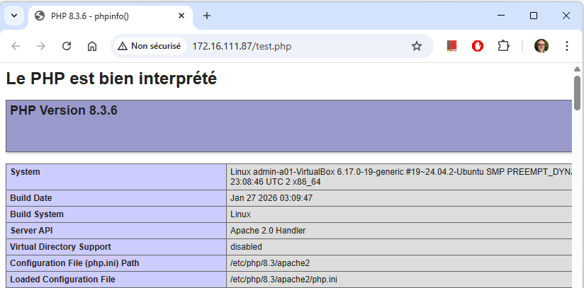

# Installer PHP (mod_php)

> * Auteur : Gwénaël LAURENT
> * Date : 28/03/2026
> * OS : Ubuntu 24.04.4 LTS (Noble Numbat) ```cat /etc/os-release```
> * Serveur SSH OpenSSH_9.6p1 ```ssh -V```
> * Apache/2.4.58 (Ubuntu) ```apache2 -v```
> * PHP 8.3.6 ```php --version```

 [Licence Creative Commons](https://creativecommons.org/licenses/by-nc-sa/3.0/fr/)

- [Installer PHP (mod\_php)](#installer-php-mod_php)
- [1. Prérequis](#1-prérequis)
- [2. Présentation de LAMP](#2-présentation-de-lamp)
- [3. Installation de PHP dans Apache (mod\_php)](#3-installation-de-php-dans-apache-mod_php)
- [4. Installation des modules PHP additionnels](#4-installation-des-modules-php-additionnels)


# 1. Prérequis
Avant d'utiliser ce tuto, assurez vous d'avoir :
* Installé Ubuntu
* Mis à jour l'OS : `sudo apt update && sudo apt upgrade`
* Installé et configuré un serveur SSH
* Installé et configuré le serveur web apache2

> **Remarque** : Dans ce tuto, j'utilise Ubuntu 24.04.4 LTS dans une VM virtualbox\
> -utilisateur : admin-a01\
> -nom de machine : admin-a01-VirtualBox\
> -addresse IP de la VM Ubuntu : 172.16.111.87 (client DHCP)


# 2. Présentation de LAMP
LAMP est l'acronyme de ```Linux Apache MySQL PHP```.

Installer LAMP sur Linux correspond à :
* installer le serveur web Apache
* **installer le module PHP d'Apache**
* installer le serveur de bases de données MySQL (ou MariaDB)
* installer phpMyAdmin (site web d'administration de MySQL)
* fournir un moyen pour mettre à jour les fichiers du site web (SFTP)


> PHP est un langage de programmation utilisé pour produire des applications Web dynamiques ou des API Web via un serveur HTTP. 
> **PHP est un langage de script interprétés côté serveur** : le serveur interprète le code PHP des pages web demandées et génère du code et des données (HTML, JSON, etc) pouvant être interprétés et rendus par un navigateur web.


# 3. Installation de PHP dans Apache (mod_php)
> Il y a [2 façons d'installer PHP sur apache](https://www.zend.com/blog/apache-phpfpm-modphp) : 
> * avec mod_php : plus facile à installer, intégré directement dans apache
> * avec php-fpm : gère un grand nombre de connexion simultanées, fournit une isolation des processus pour une sécurité renforcée.
> 
> Ce tutoriel ne concerne que **mod_php**.

Pour installer PHP :
```shell
$ sudo apt install php libapache2-mod-php
```

Vérifiez la version de PHP installée :
```shell
$ php --version
PHP 8.3.6 (cli) (built: Jan 27 2026 03:09:47) (NTS)
Copyright (c) The PHP Group
Zend Engine v4.3.6, Copyright (c) Zend Technologies
    with Zend OPcache v8.3.6, Copyright (c), by Zend Technologies
```

Pour tester l'installation de PHP (à partir d'un navigateur web), créez un fichier ```test.php``` dans le dossier racine du site web principal d'apache.
```shell
$ nano /var/www/monprojet/test.php
```
Contenu du fichier (code PHP)
```php
<?php 
    echo "<h1>Le PHP est bien interprété</h1>";
    phpinfo();
?>
```
Dans nano :
* ```Ctrl+O``` pour enregistrer les modifications
* ```Ctrl+X``` pour quitter

Dans un navigateur web, accédez au fichier PHP en saisissant l'adresse IP du serveur web et le nom du fichier ```http://172.16.111.87/test.php``` (évidemment, modifiez l'adresse IP pour correspondre à votre Linux)

> L'affichage dans le navigateur ne doit pas comporter de balise `<?php ... ?>` car le code PHP est exécuté sur le serveur web !




# 4. Installation des modules PHP additionnels
L'installation de PHP doit être complétée par l'ajout de certaines modules (= extensions).

> Les modules PHP sont disponibles dans les dépôts standards des paquets mais ils ne sont pas tous installés par défaut. Ils s'installent comme des paquets Debian standards. 

Pour afficher la liste des modules PHP disponibles dans les dépôts :
```shell
$ apt-cache search php | egrep 'module' | grep default
```

Pour savoir si le paquet correspondant au module est installée, examinez la ligne "Status" dans les résultats de la commande suivante (par exemple pour le module php-mysql):
```shell
$ dpkg -s php-mysql
```

Pour les applications PHP que vous créerez en TP, il faut installer les modules suivants :
* ```php-intl``` (Internationalisation)
* ```php-mbstring``` (chaines de caractères multi-octets comme UTF-8)
* ```php-mysql``` (accès à MySQL avec php-mysqli ou php-pdo-mysql)
* ```php-json``` (codage JSON)


Installation des 4 modules PHP souhaités :
```shell
$ sudo apt install php-intl php-mbstring php-mysql php-json
```
Relancer apache  
```shell
$ sudo systemctl restart apache2
```
