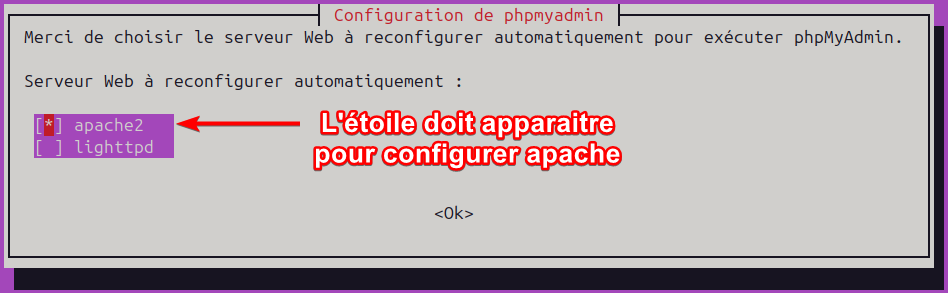
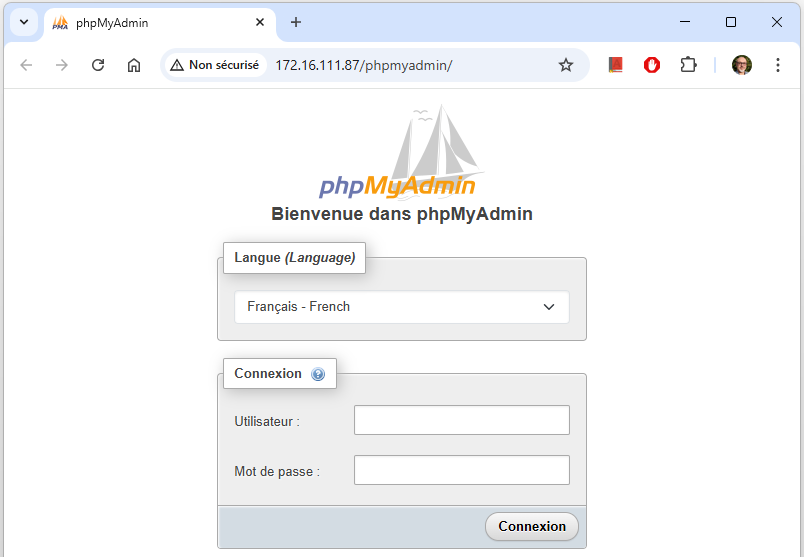
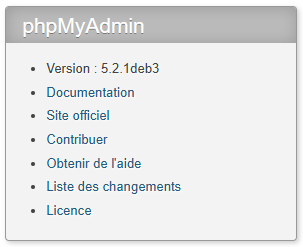

# Installer phpmyadmin

> * Auteur : Gwénaël LAURENT
> * Date : 28/03/2026
> * OS : Ubuntu 24.04.4 LTS (Noble Numbat) ```cat /etc/os-release```
> * Serveur SSH OpenSSH_9.6p1 ```ssh -V```
> * Apache/2.4.58 (Ubuntu) ```apache2 -v```
> * PHP 8.3.6 ```php --version```
> * mariadbd  Ver 10.11.14-MariaDB-0ubuntu0.24.04.1 ```mariadbd --version```
> * phpMyAdmin Version : 5.2.1deb3


 [Licence Creative Commons](https://creativecommons.org/licenses/by-nc-sa/3.0/fr/)

- [Installer phpmyadmin](#installer-phpmyadmin)
- [1. Prérequis](#1-prérequis)
- [2. Présentation de LAMP](#2-présentation-de-lamp)
- [3. Installation de phpMyAdmin](#3-installation-de-phpmyadmin)
- [4. Accès au site phpMyAdmin](#4-accès-au-site-phpmyadmin)

# 1. Prérequis
Avant d'utiliser ce tuto, assurez vous d'avoir :
* Installé Ubuntu
* Mis à jour l'OS : `sudo apt update && sudo apt upgrade`
* Installé et configuré un serveur SSH
* Installé et configuré le serveur web apache2
* Installé le module PHP
* Installé le serveur SQL mariadb

> **Remarque** : Dans ce tuto, j'utilise Ubuntu 24.04.4 LTS dans une VM virtualbox\
> -utilisateur : admin-a01\
> -nom de machine : admin-a01-VirtualBox\
> -addresse IP de la VM Ubuntu : 172.16.111.87 (client DHCP)


# 2. Présentation de LAMP
LAMP est l'acronyme de ```Linux Apache MySQL PHP```.

Installer LAMP sur Linux correspond à :
* installer le serveur web Apache
* installer le module PHP d'Apache
* installer le serveur de bases de données MySQL (ou MariaDB)
* **installer phpMyAdmin (site web d'administration de MySQL)**
* fournir un moyen pour mettre à jour les fichiers du site web (SFTP)

> PhpMyAdmin est un site web d'administration des serveurs MySQL / MariaDB.


# 3. Installation de phpMyAdmin


Pour installer phpMyAdmin :
```shell
$ sudo apt install phpmyadmin
```
* "_Please choose the web server that should be automatically configured to run phpMyAdmin_" :\
  Web server to reconfigure automatically : 
  * sélectionnez ```apache2```avec les flèces `<haut/bas>
  * appuyez sur la  **`<barre d'espace>`** pour cocher apache2\
  
  * utilisez la touche `<TAB>` pour sélectionner ```OK```
  * Appuyez sur `<Entrée>` pour valider
* "_Faut-il configurer la base de données de phpmyadmin avec dbconfig-common ?_" : 
  * utilisez la touche `<TAB>` pour sélectionner ```OUI```
  * Appuyez sur `<Entrée>` pour valider
* "_Mot de passe de connexion MySQL pour phpmyadmin :_"
  * saisissez un mot de passe différent de celui de l'administrateur Mariadb
  * utilisez la touche `<TAB>` pour sélectionner ```OK```
  * Appuyez sur `<Entrée>` pour valider
* "_Confirmation du mot de passe_"
  * re-saisissez le mot de passe choisi
  * utilisez la touche `<TAB>` pour sélectionner ```OK```
  * Appuyez sur `<Entrée>` pour valider

Rechargez ensuite Apache :
```shell
$ sudo systemctl reload apache2
```

> Pour information :
> * Le fichier de configuration principal de phpmyadmin est ```/etc/phpmyadmin/config.inc.php```
> * Les fichiers du site phpMyAdmin se situent en ```/usr/share/phpmyadmin```
> * Le site web phpMyAdmin est accessible via le web grâce à un alias d'apache. Le fichier de configuration pour cet alias est : ```/etc/apache2/conf-available/phpmyadmin.conf```


# 4. Accès au site phpMyAdmin
Pour accéder au site phpMyAdmin à distance, dans un navigateur web, saisissez l'adresse IP du serveur web suivie de l'alias "phpmyadmin". Dans mon cas : ```http://172.16.111.87/phpmyadmin/```.

On doit voir la page d'accueil de phpMyAdmin :



Logguez vous en ```root``` (administrateur de Mariadbd).

Vérifiez la version de phpMyAdmin installée : page d'accueil > encart en bas à droite



