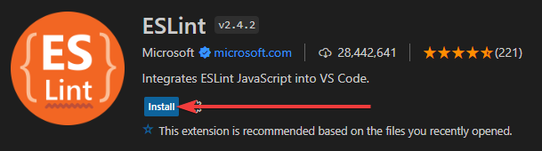
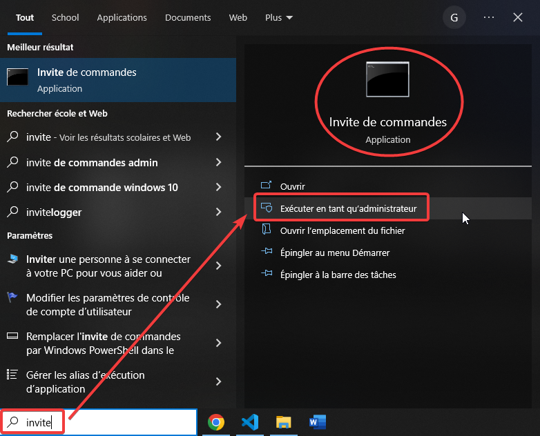
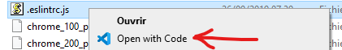
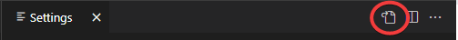

# Installation de Node.js

> * Auteur : Gwénaël LAURENT
> * Date : 24/07/2023
> * OS : Windows 10 22H2
> * Node.js : version 18.17.0 LTS

 [Licence Creative Commons](https://creativecommons.org/licenses/by-nc-sa/3.0/fr/)

- [Installation de Node.js](#installation-de-nodejs)
- [1. Présentation](#1-présentation)
- [2. Téléchargement de Node.js](#2-téléchargement-de-nodejs)
- [3. Installation](#3-installation)
- [4. Vérification de la version installée](#4-vérification-de-la-version-installée)
- [5. Installation du linter ESlint en global](#5-installation-du-linter-eslint-en-global)
  - [5.1 Installation de l'extension VScode](#51-installation-de-lextension-vscode)
  - [5.2 Installation du serveur ESlint avec npm](#52-installation-du-serveur-eslint-avec-npm)
  - [5.3 Fichier de configuration de ESlint](#53-fichier-de-configuration-de-eslint)
  - [5.4 Configuration de VScode pour utiliser .eslintrc.js](#54-configuration-de-vscode-pour-utiliser-eslintrcjs)

# 1. Présentation
Node.js® est un environnement d’exécution JavaScript construit sur le moteur JavaScript V8 de Chrome.

Node.js permet de créer des programmes en utilisant le langage Javascript. 

Node.js intègre une multitude de modules pour s'adapter aux besoins les plus courant. Parmi les modules natifs de Node.js, on retrouve http qui permet le développement de serveur Web HTTP.

# 2. Téléchargement de Node.js


Téléchargez la dernière version LTS (Long-term support)  sur [nodejs.org](https://nodejs.org/fr/)
* le site web détecte votre version d'OS : Windows (x64)
* Cliquez sur la version LTS : 18.17.0
* Enregistrez le fichier node-v18.17.0-x64.msi sur votre ordi.

# 3. Installation
Lancez l'installation en double-cliquant sur le fichier téléchargé (Double-cliquez sur le fichier téléchargé ```node-v18.17.0-x64.msi```)
   
> *Node.js est démarré automatiquement en même temps que Windows. Pas besoin de s'en occuper.*

# 4. Vérification de la version installée
Si Node.js est déjà installé sur votre poste, vérifiez sa version. Ouvrez un terminal :
```shell
node -v
v18.17.0
```

# 5. Installation du linter ESlint en global
ESlint est un analyseur syntaxique du code JavaScript ([un "linter"](https://www.developpez.com/actu/193978/Suivi-des-linters-JavaScript-outils-d-analyse-statique-de-code-source-ESLint-en-4-19-0-et-standardJS-en-11-0-0/)). Il met en évidence :
* les erreurs de code
* les problèmes de syntaxe
* le non respect de style

> **linter vs débugueur** : le linter détecte les erreurs pendant l'édition du code (analyse statique) tandis que le débugueur détecte les erreurs pendant l'exécution (analyse dynamique)

> **ESlint est un peu particulier à installer** dans VScode car il nécessite plusieurs éléments à installer (un logiciel *client* et un logiciel *serveur*) et qu'il faut le configurer suivant nos besoins.
> Je vous propose ici une configuration basique de ESlint pour le code JavaScript intégré aux pages web.

## 5.1 Installation de l'extension VScode
Pour commencer, il faut installer l'extension VScode (c'est le logiciel *client*).

Lancez VScode. Dans la barre d'activité à gauche, cliquez sur l'icône ```Extensions```.


Aidez vous de la barre de recherche pour trouver

* ESLint (Microsoft)

Dans les résultats de recherche, cliquez sur l'extension désirée et dans la fenêtre de droite, cliquez sur ```install```



## 5.2 Installation du serveur ESlint avec npm
> Le serveur Eslint est un programme qui s'exécute sur Node.js. Vous allez l'installer grâce au gestionnaire de paquets de Node.js : npm (node paquet manager)

Ouvrez une invite de commande en administrateur : touche Windows > recherchez "invite" > Quand l'application "Invite de commandes" est trouvée > Cliquez sur "Exécuter en tant qu'administrateur".



Dans la fenêtre d'invite de commandes, tapez la commande suivante, suivie de ```Entrée``` :
```cmd
npm install -g eslint
```
Le serveur ESlint va être téléchargé et installé. A la fin de la procédure, il sera disponible pour tous vos projets JavaScript.


## 5.3 Fichier de configuration de ESlint
Il faut créer un fichier **```.eslintrc.js```** *(N'oubliez pas le point en début du nom de fichier*) dans le dossier d'installation de VScode : **C:\\Program Files\\Microsoft VS Code\\**. 

Comme ce dossier est protégé en écriture dans l'explorateur Windows, il faut d'abord créer le fichier dans un dossier temporaire dont vous avez les droits d'écriture et vous le copierez plus tard dans son emplacement définitif.

Ouvrez le fichier ```.eslintrc.js``` dans VScode : **Clic droit sur le fichier > Ouvrir avec Code**




**Copiez le code** suivant dans le fichier ```.eslintrc.js``` (c'est la configuration basique de ESlint). **Enregistrez** puis **Fermez** le fichier.
```javascript
module.exports = {
    "env": {
        "browser": true,
        "es6": true,
        "jquery": true,
        "node": true,
        "mocha": true
    },
    "extends": "eslint:recommended",
    "globals": {
        "Atomics": "readonly",
        "SharedArrayBuffer": "readonly"
    },
    "parserOptions": {
        "ecmaVersion": 2018
    },
    "rules": {
    }
};
```

Copiez maintenant le fichier ```.eslintrc.js``` dans le dossier d'installation de VScode ```C:\Program Files\Microsoft VS Code```

## 5.4 Configuration de VScode pour utiliser .eslintrc.js
Le fichier de configuration de VScode s'appelle ```settings.json```. Vous allez le modifier pour que VScode intègre le contenu du fichier ```.eslintrc.js```

Dans VScode : **File > Preferences > Settings**. 

Puis ouvrez les préférences au **format JSON** en cliquant sur l'icône à droite de l'onglet "Settings" :



Le fichier de configuration ```settings.json``` est constitué de cette façon :

```json
{
    config1,
    config2,
    config3,
    ...,
    configx
}
```
* Le fichier est constitué d'un bloc d'accolades.
* A l'intérieur des accolades sont listées toutes les configurations (config1,...configx).
* Chaque configuration se termine par une virgule (pour séparer les configurations entre elles).
* Seule la dernière configuration (configx) ne se termine pas par une virgule.

**Ajouter** la configuration suivante dans ```settings.json``` :

```json
{
    ...,
    ...,
    "eslint.options": {
        "configFile": "C:/Program Files/Microsoft VS Code/.eslintrc.js"
    },
    ...,
    ...
}
```

Fermez et **```redémarrez VScode```**.

> Les résultats du linter (erreurs et avertissements) sont affichés dans le code source (soulignage des erreurs) ou dans la fenêtre des problèmes **```CTRL + SHIFT + M```**

