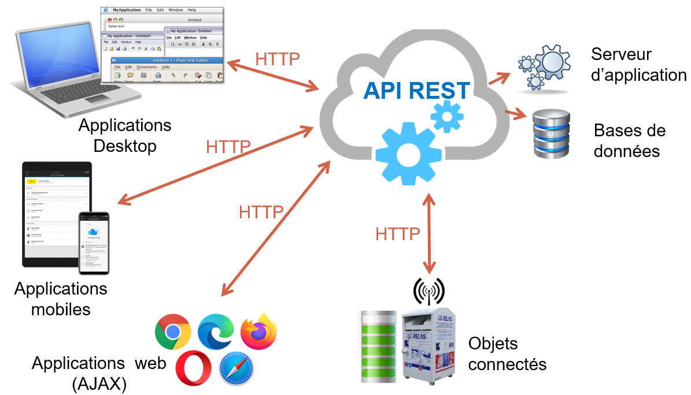
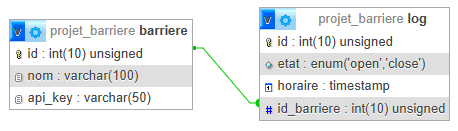

# Tutoriel - Créer une API REST en PHP pour ESP32

> * Auteur : Gwénaël LAURENT
> * Date : 06/05/2026

 [Licence Creative Commons](https://creativecommons.org/licenses/by-nc-sa/3.0/fr/)

> **Projet :** Enregistrement des logs d'ouverture de barrières automatiques pilotées par un ESP32  
> **Prérequis :** Bases PHP, notions de base de données MySQL/MariaDB, avoir déjà utilisé un navigateur pour faire des requêtes HTTP

- [Tutoriel - Créer une API REST en PHP pour ESP32](#tutoriel---créer-une-api-rest-en-php-pour-esp32)
- [1. Qu'est-ce qu'une API ?](#1-quest-ce-quune-api-)
  - [1.1. Les méthodes HTTP utilisées](#11-les-méthodes-http-utilisées)
  - [1.2. Le format d'échange : JSON](#12-le-format-déchange--json)
- [2. La base de données](#2-la-base-de-données)
- [3. Structure du projet avec l'API](#3-structure-du-projet-avec-lapi)
- [4. Flux d'une requête](#4-flux-dune-requête)
  - [4.1. Requête POST (ESP32 qui envoie un état)](#41-requête-post-esp32-qui-envoie-un-état)
  - [4.2. Requête GET (lecture des logs)](#42-requête-get-lecture-des-logs)
- [5. Codes de statut HTTP](#5-codes-de-statut-http)
- [6. Les fichiers PHP](#6-les-fichiers-php)
  - [6.1. `/config/db_connect.php` - Connexion à la base](#61-configdb_connectphp---connexion-à-la-base)
  - [6.2. `/public/api/util.php` - Fonctions utilitaires](#62-publicapiutilphp---fonctions-utilitaires)
  - [6.3. `/public/api/index.php` - Routeur principal](#63-publicapiindexphp---routeur-principal)
  - [6.4. `/public/api/endpoints/post_data.php` - Enregistrement d'un état](#64-publicapiendpointspost_dataphp---enregistrement-dun-état)
  - [6.5. `/public/api/endpoints/get_data.php` - Lecture des logs](#65-publicapiendpointsget_dataphp---lecture-des-logs)
- [7. Tester l'API sans ESP32](#7-tester-lapi-sans-esp32)
  - [7.1. Tester le POST](#71-tester-le-post)
  - [7.2. Tester le GET](#72-tester-le-get)
  - [7.3. Tester une erreur d'authentification](#73-tester-une-erreur-dauthentification)
- [8. Récapitulatif des règles de sécurité appliquées](#8-récapitulatif-des-règles-de-sécurité-appliquées)
- [9. Questions de réflexion](#9-questions-de-réflexion)


# 1. Qu'est-ce qu'une API ?

Une **API** (*Application Programming Interface*) est un programme qui permet à deux systèmes de communiquer entre eux via le réseau.



Dans ce projet :

- l'**ESP32** (client) envoie des données à l'API
- l'**API PHP** (serveur) reçoit ces données, les vérifie et les enregistre en base

La communication se fait via le protocole **HTTP**, le même que celui utilisé par votre navigateur.

## 1.1. Les méthodes HTTP utilisées

| Méthode | Usage dans ce projet |
|---------|---------------------|
| `POST`  | L'ESP32 envoie un état de barrière à enregistrer |
| `GET`   | Un client demande à lire les logs enregistrés |

## 1.2. Le format d'échange : JSON

L'ESP32 envoie ses données sous forme de **JSON** (*JavaScript Object Notation*), un format texte lisible :

```json
{
  "device_id": "1",
  "etat": "ouvert"
}
```

# 2. La base de données

Voici la structure de la base `projet_barriere` que vous avez à disposition.



# 3. Structure du projet avec l'API

**Principe :** toutes les requêtes vers l'API arrivent sur `api/index.php`. Ce fichier joue le rôle de **routeur** : il vérifie l'authentification, puis redirige vers le bon traitement selon la méthode HTTP.

```
projet_barrieres/           ← ✅ Racine du  projet
├── config/                 ← ⚠️ Ne jamais exposer ce dossier publiquement
│   └── db_connect.php      ← Connexion à la base de données
├── public/                 ← ✅ Racine web (VirtualHost Apache)
│   ├── api/                       ← ✅ API REST
│   │   ├── index.php              ← routeur : point d'entrée de l'API
│   │   ├── util.php               ← fonctions utilitaires
│   │   └── endpoints/
│   │       ├── post_data.php      ← traitement POST (ESP32 → BDD)
│   │       └── get_data.php       ← traitement GET  (lecture des logs)
│   ├── css/
│   │   └── barrieres.css   ← feuille de style pour l'affichage des logs
│   ├── img/
│   └── index.php           ← page d'affichage des logs (navigateur)
├── .env                    ← ⚠️ Identifiants d'accès à mariaDB
└── .gitignore              ← ⚠️ Pour ne JAMAIS versionner le .env
```


# 4. Flux d'une requête

## 4.1. Requête POST (ESP32 qui envoie un état)

```
ESP32
  │  POST /api/
  │  Header : X-Api-Key: cle_entree_nord_2026
  │  Body   : {"device_id":"1","etat":"ouvert"}
  ▼
api/index.php
  │  1. Lit la méthode HTTP → POST
  │  2. Récupère le header X-Api-Key
  │  3. Cherche la clé en base → OK, barrière id=1
  ▼
endpoints/post_data.php
  │  1. Lit le JSON du corps de la requête
  │  2. Vérifie que "etat" est présent et valide
  │  3. Traduit "ouvert" → "open"
  │  4. Insère dans la table log
  ▼
Réponse JSON : {"status":"ok","message":"Log enregistré","id":10}
Code HTTP    : 201 Created
```

## 4.2. Requête GET (lecture des logs)

```
Client HTTP (navigateur, Postman...)
  │  GET /api/?limit=5
  │  Header : X-Api-Key: cle_entree_nord_2026
  ▼
api/index.php  →  endpoints/get_data.php
  │  Retourne les 5 derniers logs de la barrière 1
  ▼
Réponse JSON : {"status":"ok","barriere":"Entrée Nord","count":5,"data":[...]}
Code HTTP    : 200 OK
```

# 5. Codes de statut HTTP

L'API répond toujours avec un **code HTTP** qui indique le résultat :

| Code | Signification        | Quand ?                                |
|------|----------------------|----------------------------------------|
| 200  | OK                   | Requête GET réussie                    |
| 201  | Created              | Données enregistrées (POST réussi)     |
| 400  | Bad Request          | JSON invalide ou champ manquant        |
| 401  | Unauthorized         | Clé API absente                        |
| 403  | Forbidden            | Clé API incorrecte                     |
| 405  | Method Not Allowed   | Méthode HTTP non supportée             |

# 6. Les fichiers PHP

## 6.1. `/config/db_connect.php` - Connexion à la base

```php
<?php
// config/db_connect.php - Connexion PDO partagée par tous les fichiers
declare(strict_types=1);

function getConnection(): PDO {
    // Chargement des credentials depuis .env
    $env = parse_ini_file(__DIR__ . '/../.env');

    // Data Source Name
    $dsn = sprintf(
        "mysql:host=%s;dbname=%s;charset=%s",
        $env['DB_HOST'],
        $env['DB_NAME'],
        $env['DB_CHARSET']
    );

  //Options de connexion
    $options = [
        PDO::ATTR_ERRMODE            => PDO::ERRMODE_EXCEPTION,  // Lancer des exceptions
        PDO::ATTR_DEFAULT_FETCH_MODE => PDO::FETCH_ASSOC,        // Résultats en tableau associatif
        PDO::ATTR_EMULATE_PREPARES   => false,                   // Désactiver l'émulation (sécurité)
    ];

    try {
        return new PDO($dsn, $env['DB_USER'], $env['DB_PASS'], $options);
    } catch (PDOException $e) {
        // Ne jamais afficher le message d'erreur complet à l'utilisateur
        error_log("Erreur de connexion BDD : " . $e->getMessage());
        throw new RuntimeException("Impossible de se connecter à la base de données.");
    }
}
```

> **`PDO::ATTR_EMULATE_PREPARES => false`** : active les vraies requêtes préparées, protection contre les injections SQL.

---

## 6.2. `/public/api/util.php` - Fonctions utilitaires

```php
<?php
// public/api/util.php - Fonctions communes à toute l'API

/**
 * Envoie une réponse JSON et termine le script.
 *
 * @param int   $code  Code HTTP (200, 201, 400, 401, 403, 405...)
 * @param array $data  Tableau à encoder en JSON
 */
function send_json(int $code, array $data): void {
    http_response_code($code);
    header('Content-Type: application/json; charset=utf-8');
    echo json_encode($data, JSON_UNESCAPED_UNICODE);
    exit;
}
```

> Cette fonction est appelée partout dans l'API. Elle garantit que la réponse est toujours du JSON avec le bon code HTTP.

---

## 6.3. `/public/api/index.php` - Routeur principal

C'est **le fichier le plus important** : il reçoit toutes les requêtes et les oriente.

```php
<?php
// public/api/index.php - Point d'entrée unique de l'API

require_once __DIR__ . '/../../config/db_connect.php';
require_once __DIR__ . '/util.php';

// ── 1. En-têtes de sécurité ──────────────────────────────────────────
header('X-Content-Type-Options: nosniff');
header('X-Frame-Options: DENY');

// ── 2. Quelle méthode HTTP a été utilisée ? ──────────────────────────
$method = $_SERVER['REQUEST_METHOD'];   // Contiendra "GET" ou "POST"

// ── 3. Authentification par clé API ──────────────────────────────────
// L'ESP32 envoie sa clé dans un en-tête HTTP : X-Api-Key: ma_cle
// PHP transforme "X-Api-Key" en "HTTP_X_API_KEY" dans $_SERVER
$api_key = $_SERVER['HTTP_X_API_KEY'] ?? '';

if (empty($api_key)) {
    send_json(401, ['status' => 'error', 'message' => 'Clé API manquante']);
}

// Recherche de la clé dans la base de données
// On utilise une requête préparée (jamais de variable directement dans le SQL !)
$pdo  = getConnection();
$stmt = $pdo->prepare('SELECT id, nom FROM barriere WHERE api_key = ?');
$stmt->execute([$api_key]);
$barriere = $stmt->fetch();

if (!$barriere) {
    send_json(403, ['status' => 'error', 'message' => 'Clé API invalide']);
}

// $barriere['id'] et $barriere['nom'] sont maintenant disponibles
// Ces valeurs viennent de la BDD : elles sont fiables

// ── 4. Routage selon la méthode HTTP ─────────────────────────────────
if ($method === 'POST') {
    require __DIR__ . '/endpoints/post_data.php';
} elseif ($method === 'GET') {
    require __DIR__ . '/endpoints/get_data.php';
} else {
    send_json(405, ['status' => 'error', 'message' => 'Méthode non autorisée']);
}
```

> **Point de sécurité important :** on ne fait jamais confiance au `device_id` envoyé dans le JSON. On utilise l'`id` récupéré depuis la base de données après vérification de la clé API.

---

## 6.4. `/public/api/endpoints/post_data.php` - Enregistrement d'un état

```php
<?php
// public/api/endpoints/post_data.php
// Variables disponibles depuis index.php : $pdo, $barriere

// ── 1. Lecture du corps de la requête ────────────────────────────────
// L'ESP32 envoie le JSON dans le "corps" de la requête POST
$body = file_get_contents('php://input');
$data = json_decode($body, true);

if (json_last_error() !== JSON_ERROR_NONE || !is_array($data)) {
    send_json(400, ['status' => 'error', 'message' => 'JSON invalide']);
}

// ── 2. Validation du champ "etat" ────────────────────────────────────
if (!isset($data['etat'])) {
    send_json(400, ['status' => 'error', 'message' => 'Champ "etat" manquant']);
}

// Correspondance entre les valeurs ESP32 et les valeurs en base
$etats_valides = [
    'ouvert' => 'open',
    'ferme'  => 'close',
    'open'   => 'open',    // accepte aussi directement open/close
    'close'  => 'close',
];

$etat_recu = strtolower(trim($data['etat']));

if (!array_key_exists($etat_recu, $etats_valides)) {
    send_json(400, [
        'status'  => 'error',
        'message' => 'Valeur "etat" invalide. Valeurs acceptées : ouvert, ferme'
    ]);
}

$etat_bdd = $etats_valides[$etat_recu];  // "open" ou "close"

// ── 3. Insertion en base ──────────────────────────────────────────────
// On utilise l'id de la barrière issu de l'authentification (fiable)
// Le champ "horaire" est rempli automatiquement par MariaDB (DEFAULT current_timestamp)
$stmt = $pdo->prepare(
    'INSERT INTO log (etat, id_barriere) VALUES (?, ?)'
);
$stmt->execute([$etat_bdd, $barriere['id']]);

send_json(201, [
    'status'   => 'ok',
    'message'  => 'Log enregistré',
    'id'       => (int) $pdo->lastInsertId(),
    'barriere' => $barriere['nom'],
    'etat'     => $etat_bdd,
]);
```

---

## 6.5. `/public/api/endpoints/get_data.php` - Lecture des logs

```php
<?php
// public/api/endpoints/get_data.php
// Variables disponibles depuis index.php : $pdo, $barriere

// Paramètre optionnel : ?limit=10 (maximum 100)
$limit = min((int)($_GET['limit'] ?? 10), 100);

$stmt = $pdo->prepare(
    'SELECT id, etat, horaire
     FROM log
     WHERE id_barriere = ?
     ORDER BY horaire DESC
     LIMIT ?'
);
$stmt->execute([$barriere['id'], $limit]);
$logs = $stmt->fetchAll();

send_json(200, [
    'status'   => 'ok',
    'barriere' => $barriere['nom'],
    'count'    => count($logs),
    'data'     => $logs,
]);
```


# 7. Tester l'API sans ESP32

Vous pouvez tester l'API directement depuis un terminal avec **curl** :

## 7.1. Tester le POST

```bash
# Windows CMD (échappement les guillemets doubles dans -d ...)
curl -X POST http://barrieres.local/api/ ^
     -H "Content-Type: application/json" ^
     -H "X-Api-Key: cle_entree_nord_2026" ^
     -d "{\"device_id\":\"1\",\"etat\":\"ouvert\"}"
```

```bash
# Windows PowerShell (échappement les guillemets doubles dans -d ...)
curl.exe -X POST http://barrieres.local/api/ `
     -H "Content-Type: application/json" `
     -H "X-Api-Key: cle_entree_nord_2026" `
     -d '{\"device_id\":\"1\",\"etat\":\"ouvert\"}'
```

```bash
# Linux / macOS (utilisation de guillemets simples dans -d ...)
curl -X POST http://barrieres.local/api/ \
     -H "Content-Type: application/json" \
     -H "X-Api-Key: cle_entree_nord_2026" \
     -d '{"device_id":"1","etat":"ouvert"}'
```

Réponse attendue :
```json
{"status":"ok","message":"Log enregistré","id":10,"barriere":"Entrée Nord","etat":"open"}
```

## 7.2. Tester le GET

```bash
# Windows CMD (échappement les guillemets doubles dans -d ...)
curl -X GET http://barrieres.local/api/?limit=3 ^
     -H "X-Api-Key: cle_entree_nord_2026"
```

```bash
# Windows PowerShell (échappement les guillemets doubles dans -d ...)
curl.exe -X GET http://barrieres.local/api/?limit=3 `
     -H "X-Api-Key: cle_entree_nord_2026"
```

```bash
# Linux / macOS (utilisation de guillemets simples dans -d ...)
curl -GET http://barrieres.local/api/?limit=3 \
     -H "X-Api-Key: cle_entree_nord_2026"
```

Réponse attendue :
```json
{
  "status": "ok",
  "barriere": "Entrée Nord",
  "count": 3,
  "data": [
    {"id":"10","etat":"open","horaire":"2026-04-06 08:00:00"},
    {"id":"8","etat":"open","horaire":"2026-04-03 07:49:37"},
    {"id":"6","etat":"open","horaire":"2026-04-03 07:12:53"}
  ]
}
```

## 7.3. Tester une erreur d'authentification
```bash
# Windows CMD (échappement les guillemets doubles dans -d ...)
curl -X POST http://barrieres.local/api/ ^
     -H "Content-Type: application/json" ^
     -H "X-Api-Key: mauvaise_cle" ^
     -d "{\"device_id\":\"1\",\"etat\":\"ouvert\"}"
```

```bash
# Windows PowerShell (échappement les guillemets doubles dans -d ...)
curl.exe -X POST http://barrieres.local/api/ `
     -H "Content-Type: application/json" `
     -H "X-Api-Key: mauvaise_cle" `
     -d '{\"device_id\":\"1\",\"etat\":\"ouvert\"}'
```

```bash
# Linux / macOS (utilisation de guillemets simples dans -d ...)
curl -X POST http://barrieres.local/api/ \
     -H "Content-Type: application/json" \
     -H "X-Api-Key: mauvaise_cle" \
     -d '{"device_id":"1","etat":"ouvert"}'
```

Réponse attendue (code 403) :
```json
{"status":"error","message":"Clé API invalide"}
```

---

# 8. Récapitulatif des règles de sécurité appliquées

| Règle | Où dans le code |
|-------|-----------------|
| Authentification par clé API | `api/index.php` - header `X-Api-Key` |
| Requêtes préparées PDO | Tous les fichiers qui interrogent la BDD |
| Pas de confiance au JSON | On utilise l'id BDD, pas le `device_id` JSON |
| Validation des données entrantes | `post_data.php` - vérification de `etat` |
| En-têtes de sécurité HTTP | `api/index.php` - `X-Content-Type-Options` |
| Limitation du paramètre `limit` | `get_data.php` - `min(..., 100)` |

# 9. Questions de réflexion

1. Pourquoi utilise-t-on `php://input` plutôt que `$_POST` pour lire le JSON ?
2. Pourquoi la clé API est-elle dans un **header HTTP** plutôt que dans le JSON ?
3. Que se passerait-il si on écrivait directement `WHERE api_key = '$api_key'` dans la requête SQL au lieu d'utiliser une requête préparée ?
4. Pourquoi l'`id_barriere` inséré dans `log` vient-il de la base de données et non du JSON envoyé par l'ESP32 ?
5. Quelle(s) amélioration(s) apporteriez-vous si ce projet était déployé sur internet plutôt qu'en réseau local ?
