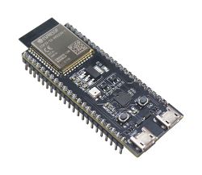
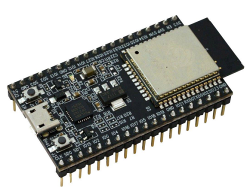
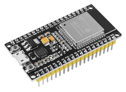
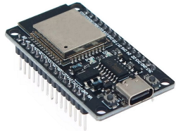
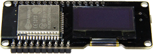
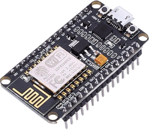

# Présentation des cartes ESP

> * Auteur : Gwénaël LAURENT
> * Date : 28/03/2026

 [Licence Creative Commons](https://creativecommons.org/licenses/by-nc-sa/3.0/fr/)


# ESP32-S3-DevKitC-1-N8R8 v1.1


* Module ESP : ESP32-S3-WROOM-1U / MCN8R8
* Brochage : [ESP32-S3-DevKitC-1-N8R8-pinout.png](img/ESP32-S3-DevKitC-1-N8R8-pinout.png)
* Projet PlatformIO > Board = **Espressif ESP32-S3-DevKitC-1-N8 (8 MB QD, No PSRAM)**\
  cf. 
* platformio.ini :
    ```ini
    [env:esp32-s3-devkitc-1]
    platform = espressif32
    board = esp32-s3-devkitc-1
    framework = arduino
    build_flags = -DCORE_DEBUG_LEVEL=3
     -DARDUINO_USB_CDC_ON_BOOT=0
     -DARDUINO_USB_MODE=1
    ```

# ESP32-DevKitC V4


* Module ESP : ESP32-WROVER-E
* Brochage : cf. [01d.presentation-esp32-devkitc-v4.md > §3](01d.presentation-esp32-devkitc-v4.md#3-brochage-du-kit-esp32-devkitc-v4)
* Projet PlatformIO > Board = **Espressif ESP-WROVER-KIT**\
  cf. [02d.esp32-devkitc-v4-projet-digital-io.md > §2](02d.esp32-devkitc-v4-projet-digital-io.md#2-création-dun-projet-platformio)
* platformio.ini :
    ```ini
    [env:esp-wrover-kit]
    platform = espressif32
    board = esp-wrover-kit
    framework = arduino
    ```

# ESP32-DevKitC V2


* Module ESP : ESP-WROOM-32
* Brochage : cf. [01c.presentation-esp32-devkitc-v2.md > §3](01c.presentation-esp32-devkitc-v2.md#3-brochage-du-kit-esp32-devkitc-v2)
* Projet PlatformIO > Board = **Espressif ESP32 Dev Module**\
  cf. [02c.esp32-devkitc-v2-projet-digital-io.md > §2](02c.esp32-devkitc-v2-projet-digital-io.md#2-création-dun-projet-platformio)
* platformio.ini :
    ```ini
    [env:esp32dev]
    platform = espressif32
    board = esp32dev
    framework = arduino
    ```

# ESP32-DevKit V1


* Module ESP : ESP-WROOM-32
* Brochage : cf. [01e.presentation-esp32-devkit-v1.md > §3](01e.presentation-esp32-devkit-v1.md#3-brochage-du-kit-esp32-devkit-v1)
* Projet PlatformIO > Board = **Espressif ESP32 Dev Module**\
  cf. [02e.esp32-devkit-v1-projet-digital-io.md > §2](02e.esp32-devkit-v1-projet-digital-io.md#2-création-dun-projet-platformio)
* platformio.ini :
    ```ini
    [env:esp32dev]
    platform = espressif32
    board = esp32dev
    framework = arduino
    ```

# ESP32 Wemos lolin-32 avec OLED


* Module ESP : ESP-WROOM-32
* Brochage : cf. [01b.presentation-esp32-wemos-lolin-32-OLED.md > §3](01b.presentation-esp32-wemos-lolin-32-OLED.md#3-brochage-du-kit-wemos-lolin-32-avec-oled)
* Projet PlatformIO > Board = **WEMOS LOLIN32**\
  cf. [02b.esp32-wemos-lolin-32-projet-digital-io.md > §2](02b.esp32-wemos-lolin-32-projet-digital-io.md#2-création-dun-projet-platformio)
* platformio.ini :
    ```ini
    [env:lolin32]
    platform = espressif32
    board = lolin32
    framework = arduino
    ```

# ESP8266 NodeMCU


* Module ESP : ESP-12E
* Inscription sur le module : ESP8266MOD
* Brochage : cf. [01a.presentation-esp8266-nodemcu.md > §3](01a.presentation-esp8266-nodemcu.md#3-brochage-du-kit-nodemcu-v1)
* Projet PlatformIO > Board = **NodeMCU 1.0 (ESP-12E Module)**\
  cf. [02a.projet-pio-esp8266-digital-io.md > §2](02a.projet-pio-esp8266-digital-io.md#2-création-dun-projet-platformio)
* platformio.ini :
    ```ini
    [env:nodemcuv2]
    platform = espressif8266
    board = nodemcuv2
    framework = arduino
    ```

