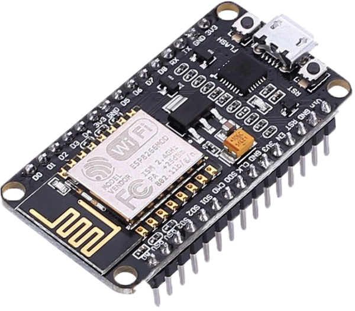
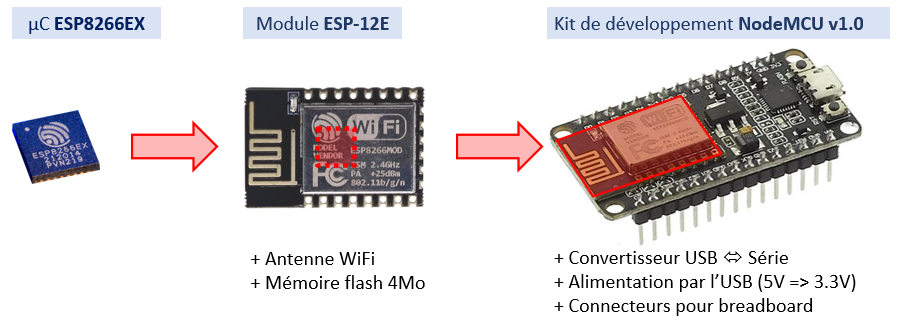
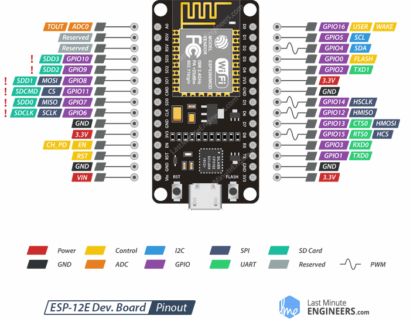
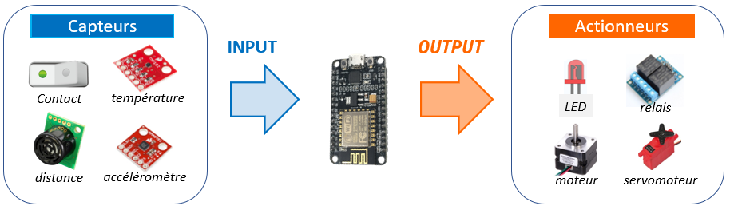
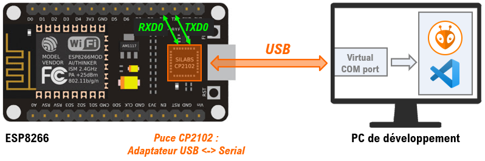
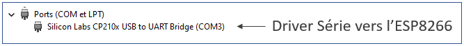

# Présentation de l'ESP8266 NodeMCU

> * Auteur : Gwénaël LAURENT
> * Date : 18/08/2022
> * OS : Windows 11

 [Licence Creative Commons](https://creativecommons.org/licenses/by-nc-sa/3.0/fr/)

- [Présentation de l'ESP8266 NodeMCU](#présentation-de-lesp8266-nodemcu)
- [1. Le kit de développement ESP8266 NodeMCU](#1-le-kit-de-développement-esp8266-nodemcu)
- [2. Caractéristiques de l'ESP8266 (module ESP-12E)](#2-caractéristiques-de-lesp8266-module-esp-12e)
- [3. Brochage du kit NodeMCU v1](#3-brochage-du-kit-nodemcu-v1)
- [4. GPIO (General Purpose Input/Output)](#4-gpio-general-purpose-inputoutput)
- [5. Choix des broches GPIO](#5-choix-des-broches-gpio)
- [6. Connexion à l'ordinateur](#6-connexion-à-lordinateur)

# 1. Le kit de développement ESP8266 NodeMCU
Le kit de développement assure un prototypage facile des **projets IoT (Internet of Things)**. Il intègre un microcontrôleur ESP8266 avec de la mémoire flash, une connexion WiFi et des entrées / sorties pour connecter des capteurs ou des actionneurs.



# 2. Caractéristiques de l'ESP8266 (module ESP-12E)
L'ESP8266 est un **microcontrôleur** fabriqué par Espressif. Il est spécialement adapté à l'**IIoT** (Industrial Internet of Things) :
* WiFi intégré pour les communications
* Très faible consommation d'énergie
* Forme compacte
* Fiabilité




| Caractéristiques            | Détail                                                                                                                                                     |
|-----------------------------|------------------------------------------------------------------------------------------------------------------------------------------------------------|
| Microcontroleur             | ESP8266EX                                                                                                                                                  |
| Processeur                  | Xtensa® monocœur L106 32 bits, fréquence jusqu'à 160 MHz                                                                                                   |
| **RAM**                         | 160 ko                                                                                                                                                     |
| RTCSRAM                     | 1 ko                                                                                                                                                       |
| **Mémoire flash**               | 4 Mo (SPI flash)                                                                                                                                           |
| **WiFi**                        | IEEE 802.11 b/g/n ; 2,4 GHz ; jusqu'à 75 Mbps                                                                                                              |
| Broches GPIO                | 17                                                                                                                                                         |
| Courant max par broche GPIO | 12 mA                                                                                                                                                      |
| Entrée analogique           | 1 x CAN (10 bits)                                                                                                                                          |
| Interfaces de communication | I2C<br/>I2S<br/>SPI<br/>UART                                                                                                                               |
| **Consommation électrique**     | WiFi Tx : 120 mA (802.11 n, Pout= +13 dBm)<br/>WiFi Rx : 56 mA (802.11 n, -65 dBm)<br/>Modem-sleep : 15 mA<br/>Light-sleep : 0.9 mA<br/>Deep-sleep : 10 µA |
| Upload du programme         | UART ou OTA                                                                                                                                                |
||

**Documentation :**

* [ESP8266EX Datasheet](https://www.espressif.com/sites/default/files/documentation/0a-esp8266ex_datasheet_en.pdf)
* [ESP Product Selector](https://products.espressif.com/#/product-selector?names=ESP8266EX&filter={%22Series%22:[%22ESP8266%22]})
* [ESP-12E WiFi Module](https://docs.ai-thinker.com/_media/esp8266/docs/esp12e_datasheet.pdf)
* [NODEMCU_DEVKIT_V1.0](https://github.com/nodemcu/nodemcu-devkit-v1.0/blob/master/NODEMCU_DEVKIT_V1.0.PDF)


# 3. Brochage du kit NodeMCU v1
[](img/ESP8266-NodeMCU-Pinout.png)

[*Crédit schéma*](https://lastminuteengineers.com/esp8266-nodemcu-arduino-tutorial/)

> La sérigraphie du kit NodeMCU ne correspond pas aux numéros du GPIO (par exemple D6 correspond à GPIO12). Dans votre codage pour ESP8266, le numéro des broches à utiliser est le numéro du GPIO.


# 4. GPIO (General Purpose Input/Output)
Les broches (pin) du kit de dévelopement NodeMCU sont réliées aux connexions de l'ESP8266. On les appelle des broches **GPIO (General Purpose Input/Output)** parce qu'elles peuvent avoir plusieurs modes de fonctionnement en fonction du paramétrage effectué dans le code du programme de l'ESP.

Les broches GPIO servent à communiquer avec des capteurs ou actionneurs.



La majorité des broches GPIO peuvent fonctionner en entrée ou sortie numérique (**Digital I/O**). On parle alors d'**entrée/sortie TOR (Tout Ou Rien)** parce qu'elles ne peuvent prendre que 2 valeurs :
* niveaux bas = LOW = 0V
* niveau haut = HIGH = 3.3V

Le programme de l'ESP peut :
* **lire l'état des entrées** (INPUT) => niveau LOW ou HIGH
* **modifier l'état des sorties** (OUTPUT) => niveau LOW ou HIGH

Le courant maximal que peut délivrer une broche GPIO en sortie est de **12 mA**.

Pour chaque broche GPIO utilisée en entrée, on peut choisir d'activer une **résistance interne de PULL-UP**.

Certains composants numériques nécessitent une communication plus élaborée avec l'ESP. Dans ce cas, on les connecte à l'ESP avec plusieurs broches, on parle alors de "**bus de communication**" (UART, I2C, SPI, ...).


# 5. Choix des broches GPIO
> **Attention : certaines broches ne doivent jamais être utilisées**, c'est le cas des broches **GPIO6 à GPIO11**. Elles sont utilisées pour la communication SPI entre le microcontrôleur et la mémoire FLASH de stockage du programme.


En fonction du mode de communication entre l'ESP et un capteur ou actionneur, il faut choisir les broches sur lesquelles brancher le composant.

| Type de communication                                                   | Broches GPIO                                                                                                                                                                                                             | Remarques                                                                                                                           |
|-------------------------------------------------------------------------|--------------------------------------------------------------------------------------------------------------------------------------------------------------------------------------------------------------------------|-------------------------------------------------------------------------------------------------------------------------------------|
| **Digital I/O**                                                             | GPIO4, GPIO5, GPIO12, GPIO13, GPIO14<br/>GPIO0, GPIO2 (résistance Pull-Up toujours active)<br/>GPIO15, GPIO16 (résistance Pull-Down toujours active)                                                                     | Pendant le démarrage, GPIO1, GPIO2, GPIO3, GPIO16 fournissent du 3.3V                                                               |
| **PWM**<br/>Pulse Width Modulation                                          | GPIO4, GPIO12, GPIO14, GPIO15                                                                                                                                                                                            | A part GPIO16, toutes les autres GPIO peuvent générer un signal PWM                                                                 |
| **Entrée analogique**                                                       | ADC0                                                                                                                                                                                                                     | Convertisseur Analogique > Numérique 10 bits<br/>La tension mesurée est convertie en un nombre compris entre 0 (0V) et 1023 (3.3V) |
| **Bus UART**<br/>Universal Asynchronous Receiver Transmitter          | GPIO1 : TXD0<br/>GPIO3 : RXD0                                                                                                                                                                                            | Relié à l'USB (upload et messages de debug)<br/>On peut créer d'autres bus UART logiciels sur les autres GPIO                      |
| **Bus I2C**<br/>Inter-Integrated Circuit<br/>TWI (Two Wire Interface) | GPIO4 : SDA<br/>GPIO5 : SCL                                                                                                                                                                                              | On peut créer d'autres bus I2C logiciels sur les autres GPIO (sauf GPIO16)                                                          |
| **Bus SPI**<br/>Serial Peripheral Interface                                 | GPIO12 : MISO<br/>GPIO13 : MOSI<br/>GPIO14 : SCLK<br/>GPIO15 : CS                                                                                                                                                        | Bus SPI matériel (HSPI)<br/>Le 2ème bus SPI n'est pas disponible car utilisé pour la mémoire flash                                 |
| **Bus I2S**<br/>Inter-IC Sound                                        | GPIO12 : Input Data Line<br/>GPIO13 : Input BCK (Bit Clock Line)<br/>GPIO14 : Input WS (Word Select Line)<br/>GPIO3 : Output Data Line<br/>GPIO15 : Output BCK (Bit Clock Line)<br/>GPIO2 : Output WS (Word Select Line) | Le bus I2S est un standard de bus série pour connecter des matériels audio numériques ensemble.                                     |
||

Pour plus d'informations, consultez https://randomnerdtutorials.com/esp8266-pinout-reference-gpios/ ou également [ce site](https://tttapa.github.io/ESP8266/Chap04%20-%20Microcontroller.html)


# 6. Connexion à l'ordinateur


Reliez le kit NodeMCU à l'ordinateur avec un câble USB (connecteur micro USB).

Si tout se passe bien, vous devriez voir un nouveau périphérique **Port COM** car la communication s'effectue en laison série.



Vous pouvez également voir le port COM utilisé pour la liaison avec l'ESP dans un invite de commande :
```cmd
> mode

Statut du périphérique COM3:
----------------------------
    Baud :            115200
    Parité :          None
    Bits de données : 8
    Bits d’arrêt :    1
    Temporisation :   OFF
    XON/XOFF :        OFF
    Protocole CTS :   OFF
    Protocole DSR :   OFF
    Sensibilité DSR : OFF
    Circuit DTR :     OFF
    Circuit RTS :     OFF


Statut du périphérique CON:
---------------------------
    Lignes :          9001
    Colonnes :        120
    Vitesse clavier : 31
    Délai clavier :   1
    Page de codes :   850

```

Si ce n'est pas le cas, il faut installer le **driver de port COM virtuel (VCP)** correspondant à la puce de votre kit de développement (Adaptateur USB <-> Serial
) :
* Télécharger le driver pour une puce [Silicon Labs CP1202](https://www.silabs.com/developers/usb-to-uart-bridge-vcp-drivers)
* Télécharger le driver pour une puce [FTDI Chip](https://ftdichip.com/drivers/vcp-drivers/)
* Télécharger le driver pour une puce [WCH CH340/341](http://www.wch-ic.com/downloads/CH341SER_ZIP.html)