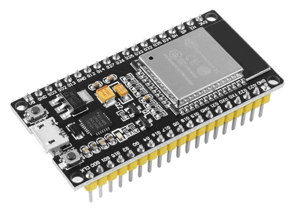
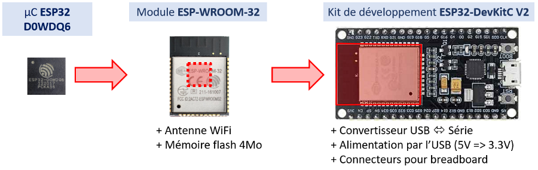
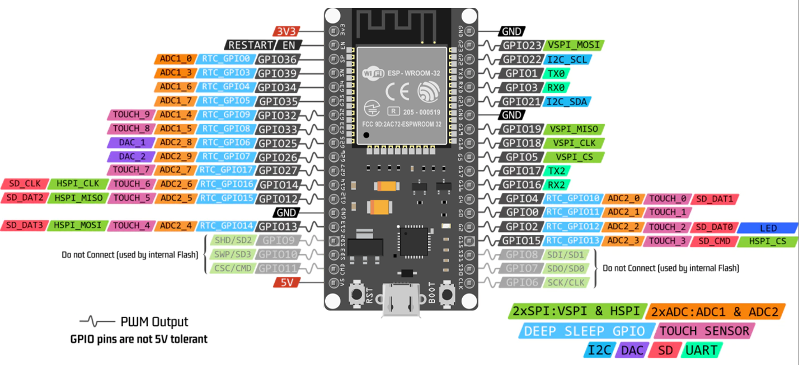
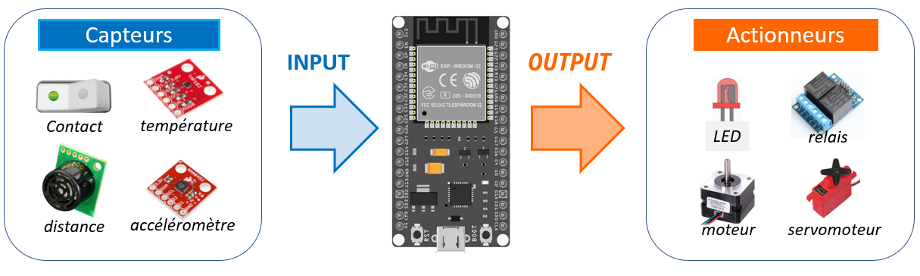
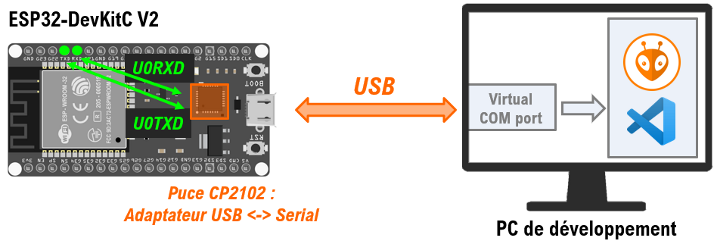
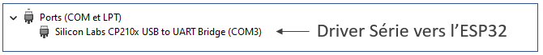

# Présentation de l'ESP32-DevKitC V2

> * Auteur : Gwénaël LAURENT
> * Date : 18/08/2022
> * OS : Windows 11

 [Licence Creative Commons](https://creativecommons.org/licenses/by-nc-sa/3.0/fr/)

- [Présentation de l'ESP32-DevKitC V2](#présentation-de-lesp32-devkitc-v2)
- [1. Le kit de développement ESP32-DevKitC V2](#1-le-kit-de-développement-esp32-devkitc-v2)
- [2. Caractéristiques du module ESP-WROOM-32](#2-caractéristiques-du-module-esp-wroom-32)
- [3. Brochage du kit ESP32-DevKitC V2](#3-brochage-du-kit-esp32-devkitc-v2)
- [4. GPIO (General Purpose Input/Output)](#4-gpio-general-purpose-inputoutput)
- [5. Choix des broches GPIO](#5-choix-des-broches-gpio)
- [6. Connexion à l'ordinateur](#6-connexion-à-lordinateur)

# 1. Le kit de développement ESP32-DevKitC V2
Le kit de développement assure un prototypage facile des **projets IoT (Internet of Things)**. Il intègre un microcontrôleur ESP32 avec de la mémoire flash, des connexions WiFi et bluetooth, ainsi que des entrées / sorties pour connecter des capteurs ou des actionneurs.



# 2. Caractéristiques du module ESP-WROOM-32
L'ESP32 est un **microcontrôleur** fabriqué par Espressif. Il est spécialement adapté à l'**IIoT** (Industrial Internet of Things) :
* WiFi et Bluetooth intégré pour les communications
* Très faible consommation d'énergie
* Forme compacte
* Fiabilité



| Caractéristiques            | Détail                                                                                                                                                         |
|-----------------------------|----------------------------------------------------------------------------------------------------------------------------------------------------------------|
| Microcontroleur             | ESP32-D0WDQ6                                                                                                                                                   |
| Processeur                  | Xtensa® Dual-Core 32-bit LX6, fréquence jusqu'à 240 MHz                                                                                                        |
| **RAM**                         | 520 ko                                                                                                                                                         |
| RTC SRAM                     | 8ko RTC FAST Memory + 8ko RTC SLOW Memory                                                                                                                        |
| **Mémoire flash**               | 4 Mo (SPI flash)                                                                                                                                               |
| eFuse                       | 1ko                                                                                                                                                            |
| **WiFi**                        | IEEE 802.11 b/g/n ; 2,4 GHz ; jusqu'à 150 Mbps                                                                                                                 |
| **Bluetooth**                   | Bluetooth  4.2 BR/EDR + Bluetooth LE                                                                                                                           |
| Broches GPIO                | 32                                                                                                                                                             |
| Courant max par broche GPIO | 20 mA                                                                                                                                                          |
| Entrées analogiques         | 18 x CAN (12 bits)                                                                                                                                             |
| Sorties analogiques         | 2 x CNA (8 bits)                                                                                                                                               |
| Entrées tactiles            | 10 × capacitive touch sensor                                                                                                                                   |
| Capteur intégré             | Hall sensor                                                                                                                                                    |
| Interfaces de communication | I2C<br/>I2S<br/>SPI<br/>UART                                                                                                                                   |
| Débogage                    | JTAG                                                                                                                                                           |
| **Consommation électrique**     | WiFi Tx : 180 mA (802.11 n, Pout= +14 dBm)<br/>WiFi Rx : 100 mA<br/>Modem-sleep : 20 mA<br/>Light-sleep : 0.8 mA<br/>Deep-sleep : 10 µA<br/>Hibernation : 5 µA |
| Upload du programme         | UART ou OTA                                                                                                                                                    |
||


**Documentation :**

* [ESP32-D0WDQ6 Datasheet](https://www.espressif.com/sites/default/files/documentation/esp32_datasheet_en.pdf)
* [ESP32 Technical Reference Manual](https://www.espressif.com/sites/default/files/documentation/esp32_technical_reference_manual_en.pdf)
* [ESP Product Selector](https://products.espressif.com/#/product-selector?names=ESP32-WROOM-32-N4&filter={%22Series%22:[%22ESP32%22]})
* [ESP32-­WROOM-­32 module](https://www.espressif.com/sites/default/files/documentation/esp32-wroom-32_datasheet_en.pdf)
* [ESP32-DevKitC V2 Getting Started Guide](https://docs.espressif.com/projects/esp-idf/en/latest/esp32/hw-reference/esp32/get-started-devkitc-v2.html)
* [ESP32-DevKitC V2 schematics](https://dl.espressif.com/dl/schematics/ESP32-Core-Board-V2_sch.pdf)


# 3. Brochage du kit ESP32-DevKitC V2
[](img/esp32-devkitC-v2-pinout3.png)

> Dans votre codage pour ESP32, le numéro des broches à utiliser est le numéro du GPIO.


# 4. GPIO (General Purpose Input/Output)
Les broches (pin) du kit de dévelopement sont réliées aux connexions de l'ESP32. On les appelle des broches **GPIO (General Purpose Input/Output)** parce qu'elles peuvent avoir plusieurs modes de fonctionnement en fonction du paramétrage effectué dans le code du programme de l'ESP.

Les broches GPIO servent à communiquer avec des capteurs ou actionneurs.



La majorité des broches GPIO peuvent fonctionner en entrée ou sortie numérique (**Digital I/O**). On parle alors d'**entrée/sortie TOR (Tout Ou Rien)** parce qu'elles ne peuvent prendre que 2 valeurs :
* niveaux bas = LOW = 0V
* niveau haut = HIGH = 3.3V

Le programme de l'ESP peut :
* **lire l'état des entrées** (INPUT) => niveau LOW ou HIGH
* **modifier l'état des sorties** (OUTPUT) => niveau LOW ou HIGH

Le courant maximal que peut délivrer une broche GPIO en sortie est de **20 mA**.

Pour chaque broche GPIO utilisée en entrée, on peut choisir d'activer une **résistance interne de PULL-UP ou de PULL-DOWN**.

Certains composants numériques nécessitent une communication plus élaborée avec l'ESP. Dans ce cas, on les connecte à l'ESP avec plusieurs broches, on parle alors de "**bus de communication**" (UART, I2C, SPI, ...).


# 5. Choix des broches GPIO
> **Attention : certaines broches ne doivent jamais être utilisées**, c'est le cas des broches **GPIO6 à GPIO11**. Elles sont utilisées pour la communication SPI entre le microcontrôleur et la mémoire FLASH de stockage du programme.


En fonction du mode de communication entre l'ESP et un capteur ou actionneur, il faut choisir les broches sur lesquelles brancher le composant.

| Type de communication                                                   | Broches GPIO                                                                                                                                                                                                                        | Remarques                                                                                                                                                                                                           |
|-------------------------------------------------------------------------|-------------------------------------------------------------------------------------------------------------------------------------------------------------------------------------------------------------------------------------|---------------------------------------------------------------------------------------------------------------------------------------------------------------------------------------------------------------------|
| **Digital I/O**                                                             | GPIO2, GPIO4, GPIO13, GPIO16 à GPIO33<br/>GPIO0 (résistance Pull-Up toujours active)<br/>GPIO12 (boot fail if pulled high)<br/>GPIO 5, 14, 15, (outputs PWM signal at boot)<br/>GPIO 34 à 39 (input only, ni pull-up, ni pull-down) | GPIO0, GPIO2, GPIO12, GPIO15 ont un comportement particulier au démarrage                                                                                                                                           |
| **PWM**<br/>Pulse Width Modulation                                          | A part GPIO 34 à 39, toutes les autres GPIO peuvent générer un signal PWM.                                                                                                                                                          | 16 canaux PWM simultanés maximum                                                                                                                                                                                    |
| **Entrées analogiques**                                                     | ADC1 : GPIO 32, 33, 34, 35, 36, 39<br/>ADC2 : GPIO 0, 2, 4, 12, 13, 14, 15, 25, 26, 27                                                                                                                                              | Convertisseur Analogique > Numérique 12 bits<br/>La tension mesurée est convertie en un nombre compris entre 0 (0V) et 4095 (3.3V)<br/>Les canaux ADC2 ne peuvent pas être utilisés en ADC quand le WiFi est activé |
| **Sorties analogiques**                                                     | GPIO25, GPIO26                                                                                                                                                                                                                      | 8 bits                                                                                                                                                                                                              |
| **Bus UART**<br/>Universal Asynchronous Receiver Transmitter                | GPIO1 : U0TXD - GPIO3 : U0RXD<br/>GPIO17 : U2TXD - GPIO16 : U2RXD                                                                                                                                                                   | Relié à l'USB (upload et messages de debug)<br/>On peut créer d'autres bus UART logiciels sur les autres GPIO                                                                                                      |
| **Bus I2C**<br/>Inter-Integrated Circuit<br/>TWI (Two Wire Interface) | GPIO21 : SDA - GPIO22 : SCL                                                                                                                                                                                                         | On peut créer d'autres bus I2C logiciels sur les autres GPIO (sauf GPIO 36 et 39)                                                                                                                                   |
| **Bus SPI**<br/>Serial Peripheral Interface                                 | HSPI : GPIO12 : MISO - GPIO13 : MOSI - GPIO14 : SCLK - GPIO15 : CS<br/>VSPI : GPIO19 : MISO - GPIO23 : MOSI - GPIO18 : SCLK - GPIO5 : CS                                                                                            | HSPI = Bus SPI matériel<br/>VSPI = Bus SPI Virtuel"                                                                                                                                                                 |
| **Bus I2S**<br/>Inter-IC Sound                                        | N'importe quelle broche GPIO à part GPIO 34 et 39                                                                                                                                                                                   | Le bus I2S est un standard de bus série pour connecter des matériels audio numériques.                                                                                                                              |
| **Bus JTAG**                                                                | GPIO 12,13,14,15                                                                                                                                                                                                                    | Pour le On-Chip Debugging                                                                                                                                                                                           |
| **Capacitive Touch**                                                        | GPIO 0, 2, 4, 12, 13, 14, 15, 27, 32, 33                                                                                                                                                                                            |                                                                                                                                                                                                                     |
| **RTC GPIO**                                                                | GPIO 0, 2, 4, 12, 13, 14, 15, 25, 26, 27, 32, 33, 34, 35, 36, 39                                                                                                                                                                    | Peuvent être utilisées pour réveiller l'ESP du deep-sleep quand le co-processeur ULP (Ultra Low Power) est en fonctionnement                                                                                        |
| **Interruptions matérielles**                                               | N'importe quelle broche GPIO                                                                                                                                                                                                        |

Pour plus d'informations, consultez https://randomnerdtutorials.com/esp32-pinout-reference-gpios/ ou également [ce site](https://www.electrorules.com/esp32-pinout-reference/), ou [celui-ci](https://circuits4you.com/2018/12/31/esp32-devkit-esp32-wroom-gpio-pinout/), ou encore [celui-là](https://www.upesy.fr/blogs/tutorials/esp32-pinout-reference-gpio-pins-ultimate-guide)


# 6. Connexion à l'ordinateur


Reliez le kit à l'ordinateur avec un câble USB (connecteur micro USB).

Si tout se passe bien, vous devriez voir un nouveau périphérique **Port COM** car la communication s'effectue en laison série avec les broches U0RXD et U0TXD.



Vous pouvez également voir le port COM utilisé pour la liaison avec l'ESP dans un invite de commande :
```cmd
> mode

Statut du périphérique COM3:
----------------------------
    Baud :            115200
    Parité :          None
    Bits de données : 8
    Bits d’arrêt :    1
    Temporisation :   OFF
    XON/XOFF :        OFF
    Protocole CTS :   OFF
    Protocole DSR :   OFF
    Sensibilité DSR : OFF
    Circuit DTR :     OFF
    Circuit RTS :     OFF


Statut du périphérique CON:
---------------------------
    Lignes :          9001
    Colonnes :        120
    Vitesse clavier : 31
    Délai clavier :   1
    Page de codes :   850

```

Si ce n'est pas le cas, il faut installer le **driver de port COM virtuel (VCP)** correspondant à la puce de votre kit de développement (Adaptateur USB <-> Serial
) :
* Télécharger le driver pour une puce [Silicon Labs CP1202](https://www.silabs.com/developers/usb-to-uart-bridge-vcp-drivers)
* Télécharger le driver pour une puce [FTDI Chip](https://ftdichip.com/drivers/vcp-drivers/)
* Télécharger le driver pour une puce [WCH CH340/341](http://www.wch-ic.com/downloads/CH341SER_ZIP.html)