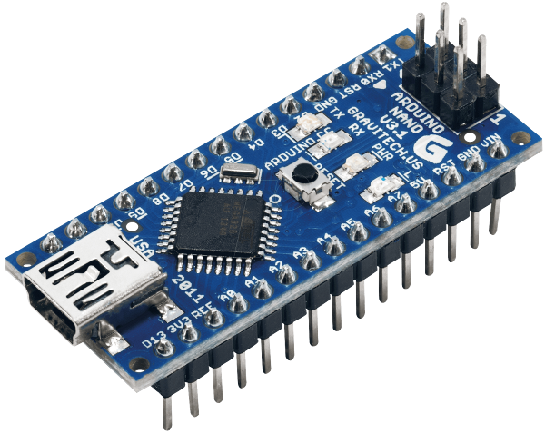
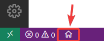
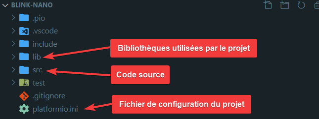
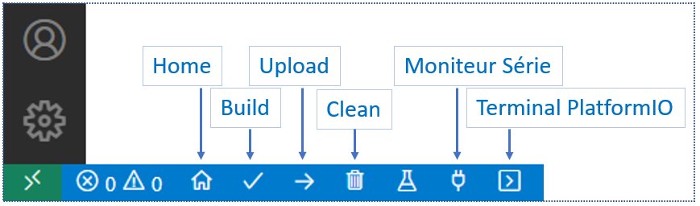
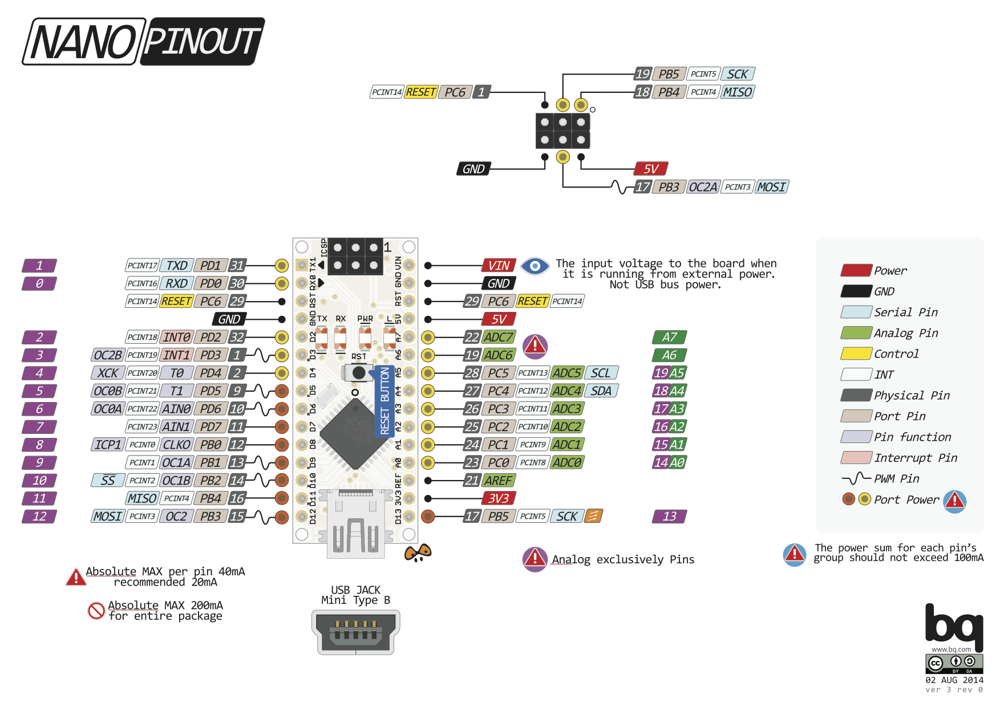

# Créer un projet PlatformIO pour Arduino nano

> * Auteur : Gwénaël LAURENT
> * Date : 05/01/2021
> * OS : Windows 10 (version 1903)
> * VScode : version 1.52.1 (system setup)
> * Node.js : version 12.16.2
> * PlatformIO : Core 5.0.4 Home 3.3.1

 [Licence Creative Commons](https://creativecommons.org/licenses/by-nc-sa/3.0/fr/)

- [Créer un projet PlatformIO pour Arduino nano](#créer-un-projet-platformio-pour-arduino-nano)
- [1. Pré-requis](#1-pré-requis)
- [2. Création d'un projet](#2-création-dun-projet)
- [4. Brochage de l'Arduino nano](#4-brochage-de-larduino-nano)
- [3. Création et upload du programme BLINK](#3-création-et-upload-du-programme-blink)
- [6. Monitoring](#6-monitoring)

# 1. Pré-requis
* VScode est installé avec les extensions pour PlatformIO
* La plateforme **```Atmel AVR```** est installée
* cf [VScode - Installation de PlatformIO (arduino, ESP8266, ESP32)](../vscode/vscode-platformio.md)
* avoir une carte **```Arduino nano```** connectée en USB sur l'ordinateur.


# 2. Création d'un projet
> Ouvrez une nouvelle fenêtre VScode sans aucun projet ouvert.

Dans VScode, lancez PlatformIO à partir de la barre de statut (en bas) 

Cliquez sur ```New Project``` :
* Name (nom du projet) : blink-nano
* Board : [**```Arduino Nano ATmega328```**](https://docs.platformio.org/en/latest/boards/atmelavr/nanoatmega328.html)
* Framework : Arduino
* Location : 
  * décochez "Use default location"
  * sélectionner l'emplacement du projet (un dossier portant le nom du projet sera créé à cet emplacement)
* Finish

> Le framework sélectionné sera téléchargé lors de la création du premier projet qui l'utilise.

Structure du projet :



Le **fichier source principal** ```/src/main.cpp``` a une structure standard de projet arduino
```cpp
#include <Arduino.h>
// Directives d’inclusion
// Déclaration des CONSTANTES
// Déclaration des variables

void setup() {
  // Fonction d'initialisation : exécutée une fois au démarrage
  // Configuration des entrées/sorties

}

void loop() {
  // Boucle infinie : appelée en permanene
  // Contenu du programme
}

// Fonctions personnelles ...
```

Le fichier ```/platformio.ini``` est le **fichier de configuration du projet**.

```ini
[env:nanoatmega328]
platform = atmelavr
board = nanoatmega328
framework = arduino
```

Barre d'outils de platformIO dans la barre de statut (en bas) :



Plus d'outils sont disponibles à partir de la barre d'activité > PlatformIO 

# 4. Brochage de l'Arduino nano
L'arduino nano intègre un microcontroleur **ATMEGA 328 P**.

[](img/arduino-nano-pinout.png)

Crédit schéma [https://core-electronics.com.au/tutorials/compare-arduino-boards.html](https://core-electronics.com.au/tutorials/compare-arduino-boards.html)

Documentation plus complète sur [https://store.arduino.cc/arduino-nano](https://store.arduino.cc/arduino-nano)

Dans votre codage pour **Arduino nano**, **```le numéro des broches à utiliser est le numéro en violet sur le schéma```**. Par exemple pour utiliser la broche sérigraphiée D4 :
```cpp
#define PIN_LED_ROUGE 4
```
Pour les broches sérigraphiées D2 à D13, il suffit donc d'utiliser les numéros 2 à 13.

Pour les broches sérigraphiées A0 à A7, il existe des constantes prédéfinies qui correspondent à la sérigraphie de la carte. Par exemple, pour utiliser la broche sérigraphiée A2 :
```cpp
#define PIN_LED_VERTE A2
```

Les broches peuvent avoir plusieurs fonctions (à choisir dans votre codage). **```Il faut cependant connaitre les limitations```** : par exemple, on ne peut faire du PWM que sur les broches D3, D5, D6, D9, D10 et D11.

# 3. Création et upload du programme BLINK
Un petit programme pour faire clignoter la LED intégré à l'arduino nano.

> La "Buit-in LED" est connectée sur la broche D13

Modifiez le code de ```/src/main.cpp```
```cpp
#include <Arduino.h>

void setup()
{
  // initialize LED digital pin as an output.
  pinMode(LED_BUILTIN, OUTPUT);
}

void loop()
{
  // turn the LED on (HIGH is the voltage level)
  digitalWrite(LED_BUILTIN, HIGH);
  // wait for a second
  delay(1000);
  // turn the LED off by making the voltage LOW
  digitalWrite(LED_BUILTIN, LOW);
  // wait for a second
  delay(1000);
}
```
Cliquez sur ```Build``` puis ```Upload``` (dans la barre d'outils)

> Le port série sur lequel est connecté la carte est détecté automatiquement pour le transfert du programme. 

Le port série peut être choisi en modifiant ```platformio.ini``` : par exemple pour utiliser COM4
```ini
[env:nanoatmega328]
upload_port = COM5
```


# 6. Monitoring
Il y a peu de moyen de debuguer le programme embarqué. La plupart du temps, on utilise la liaison série entre l'ordi de dév et la carte électronique (liaison série sur un support matériel USB).

Dans le code source, il faut initialiser la communication série dans la fonction setup()
```cpp
void setup()
{
  // autres initialisations
  Serial.begin(9600); //9600 bit/s
}
```

Dans la fonction loop(), on peut envoyer des messages vers l'ordi avec la commande :
```cpp
void loop()
{
  // codage
  Serial.println("LED éteinte");
}
```

Dans VScode/PlatformIO les messages sont reçus dans la console du moniteur série. 

Cliquez sur ```Serial Monitor``` (dans la barre d'outils)

> Par défaut, le moniteur série est configuré pour une vitesse de communication de 9600 bits/s. 

La vitesse des communications reçue dans le moniteur série peut être choisie en modifiant ```platformio.ini``` :
```ini
[env:nanoatmega328]
monitor_speed = 115200
```
Bien sûr, il faut que ça corresponde à la configuration de la communication série dans votre programme :
```cpp
  Serial.begin(115200); //115200 bit/s
```