# Créer un projet PlatformIO pour l'ESP32-DevKitC V2

> * Auteur : Gwénaël LAURENT
> * Date : 28/08/2022
> * OS : Windows 11

 [Licence Creative Commons](https://creativecommons.org/licenses/by-nc-sa/3.0/fr/)

- [Créer un projet PlatformIO pour l'ESP32-DevKitC V2](#créer-un-projet-platformio-pour-lesp32-devkitc-v2)
- [1. Pré-requis](#1-pré-requis)
- [2. Création d'un projet PlatformIO](#2-création-dun-projet-platformio)
- [3. Commander une sortie numérique (Digital Output)](#3-commander-une-sortie-numérique-digital-output)
  - [3.1 Objectif](#31-objectif)
  - [3.2 Fonctionnement d'une LED (rappels)](#32-fonctionnement-dune-led-rappels)
  - [3.3 Utilisation de l'ESP pour alimenter la LED](#33-utilisation-de-lesp-pour-alimenter-la-led)
  - [3.4 Cablage du circuit en utilisant une breadboard](#34-cablage-du-circuit-en-utilisant-une-breadboard)
    - [Doc breadboard](#doc-breadboard)
    - [Repérage Anode-Cathode d'une LED](#repérage-anode-cathode-dune-led)
    - [Code des couleurs des résistances](#code-des-couleurs-des-résistances)
    - [Fritzing](#fritzing)
  - [3.5 Programme pour faire clignoter la LED](#35-programme-pour-faire-clignoter-la-led)
  - [3.6  Upload du programme sur l'ESP](#36--upload-du-programme-sur-lesp)
    - [Choix du port série](#choix-du-port-série)
  - [3.7 Monitoring du programme](#37-monitoring-du-programme)
  - [3.8 Mise en pratique](#38-mise-en-pratique)
- [4. Lire une entrée numérique (Digital Input)](#4-lire-une-entrée-numérique-digital-input)
  - [4.1 Objectif](#41-objectif)
  - [4.2 Fonctionnement d'un bouton poussoir (rappels)](#42-fonctionnement-dun-bouton-poussoir-rappels)
  - [4.3 Utilisation de l'ESP pour lire l'état du bouton poussoir](#43-utilisation-de-lesp-pour-lire-létat-du-bouton-poussoir)
  - [4.4 Cablage du circuit en utilisant une breadboard](#44-cablage-du-circuit-en-utilisant-une-breadboard)
  - [4.5 Programme de lecture du bouton poussoir](#45-programme-de-lecture-du-bouton-poussoir)
  - [4.6  Upload du programme sur l'ESP](#46--upload-du-programme-sur-lesp)
  - [4.7 Mise en pratique](#47-mise-en-pratique)
- [5. Documentation du framework aduino pour ESP32](#5-documentation-du-framework-aduino-pour-esp32)

# 1. Pré-requis
**Matériel :**
* un kit de développement [**```ESP32-DevKitC V2```**](01c.presentation-esp32-devkitc-v2.md) avec son câble USB pour le relier à l'ordinateur.
* Une platine d'expérimentation (breadbord)
* Une LED et sa résistance de protection de 220 ohms
* Un bouton poussoir pour breadboard
* Des câbles de liaison Mâle-Mâle pour breadbord (câbles "dupont" Mâle-Mâle)

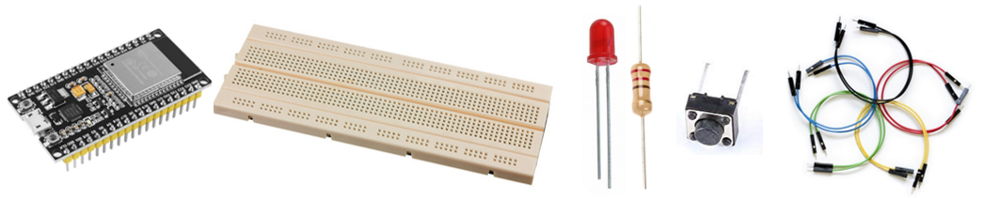

**Logiciels :**
* VScode est installé
* L'extension PlatformIO est installée dans VScode
* La plateforme Espressif 32 est installée dans PlatformIO
* Le driver de port COM virtuel (VCP) est installé


**Documentation :**
  * [VScode - Installation de PlatformIO (arduino, ESP8266, ESP32)](../vscode/vscode-platformio.md)
  * [Présentation de l'ESP32-DevKitC V2](01c.presentation-esp32-devkitc-v2.md)


# 2. Création d'un projet PlatformIO
Ouvrez une nouvelle fenêtre **VScode** sans aucun projet ouvert.

Dans VScode, lancez **PlatformIO** à partir de la barre de statut (en bas) 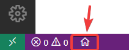

Cliquez sur ```New Project``` :
* Name (nom du projet) : blink-esp32
* Board : [**```Espressif ESP32 Dev Module```**](https://docs.platformio.org/en/latest/boards/espressif32/esp32dev.html)
* Framework : **Arduino**
* Location : 
  * décochez "Use default location"
  * sélectionnez l'emplacement du projet (un dossier portant le nom du projet sera créé à cet emplacement)
* Finish

> Le framework sélectionné sera téléchargé lors de la création du premier projet qui l'utilise.

Structure du projet :

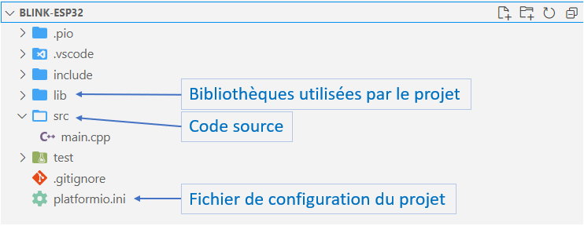

Le **fichier principal en langage C** ```/src/main.cpp``` a une structure standard de projet arduino
```cpp
#include <Arduino.h>
// Directives d’inclusion des bibliothèques
// Déclaration des CONSTANTES
// Déclaration des variables

// Fonctions personnelles ...

void setup() {
  // C'est la fonction d'initialisation.
  // Elle est exécutée une seule fois au démarrage de l'ESP
  // Elle sert à configurer les entrées/sorties

}

void loop() {
  // Cette fonction contient le programme principal.
  // Elle est exécutée automatiquement après la fonction setup.
  // Quand son exécution est terminée, elle est automatiquement ré-exécutée indéfiniment.
  // C'est donc une boucle infinie.
}

```

Le fichier ```/platformio.ini``` est le **fichier de configuration du projet**.

```ini
[env:esp32dev]
platform = espressif32
board = esp32dev
framework = arduino
```

Barre d'outils de platformIO dans la barre de statut (en bas) :

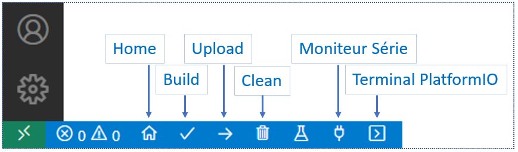

Plus d'outils sont disponibles à partir de la barre d'activité > PlatformIO 


# 3. Commander une sortie numérique (Digital Output)

## 3.1 Objectif
Le programme de l'ESP va commander l'allumage d'une LED en la faisant clignoter indéfiniment.

## 3.2 Fonctionnement d'une LED (rappels)


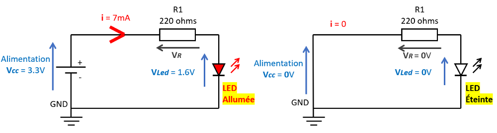

Une LED s'allume si :
* la tension à ses bornes (V<sub>Led</sub>) est égale à la "tension de seuil" (environ 1.6V pour une LED rouge)
* Si un courant (i) la traverse dans le sens Anode>Cathode

Pour protéger la LED contre la destruction on met toujours une résistance (R1) en série dans le circuit d'alimentation. Cela permet de :
* Ne pas dépasser la tension de seuil à ses bornes :\
  V<sub>Led</sub> = V<sub>cc</sub> - V<sub>R</sub>
* Ne pas dépasser quelques mA de courant :\
 i = V<sub>R</sub> / R1 = (V<sub>cc</sub> - V<sub>Led</sub>) / R1 = (3.3 - 1.6) / 200 = 7.7mA

> Pour connaitre précisémment la tension de seuil d'une LED, il faut consulter la documentation du constructeur. Voici par exemple les datasheets d'une [LED Rouge 5mm](https://www.farnell.com/datasheets/2861526.pdf) et d'une [LED verte 5mm](https://www.farnell.com/datasheets/2861527.pdf)


## 3.3 Utilisation de l'ESP pour alimenter la LED
Vous allez utiliser une broche de l'ESP pour jouer le rôle de l'alimentation du circuit LED + Résistance.\
Pour commander l'allumage de la LED, vous allez configurer la broche **GPIO16** de l'ESP en **SORTIE NUMERIQUE** (Digital Output).

Cette broche fournira :
* soit la tension d'alimentation de 3.3V qui allumera la LED,
* soit une tension d'alimentation de OV, ce qui éteindra la LED.

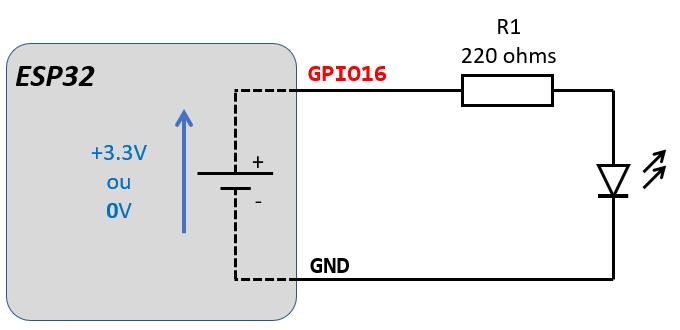

> Pour savoir quelle broche de l'ESP utiliser, consultez le document "01c-Présentation de l'ESP32-DevKitC V2" :\
1/ Le paragraphe **[Choix des broches GPIO](01c.presentation-esp32-devkitc-v2.md#5-choix-des-broches-gpio)** liste les broches disponibles pour une utilisation en mode Digital I/O.\
2/ Le paragraphe **[Brochage du kit ESP32-DevKitC V2](01c.presentation-esp32-devkitc-v2.md#3-brochage-du-kit-esp32-devkitc-v2)** permet de trouver l'emplacement de la broche sur le kit de développement.


## 3.4 Cablage du circuit en utilisant une breadboard

Connectez une led et sa résistance de protection sur la broche GPIO16 de l'ESP.

Proposition de câblage sur breadboard :

> La largeur du kit ESP32 nécessite d'utiliser 2 breadboards et de positionner le kit ESP32 à cheval sur les deux.

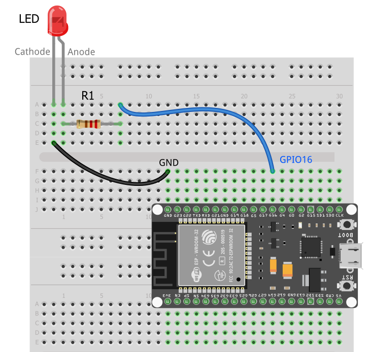

### Doc breadboard
Une **breadboard** (ou platine d'expérimentation) est un dispositif qui permet de réaliser le **prototype** d'un circuit électronique et de le tester. L'avantage de ce système est d'être totalement réutilisable, car il ne nécessite **pas de soudure**.

Les liaisons électriques entre les "points" sont réalisées par des bandes métalliques internes.

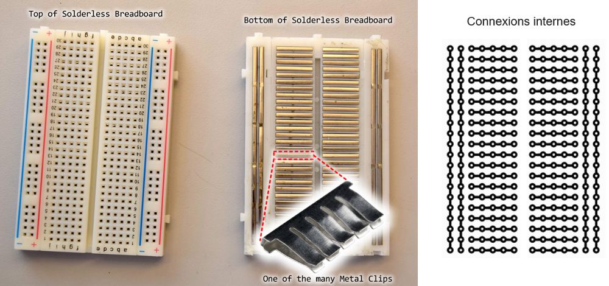\
Crédit[ photo 1](https://eleccelerator.com/ssfpl_robotics_class_2018/connectingmoreparts.htm) et [photo 2](https://fr.wikipedia.org/wiki/Platine_d%27exp%C3%A9rimentation)

### Repérage Anode-Cathode d'une LED
Il est important de branche la LED dans le bon sens pour que le courant qui la traverse circule de l'Anode vers la Cathode. Voici les méthodes pour **repérer la Cathode** :

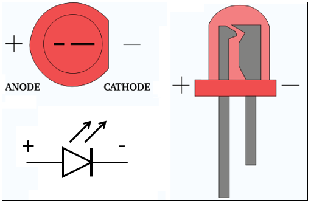


* Regarder à travers la LED. L'électrode la plus grosse est la Cathode
* Regarder la LED par dessus. Le méplat désigne la Cathode (méplat = partie plate sur une pièce cylindrique)
* Regarder la longueur des pattes. La patte la plus courte est la Cathode

Pour les **LED RGB** (3 LEDs de couleurs différentes dans le même boitier de 5mm) il faut déjà savoir s'il s'agit d'une LED RGB à Cathode commune ou à Anode commune. Dans le cas d'une **Cathode commune**, voici le répérage des pattes :

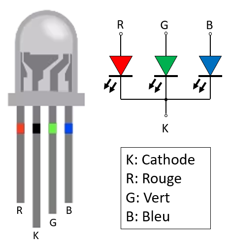

> Les tensions de seuil des LED RVB sont souvent supérieures aux LEDs standard. Pour la couleur rouge V<sub>seuil</sub>=2V et pour les couleurs verte et bleue V<sub>seuil</sub>=2.7V. Par contre, il faut moins de courant pour allumer les LEDs (3-5mA). 

### Code des couleurs des résistances
La valeur d'une résistance est "codée" grace à 4 anneaux de couleurs

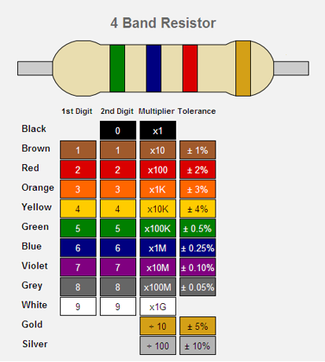

[Crédit photo](https://electro-niques.blogspot.com/2011/08/calculer-resistances-code-couleur-4.html) et [exemples plus détaillés](https://www.siliquarzt.com/les-resistances)

### Fritzing
Fritzing est un logiciel qui permet de présenter les circuits électroniques sur breadboard (cf l'image de cablage que j'ai utilisée). Les nouvelles versions de Fritzing sont payantes mais vous pouvez toujours télécharger une ancienne version gratuitement (Version portable, c'est un fichier ZIP à décompresser).\
[Téléchargez Fritzing 0.9.3b pour Windows](https://arduinofactory.fr/telecharger-fritzing-gratuitement-et-legalement/)\
[Téléchargez Fritzing 0.8.7b pour d'autres OS](https://www.electroschematics.com/fritzing-software-download/)\
Vous pouvez y ajouter des composants personnalisés (magasin Composants > MINE > Importer).\
[Téléchargez mon jeu de composants (ESP8266 NodeMCU, ESP32 OLED, ESP32 DevKitC v2, ESP32 DevKitC v4, PushButton2lead, Red LED, RGB LED)](fritzing_parts/fritzing_parts_snir.fzbz)


## 3.5 Programme pour faire clignoter la LED
Avant de commander l'allumage de la LED, il faut configurer la broche GPIO16 en **SORTIE NUMERIQUE** (Digital Output). Pour cela, à l'intérieur de la fonction ```setup```, on appelle la fonction ```pinMode``` comme ceci :
```cpp
pinMode(16, OUTPUT);
```

Ensuite, on commande l'allumage de la LED en fixant la tension que doit générer la broche GPIO16 :
* niveaux bas = LOW = 0V
* niveau haut = HIGH = 3.3V

Pour générer un niveau bas ou haut, on appelle la fonction ```digitalWrite``` en lui passant en paramètre le niveau souhaité :
```cpp
digitalWrite(16, LOW); //pour fixer la tension à 0V
digitalWrite(16, HIGH); //pour fixer la tension à 3.3V
```
A l'intérieur de la fonction ```loop```, on ne codera qu'un seul cycle d'allumage/extinction de la LED. Comme la fonction ```loop``` est ré-exécutée indéfiniment, le programme fera clignoter la LED indéfiniment.

Voici le code source complet de ```/src/main.cpp``` qui permet de faire clignoter la LED branchée sur GPIO16. 

```cpp
#include <Arduino.h>

#define LED_PIN 16 // Le numéro de broche (GPIO16) est enregistrée dans une constante

void setup()
{
  pinMode(LED_PIN, OUTPUT); //GPIO16 en sortie numérique
}

void loop()
{
  digitalWrite(LED_PIN, HIGH); // allumer la LED

  delay(1000); //attendre 1000ms = 1s
  
  digitalWrite(LED_PIN, LOW); // éteindre la LED
  
  delay(1000); //attendre 1000ms = 1s
}
```

## 3.6  Upload du programme sur l'ESP
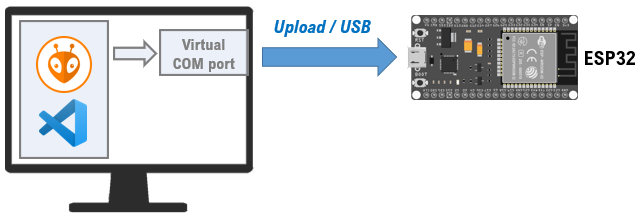

Reliez l'ESP à l'ordinateur avec un câble USB (connecteur micro USB).

Cliquez sur ```Build``` puis ```Upload``` (dans la barre d'outils de platformio, en bas de l'écran). A la fin du transfert, l'ESP redémarre et exécute votre programme.

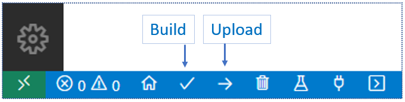

>  Sur certains kit de développement ESP32, le transfert du programme bloque sur l'étape :\
> ```Connecting...............```\
> Dans ce cas, il faut appuyer sur le bouton BOOT du kit jusqu'à ce que le transfert démarre.

Votre programme est stocké sur la mémoire flash de l'ESP. Ce type de mémoire est "non volatile", c'est à dire qu'il reste en mémoire même s'il n'y a plus d'électricité pour alimenter l'ESP. **A chaque démarrage de l'ESP, le programme précédemment enregistré s'exécute de nouveau**.

### Choix du port série
Le port série sur lequel est connecté l'ESP est détecté automatiquement pour le transfert du programme. Si vous avez plusieurs ESP connectés à votre ordinateur, il est utile de choisir explicitement le port série en ajoutant une option dans ```platformio.ini```. Par exemple pour utiliser COM4 :
```ini
[env:esp32dev]
...
upload_port = COM4
```

## 3.7 Monitoring du programme
Il y a peu de moyen de suivre l'exécution du programme quand il s'exécute sur l'ESP. La plupart du temps, **on insère des messages dans le code source** qui seront affichés dans le moniteur série de PlatformIO. Les messages sont envoyés à l'ordinateur via la liaison série du câble USB.

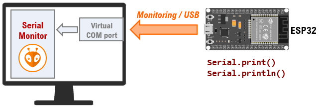

Dans le code source, il faut initialiser la communication série dans la fonction ```setup``` :
```cpp
void setup()
{
  // autres initialisations
  Serial.begin(9600); //9600 bit/s
}
```

Dans la fonction ```loop```, on peut envoyer des messages vers l'ordi avec la commande :
```cpp
void loop()
{
  // codage
  Serial.println("LED éteinte");
}
```

Dans VScode/PlatformIO les messages sont reçus dans la console du moniteur série. 

Cliquez sur ```Serial Monitor``` (dans la barre d'outils)

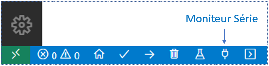

Par défaut, le moniteur série est configuré pour une vitesse de communication de 9600 bits/s. 

La vitesse des communications reçue dans le moniteur série peut être choisie en modifiant ```platformio.ini``` :
```ini
[env:esp32dev]
...
monitor_speed = 115200
```
Bien sûr, il faut que cette vitesse corresponde à la configuration de la communication série dans votre programme :
```cpp
  Serial.begin(115200); //115200 bit/s
```
> Pour avoir plus de détail sur les fonctions ```Serial.print```, ```Serial.println``` et les autres façons de déboguer un programme ESP, consultez le document "[esp32-debogage](17.esp32-debogage.md)"


## 3.8 Mise en pratique
* Affichez un message dans le moniteur série correspondant à l'état de la LED (éteinte ou allumée)
* Modifiez la vitesse de clignotement de la LED. Eteinte pendant 0.5s et allumée pendant 0.2s.
* Branchez une deuxième LED sur une autre broche de l'ESP. Faites les clignoter alternativement.


# 4. Lire une entrée numérique (Digital Input)

## 4.1 Objectif
Le programme de l'ESP va lire l'état du bouton poussoir. S'il est actionné la LED devra s'allumer, s'il est au repos la LED sera éteinte.

## 4.2 Fonctionnement d'un bouton poussoir (rappels)
Un bouton poussoir ressemble à un interrupteur à ceci près que son bouton revient toujours à la même position après avoir été actionné (grâce à un ressort de rappel).

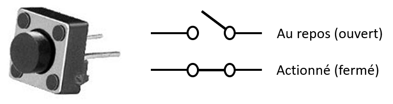

Dans notre cas, pour détecter si le bouton poussoir est actionné ou non, nous allons **mesurer la tension à ses bornes** ( V<sub>BP</sub>). Pour cela, il est nécessaire d'ajouter une résistance reliée à  V<sub>CC</sub>.

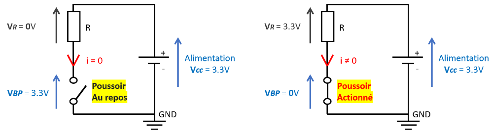

L'utilisation de la résistance R reliée à V<sub>CC</sub> permet de forcer la tension au borne du poussoir quand il est ouvert. Cette résistance s'appelle une "**résistance de pull-up**" parce qu'elle permet de "tirer" la tension vers le haut ( V<sub>CC</sub>).

Quand le poussoir est **au repos** :
* le **circuit est ouvert**, le courant ne peut pas passer entre les deux bornes du poussoir
* i=0 donc V<sub>R</sub> = R x i = 0
*  V<sub>BP</sub> =  V<sub>CC</sub> -  V<sub>R</sub> =  V<sub>CC</sub> = 3.3V

Quand le poussoir est **actionné** :
* le **circuit est fermé**, le courant peut passer entre les deux bornes du poussoir.
* le poussoir se comporte comme un fil, la tension entre ses bornes est nulle.
* V<sub>BP</sub> = 0V

> La valeur de la résistance de pull-up est choisie pour ne pas consommer beaucoup de courant quand le poussoir est actionné. On prend généralement une valeur proche de 47 kohms.

## 4.3 Utilisation de l'ESP pour lire l'état du bouton poussoir
Vous allez utiliser une broche de l'ESP pour mesurer (ou "lire") la tension aux bornes du bouton poussoir.

Cette tension ne peut avoir que deux valeurs : 
* soit 0V quand le poussoir est actionné, ce qui correspond à l'état LOW (état bas) d'un signal numérique
* soit  V<sub>CC</sub> = 3.3V quand le bouton poussoir est au repos, ce qui correspond à l'état HIGH (état haut) d'un signal numérique

Pour mesurer l'état du bouton poussoir, on peut donc utiliser la broche **GPIO17** de l'ESP en **ENTREE NUMERIQUE** (Digital Input). Les entrées numériques ne peuvent lire que deux valeurs du signal : niveau LOW ou HIGH.

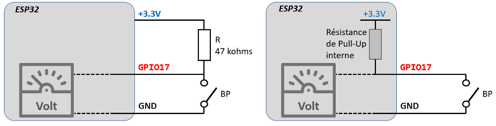

Chaque broche de l'ESP dispose d'une résistance de pull-up interne que l'on peut activer à partir du programme (Il existe quelques exceptions, cf la documentation de l'ESP).

Nous allons donc **activer la résistance interne de l'entrée numérique GPIO17**, ce qui donne comme schéma complet de branchement avec la LED sur GPIO16 :

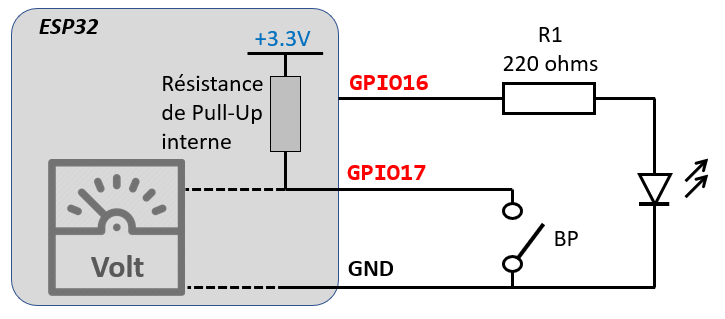

> Pour savoir quelle broche de l'ESP utiliser, consultez le document "01c-Présentation de l'ESP32-DevKitC V2" :\
1/ Le paragraphe **[Choix des broches GPIO](01c.presentation-esp32-devkitc-v2.md#5-choix-des-broches-gpio)** liste les broches disponibles pour une utilisation en mode Digital I/O.\
2/ Le paragraphe **[Brochage du kit ESP32-DevKitC V2](01c.presentation-esp32-devkitc-v2.md#3-brochage-du-kit-esp32-devkitc-v2)** permet de trouver l'emplacement de la broche sur le kit de développement.

## 4.4 Cablage du circuit en utilisant une breadboard
Laissez la LED branchée comme précédemment et ajoutez le bouton poussoir sur la broche GPIO17 de l'ESP.

Proposition de câblage sur breadboard :

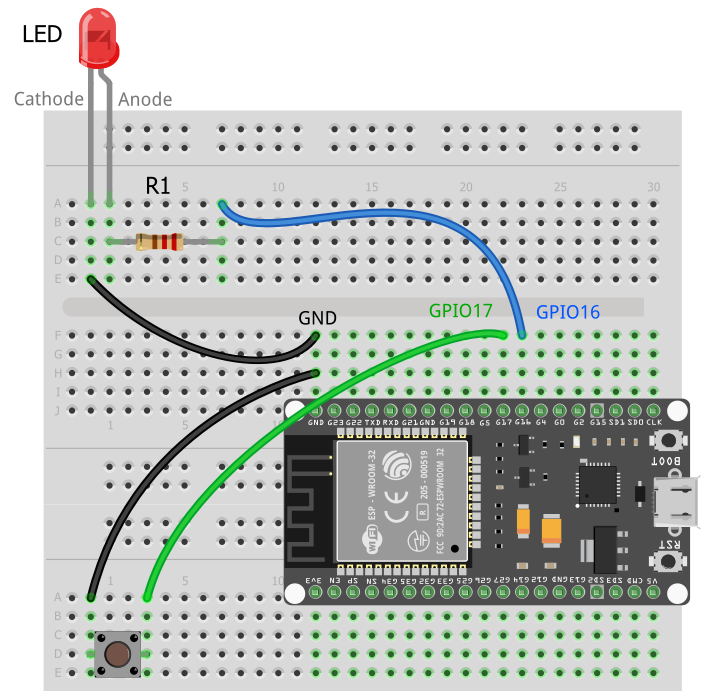


## 4.5 Programme de lecture du bouton poussoir
Pour lire l'état du bouton poussoir, il faut commencer par configurer la broche GPIO17 en **ENTREE NUMERIQUE** (Digital Input) et activer la **résistance interne de pull-up**. Pour cela, à l'intérieur de la fonction ```setup```, on appelle la fonction ```pinMode``` comme ceci :
```cpp
pinMode(17, INPUT_PULLUP);
```

Ensuite, pour lire l'état du poussoir, on appelle la fonction ```digitalRead``` en lui passant en paramètre le numéro de broche sur lequel est branché le poussoir. Cette fonction renvoie le niveau logique correspondant à :
* **LOW** si la tension entre GPIO17 et GND est de 0V (= Bouton actionné)
* **HIGH** si la tension entre GPIO17 et GND est de 3.3V (= Bouton au repos)

Il suffit donc de tester la valeur de retour de la fonction ```digitalRead``` :
```cpp
if (digitalRead(17) == LOW)
{
  // Poussoir actionné
}
else
{
  // Poussoir au repos
}
```

Enfin, le test de l'état du bouton poussoir doit se faire très régulièrement. A l'échelle humaine, si on teste l'état du poussoir 10 fois par seconde, on aura un programme qui réagit de manière satisfaisante.\
On code donc le test à l'intérieur de la fonction ```loop``` en y intégrant une pause de 100ms.

Voici le code source complet de ```/src/main.cpp``` qui permet d'allumer la LED si le bouton poussoir est actionné et de l'éteindre quand le poussoir est au repos. 

```cpp
#include <Arduino.h>

#define LED_PIN 16 // numéro de broche (GPIO16) pour la LED
#define BP_PIN 17  // numéro de broche (GPIO17) pour le bouton poussoir

void setup()
{
  pinMode(LED_PIN, OUTPUT);      // GPIO16 en sortie numérique
  pinMode(BP_PIN, INPUT_PULLUP); // GPIO17 en entrée numérique avec résistance de pull-up
}

void loop()
{
  if (digitalRead(BP_PIN) == LOW)
  {
    // Poussoir actionné
    digitalWrite(LED_PIN, HIGH); // allumer la LED
  }
  else
  {
    // Poussoir au repos
    digitalWrite(LED_PIN, LOW); // éteindre la LED
  }
  delay(100); // attendre 100ms
}
```

## 4.6  Upload du programme sur l'ESP
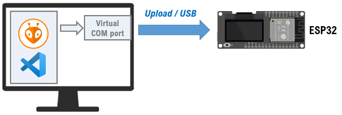

Reliez l'ESP à l'ordinateur avec un câble USB (connecteur micro USB).

Cliquez sur ```Build``` puis ```Upload``` (dans la barre d'outils de platformio, en bas de l'écran). A la fin du transfert, l'ESP redémarre et exécute votre programme.

## 4.7 Mise en pratique
* Affichez un message dans le moniteur série correspondant à l'état du bouton poussoir
* Branchez une deuxième LED sur une autre broche de l'ESP. Suivant l'état du poussoir, soit c'est une LED qui est allumée, soit c'est l'autre.

# 5. Documentation du framework aduino pour ESP32
* [Dépôt github du framework aduino pour ESP32](https://github.com/espressif/arduino-esp32)
* [Bibliothèques inclues dans le framework arduino pour ESP32](https://github.com/espressif/arduino-esp32/tree/master/libraries)
* [Product Selector](https://products.espressif.com/#/product-selector)