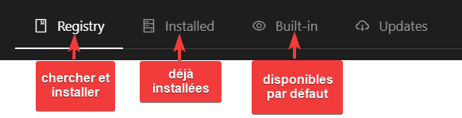

# PlatformIO : ajouter une bibliothèque disponible dans les dépôts (ArduinoJson)

> * Auteur : Gwénaël LAURENT
> * Date : 03/01/2021
> * OS : Windows 10 (version 1903)
> * VScode : version 1.52.1 (system setup)
> * Node.js : version 12.16.2
> * PlatformIO : Core 5.0.4 Home 3.3.1

 [Licence Creative Commons](https://creativecommons.org/licenses/by-nc-sa/3.0/fr/)

> Exemple pour une bibliothèque pour "parser du JSON" avec le framework arduino.

# 1. Installation d'une bibliothèque dans le projet
Ouvrez un projet PlatformIO (ou crééz en un nouveau)

Dans PlateformIO, cliquez dans le menu principal (à gauche) sur l'icône "Libraries" 



Cliquez sur **Registry**
* chercher "json"
    > Avant d'installer, dans la liste des résultats, chercher une bibliothèque compatible avec la pateforme que vous utilisez (Atmel AVR, Espressif 8266, Espressif 32, ...)
* cliquez sur **```ArduinoJson by Benoit Blanchon```**
    > Profitez en pour regarder les exemples d'utilisation de cette bibliothèque
    
    > [Dépôt GitHub](https://github.com/bblanchon/ArduinoJson)
* Cliquez sur ```Add to project```
* Dans le fenêtre "Add project dependency", sélectionner votre projet dans la liste
* Cliquez sur ```Add```

# 2. Les fichiers de la bibliothèque
La bibliothèque est téléchargée dans la structure du projet, dans le dossier ```.pio\libdeps\lolin32\ArduinoJson```.

Suivez les exemples fournies avec la bibliothèque : 
* ils sont disponibles dans ```.pio\libdeps\lolin32\ArduinoJson\examples```
* lisez toujours le fichier README.md des bibliothèques

Le fichier de configuration du projet ```platformio.ini``` comporte une nouvelle ligne
```ini
lib_deps = bblanchon/ArduinoJson@^6.17.2
```

# 3. Utilisation de la bibliothèque
Voici un exemple pour sérialiser en JSON grâce à cette bibliothèque :
```cpp
#include <Arduino.h>
#include <ArduinoJson.h>

DynamicJsonDocument doc(1024);

void setup()
{
  Serial.begin(9600); //
  doc["sensor"] = "gps";
  doc["time"] = 1351824120;
  doc["data"][0] = 48.756080;
  doc["data"][1] = 2.302038;
}

void loop()
{
  serializeJson(doc, Serial);
  Serial.println();
  delay(1000);
}
```
Le moniteur série affiche des lignes au format JSON:
```
{"sensor":"gps","time":1351824120,"data":[48.75608,2.302038]}
```